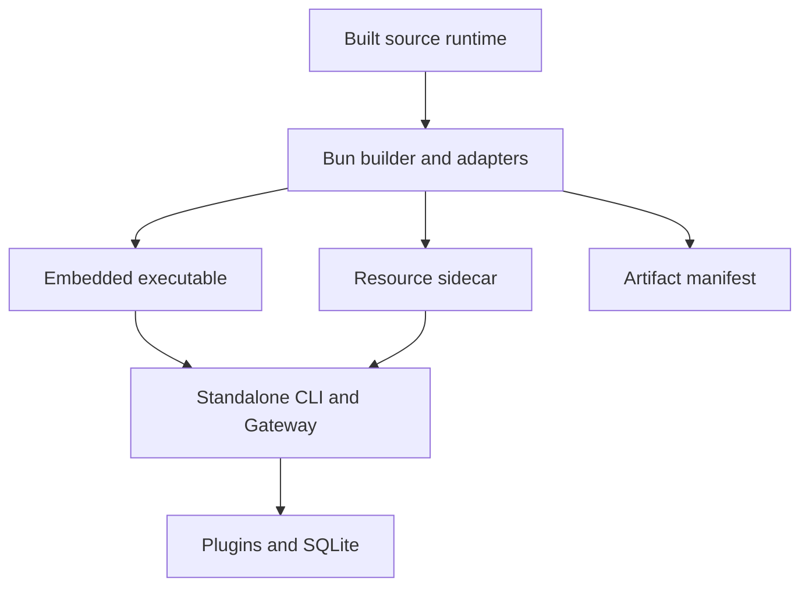

Codex review: needs real behavior proof before merge.

## What this changes

This PR replaces the full standalone runtime copy with selected resources, embeds dependency code, and bundles SQLite on macOS.

**Example:** Run a macOS arm64 standalone artifact on a Mac without Homebrew SQLite.
- **Before:** Database initialization requires a separately provisioned supported SQLite library.
- **After:** The executable selects runtime/lib/libsqlite3.dylib unless an explicit override is supplied.

## Review scores

| Measure | Result | What it means |
|---|---|---|
| **Overall readiness** | 🧂 unranked krab **(1/6)** | Useful owner-backed implementation with no discrete introduced defect found, but required execution-boundary proof remains insufficient; no user-state schema or serialized format changes were found. |
| **Proof confidence** | 🧂 unranked krab **(1/6)** | Real behavior proof is necessary before merge. See [Before merge](#before-merge). |
| **Patch quality** | 🦐 gold shrimp **(3/6)** | Security review found an item that needs attention. |

## Product

**Kind:** Feature · **Worth it:** Yes · **Fix scope:** Complete
**User problem:** Standalone artifacts carry excessive runtime files and require separately installed SQLite on clean Macs.
**Reason:** The direction is maintainer-backed, addresses measured distribution overhead, and supports an active desktop consumer.

## Merge readiness

⛔ **Blocked before merge - 4 items remain**

Keep this maintainer-backed PR open: current main lacks its minimal sidecar and bundled SQLite, and the linked desktop work depends on it.

**Priority:** P2
**Reviewed head:** `19a7e3ee2acd31fa687def247030dc819e9aed0e`

## Before merge

- [ ] **Add real behavior proof** - Authority-chain proof required: show actual execution of an image-owned plugin and declared secret resolver, with external or redirected roots and undeclared resolver entrypoints rejected before import or child spawning. The body reports older signed builds and explicitly leaves final qualification pending; the supplied tests mock these final effects. Attach redacted terminal output or logs, removing IPs, API keys, phone numbers, and non-public endpoints. After adding proof, update the PR body, then request a new review with `@clawsweeper re-review`. The PR author or someone with repository write access can request it.
- [ ] **Resolve security concern: Verify image authority through actual execution** - Build-time image membership now substitutes for physical safe opens across several executable entrypoint owners. Existing negative tests constrain path admission, but mocked module loaders and entrypoint-only secret tests cannot establish that forbidden paths remain rejected at the final import or process spawn.
- [ ] **Resolve merge risk** - Confirm that external or redirected plugin paths cannot acquire image-owned admission authority and reach module execution or secret-resolver spawning.
- [ ] **Complete next step** - Classify the failed session-management and sidebar UI E2E jobs against the base revision before landing.

## Findings

- [medium] Verify image authority through actual execution — `scripts/lib/bun-standalone-metadata.mjs:327`

### Tests

- Missing end-to-end proof: Final artifact qualification must exercise actual embedded loading and secret-resolver execution with allowed and nearest-forbidden paths; the supplied admission tests mock those final effects.

<strong>Agent review details</strong>

### How this fits together

The standalone builder consumes a completed OpenClaw runtime and produces an executable, resource sidecar, and manifest used by deployment and desktop packaging.

### Technical review

Best possible solution:

Ship one resource-selection owner with embedded application code, contained native resources, bundled SQLite, and complete artifact replacement.

Do we have a high-confidence way to reproduce the issue?

Current-main source confirms the full-sidecar pruning policy and external SQLite requirement; the reported artifact measurements were not independently reproduced during this read-only review.

Is this the best way to solve the issue?

Reusing the existing SQLite builder and selector, sharing workspace alias rules, and replacing the previous pruning path is a coherent solution without a competing runtime owner.

AGENTS.md: found and applied where relevant.

Codex review notes: model internal, reasoning medium; reviewed against [a10d95485b5d](https://github.com/openclaw/openclaw/commit/a10d95485b5d118ca3bce32b9161e4e39fef24f5).

### Merge-risk options

**Maintainer options:**
1. **Prove rejection at execution (recommended)**  
   Provide production-path evidence that image-owned entries execute while external paths, redirected roots, and undeclared secret entrypoints are rejected before import or child spawning.

### Provenance checked

- `Standalone sidecar selection and manifest` changes intended behavior with a stated reason (7c6b8bcfcc991d25340c16da32d5a550345673d6: Establish relocatable executable, runtime, provenance, signing, and whole-artifact update contracts.)
- `macOS Bun SQLite selection` keeps the original intent (757e482ab646421f45b3eb9c069beb3eb1f7027c: Select an extension-capable library before the first database open while preserving explicit override priority.)
- `Unsupported system SQLite refusal` keeps the original intent (65eb3267904764fa4b5e4c91a4b6db048a3cb154: Avoid Apple's SQLite failures on read-only database connections and explain recovery.)
- `Workspace package aliases` keeps the original intent (https://github.com/openclaw/openclaw/pull/88659: Derive aliases from package exports and preserve packaged fallbacks; the extraction shares these rules with the builder.)

### Testing

Proof path: in-process harness.

### Security

Needs attention: Image-backed executable admission requires final-effect evidence, although source inspection established no concrete exploitable bypass.

### Evidence

Security concerns:

- [medium] Verify image authority through actual execution — `scripts/lib/bun-standalone-metadata.mjs:327`
  Build-time image membership now substitutes for physical safe opens across several executable entrypoint owners. Existing negative tests constrain path admission, but mocked module loaders and entrypoint-only secret tests cannot establish that forbidden paths remain rejected at the final import or process spawn.
  Confidence: 0.94

What I checked:

- **Pinned introduction and current-main comparison:** Reviewed the introduced change from 9e3e16c224697b9a5cb24e7ede12ac4992a97a87 to 19a7e3ee2acd31fa687def247030dc819e9aed0e. Fetched main still uses declaration/map pruning and host SQLite discovery; the central change remains necessary. ([`scripts/lib/bun-standalone-contract.mjs:110`](https://github.com/openclaw/openclaw/blob/a10d95485b5d118ca3bce32b9161e4e39fef24f5/scripts/lib/bun-standalone-contract.mjs#L110), [a10d95485b5d](https://github.com/openclaw/openclaw/commit/a10d95485b5d118ca3bce32b9161e4e39fef24f5))
- **Existing SQLite owners reused:** Staging invokes the existing pinned macOS SQLite builder, checks capabilities and version, and records its hash; runtime selection preserves explicit overrides before trying bundled SQLite. ([`scripts/lib/bun-standalone-sqlite.mjs:68`](https://github.com/openclaw/openclaw/blob/19a7e3ee2acd31fa687def247030dc819e9aed0e/scripts/lib/bun-standalone-sqlite.mjs#L68), [19a7e3ee2acd](https://github.com/openclaw/openclaw/commit/19a7e3ee2acd31fa687def247030dc819e9aed0e))
- **Earlier review corrections verified:** The shared resource policy preserves public templates and Markdown/MDX while excluding private documentation; the snapshot regression covers those outcomes, matching the discussion corrections. ([`test/scripts/bun-standalone-snapshot.test.ts:73`](https://github.com/openclaw/openclaw/blob/19a7e3ee2acd31fa687def247030dc819e9aed0e/test/scripts/bun-standalone-snapshot.test.ts#L73), [19a7e3ee2acd](https://github.com/openclaw/openclaw/commit/19a7e3ee2acd31fa687def247030dc819e9aed0e))
- **Changed admission boundary:** Image-owned paths can now satisfy module, hook, and secret-entrypoint admission without physical source-file opens; canonical-root and image-membership checks constrain that authority. ([`scripts/lib/bun-standalone-metadata.mjs:266`](https://github.com/openclaw/openclaw/blob/19a7e3ee2acd31fa687def247030dc819e9aed0e/scripts/lib/bun-standalone-metadata.mjs#L266), [19a7e3ee2acd](https://github.com/openclaw/openclaw/commit/19a7e3ee2acd31fa687def247030dc819e9aed0e))
- **Final-effect proof gap:** Admission regressions use mocked module loaders, hook imports, or entrypoint resolution; they do not demonstrate rejection through actual module execution or secret-resolver child spawning. ([`test/scripts/bun-standalone-metadata.test.ts:1024`](https://github.com/openclaw/openclaw/blob/19a7e3ee2acd31fa687def247030dc819e9aed0e/test/scripts/bun-standalone-metadata.test.ts#L1024), [19a7e3ee2acd](https://github.com/openclaw/openclaw/commit/19a7e3ee2acd31fa687def247030dc819e9aed0e))
- **Author qualification hold:** The full PR body identifies d1ec6b758be3838a85302256302553ed61f651eb as the last built source and explicitly says final builds and qualification remain pending. ([19a7e3ee2acd](https://github.com/openclaw/openclaw/commit/19a7e3ee2acd31fa687def247030dc819e9aed0e))

Likely related people:

- **Peter Steinberger:** Raw commit 7c6b8bcfcc991d25340c16da32d5a550345673d6 adds scripts/build-bun-standalone.mjs:2 relative to its recorded parents. This identifies author metadata, not feature responsibility or a PR merger. (role: source-line author; confidence: high; commits: [7c6b8bcfcc99](https://github.com/openclaw/openclaw/commit/7c6b8bcfcc991d25340c16da32d5a550345673d6); files: `scripts/build-bun-standalone.mjs`)

### PR surface

Source +14, Tests +3180, Docs +50, Other +1982. Total +5226 across 22 files. Added test files: 5.

View PR surface stats

| Area | Files | Added | Removed | Net |
|---|---:|---:|---:|---:|
| Source | 3 | 86 | 72 | +14 |
| Tests | 9 | 3211 | 31 | +3180 |
| Docs | 2 | 76 | 26 | +50 |
| Config | 0 | 0 | 0 | 0 |
| Generated | 0 | 0 | 0 | 0 |
| Other | 8 | 2079 | 97 | +1982 |
| **Total** | **22** | **5452** | **226** | **+5226** |

### Labels

Label changes:

No label changes.

Label justifications:

- `P2`: This is a useful standalone packaging improvement with a limited deployment surface.
- `merge-risk: 🚨 security-boundary`: Generated image facts replace physical admission checks for executable plugin, hook, and secret-provider entrypoints.
- `rating: 🧂 unranked krab`: Overall readiness is 🧂 unranked krab; proof is 🧂 unranked krab and patch quality is 🦐 gold shrimp.
- `status: 📣 needs proof`: The PR needs real behavior proof before ClawSweeper can clear the contributor ask.

### Rank-up moves

Optional improvements that raise the rating; they are not merge blockers.

- Add final-effect proof for external or redirected plugin roots and undeclared secret entrypoints, demonstrating rejection before module import or child spawning.

### Rating scale

6/6 🦀 challenger crab · 5/6 🦞 diamond lobster · 4/6 🐚 platinum hermit · 3/6 🦐 gold shrimp · 2/6 🦪 silver shellfish · 1/6 🧂 unranked krab. Overall follows the weaker of proof and patch quality; ✨ marks media proof (a screenshot, video, or linked artifact) that directly shows the changed behavior.

### Workflow

ClawSweeper edits this one comment on every review. Comment `@clawsweeper re-review` for a fresh review only. Repair and merge execution lanes are retired.

_Reviewed October 15, 2026, 3:16 AM ET / 07:16 UTC._

<!-- clawsweeper-security:security-sensitive item=172802 sha=19a7e3ee2acd31fa687def247030dc819e9aed0e confidence=high updated_at=2026-10-15T07:10:38Z reviewed_at=2026-10-15T07:16:14.556Z lease_owner=github-run-38696884643-1 lease_comment_id=6186588486 source_revision=359bc924a9f09d502b0990fbd6a9209703bd41d15daa866587f10c8dd519f3b4 -->
<!-- clawsweeper-verdict:needs-human item=172802 sha=19a7e3ee2acd31fa687def247030dc819e9aed0e confidence=high updated_at=2026-10-15T07:10:38Z reviewed_at=2026-10-15T07:16:14.556Z lease_owner=github-run-38696884643-1 lease_comment_id=6186588486 source_revision=359bc924a9f09d502b0990fbd6a9209703bd41d15daa866587f10c8dd519f3b4 hold=security findings=0 -->
<!-- clawsweeper-review-state:blocked item=172802 sha=19a7e3ee2acd31fa687def247030dc819e9aed0e v=1 -->

<!-- clawsweeper-review-version item=172802 reviewed_at=2026-10-15T07:16:14.556Z sha=19a7e3ee2acd31fa687def247030dc819e9aed0e source_revision=359bc924a9f09d502b0990fbd6a9209703bd41d15daa866587f10c8dd519f3b4 lease_owner=github-run-38696884643-1 lease_comment_id=6186588486 v=1 -->

<!-- clawsweeper-review item=172802 -->