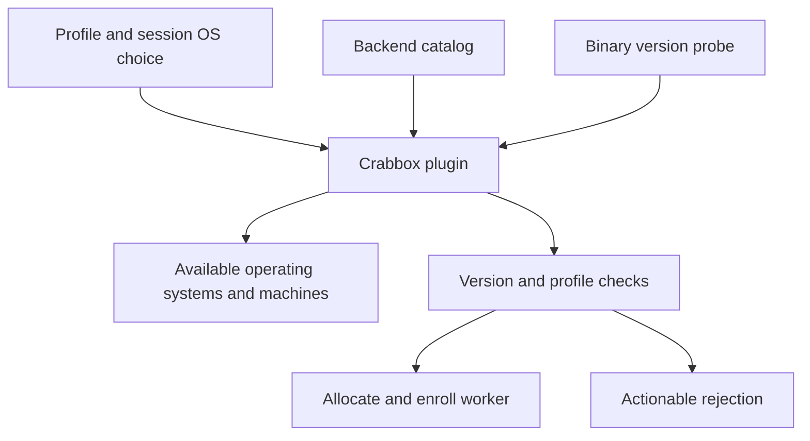

Codex review: blocked before merge. _Reviewed September 8, 2026, 7:41 PM ET / 23:41 UTC (Revision 2)._

# ClawSweeper review

## What this changes

The Crabbox plugin adds version-gated Windows (WSL2) cloud-worker selection, allocation arguments, Doctor diagnostics, documentation, and compatibility tests.

## Merge readiness

⛔ **Blocked before merge - 1 item remains**

The work remains necessary on current main. The compatibility response resolves the earlier migration concern, and no blocking defect was found.

**Priority:** P2
**Reviewed head:** `8028c729a643d0ba62480154d24ecbb3279d7755`

## Review scores

| Measure | Result | What it means |
|---|---|---|
| **Overall readiness** | 🐚 platinum hermit **(4/6)** | A focused implementation with convincing live proof and compatibility coverage; no blocking findings remain. |
| **Proof confidence** | 🦞 diamond lobster **(5/6)** | Sufficient (live_output): The supplied AWS transcript exercises the changed Crabbox discovery and allocation path through a fresh Gateway, WSL2 enrollment, real agent execution, reconciliation, and successful reclaim on 0.53.1-dev. |
| **Patch quality** | 🐚 platinum hermit **(4/6)** | No actionable review findings were identified. |

## Verification

| Check | Result | Evidence |
|---|---|---|
| **Real behavior** | Verified | Sufficient (live_output): The supplied AWS transcript exercises the changed Crabbox discovery and allocation path through a fresh Gateway, WSL2 enrollment, real agent execution, reconciliation, and successful reclaim on 0.53.1-dev. |
| **Evidence reviewed** | 9 items | Current main still excludes WSL2: The fetched main revision permits only Linux. Its Crabbox subtree and cloud-worker documentation match the pinned merge base, so the introduced WSL2 capability remains distinct. Shared version gate precedes allocation: Discovery and provisioning share an in-memory version resolver. WSL2 preparation rejects unsupported or indeterminate versions before returning the allocation callback, and rechecks cancellation after probing. Compatibility response is supported: The introduced changes contain no schema, migration, serialized-record, or persistence changes. Existing Linux defaults and allocation arguments remain intact; tests cover saved WSL2 defaults, placement overrides, old binaries, and Linux-only desktop/warm-image restrictions. These tests were inspected, not executed during this review. |
| **Findings** | None | None. |
| **Security** | None | None. |

## How this fits together

Cloud workers run session work on temporary machines while the Gateway retains the transcript and placement state. The Crabbox plugin translates profile and session OS choices into advertised machines and allocation commands.

## Before merge

- [ ] **Add data-model compatibility proof** - Confirm migration or upgrade compatibility proof before merge.

<strong>Agent review details</strong>

### Security

None.

### PR surface

Source +98, Tests +161, Docs 0. Total +259 across 8 files.

View PR surface stats

| Area | Files | Added | Removed | Net |
|---|---:|---:|---:|---:|
| Source | 5 | 121 | 23 | +98 |
| Tests | 2 | 214 | 53 | +161 |
| Docs | 1 | 3 | 3 | 0 |
| Config | 0 | 0 | 0 | 0 |
| Generated | 0 | 0 | 0 | 0 |
| Other | 0 | 0 | 0 | 0 |
| **Total** | **8** | **338** | **79** | **+259** |

### Review metrics

| Metric | Value | Why it matters |
|---|---|---|
| **Compatibility surface** | 1 accepted OS value added; 0 new config keys or migrations | The capability extends existing selection fields without rewriting users' saved settings. |
| **Production and test growth** | Production +98 net lines; tests +161 net lines | Production growth implements shared version gating and diagnostics, with boundary tests for compatibility and allocation rejection. |

### Stored data model

Persistent data-model change detected: `migration/backfill/repair: extensions/crabbox/src/crabbox-worker-machine-options.ts`, `migration/backfill/repair: extensions/crabbox/src/crabbox-worker-provider.ts`, `migration/backfill/repair: extensions/crabbox/src/doctor.ts`, `unknown-data-model-change: extensions/crabbox/src/doctor.ts`. Confirm migration or upgrade compatibility proof before merge.

### Technical review

Best possible solution:

Keep OS support in the Crabbox plugin, using the existing selector and enrollment lifecycle while preserving Linux defaults.

Do we have a high-confidence way to reproduce the issue?

Not applicable as a defect reproduction: this adds an intentionally unavailable target; current main's Linux-only restriction is directly visible in source.

Is this the best way to solve the issue?

Yes. Reusing the existing OS-selection contract and gating the plugin's advertised and allocated targets is a focused solution; no storage migration is needed.

AGENTS.md: found and applied where relevant.

Codex review notes: model internal, reasoning medium; reviewed against [d40a54a430be](https://github.com/openclaw/openclaw/commit/d40a54a430bed0eeb5dd8995230805a93ff20c6d).

### Labels

Label justifications:

- `P2`: This is a bounded extension to opt-in cloud-worker OS support, with Linux behavior preserved.
- `rating: 🐚 platinum hermit`: Overall readiness is 🐚 platinum hermit; proof is 🦞 diamond lobster and patch quality is 🐚 platinum hermit.
- `status: 👀 ready for maintainer look`: ClawSweeper has no concrete contributor-facing blocker left for this PR. Sufficient (live_output): The supplied AWS transcript exercises the changed Crabbox discovery and allocation path through a fresh Gateway, WSL2 enrollment, real agent execution, reconciliation, and successful reclaim on 0.53.1-dev.
- `proof: sufficient`: Contributor real behavior proof is sufficient. The supplied AWS transcript exercises the changed Crabbox discovery and allocation path through a fresh Gateway, WSL2 enrollment, real agent execution, reconciliation, and successful reclaim on 0.53.1-dev.

### Evidence

What I checked:

- **Current main still excludes WSL2:** The fetched main revision permits only Linux. Its Crabbox subtree and cloud-worker documentation match the pinned merge base, so the introduced WSL2 capability remains distinct. ([`extensions/crabbox/src/crabbox-worker-profile.ts:59`](https://github.com/openclaw/openclaw/blob/d40a54a430bed0eeb5dd8995230805a93ff20c6d/extensions/crabbox/src/crabbox-worker-profile.ts#L59), [d40a54a430be](https://github.com/openclaw/openclaw/commit/d40a54a430bed0eeb5dd8995230805a93ff20c6d))
- **Shared version gate precedes allocation:** Discovery and provisioning share an in-memory version resolver. WSL2 preparation rejects unsupported or indeterminate versions before returning the allocation callback, and rechecks cancellation after probing. ([`extensions/crabbox/src/crabbox-worker-provider.ts:282`](https://github.com/openclaw/openclaw/blob/8028c729a643d0ba62480154d24ecbb3279d7755/extensions/crabbox/src/crabbox-worker-provider.ts#L282), [8028c729a643](https://github.com/openclaw/openclaw/commit/8028c729a643d0ba62480154d24ecbb3279d7755))
- **Compatibility response is supported:** The introduced changes contain no schema, migration, serialized-record, or persistence changes. Existing Linux defaults and allocation arguments remain intact; tests cover saved WSL2 defaults, placement overrides, old binaries, and Linux-only desktop/warm-image restrictions. These tests were inspected, not executed during this review. ([`extensions/crabbox/src/crabbox-worker-provider.test.ts:388`](https://github.com/openclaw/openclaw/blob/8028c729a643d0ba62480154d24ecbb3279d7755/extensions/crabbox/src/crabbox-worker-provider.test.ts#L388), [8028c729a643](https://github.com/openclaw/openclaw/commit/8028c729a643d0ba62480154d24ecbb3279d7755))
- **Real WSL2 behavior proof:** The supplied body snapshot, sourceRevision 8e556830315d127857999e718bdbb23a56f36a1b1a992dc99d8eef0447b66478, records a fresh isolated AWS dispatch using Crabbox 0.53.1-dev without profile setup: WSL2 catalog discovery, active enrollment, successful real agent execution, workspace reconciliation, and completed reclaim. The four inspected images belong to the earlier selector PR and are supplemental UI context, not runtime proof for this patch.
- **Affirmative Crabbox dependency contract:** The allocation builder directly invokes Crabbox with --target windows --windows-mode wsl2. This establishes the Crabbox CLI and managed WSL2 runtime as the relevant dependency contract. ([`extensions/crabbox/src/crabbox-worker-profile.ts:393`](https://github.com/openclaw/openclaw/blob/8028c729a643d0ba62480154d24ecbb3279d7755/extensions/crabbox/src/crabbox-worker-profile.ts#L393), [8028c729a643](https://github.com/openclaw/openclaw/commit/8028c729a643d0ba62480154d24ecbb3279d7755))
- **Required managed WSL2 behavior is merged:** GitHub confirms https://github.com/openclaw/crabbox/pull/2016 merged. Its source configures the non-root worker, requires Node/npm during readiness, and preserves the distro between commands through the lease lifetime. ([`internal/cli/bootstrap.go:309`](https://github.com/openclaw/crabbox/blob/2db8380d3f9f1db79033200977c1b03f7c730b05/internal/cli/bootstrap.go#L309), [2db8380d3f9f](https://github.com/openclaw/crabbox/commit/2db8380d3f9f1db79033200977c1b03f7c730b05))

Likely related people:

- **unknown:** The claimed source-line change could not be verified from bounded local history. (role: source history unknown; confidence: low)

### Rating scale

| Score | Internal tier | Crab rank | Meaning |
|---:|:---:|---|---|
| **6/6** | S | 🦀 challenger crab | Exceptional readiness |
| **5/6** | A | 🦞 diamond lobster | Very strong readiness |
| **4/6** | B | 🐚 platinum hermit | Good normal PR; ordinary maintainer review |
| **3/6** | C | 🦐 gold shrimp | Useful, but confidence is limited |
| **2/6** | D | 🦪 silver shellfish | Proof or implementation needs work |
| **1/6** | F | 🧂 unranked krab | Not merge-ready |
| N/A | NA | 🌊 off-meta tidepool | Rating does not apply |

Overall follows the weaker of proof and patch quality.
Shiny media proof means a screenshot, video, or linked artifact directly shows the changed behavior. Runtime, network, CSP, and security claims still need visible diagnostics.

### Workflow

- ClawSweeper keeps one durable marker-backed review comment per issue or PR.
- Re-runs edit this comment so the latest verdict, findings, and automation markers stay together instead of adding duplicate bot comments.
- A fresh review can be triggered by eligible `@clawsweeper re-review` comments, exact-item GitHub events, scheduled/background review runs, or manual workflow dispatch.
- PR/issue authors and users with repository write access can comment `@clawsweeper re-review` or `@clawsweeper re-run` on an open PR or issue to request a fresh review only.
- Maintainers can also comment `@clawsweeper review` to request a fresh review only.
- Fresh-review commands do not start repair, autofix, rebase, CI repair, or automerge.
- Maintainer-only repair and merge flows require explicit commands such as `@clawsweeper autofix`, `@clawsweeper automerge`, `@clawsweeper fix ci`, or `@clawsweeper address review`.
- Maintainers can comment `@clawsweeper explain` to ask for more context, or `@clawsweeper stop` to stop active automation.

### History

Review history (1 earlier review cycle)

<!-- clawsweeper-review-history v=1 total=1 -->
- reviewed 2026-09-08T23:32:38.878Z sha cea282c935bb5528cf58eb2b32ae02d4e15d4d14 :: blocked before merge. :: none

<!-- clawsweeper-verdict:needs-human item=142679 sha=8028c729a643d0ba62480154d24ecbb3279d7755 confidence=high updated_at=2026-09-08T23:38:26Z reviewed_at=2026-09-08T23:41:22.729Z lease_owner=github-run-34291431446-1 lease_comment_id=5593417283 source_revision=8e556830315d127857999e718bdbb23a56f36a1b1a992dc99d8eef0447b66478 live_verification=absent -->
<!-- clawsweeper-review-state:blocked item=142679 sha=8028c729a643d0ba62480154d24ecbb3279d7755 v=1 -->

<!-- clawsweeper-review-version item=142679 reviewed_at=2026-09-08T23:41:22.729Z sha=8028c729a643d0ba62480154d24ecbb3279d7755 source_revision=8e556830315d127857999e718bdbb23a56f36a1b1a992dc99d8eef0447b66478 lease_owner=github-run-34291431446-1 lease_comment_id=5593417283 v=1 -->

<!-- clawsweeper-review item=142679 -->