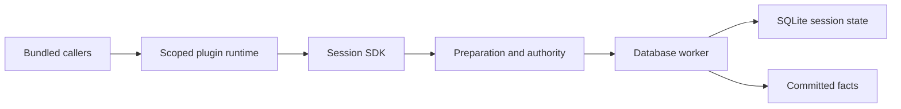

Codex review: needs real behavior proof before merge.

## What this changes

This PR moves bundled session mutations through worker-backed SDK operations while preserving released compatibility adapters.

**Example:** A plugin renames session agent:main:managed to Research.
- **Before:** A promise-returning mutation can still perform SQLite work on the Gateway thread.
- **After:** Preparation runs outside SQLite, and the owning worker conditionally commits Research with the applicable authority checks.

## Review scores

| Measure | Result | What it means |
|---|---|---|
| **Overall readiness** | 🦐 gold shrimp **(3/6)** | The implementation follows existing owners and preserves compatibility, but final-effect authority validation limits readiness. |
| **Proof confidence** | 🦐 gold shrimp **(3/6)** | Real behavior proof is necessary before merge. See [Before merge](#before-merge). |
| **Patch quality** | 🦐 gold shrimp **(3/6)** | Security review found an item that needs attention. |

## Product

**Kind:** Refactor · **Worth it:** Yes · **Fix scope:** Complete
**User problem:** Session persistence can occupy the Gateway thread, and queued mutations can outlive the plugin capability that authorized them.
**Reason:** Maintainer direction and merged feature history support consolidating persistence through existing worker owners while retaining shipped contracts.

## Merge readiness

⛔ **Blocked before merge - 4 items remain**

Keep this useful maintainer-directed PR open; no discrete introduced bug was established, and the earlier conflict blocker is resolved.

**Priority:** P2
**Reviewed head:** `2223b22b14ee08b0ee16135be7816f906c3469c2`

## Before merge

- [ ] **Add real behavior proof** - Authority-chain proof required: supplied built-runtime measurements support the worker migration, but add redacted logs or terminal output showing allowed patches, upserts, and routes committing through the actual scoped runtime and SQLite writer while foreign or retired plugins leave storage unchanged, including retirement after preparation before commit; redact credentials, IPs, phone numbers, and non-public endpoints. After adding proof, update the PR body; ClawSweeper should re-review automatically. If it does not, the PR author or someone with repository write access can comment `@clawsweeper re-review`.
- [ ] **Resolve security concern: Verify managed authority through the final storage effect** - The retirement cases replace persistence methods, while real-worker cases supply host authority directly; their production composition has not demonstrated rejection before SQLite commit.
- [ ] **Resolve merge risk** - Queued mutations carry managed-plugin authority across preparation and worker admission; rejection of foreign or retired plugins at the final storage effect remains unproven.
- [ ] **Complete next step** - Have the landing owner classify failures in the exact-head CI run against its tested base before applying an inherited-failure exception.

## Findings

- [medium] Verify managed authority through the final storage effect — `src/plugins/registry.runtime-session-ownership.test.ts:49`

### Tests

- Missing end-to-end proof: Show allowed, foreign-owner, and post-preparation retirement cases through the real scoped plugin runtime and SQLite writer, with final persisted-state observations.

<strong>Agent review details</strong>

### How this fits together

Plugin and channel callers submit session changes through the SDK; database workers commit SQLite state and publish committed facts to runtime consumers.

### Technical review

Best possible solution:

Complete the existing worker-owner cutover while preserving released adapters and demonstrating final-effect plugin authority.

Do we have a high-confidence way to reproduce the issue?

Current-main source retains native callback compatibility paths that can perform caller-thread SQLite work; this read-only review ran no reproduction.

Is this the best way to solve the issue?

Reusing the existing worker, exact-snapshot commit, and publication owners is appropriate, with explicitly retained compatibility boundaries.

AGENTS.md: found and applied where relevant.

Codex review notes: model internal, reasoning medium; reviewed against [171df4e1c5a0](https://github.com/openclaw/openclaw/commit/171df4e1c5a08e1da631c4fff50c420db2bb6f84).

### Merge-risk options

**Maintainer options:**
1. **Hold for final-effect authority evidence (recommended)**  
   Demonstrate allowed commits and forbidden-plugin rejection through the scoped runtime and actual SQLite writer, including retirement after preparation.

### Provenance checked

- `Plugin runtime ownership` keeps the original intent (7008414e344e77f066f1366e9454a6c090cc64b0: Consolidate ownership and runtime facades while preserving lazy loading, supplied-runtime forwarding, and revocation.)
- `Worker entry mutations` keeps the original intent (ad3c93078e7fca4eb8733185479a627d5bea4988: Move entry operations into the existing worker while retaining current authority, FIFO ordering, and released callback visibility.)
- `Persistence diagnostics` changes intended behavior with a stated reason (82a4cfbe57d735a4db26be139fc8a0d5deadbb6b: Add awaited persistence with synchronous compatibility and per-method warnings; this PR explicitly replaces those warning budgets with shared per-plugin capability-family budgets.)
- `Ambient transcript watermarks` keeps the original intent (3ad465d32b3b96ae10a5da1c23d1160591bee56a: Track durable ambient transcript progress; the moved reducer retains monotonic advancement and session-identity checks.)

### Testing

Proof path: in-process harness.

### Security

Needs attention: Live-authority guards are present, but their complete managed-plugin composition lacks final-effect proof.

### Evidence

Security concerns:

- [medium] Verify managed authority through the final storage effect — `src/plugins/registry.runtime-session-ownership.test.ts:49`
  The retirement cases replace persistence methods, while real-worker cases supply host authority directly; their production composition has not demonstrated rejection before SQLite commit.
  Confidence: 0.98

What I checked:

- **Verified introduced behavior:** The pinned introduction adds prepared patches, conditional data patches, authority-bound routes, and bundled caller migrations through existing storage owners. ([`src/plugin-sdk/session-store-runtime.ts:270`](https://github.com/openclaw/openclaw/blob/2223b22b14ee08b0ee16135be7816f906c3469c2/src/plugin-sdk/session-store-runtime.ts#L270), [2223b22b14ee](https://github.com/openclaw/openclaw/commit/2223b22b14ee08b0ee16135be7816f906c3469c2))
- **Current-main boundary:** Fetched main retains the callback SDK implementation without the prepared replacement introduced here; the central cutover remains distinct work. ([`src/plugin-sdk/session-store-runtime.ts:229`](https://github.com/openclaw/openclaw/blob/171df4e1c5a08e1da631c4fff50c420db2bb6f84/src/plugin-sdk/session-store-runtime.ts#L229), [171df4e1c5a0](https://github.com/openclaw/openclaw/commit/171df4e1c5a08e1da631c4fff50c420db2bb6f84))
- **Authority evidence boundary:** Managed-plugin retirement tests substitute preparation and route persistence with local-variable writes; separate SDK tests exercise the real worker using directly supplied host authority. ([`src/plugins/registry.runtime-session-ownership.test.ts:49`](https://github.com/openclaw/openclaw/blob/2223b22b14ee08b0ee16135be7816f906c3469c2/src/plugins/registry.runtime-session-ownership.test.ts#L49), [2223b22b14ee](https://github.com/openclaw/openclaw/commit/2223b22b14ee08b0ee16135be7816f906c3469c2))
- **Complete proof account inspected:** The complete REST body, including omitted excerpts, reports built-runtime workload measurements and a v2026.9.9-driver update preserving durable and incognito content on 808c7b409ec57e201f8cd01f744a3a8c3dbbfba6; it does not demonstrate the complete managed-plugin authority scenario. ([2223b22b14ee](https://github.com/openclaw/openclaw/commit/2223b22b14ee08b0ee16135be7816f906c3469c2))
- **Released compatibility:** Legacy callbacks and synchronous adapters remain available, with documented replacements and removal at the next Plugin SDK major: https://docs.openclaw.ai/plugins/sdk-migration/how-to-migrate#prepare-session-entry-changes. ([`docs/plugins/sdk-migration/how-to-migrate.md:248`](https://docs.openclaw.ai/plugins/sdk-migration/how-to-migrate), [2223b22b14ee](https://github.com/openclaw/openclaw/commit/2223b22b14ee08b0ee16135be7816f906c3469c2))
- **Accepted retained boundaries:** The maintainer-authored body explicitly retains process-held incognito and cross-store atomic adapters pending separate cutovers and acknowledges the additional transport cost of prepared transcript operations. Public docs: [`docs/reference/database-schemas/worker-access.md`](https://docs.openclaw.ai/reference/database-schemas/worker-access). ([`docs/reference/database-schemas/worker-access.md:144`](https://docs.openclaw.ai/reference/database-schemas/worker-access), [2223b22b14ee](https://github.com/openclaw/openclaw/commit/2223b22b14ee08b0ee16135be7816f906c3469c2))

Likely related people:

- **Ayaan Zaidi:** Raw commit 3ad465d32b3b96ae10a5da1c23d1160591bee56a adds src/config/sessions/ambient-transcript-watermark.ts:11 relative to its recorded parents. This identifies author metadata, not feature responsibility or a PR merger. (role: source-line author; confidence: medium; commits: [3ad465d32b3b](https://github.com/openclaw/openclaw/commit/3ad465d32b3b96ae10a5da1c23d1160591bee56a); files: `src/config/sessions/ambient-transcript-watermark.ts`)

### PR surface

PR surface statistics unavailable: the file list is incomplete.

### Review metrics

| Metric | Value | Why it matters |
|---|---|---|
| **Public SDK additions** | 3 operations and 4 types | Prepared patches, conditional patches, and authority-bound routes extend the existing session-store SDK without adding configuration. |

### Labels

Label changes:

No label changes.

Label justifications:

- `P2`: This improves persistence placement and lifecycle correctness without evidence of an urgent user-facing outage.
- `merge-risk: 🚨 compatibility`: Public SDK operations and deprecation diagnostics change, while released adapters and their documented compatibility window remain.
- `merge-risk: 🚨 security-boundary`: Managed-plugin ownership and lifetime must remain authoritative through the final SQLite commit.
- `rating: 🦐 gold shrimp`: Overall readiness is 🦐 gold shrimp; proof is 🦐 gold shrimp and patch quality is 🦐 gold shrimp.
- `status: 📣 needs proof`: The PR needs real behavior proof before ClawSweeper can clear the contributor ask.

### Rank-up moves

Optional improvements that raise the rating; they are not merge blockers.

- Demonstrate allowed commits and rejection of foreign or retired plugins through the complete scoped runtime and SQLite writer.

### Rating scale

6/6 🦀 challenger crab · 5/6 🦞 diamond lobster · 4/6 🐚 platinum hermit · 3/6 🦐 gold shrimp · 2/6 🦪 silver shellfish · 1/6 🧂 unranked krab. Overall follows the weaker of proof and patch quality; ✨ marks media proof (a screenshot, video, or linked artifact) that directly shows the changed behavior.

### Workflow

ClawSweeper edits this one comment on every review. Comment `@clawsweeper re-review` for a fresh review only; repair and merge need explicit maintainer commands such as `@clawsweeper autofix` or `@clawsweeper automerge`.

### History

Review history (9 earlier review cycles; latest 8 shown)

<!-- clawsweeper-review-history v=1 total=9 -->
- reviewed 2026-10-10T14:24:54.752Z sha 1e043d4e6dc4e6115615f66790805adbe496092c :: needs real behavior proof before merge. :: none
- reviewed 2026-10-10T14:55:12.925Z sha 46bb1487346816070fb43398966a715602d59f20 :: needs real behavior proof before merge. :: [P1] Remove the unused copy of session creation | [P2] Update the deprecated-export assertion for the new public types | [P2] Keep the ownership adapter within the enforced lint limit
- reviewed 2026-10-10T15:28:49.352Z sha f2394b533ca3fda4ad760f421e287f07e470c07a :: needs real behavior proof before merge. :: [P2] Keep the ownership adapter within the enforced lint limit
- reviewed 2026-10-10T15:55:38.452Z sha ef8631251ffeeb8ddde3ab31ded1f9b8a26b1ccd :: needs real behavior proof before merge. :: [P2] Keep the ownership adapter within the enforced lint limit
- reviewed 2026-10-10T16:16:31.427Z sha a6f2a77a34c76a30d333c0da5813680261db80e9 :: needs real behavior proof before merge. :: [P2] Keep the ownership adapter within the enforced lint limit
- reviewed 2026-10-10T17:12:07.911Z sha 808c7b409ec57e201f8cd01f744a3a8c3dbbfba6 :: needs real behavior proof before merge. :: [P2] Keep the ownership adapter within the enforced lint limit
- reviewed 2026-10-10T17:28:44.255Z sha d6e1351b537f33b44a561aa6ccf7935930717c59 :: needs real behavior proof before merge. :: [P2] Keep the ownership adapter within the enforced lint limit
- reviewed 2026-10-10T17:57:08.841Z sha d6e1351b537f33b44a561aa6ccf7935930717c59 :: needs real behavior proof before merge. :: none

_Reviewed October 10, 2026, 2:17 PM ET / 18:17 UTC (Revision 10)._

<!-- clawsweeper-security:security-sensitive item=168453 sha=2223b22b14ee08b0ee16135be7816f906c3469c2 confidence=high updated_at=2026-10-10T18:11:43Z reviewed_at=2026-10-10T18:17:18.781Z lease_owner=github-run-38074732519-1 lease_comment_id=6100635556 source_revision=7b1d8afe35cedd00d8c2264543013e2cf85069d9b4500a2d5d77d19c6b228b08 live_verification=absent -->
<!-- clawsweeper-verdict:needs-human item=168453 sha=2223b22b14ee08b0ee16135be7816f906c3469c2 confidence=high updated_at=2026-10-10T18:11:43Z reviewed_at=2026-10-10T18:17:18.781Z lease_owner=github-run-38074732519-1 lease_comment_id=6100635556 source_revision=7b1d8afe35cedd00d8c2264543013e2cf85069d9b4500a2d5d77d19c6b228b08 live_verification=absent hold=security findings=0 -->
<!-- clawsweeper-review-state:blocked item=168453 sha=2223b22b14ee08b0ee16135be7816f906c3469c2 v=1 -->

<!-- clawsweeper-review-version item=168453 reviewed_at=2026-10-10T18:17:18.781Z sha=2223b22b14ee08b0ee16135be7816f906c3469c2 source_revision=7b1d8afe35cedd00d8c2264543013e2cf85069d9b4500a2d5d77d19c6b228b08 lease_owner=github-run-38074732519-1 lease_comment_id=6100635556 v=1 -->

<!-- clawsweeper-review item=168453 -->