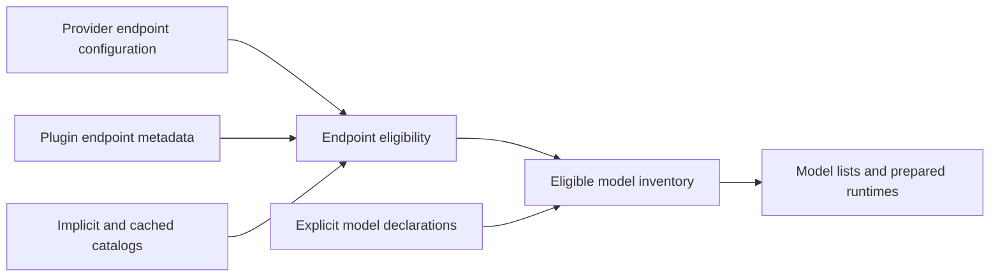

Codex review: blocked before merge. _Reviewed September 8, 2026, 10:18 AM ET / 14:18 UTC._

# ClawSweeper review

## What this changes

Filters automatically supplied model catalogs against configured provider endpoints while preserving explicitly declared models and their settings.

## Merge readiness

⛔ **Blocked before merge - 2 items remain**

This remains useful, distinct work. No actionable correctness defect was found, and the updated compiled CLI, Gateway, and persisted-cache evidence addresses the previous review’s proof gap.

**Priority:** P2
**Reviewed head:** `76089cab111170c490b481d5ca71607e5d4f0f98`

## Review scores

| Measure | Result | What it means |
|---|---|---|
| **Overall readiness** | 🐚 platinum hermit **(4/6)** | The implementation is coherent and the updated runtime evidence addresses the prior blocker, with the intentional proxy compatibility impact clearly documented. |
| **Proof confidence** | 🦞 diamond lobster **(5/6)** | Sufficient (live_output): Reported compiled CLI and Gateway observations exercise the changed catalog owners with native/custom endpoints, authored rows, shared Google/Vertex outputs, and a baseline-seeded per-agent database. The results resolve the previous fresh-state and retained-cache gap; they do not claim vendor inference or standalone installation coverage. |
| **Patch quality** | 🐚 platinum hermit **(4/6)** | No actionable review findings were identified. |

## Verification

| Check | Result | Evidence |
|---|---|---|
| **Real behavior** | Verified | Sufficient (live_output): Reported compiled CLI and Gateway observations exercise the changed catalog owners with native/custom endpoints, authored rows, shared Google/Vertex outputs, and a baseline-seeded per-agent database. The results resolve the previous fresh-state and retained-cache gap; they do not claim vendor inference or standalone installation coverage. |
| **Evidence reviewed** | 10 items | Introduced source boundary: The merge-base-to-head diff introduces one endpoint eligibility predicate and applies it to manifest planning, discovery, static catalogs, augmentation, and generated catalog recovery. Base-only changes were excluded from review ownership. Current main still needs the change: The fetched main implementation passes provider filters and remote overlays to the manifest planner without endpoint eligibility. Its provider-config owner also lacks the new predicate. Latest release comparison: The v2026.9.2 source likewise lacks endpoint eligibility in the effective catalog planner. The release endpoint confirms that tag was published; no released replacement for this change was established. |
| **Findings** | None | None. |
| **Security** | None | None. |

## How this fits together

Provider plugins supply model inventory through manifests, discovery, and cached catalogs. OpenClaw combines that inventory with operator declarations to prepare model lists and runtime definitions.

## Before merge

- [ ] **Resolve merge risk (P1)** - Existing proxy configurations that rely on implicit native model inventory will lose those rows and require explicit model declarations; preservation proof covers authored configurations, not readiness of every existing proxy setup.
- [ ] **Add data-model compatibility proof** - Confirm migration or upgrade compatibility proof before merge.

<strong>Agent review details</strong>

### Security

None.

### PR surface

Source +235, Tests +449, Docs +3. Total +687 across 20 files.

View PR surface stats

| Area | Files | Added | Removed | Net |
|---|---:|---:|---:|---:|
| Source | 15 | 301 | 66 | +235 |
| Tests | 3 | 449 | 0 | +449 |
| Docs | 2 | 3 | 0 | +3 |
| Config | 0 | 0 | 0 | 0 |
| Generated | 0 | 0 | 0 | 0 |
| Other | 0 | 0 | 0 | 0 |
| **Total** | **20** | **753** | **66** | **+687** |

### Review metrics

| Metric | Value | Why it matters |
|---|---|---|
| **Production versus test growth** | Production net +235 lines; tests +449 lines | Production growth applies one eligibility rule across catalog producers and consumers and restores authored runtime definitions. |

### Stored data model

Persistent data-model change detected: `unknown-data-model-change: src/agents/plugin-model-catalog.ts`. Confirm migration or upgrade compatibility proof before merge.

### Merge-risk options

**Maintainer options:**
1. **Retain the documented endpoint cutoff (recommended)**  
   Accept the stated inventory change with explicit proxy model declarations, supported by the new fresh-state and retained-cache results.

### Technical review

Best possible solution:

Retain the shared endpoint rule with the documented explicit-model path and the demonstrated fresh-state and persisted-cache preservation contract.

Do we have a high-confidence way to reproduce the issue?

Not applicable as a new inventory policy; source inspection and the reported compiled baseline/candidate runs establish the behavior being changed.

Is this the best way to solve the issue?

Yes. A shared provider-owned eligibility rule covers fresh and retained inventory while preserving explicit definitions, without introducing another configuration switch or catalog store.

AGENTS.md: found and applied where relevant.

Codex review notes: model internal, reasoning medium; reviewed against [1b011fe705ab](https://github.com/openclaw/openclaw/commit/1b011fe705abb14d163100f886d38e3a2b50f100).

### Labels

Label changes:

- add `proof: sufficient`: Contributor real behavior proof is sufficient. Reported compiled CLI and Gateway observations exercise the changed catalog owners with native/custom endpoints, authored rows, shared Google/Vertex outputs, and a baseline-seeded per-agent database. The results resolve the previous fresh-state and retained-cache gap; they do not claim vendor inference or standalone installation coverage.

Label justifications:

- `P2`: This is a bounded model-inventory improvement for configured provider endpoints.
- `merge-risk: 🚨 compatibility`: Existing proxies relying on automatically supplied native models must explicitly declare their supported models after this change.
- `rating: 🐚 platinum hermit`: Overall readiness is 🐚 platinum hermit; proof is 🦞 diamond lobster and patch quality is 🐚 platinum hermit.
- `status: 👀 ready for maintainer look`: ClawSweeper has no concrete contributor-facing blocker left for this PR. Sufficient (live_output): Reported compiled CLI and Gateway observations exercise the changed catalog owners with native/custom endpoints, authored rows, shared Google/Vertex outputs, and a baseline-seeded per-agent database. The results resolve the previous fresh-state and retained-cache gap; they do not claim vendor inference or standalone installation coverage.
- `proof: sufficient`: Contributor real behavior proof is sufficient. Reported compiled CLI and Gateway observations exercise the changed catalog owners with native/custom endpoints, authored rows, shared Google/Vertex outputs, and a baseline-seeded per-agent database. The results resolve the previous fresh-state and retained-cache gap; they do not claim vendor inference or standalone installation coverage.

### Evidence

What I checked:

- **Introduced source boundary:** The merge-base-to-head diff introduces one endpoint eligibility predicate and applies it to manifest planning, discovery, static catalogs, augmentation, and generated catalog recovery. Base-only changes were excluded from review ownership. ([`src/plugins/provider-config-owner.ts:16`](https://github.com/openclaw/openclaw/blob/76089cab111170c490b481d5ca71607e5d4f0f98/src/plugins/provider-config-owner.ts#L16), [76089cab1111](https://github.com/openclaw/openclaw/commit/76089cab111170c490b481d5ca71607e5d4f0f98))
- **Current main still needs the change:** The fetched main implementation passes provider filters and remote overlays to the manifest planner without endpoint eligibility. Its provider-config owner also lacks the new predicate. ([`src/model-catalog/index.ts:20`](https://github.com/openclaw/openclaw/blob/1b011fe705abb14d163100f886d38e3a2b50f100/src/model-catalog/index.ts#L20), [1b011fe705ab](https://github.com/openclaw/openclaw/commit/1b011fe705abb14d163100f886d38e3a2b50f100))
- **Latest release comparison:** The v2026.9.2 source likewise lacks endpoint eligibility in the effective catalog planner. The release endpoint confirms that tag was published; no released replacement for this change was established. ([`src/model-catalog/index.ts:22`](https://github.com/openclaw/openclaw/blob/3928bad9badfcb6c7d140530435e806fb8092190/src/model-catalog/index.ts#L22), [3928bad9badf](https://github.com/openclaw/openclaw/commit/3928bad9badfcb6c7d140530435e806fb8092190))
- **Prior findings resolved:** Shared hooks now retain eligible sibling identities, and declared endpoint URLs use the existing normalization contract. The complete added tests cover scoped and unscoped shared outputs, aliases, normalized URLs, registry forks, and authored rows. The previous completed review used this same head and reported no findings. ([`src/agents/models-config.providers.endpoint.test.ts:175`](https://github.com/openclaw/openclaw/blob/76089cab111170c490b481d5ca71607e5d4f0f98/src/agents/models-config.providers.endpoint.test.ts#L175), [76089cab1111](https://github.com/openclaw/openclaw/commit/76089cab111170c490b481d5ca71607e5d4f0f98))
- **Compiled behavior and upgrade evidence:** The captured body reports a compiled artifact containing the reviewed head: native DeepSeek inventory 3, custom inventory 0, authored rows 2 after refresh/replace, and native restoration 3. Gateway projections preserve authored rows and unchanged config. A baseline-seeded per-agent database exposes four generated rows before the change and none afterward; explicitly reusing historical/native IDs preserves authored names, context sizes, aliases, and settings. Google’s shared hook retains ten native Vertex models. These observations address the previous rank-up request. The live body retained the same evidence narrative; captured context identity is sourceRevision 9b972a139d4d277be62dfb4b898506be84e9136c0d4a7d9583aa468a4c4d9b19. No reviewer-side runtime execution or vendor inference is claimed. ([76089cab1111](https://github.com/openclaw/openclaw/commit/76089cab111170c490b481d5ca71607e5d4f0f98))
- **Explicit upgrade contract:** The PR body identifies the endpoint-inventory direction as approved. The CLI and plugin documentation explain that a custom provider endpoint excludes implicit inventory, that proxy models must be declared explicitly, and that endpoint classification does not establish request authorization. Public docs: [`docs/cli/models.md`](https://docs.openclaw.ai/cli/models). ([`docs/cli/models.md:167`](https://docs.openclaw.ai/cli/models), [76089cab1111](https://github.com/openclaw/openclaw/commit/76089cab111170c490b481d5ca71607e5d4f0f98))

Likely related people:

- **unknown:** The claimed source-line change could not be verified from bounded local history. (role: source history unknown; confidence: low)
- **unknown:** The claimed source-line change could not be verified from bounded local history. (role: source history unknown; confidence: low)

### Rating scale

| Score | Internal tier | Crab rank | Meaning |
|---:|:---:|---|---|
| **6/6** | S | 🦀 challenger crab | Exceptional readiness |
| **5/6** | A | 🦞 diamond lobster | Very strong readiness |
| **4/6** | B | 🐚 platinum hermit | Good normal PR; ordinary maintainer review |
| **3/6** | C | 🦐 gold shrimp | Useful, but confidence is limited |
| **2/6** | D | 🦪 silver shellfish | Proof or implementation needs work |
| **1/6** | F | 🧂 unranked krab | Not merge-ready |
| N/A | NA | 🌊 off-meta tidepool | Rating does not apply |

Overall follows the weaker of proof and patch quality.
Shiny media proof means a screenshot, video, or linked artifact directly shows the changed behavior. Runtime, network, CSP, and security claims still need visible diagnostics.

### Workflow

- ClawSweeper keeps one durable marker-backed review comment per issue or PR.
- Re-runs edit this comment so the latest verdict, findings, and automation markers stay together instead of adding duplicate bot comments.
- A fresh review can be triggered by eligible `@clawsweeper re-review` comments, exact-item GitHub events, scheduled/background review runs, or manual workflow dispatch.
- PR/issue authors and users with repository write access can comment `@clawsweeper re-review` or `@clawsweeper re-run` on an open PR or issue to request a fresh review only.
- Maintainers can also comment `@clawsweeper review` to request a fresh review only.
- Fresh-review commands do not start repair, autofix, rebase, CI repair, or automerge.
- Maintainer-only repair and merge flows require explicit commands such as `@clawsweeper autofix`, `@clawsweeper automerge`, `@clawsweeper fix ci`, or `@clawsweeper address review`.
- Maintainers can comment `@clawsweeper explain` to ask for more context, or `@clawsweeper stop` to stop active automation.

### History

Review history (3 earlier review cycles)

<!-- clawsweeper-review-history v=1 total=3 -->
- reviewed 2026-09-08T12:53:58.723Z sha ba2f14fac8029571dbde1b86e90c0ec487f4e384 :: blocked before merge. :: [P1] Preserve eligible outputs from shared provider hooks | [P2] Normalize declared endpoint URLs before catalog matching
- reviewed 2026-09-08T13:11:56.443Z sha a78a5e356981754340f6859d32307c232b81747e :: blocked before merge. :: none
- reviewed 2026-09-08T13:43:44.592Z sha 76089cab111170c490b481d5ca71607e5d4f0f98 :: blocked before merge. :: none

<!-- clawsweeper-verdict:needs-human item=142158 sha=76089cab111170c490b481d5ca71607e5d4f0f98 confidence=high updated_at=2026-09-08T14:15:44Z reviewed_at=2026-09-08T14:18:46.877Z lease_owner=github-run-34236950540-1 lease_comment_id=5586557559 source_revision=9b972a139d4d277be62dfb4b898506be84e9136c0d4a7d9583aa468a4c4d9b19 live_verification=absent -->
<!-- clawsweeper-review-state:blocked item=142158 sha=76089cab111170c490b481d5ca71607e5d4f0f98 v=1 -->

<!-- clawsweeper-review-version item=142158 reviewed_at=2026-09-08T14:18:46.877Z sha=76089cab111170c490b481d5ca71607e5d4f0f98 source_revision=9b972a139d4d277be62dfb4b898506be84e9136c0d4a7d9583aa468a4c4d9b19 lease_owner=github-run-34236950540-1 lease_comment_id=5586557559 v=1 -->

<!-- clawsweeper-review item=142158 -->