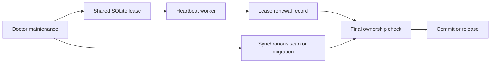

Codex review: found issues before merge. _Reviewed September 1, 2026, 5:47 AM ET / 09:47 UTC._

# ClawSweeper review

## What this changes

This PR moves Doctor’s shared SQLite maintenance-lease renewal into a dedicated worker and updates runtime-worker build and test inventories.

## Regression provenance

Possible regression — suspected (reviewed change). No predecessor PR is attributed.

## Merge readiness

⚠️ **Ready for maintainer review - 6 items remain**

Keep open: the new heartbeat cannot start from a Node 22 source checkout because its worker loader does not register the resolver required for the worker’s `.js` source imports. This member-authored, maintainer-labeled PR also requires explicit maintainer handling.

**Priority:** P1
**Reviewed head:** `efbf78adcb4568a8b5d32d60944ce1b75bb7d6cd`
**Owner decision:** Required. See [Decision needed](#decision-needed).

## Review scores

| Measure | Result | What it means |
|---|---|---|
| **Overall readiness** | 🦐 gold shrimp **(3/6)** | The concurrency design and reported exercise are substantial, but a supported source-runtime path has a blocking loader defect. |
| **Proof confidence** | 🦐 gold shrimp **(3/6)** | Not applicable: The contributor-proof gate does not apply because repository state identifies this as a member-authored PR; the body reports real built-worker runs, but those do not cover the introduced Node 22 source-worker failure. |
| **Patch quality** | 🦐 gold shrimp **(3/6)** | 1 actionable review finding remain. |

## Verification

| Check | Result | Evidence |
|---|---|---|
| **Real behavior** | Not applicable | Not applicable: The contributor-proof gate does not apply because repository state identifies this as a member-authored PR; the body reports real built-worker runs, but those do not cover the introduced Node 22 source-worker failure. |
| **Evidence reviewed** | 7 items | Introduced source-worker trigger: The introduced heartbeat starts its source `.ts` worker with the generic `--import tsx` arguments. Existing Node 22 source-worker contract: The analogous archive worker documents that `--import tsx` does not register tsx’s ESM resolver inside a Node 22 Worker and programmatically registers `tsx/esm/api` instead. Unresolvable source imports: The new worker imports local modules through `.js` specifiers, which require that resolver when its entry is the source `.ts` file. |
| **Findings** | 1 actionable finding | [P1] Register tsx’s Worker resolver for source execution |
| **Security** | None | None. |

## How this fits together

Doctor holds a shared-state lease while it scans or migrates agent databases, preventing other writers from entering maintenance-sensitive paths. The new worker is intended to renew that lease independently while the Doctor process is synchronously blocked.

## Decision needed

| Question | Recommendation |
|---|---|
| Should this member-owned, maintainer-labeled PR be updated to preserve Node 22 source-checkout Doctor operation before merge? | **Repair source-worker loading:** Register tsx’s Worker resolver for source-mode heartbeat execution, add focused Node 22 coverage, and then rerun the outstanding Windows proof. |

Why: The source-loader failure is mechanical, but the protected maintainer label requires explicit maintainer handling and the prior Windows lifecycle rank-up remains unresolved.

## Before merge

- [ ] **Register tsx’s Worker resolver for source execution (P1)** - `resolveRuntimeWorkerArgv` supplies only `--import tsx` here, but the analogous source Worker documents that Node 22 does not register tsx’s ESM resolver that way. This new worker imports local `.js` specifiers, so source-mode Doctor cannot reach `ready` before maintenance begins. This was visible at the earlier reviewed head; add the programmatic resolver registration and a Node 22 source-mode regression.
- [ ] **Resolve merge risk (P1)** - On supported Node 22 source checkouts, Doctor waits for a heartbeat worker that cannot resolve its local `.js` imports, turning maintenance into a startup failure.
- [ ] **Resolve merge risk (P1)** - The PR adds core runtime +354/-100 lines; the independent worker is justified by blocked event-loop renewal, but the source-runtime repair must be proven before accepting that added lifecycle boundary.
- [ ] **Resolve merge risk (P1)** - The PR body retains an exact-head Windows worker-inventory and cleanup verification gap; current-main source could not be independently read in this partial clone.
- [ ] **Complete next step (P2)** - A concrete P1 repair exists, but the protected maintainer label and prior platform-proof gap require explicit maintainer handling rather than automated repair dispatch.

## Findings

- [P1] Register tsx’s Worker resolver for source execution — `src/state/openclaw-state-lease-heartbeat.ts:34`

<strong>Agent review details</strong>

### Security

None.

### PR surface

Source +254, Tests +204, Docs +4, Other +16. Total +478 across 21 files.

View PR surface stats

| Area | Files | Added | Removed | Net |
|---|---:|---:|---:|---:|
| Source | 9 | 354 | 100 | +254 |
| Tests | 7 | 318 | 114 | +204 |
| Docs | 1 | 4 | 0 | +4 |
| Config | 0 | 0 | 0 | 0 |
| Generated | 0 | 0 | 0 | 0 |
| Other | 4 | 35 | 19 | +16 |
| **Total** | **21** | **711** | **233** | **+478** |

### Review metrics

| Metric | Value | Why it matters |
|---|---|---|
| **Production versus validation delta** | core runtime +354/-100; tooling +35/-19; tests/support +318/-114; docs +4 | The positive core growth creates an independent renewal lifecycle that cannot be implemented by the event loop being repaired. |
| **Source-worker coverage** | 0 explicit Node 22 source-mode heartbeat cases | Existing new tests and the added memory fixture do not establish the failing source-loader path. |

### Merge-risk options

**Maintainer options:**
1. **Fix the Node 22 source worker (recommended)**  
   Use programmatic tsx resolver registration for the heartbeat’s source Worker and prove Doctor reaches maintenance from a source checkout.
2. **Pause the worker heartbeat**  
   Keep the current timer implementation until the worker lifecycle is proven on every supported source runtime.

### Technical review

Best possible solution:

Use the existing programmatic `tsx/esm/api` source-worker registration pattern, preferably as a shared runtime-worker helper, and add a Node 22 source-mode heartbeat regression before rechecking the Windows lifecycle result.

Do we have a high-confidence way to reproduce the issue?

Yes, from source: on Node 22, run Doctor from a source checkout so the maintenance heartbeat starts its `.ts` Worker. The repository’s analogous worker documents the missing resolver behavior, although this read-only review did not execute it.

Is this the best way to solve the issue?

No: the independent heartbeat is the right ownership boundary for a blocked event loop, but this implementation must use the repository’s programmatic Worker resolver before it is a supported source-runtime solution.

Full review comments:

- [P1] Register tsx’s Worker resolver for source execution — `src/state/openclaw-state-lease-heartbeat.ts:34`
  `resolveRuntimeWorkerArgv` supplies only `--import tsx` here, but the analogous source Worker documents that Node 22 does not register tsx’s ESM resolver that way. This new worker imports local `.js` specifiers, so source-mode Doctor cannot reach `ready` before maintenance begins. This was visible at the earlier reviewed head; add the programmatic resolver registration and a Node 22 source-mode regression.
  Confidence: 0.97
  Late finding: first raised on code an earlier review cycle already covered.

Overall correctness: patch is incorrect
Overall confidence: 0.97

AGENTS.md: found and applied where relevant.

Codex review notes: model internal, reasoning high; reviewed against [f2646be7a983](https://github.com/openclaw/openclaw/commit/f2646be7a98347329124b55ae9752ce6f915c09c).

### Labels

Label changes:

- add `status: ⏳ waiting on author`: ClawSweeper has contributor-facing work open and is waiting for author action. Not applicable: The contributor-proof gate does not apply because repository state identifies this as a member-authored PR; the body reports real built-worker runs, but those do not cover the introduced Node 22 source-worker failure.
- remove `status: 👀 ready for maintainer look`: Current PR status label is `status: ⏳ waiting on author`.

Label justifications:

- `P1`: The introduced loader failure prevents Doctor maintenance from starting in a supported source-runtime workflow.
- `merge-risk: 🚨 availability`: The new worker determines whether a core database maintenance operation can acquire and retain its lease.
- `rating: 🦐 gold shrimp`: Overall readiness is 🦐 gold shrimp; proof is 🦐 gold shrimp and patch quality is 🦐 gold shrimp.
- `status: ⏳ waiting on author`: ClawSweeper has contributor-facing work open and is waiting for author action. Not applicable: The contributor-proof gate does not apply because repository state identifies this as a member-authored PR; the body reports real built-worker runs, but those do not cover the introduced Node 22 source-worker failure.

### Evidence

What I checked:

- **Introduced source-worker trigger:** The introduced heartbeat starts its source `.ts` worker with the generic `--import tsx` arguments. ([`src/state/openclaw-state-lease-heartbeat.ts:34`](https://github.com/openclaw/openclaw/blob/efbf78adcb45/src/state/openclaw-state-lease-heartbeat.ts#L34), [efbf78adcb45](https://github.com/openclaw/openclaw/commit/efbf78adcb45))
- **Existing Node 22 source-worker contract:** The analogous archive worker documents that `--import tsx` does not register tsx’s ESM resolver inside a Node 22 Worker and programmatically registers `tsx/esm/api` instead. ([`src/config/sessions/session-accessor.sqlite-archive.ts:272`](https://github.com/openclaw/openclaw/blob/efbf78adcb45/src/config/sessions/session-accessor.sqlite-archive.ts#L272), [efbf78adcb45](https://github.com/openclaw/openclaw/commit/efbf78adcb45))
- **Unresolvable source imports:** The new worker imports local modules through `.js` specifiers, which require that resolver when its entry is the source `.ts` file. ([`src/state/openclaw-state-lease-heartbeat.worker.ts:2`](https://github.com/openclaw/openclaw/blob/efbf78adcb45/src/state/openclaw-state-lease-heartbeat.worker.ts#L2), [efbf78adcb45](https://github.com/openclaw/openclaw/commit/efbf78adcb45))
- **Affected Doctor path:** Agent database maintenance always opts into the worker heartbeat, and lease entry waits for worker readiness before invoking Doctor work. ([`src/state/openclaw-agent-db.ts:678`](https://github.com/openclaw/openclaw/blob/efbf78adcb45/src/state/openclaw-agent-db.ts#L678), [efbf78adcb45](https://github.com/openclaw/openclaw/commit/efbf78adcb45))
- **Coverage gap:** The new heartbeat tests exercise the lease API but do not force the Node 22 source-worker loader; the added memory fixture deliberately executes a generated dist bundle. ([`src/state/openclaw-state-lease-heartbeat.test.ts:41`](https://github.com/openclaw/openclaw/blob/efbf78adcb45/src/state/openclaw-state-lease-heartbeat.test.ts#L41), [efbf78adcb45](https://github.com/openclaw/openclaw/commit/efbf78adcb45))
- **Introduced-diff provenance:** The first PR commit has a recorded parent and its raw-parent diff adds the heartbeat option and generic lease-worker implementation. ([`src/state/openclaw-state-lease.ts:553`](https://github.com/openclaw/openclaw/blob/6ad462c01800/src/state/openclaw-state-lease.ts#L553), [6ad462c01800](https://github.com/openclaw/openclaw/commit/6ad462c01800))

Likely related people:

- **Peter Steinberger:** Suggested for follow-up; no historical authorship or introduction is verified. (role: unverified routing candidate; confidence: low)
- **Omar Shahine:** Suggested for follow-up; no historical authorship or introduction is verified. (role: unverified routing candidate; confidence: low)

### Rank-up moves

Optional improvements that raise the rating; they are not merge blockers.

- Register the source Worker resolver and add a Node 22 source-mode heartbeat regression.
- Complete the exact-head Windows worker-inventory and cleanup verification with redacted lifecycle output.

### Rating scale

| Score | Internal tier | Crab rank | Meaning |
|---:|:---:|---|---|
| **6/6** | S | 🦀 challenger crab | Exceptional readiness |
| **5/6** | A | 🦞 diamond lobster | Very strong readiness |
| **4/6** | B | 🐚 platinum hermit | Good normal PR; ordinary maintainer review |
| **3/6** | C | 🦐 gold shrimp | Useful, but confidence is limited |
| **2/6** | D | 🦪 silver shellfish | Proof or implementation needs work |
| **1/6** | F | 🧂 unranked krab | Not merge-ready |
| N/A | NA | 🌊 off-meta tidepool | Rating does not apply |

Overall follows the weaker of proof and patch quality.
Shiny media proof means a screenshot, video, or linked artifact directly shows the changed behavior. Runtime, network, CSP, and security claims still need visible diagnostics.

### Workflow

- ClawSweeper keeps one durable marker-backed review comment per issue or PR.
- Re-runs edit this comment so the latest verdict, findings, and automation markers stay together instead of adding duplicate bot comments.
- A fresh review can be triggered by eligible `@clawsweeper re-review` comments, exact-item GitHub events, scheduled/background review runs, or manual workflow dispatch.
- PR/issue authors and users with repository write access can comment `@clawsweeper re-review` or `@clawsweeper re-run` on an open PR or issue to request a fresh review only.
- Maintainers can also comment `@clawsweeper review` to request a fresh review only.
- Fresh-review commands do not start repair, autofix, rebase, CI repair, or automerge.
- Maintainer-only repair and merge flows require explicit commands such as `@clawsweeper autofix`, `@clawsweeper automerge`, `@clawsweeper fix ci`, or `@clawsweeper address review`.
- Maintainers can comment `@clawsweeper explain` to ask for more context, or `@clawsweeper stop` to stop active automation.

### History

Review history (4 earlier review cycles)

<!-- clawsweeper-review-history v=1 total=4 -->
- reviewed 2026-09-01T05:41:59.083Z sha 6ad462c01800976c60d0c0a412d1bc40c1aab2f2 :: needs maintainer review before merge. :: none
- reviewed 2026-09-01T07:11:33.141Z sha 8091f7661222c1ebd319ee9bab35f2f346057579 :: needs maintainer review before merge. :: none
- reviewed 2026-09-01T08:15:36.554Z sha e83feeeb349db1512005509c8a9332b46cb169b4 :: needs maintainer review before merge. :: none
- reviewed 2026-09-01T09:07:00.221Z sha 5dfb87f6676b1f3f8313343f582ce67527dad656 :: needs maintainer review before merge. :: none

<!-- clawsweeper-verdict:needs-human item=134880 sha=efbf78adcb4568a8b5d32d60944ce1b75bb7d6cd confidence=high updated_at=2026-09-01T09:42:54Z reviewed_at=2026-09-01T09:47:41.086Z lease_owner=github-run-33493525577-1 lease_comment_id=5492056164 source_revision=0b2b6bed7a15a449bd269bd4e24fcba1ca4699bde92ede0bfefbd392f6141f8a live_verification=absent -->

<!-- clawsweeper-review-version item=134880 reviewed_at=2026-09-01T09:47:41.086Z sha=efbf78adcb4568a8b5d32d60944ce1b75bb7d6cd source_revision=0b2b6bed7a15a449bd269bd4e24fcba1ca4699bde92ede0bfefbd392f6141f8a lease_owner=github-run-33493525577-1 lease_comment_id=5492056164 v=1 -->

<!-- clawsweeper-review item=134880 -->