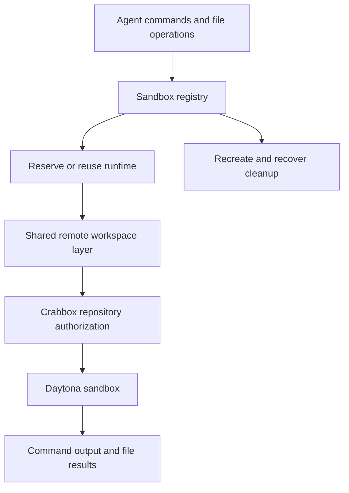

Codex review: blocked before merge. _Reviewed September 11, 2026, 6:04 PM ET / 22:04 UTC (Revision 7)._

# ClawSweeper review

## What this changes

Adds Crabbox-hosted tool sandboxes with durable lease recovery and shares remote workspace initialization, execution, and file operations with the SSH backend.

## Merge readiness

⛔ **Blocked before merge - 4 items remain**

This remains useful, maintainer-sponsored work absent from current main. The earlier lifecycle and ownership findings are resolved, and the required Crabbox dependency is now merged; no new blocking code defect was established.

**Priority:** P2
**Reviewed head:** `e23770c3ff0479c0233cf6c73f3c54621c82c178`

## Review scores

| Measure | Result | What it means |
|---|---|---|
| **Overall readiness** | 🐚 platinum hermit **(4/6)** | The revised implementation and reported authority-transfer proof are solid; deployment compatibility evidence remains the material readiness gap. |
| **Proof confidence** | 🦞 diamond lobster **(5/6)** | Sufficient (live_output): Reported real Daytona execution through the registered plugin, exec runtime, filesystem bridge, and management owner demonstrates recovery and rejects old-owner effects after repository transfer while allowing the current owner. Registry/plugin reopen is demonstrated; a full Gateway restart and published-version upgrade are not claimed. |
| **Patch quality** | 🐚 platinum hermit **(4/6)** | No actionable review findings were identified. |

## Verification

| Check | Result | Evidence |
|---|---|---|
| **Real behavior** | Verified | Sufficient (live_output): Reported real Daytona execution through the registered plugin, exec runtime, filesystem bridge, and management owner demonstrates recovery and rejects old-owner effects after repository transfer while allowing the current owner. Registry/plugin reopen is demonstrated; a full Gateway restart and published-version upgrade are not claimed. |
| **Evidence reviewed** | 13 items | Capability remains absent from main: The pinned main Crabbox entry registers cloud workers but no sandbox backend; the PR introduces the sandbox registration at lines 75–97. Latest release comparison: The v2026.9.4 Crabbox entry likewise provides cloud workers without this sandbox registration. No same-repository replacement fixing PR was established; the supplied Telegram-related item is unrelated. Durable lifecycle and previous findings: Reservation precedes allocation, retains the original workspace, serializes provider lifecycle operations, and records removal before waiting. Unknown failures retain their generation; only an exact released lease permits replacement. |
| **Findings** | None | None. |
| **Security** | None | None. |

## How this fits together

OpenClaw’s sandbox layer sends agent commands and file operations to isolated environments while the Gateway and agent loop remain local. The registry owns runtime generations; the Crabbox plugin delegates provider access and repository authorization to the Crabbox CLI.

## Before merge

- [ ] **Resolve merge risk (P1)** - Existing SSH setups without native no-replace directory rename can reuse existing workspaces but will fail when creating or recreating one.
- [ ] **Resolve merge risk (P1)** - Published-updater upgrade and disable/reconcile/rollback execution remain unproven; older binaries can read the database without understanding pending lease recovery.
- [ ] **Resolve merge risk (P1)** - The new opt-in backend currently requires a supporting Crabbox build beyond published v0.56.0; unsupported binaries are rejected before allocation.
- [ ] **Complete next step (P2)** - Record published-updater × candidate upgrade and disable/reconcile/rollback results preserving existing runtimes and pending lease records.

<strong>Agent review details</strong>

### Security

None.

### PR surface

Source +994, Tests +1635, Docs +176, Generated 0, Other -2. Total +2803 across 47 files.

View PR surface stats

| Area | Files | Added | Removed | Net |
|---|---:|---:|---:|---:|
| Source | 22 | 2258 | 1264 | +994 |
| Tests | 12 | 1695 | 60 | +1635 |
| Docs | 9 | 199 | 23 | +176 |
| Config | 0 | 0 | 0 | 0 |
| Generated | 2 | 3 | 3 | 0 |
| Other | 2 | 0 | 2 | -2 |
| **Total** | **47** | **4155** | **1352** | **+2803** |

### Review metrics

| Metric | Value | Why it matters |
|---|---|---|
| **New plugin configuration** | 5 optional fields in 1 sandbox block | Provider, class, TTL, idle timeout, and binary selection configure the opt-in backend without changing the default backend. |
| **Persistent lifecycle contract** | 2 payload fields; 4 runtime states; no new table or schema version | The existing registry gains durable recovery semantics despite retaining its physical schema. |

### Merge-risk options

**Maintainer options:**
1. **Complete the upgrade evidence (recommended)**  
   Record a published-updater upgrade and safe rollback with existing SSH runtimes and pending Crabbox reservations, including the documented unsupported-filesystem outcome.

### Technical review

Best possible solution:

Keep the shared registry and remote-shell owners, with verified published-version upgrade and disable/reconcile-before-rollback behavior that preserves existing runtimes and uncertain leases.

Do we have a high-confidence way to reproduce the issue?

Not applicable to the feature request. Earlier lifecycle defects have targeted regression coverage and reported Daytona verification; this read-only review did not execute them.

Is this the best way to solve the issue?

Yes: the existing plugin, registry, and shared remote-shell boundaries are appropriate, and the recorded maintainer rewrite establishes the intended SSH tradeoff. Upgrade and rollback validation remains necessary.

AGENTS.md: found and applied where relevant.

Codex review notes: model internal, reasoning medium; reviewed against [f3f3d6b1ed68](https://github.com/openclaw/openclaw/commit/f3f3d6b1ed680c364c1ea3b549e7e4fa8fc500b9).

### Labels

Label changes:

- add `proof: sufficient`: Contributor real behavior proof is sufficient. Reported real Daytona execution through the registered plugin, exec runtime, filesystem bridge, and management owner demonstrates recovery and rejects old-owner effects after repository transfer while allowing the current owner. Registry/plugin reopen is demonstrated; a full Gateway restart and published-version upgrade are not claimed.
- add `rating: 🐚 platinum hermit`: Overall readiness is 🐚 platinum hermit; proof is 🦞 diamond lobster and patch quality is 🐚 platinum hermit.
- add `status: 👀 ready for maintainer look`: ClawSweeper has no concrete contributor-facing blocker left for this PR. Sufficient (live_output): Reported real Daytona execution through the registered plugin, exec runtime, filesystem bridge, and management owner demonstrates recovery and rejects old-owner effects after repository transfer while allowing the current owner. Registry/plugin reopen is demonstrated; a full Gateway restart and published-version upgrade are not claimed.
- remove `rating: 🦐 gold shrimp`: Current PR rating is `rating: 🐚 platinum hermit`, so this older rating label is no longer current.
- remove `merge-risk: 🚨 security-boundary`: Current PR review merge-risk labels are `merge-risk: 🚨 compatibility`.
- remove `status: 📣 needs proof`: Current PR status label is `status: 👀 ready for maintainer look`.

Label justifications:

- `P2`: This is a bounded, opt-in sandbox improvement with useful lifecycle repairs and no demonstrated urgent production incident.
- `merge-risk: 🚨 compatibility`: Shared SSH initialization gains a platform requirement, and durable reservations require safe upgrade and rollback handling beyond ordinary CI.
- `rating: 🐚 platinum hermit`: Overall readiness is 🐚 platinum hermit; proof is 🦞 diamond lobster and patch quality is 🐚 platinum hermit.
- `status: 👀 ready for maintainer look`: ClawSweeper has no concrete contributor-facing blocker left for this PR. Sufficient (live_output): Reported real Daytona execution through the registered plugin, exec runtime, filesystem bridge, and management owner demonstrates recovery and rejects old-owner effects after repository transfer while allowing the current owner. Registry/plugin reopen is demonstrated; a full Gateway restart and published-version upgrade are not claimed.
- `proof: sufficient`: Contributor real behavior proof is sufficient. Reported real Daytona execution through the registered plugin, exec runtime, filesystem bridge, and management owner demonstrates recovery and rejects old-owner effects after repository transfer while allowing the current owner. Registry/plugin reopen is demonstrated; a full Gateway restart and published-version upgrade are not claimed.

### Evidence

What I checked:

- **Capability remains absent from main:** The pinned main Crabbox entry registers cloud workers but no sandbox backend; the PR introduces the sandbox registration at lines 75–97. ([`extensions/crabbox/index.ts:75`](https://github.com/openclaw/openclaw/blob/f3f3d6b1ed680c364c1ea3b549e7e4fa8fc500b9/extensions/crabbox/index.ts#L75), [f3f3d6b1ed68](https://github.com/openclaw/openclaw/commit/f3f3d6b1ed680c364c1ea3b549e7e4fa8fc500b9))
- **Latest release comparison:** The v2026.9.4 Crabbox entry likewise provides cloud workers without this sandbox registration. No same-repository replacement fixing PR was established; the supplied Telegram-related item is unrelated. ([`extensions/crabbox/index.ts`](https://github.com/openclaw/openclaw/blob/3a9d69db306cd7f081e06254cb89c4bcc14a7107/extensions/crabbox/index.ts), [3a9d69db306c](https://github.com/openclaw/openclaw/commit/3a9d69db306cd7f081e06254cb89c4bcc14a7107))
- **Durable lifecycle and previous findings:** Reservation precedes allocation, retains the original workspace, serializes provider lifecycle operations, and records removal before waiting. Unknown failures retain their generation; only an exact released lease permits replacement. ([`src/agents/sandbox/registry.ts:365`](https://github.com/openclaw/openclaw/blob/e23770c3ff0479c0233cf6c73f3c54621c82c178/src/agents/sandbox/registry.ts#L365), [e23770c3ff04](https://github.com/openclaw/openclaw/commit/e23770c3ff0479c0233cf6c73f3c54621c82c178))
- **Dependency boundary and execution authority:** The adapter directly executes Crabbox capability checks, fixed-ID warmup, claim-owned exec, and repository-scoped stop. This establishes the Crabbox dependency inspection requirement; no Codex runtime contract is involved. ([`extensions/crabbox/src/crabbox-sandbox-backend.ts:175`](https://github.com/openclaw/openclaw/blob/e23770c3ff0479c0233cf6c73f3c54621c82c178/extensions/crabbox/src/crabbox-sandbox-backend.ts#L175), [e23770c3ff04](https://github.com/openclaw/openclaw/commit/e23770c3ff0479c0233cf6c73f3c54621c82c178))
- **Required dependency is merged:** GitHub confirms https://github.com/openclaw/crabbox/pull/2119 merged as 5c3aec438fa8368263b3465d0376003ff00402b4. This resolves the previous review’s unmerged-dependency blocker. ([5c3aec438fa8](https://github.com/openclaw/crabbox/commit/5c3aec438fa8368263b3465d0376003ff00402b4))
- **Final execution admission:** The merged exec command checks repository ownership under a retained claim fence before resolving provider access and launching SSH; transport cleanup remains inside that fence. Daytona restricts this route to acquired fixed-ID leases, and scoped release checks the repository under its exclusive durable claim lock. ([`internal/cli/exec.go:94`](https://github.com/openclaw/crabbox/blob/5c3aec438fa8368263b3465d0376003ff00402b4/internal/cli/exec.go#L94), [5c3aec438fa8](https://github.com/openclaw/crabbox/commit/5c3aec438fa8368263b3465d0376003ff00402b4))

Likely related people:

- **unknown:** The claimed source-line change could not be verified from bounded local history. (role: source history unknown; confidence: low)
- **vincentkoc:** Suggested for follow-up; no historical authorship or introduction is verified. (role: unverified routing candidate; confidence: low)

### Rank-up moves

Optional improvements that raise the rating; they are not merge blockers.

- Record published-updater upgrade and disable/reconcile/rollback evidence that preserves existing runtimes and pending lease records.

### Rating scale

| Score | Internal tier | Crab rank | Meaning |
|---:|:---:|---|---|
| **6/6** | S | 🦀 challenger crab | Exceptional readiness |
| **5/6** | A | 🦞 diamond lobster | Very strong readiness |
| **4/6** | B | 🐚 platinum hermit | Good normal PR; ordinary maintainer review |
| **3/6** | C | 🦐 gold shrimp | Useful, but confidence is limited |
| **2/6** | D | 🦪 silver shellfish | Proof or implementation needs work |
| **1/6** | F | 🧂 unranked krab | Not merge-ready |
| N/A | NA | 🌊 off-meta tidepool | Rating does not apply |

Overall follows the weaker of proof and patch quality.
Shiny media proof means a screenshot, video, or linked artifact directly shows the changed behavior. Runtime, network, CSP, and security claims still need visible diagnostics.

### Workflow

- ClawSweeper keeps one durable marker-backed review comment per issue or PR.
- Re-runs edit this comment so the latest verdict, findings, and automation markers stay together instead of adding duplicate bot comments.
- A fresh review can be triggered by eligible `@clawsweeper re-review` comments, exact-item GitHub events, scheduled/background review runs, or manual workflow dispatch.
- PR/issue authors and users with repository write access can comment `@clawsweeper re-review` or `@clawsweeper re-run` on an open PR or issue to request a fresh review only.
- Maintainers can also comment `@clawsweeper review` to request a fresh review only.
- Fresh-review commands do not start repair, autofix, rebase, CI repair, or automerge.
- Maintainer-only repair and merge flows require explicit commands such as `@clawsweeper autofix`, `@clawsweeper automerge`, `@clawsweeper fix ci`, or `@clawsweeper address review`.
- Maintainers can comment `@clawsweeper explain` to ask for more context, or `@clawsweeper stop` to stop active automation.

### History

Review history (6 earlier review cycles)

<!-- clawsweeper-review-history v=1 total=6 -->
- reviewed 2026-09-10T22:43:55.404Z sha 0a852dd8bd223179ee4ea1fb523d581748cfb4fc :: needs real behavior proof before merge. :: [P1] [P1] Resume nonterminal leases instead of replacing their workspace | [P2] [P2] Serialize allocation for callers sharing a sandbox scope | [P2] [P2] Retain the lease ID when provisioning fails before registration | [P2] [P2] Honor the configured SSH token lifetime
- reviewed 2026-09-11T18:46:16.700Z sha 287cf295675043479993dd6a6f708857efddef9c :: needs real behavior proof before merge. :: [P1] [P1] Fence prepared SSH execution against repository transfer | [P2] [P2] Replay shared reservations from their original workspace
- reviewed 2026-09-11T18:58:36.810Z sha 287cf295675043479993dd6a6f708857efddef9c :: needs real behavior proof before merge. :: [P1] [P1] Fence prepared SSH execution against repository transfer | [P2] [P2] Replay shared reservations from their original workspace
- reviewed 2026-09-11T19:18:01.174Z sha fcb92e759070fa8d8600c76223e00548f5961b22 :: needs real behavior proof before merge. :: [P1] [P1] Fence prepared SSH execution against repository transfer | [P2] [P2] Replay shared reservations from their original workspace
- reviewed 2026-09-11T19:31:27.487Z sha 10418efe6659bdd631ac22bc9d24006135c6a4d4 :: needs real behavior proof before merge. :: [P1] [P1] Fence prepared SSH execution against repository transfer | [P2] [P2] Replay shared reservations from their original workspace
- reviewed 2026-09-11T21:44:09.255Z sha edf11073c92c3a94658d1f06e4b59d34fe6051e4 :: blocked before merge. :: none

<!-- clawsweeper-verdict:needs-human item=144454 sha=e23770c3ff0479c0233cf6c73f3c54621c82c178 confidence=high updated_at=2026-09-11T22:00:20Z reviewed_at=2026-09-11T22:04:02.433Z lease_owner=github-run-34651881868-1 lease_comment_id=5641120600 source_revision=9ee2d461058e2d53184fa3ece73bef0880e41155c1d48799b6b2b4c218991651 live_verification=absent -->
<!-- clawsweeper-review-state:blocked item=144454 sha=e23770c3ff0479c0233cf6c73f3c54621c82c178 v=1 -->

<!-- clawsweeper-review-version item=144454 reviewed_at=2026-09-11T22:04:02.433Z sha=e23770c3ff0479c0233cf6c73f3c54621c82c178 source_revision=9ee2d461058e2d53184fa3ece73bef0880e41155c1d48799b6b2b4c218991651 lease_owner=github-run-34651881868-1 lease_comment_id=5641120600 v=1 -->

<!-- clawsweeper-review item=144454 -->