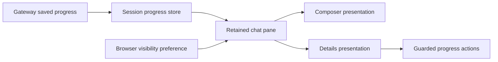

Codex review: needs changes before merge.

## What this changes

This PR separates saved progress from chat visibility and adds dedicated task-progress presentations for Details.

**Example:** Hide a saved three-step research plan using Show task progress cards.
- **Before:** The saved plan disappears from Details as well as chat.
- **After:** Intended: Details retains the plan and can restore chat visibility; the reviewed patch still passes the filtered card to Details.

## Review scores

| Measure | Result | What it means |
|---|---|---|
| **Overall readiness** | 🧂 unranked krab **(1/6)** | Useful approved direction, but the central user flow is not connected, terminal accessibility regresses, and required visual behavior proof is absent. |
| **Proof confidence** | 🧂 unranked krab **(1/6)** | Real behavior proof is not required for maintainer- or bot-authored pull requests. |
| **Patch quality** | 🦪 silver shellfish **(2/6)** | 2 actionable review findings remain. |

## Product

**Kind:** Feature · **Worth it:** Yes · **Fix scope:** Partial
**User problem:** Hiding progress from chat also removes access to the saved plan from Details.
**Reason:** Independent access to saved progress has clear value, and maintainer authorship supplies direction approval; the delivered integration remains incomplete.

## Merge readiness

⛔ **Needs changes before merge - 3 items remain**

Keep open: this maintainer-authored feature has clear value, but its production wiring is incomplete and the new Details summary loses terminal outcome information.

**Priority:** P2
**Reviewed head:** `ee1eeb22b215b4ed711ffd5351d1fba1325ef4be`

## Before merge

- [ ] **Connect the saved-progress projection to the actual Details hosts (P2)** - With a saved card and chatShowTaskProgress=false, progressCardPresentation still returns null. chat-pane-render.ts publishes that filtered value into chatProps, and the existing ChatDetails host uses those same fields, so hiding progress still removes the saved plan from Details. The dedicated mobile components have no callers, and ChatDetails never supplies the new desktop flag, leaving the advertised responsive views and Show in chat controls unreachable. Thread the unfiltered card, identity, loading/error state, refresh action, and visibility action through the Details contract and mount the intended responsive views while keeping composer filtering separate.
- [ ] **Preserve terminal outcomes in the Details summary (P2)** - For a failed, stopped, or completed run whose saved card belongs to that run, the previous Details renderer included outcomeLabel in both its visible collapsed summary and its accessible label. DetailsCard now renders only the step text and numeric position; its outcome marker is aria-hidden and the summary has no replacement accessible label. A screen-reader user inspecting collapsed progress therefore cannot distinguish a failed or stopped task from unfinished work. Preserve the existing outcome-aware summary label and visible terminal text.
- [ ] **Explain or restore the original intent of Shared progress rendering** - e34df0b9e44ebbb0dfa04ee85c8e930cc18803f8: https://github.com/openclaw/openclaw/pull/171596 preserved card status, actions, and disclosure during the Solid migration; the new Details renderer removes terminal outcome text without explaining that loss.

## Findings

- [P2] Connect the saved-progress projection to the actual Details hosts — `ui/src/pages/chat/chat-pane-retained-presentation.ts:362-365`
- [P2] Preserve terminal outcomes in the Details summary — `ui/src/components/session-progress-card-solid.tsx:437`

### Provenance

- `Shared progress rendering` changes intended behavior without addressing why it exists (e34df0b9e44ebbb0dfa04ee85c8e930cc18803f8: https://github.com/openclaw/openclaw/pull/171596 preserved card status, actions, and disclosure during the Solid migration; the new Details renderer removes terminal outcome text without explaining that loss.)

### Tests

- Missing end-to-end proof: No shipped-UI evidence shows hidden progress remaining available in Details, responsive controls working, or terminal outcomes remaining accessible, and no base-red/head-green regression for that flow is supplied.

<strong>Agent review details</strong>

### How this fits together

The Gateway progress store supplies session-scoped saved cards to the retained chat pane, which projects cards and guarded actions into the composer and Details.

### Technical review

Best possible solution:

Complete the separate Details projection through the existing pane and Details owners, connect its responsive views, and preserve terminal outcome labels.

Do we have a high-confidence way to reproduce the issue?

Source tracing establishes that setting chatShowTaskProgress=false still gives Details a null card; no target code was executed during this read-only review.

Is this the best way to solve the issue?

Separating saved progress from composer visibility is appropriate, but the split must reach the production consumers rather than end at unused getters and components.

Full review comments:

- [P2] Connect the saved-progress projection to the actual Details hosts — `ui/src/pages/chat/chat-pane-retained-presentation.ts:362-365`
  With a saved card and chatShowTaskProgress=false, progressCardPresentation still returns null. chat-pane-render.ts publishes that filtered value into chatProps, and the existing ChatDetails host uses those same fields, so hiding progress still removes the saved plan from Details. The dedicated mobile components have no callers, and ChatDetails never supplies the new desktop flag, leaving the advertised responsive views and Show in chat controls unreachable. Thread the unfiltered card, identity, loading/error state, refresh action, and visibility action through the Details contract and mount the intended responsive views while keeping composer filtering separate.
  Confidence: 0.99
- [P2] Preserve terminal outcomes in the Details summary — `ui/src/components/session-progress-card-solid.tsx:437`
  For a failed, stopped, or completed run whose saved card belongs to that run, the previous Details renderer included outcomeLabel in both its visible collapsed summary and its accessible label. DetailsCard now renders only the step text and numeric position; its outcome marker is aria-hidden and the summary has no replacement accessible label. A screen-reader user inspecting collapsed progress therefore cannot distinguish a failed or stopped task from unfinished work. Preserve the existing outcome-aware summary label and visible terminal text.
  Confidence: 0.98

Overall correctness: patch is incorrect
Overall confidence: 0.98

AGENTS.md: found and applied where relevant.

Codex review notes: model internal, reasoning medium; reviewed against [86c35bc72ac0](https://github.com/openclaw/openclaw/commit/86c35bc72ac0d833522ef92cd7e17457e8d12683).

### Provenance checked

- `Hidden-progress reads and presentation filtering` changes intended behavior with a stated reason (84768345f59668e1deac07303654030b4f0b33dd: https://github.com/openclaw/openclaw/pull/152429 deliberately suppressed composer progress and unnecessary reads while hidden; this PR explains why Details now needs those saved-plan reads.)
- `Session-scoped progress actions` keeps the original intent (b883658c8178ce1ea5dced8ffb6da60a612d66e1: https://github.com/openclaw/openclaw/pull/161674 retained existing action ownership and permissions while grouping progress into Details; the extracted action helper preserves the connection and session checks.)
- `Progress header actions` keeps the original intent (b7abb0f161e62b289c662505e1863df595aef556: https://github.com/openclaw/openclaw/pull/174553 consolidated secondary actions while distinguishing local hiding, browser preferences, and shared clearing; the new presentation retains those separate operations.)

### Testing

Proof path: in-process harness.

### Security

None.

### Evidence

Acceptance criteria:

- pnpm test ui/src/pages/chat/chat-pane-progress-history.test.ts --maxWorkers=1
- pnpm test ui/src/components/session-progress-card-refresh.test.ts --maxWorkers=1
- pnpm test ui/src/pages/chat/components/chat-details.browser.test.ts --maxWorkers=1
- pnpm tsgo:ui
- pnpm ui:i18n:verify

What I checked:

- **Pinned PR introduction:** The introduced diff separates the saved-card getter from the chat visibility filter, adds dedicated rendering components, and changes the existing Details renderer. ([`ui/src/pages/chat/chat-pane-retained-presentation.ts:300`](https://github.com/openclaw/openclaw/blob/ee1eeb22b215b4ed711ffd5351d1fba1325ef4be/ui/src/pages/chat/chat-pane-retained-presentation.ts#L300), [ee1eeb22b215](https://github.com/openclaw/openclaw/commit/ee1eeb22b215b4ed711ffd5351d1fba1325ef4be))
- **Details still consumes filtered chat progress:** The pane publishes progressPresentation into chatProps, ChatDetailsProps reuses those progress fields, and ChatDetails mounts progress only when that filtered card or loading flag exists. ([`ui/src/pages/chat/chat-pane-render.ts:407`](https://github.com/openclaw/openclaw/blob/ee1eeb22b215b4ed711ffd5351d1fba1325ef4be/ui/src/pages/chat/chat-pane-render.ts#L407), [ee1eeb22b215](https://github.com/openclaw/openclaw/commit/ee1eeb22b215b4ed711ffd5351d1fba1325ef4be))
- **New presentation paths have no production callers:** MobileTaskProgressContent and MobileTaskProgressControls occur only at their definitions; the existing ChatDetails caller supplies no desktop flag, and the new saved-progress error getter is unused. ([`ui/src/pages/chat/components/chat-details-progress.tsx:115`](https://github.com/openclaw/openclaw/blob/ee1eeb22b215b4ed711ffd5351d1fba1325ef4be/ui/src/pages/chat/components/chat-details-progress.tsx#L115), [ee1eeb22b215](https://github.com/openclaw/openclaw/commit/ee1eeb22b215b4ed711ffd5351d1fba1325ef4be))
- **Existing outcome contract:** The base Details presentation used ComposerCard, whose summary exposed outcomeLabel both visibly and in its accessible label; the replacement omits both uses. ([`ui/src/components/session-progress-card-solid.tsx:437`](https://github.com/openclaw/openclaw/blob/e43f2b3b7cf2667567ec26b44fbc1cc54222e8ce/ui/src/components/session-progress-card-solid.tsx#L437), [e43f2b3b7cf2](https://github.com/openclaw/openclaw/commit/e43f2b3b7cf2667567ec26b44fbc1cc54222e8ce))
- **Current main and original visibility intent:** Current main still filters progress with chatShowTaskProgress. https://github.com/openclaw/openclaw/pull/152429 introduced browser-local visibility and intentionally avoided hidden-card reads; https://github.com/openclaw/openclaw/pull/161674 subsequently placed progress in Details. ([`ui/src/pages/chat/chat-pane-retained-presentation.ts`](https://github.com/openclaw/openclaw/blob/86c35bc72ac0d833522ef92cd7e17457e8d12683/ui/src/pages/chat/chat-pane-retained-presentation.ts), [86c35bc72ac0](https://github.com/openclaw/openclaw/commit/86c35bc72ac0d833522ef92cd7e17457e8d12683))
- **Live discussion and supplied validation:** The current body explicitly leaves final Details/composer integration and browser, motion, and visual validation outstanding; both discussion comments are bot status messages.

### PR surface

Source +1123, Tests +5. Total +1128 across 10 files. Added test files: 0.

View PR surface stats

| Area | Files | Added | Removed | Net |
|---|---:|---:|---:|---:|
| Source | 8 | 1353 | 230 | +1123 |
| Tests | 2 | 8 | 3 | +5 |
| Docs | 0 | 0 | 0 | 0 |
| Config | 0 | 0 | 0 | 0 |
| Generated | 0 | 0 | 0 | 0 |
| Other | 0 | 0 | 0 | 0 |
| **Total** | **10** | **1361** | **233** | **+1128** |

### Labels

Label changes:

- add `P2`: The feature remains incomplete and introduces a contained Details accessibility regression without affecting core message delivery or persisted progress.
- add `rating: 🧂 unranked krab`: Overall readiness is 🧂 unranked krab; proof is 🧂 unranked krab and patch quality is 🦪 silver shellfish.
- add `status: ⏳ waiting on author`: ClawSweeper has contributor-facing work open and is waiting for author action.

Label justifications:

- `P2`: The feature remains incomplete and introduces a contained Details accessibility regression without affecting core message delivery or persisted progress.
- `rating: 🧂 unranked krab`: Overall readiness is 🧂 unranked krab; proof is 🧂 unranked krab and patch quality is 🦪 silver shellfish.
- `status: ⏳ waiting on author`: ClawSweeper has contributor-facing work open and is waiting for author action.

### Rating scale

6/6 🦀 challenger crab · 5/6 🦞 diamond lobster · 4/6 🐚 platinum hermit · 3/6 🦐 gold shrimp · 2/6 🦪 silver shellfish · 1/6 🧂 unranked krab. Overall follows the weaker of proof and patch quality; ✨ marks media proof (a screenshot, video, or linked artifact) that directly shows the changed behavior.

### Workflow

ClawSweeper edits this one comment on every review. Comment `@clawsweeper re-review` for a fresh review only. Repair and merge execution lanes are retired.

_Reviewed October 18, 2026, 4:28 PM ET / 20:28 UTC._

<!-- clawsweeper-verdict:needs-changes item=176406 sha=ee1eeb22b215b4ed711ffd5351d1fba1325ef4be confidence=high updated_at=2026-10-18T20:25:12Z reviewed_at=2026-10-18T20:28:48.058Z lease_owner=github-run-39163130964-1 lease_comment_id=6254725805 source_revision=dc61b0b78d52200a5e47a6028ec56363516515c77016fb104517cdb088075938 -->
<!-- clawsweeper-review-state:needs-changes item=176406 sha=ee1eeb22b215b4ed711ffd5351d1fba1325ef4be v=1 -->

<!-- clawsweeper-review-version item=176406 reviewed_at=2026-10-18T20:28:48.058Z sha=ee1eeb22b215b4ed711ffd5351d1fba1325ef4be source_revision=dc61b0b78d52200a5e47a6028ec56363516515c77016fb104517cdb088075938 lease_owner=github-run-39163130964-1 lease_comment_id=6254725805 v=1 -->

<!-- clawsweeper-review item=176406 -->