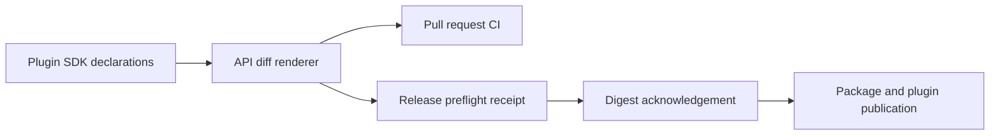

Codex review: needs maintainer review before merge. _Reviewed August 13, 2026, 6:05 AM ET / 10:05 UTC._

# ClawSweeper review

## What this changes

Replaces committed Plugin SDK API baseline records with base-to-head declaration diffs and adds a digest acknowledgement to release publication workflows when that API changes.

## Merge readiness

⚠️ **Needs maintainer review before merge - 3 items remain**

Keep open for maintainer merge handling. The proposed replacement is still absent from current main, but the exact PR head could not be hydrated locally and current GitHub status has unresolved failures, so this review cannot certify the merge result.

**Priority:** P2
**Reviewed head:** `942858f35c30e887f12de8ebdd871adf45f27ffe`

## Review scores

| Measure | Result | What it means |
|---|---|---|
| **Overall readiness** | 🦐 gold shrimp **(3/6)** | The PR has strong submitted proof and no supported code finding, but current failed checks and unavailable exact-head source prevent a higher-confidence merge rating. |
| **Proof confidence** | 🦞 diamond lobster **(5/6)** | Sufficient (logs): The PR body and exact-head maintainer comment provide after-fix release-path output, acknowledgement rejection coverage, and focused CI evidence. |
| **Patch quality** | 🐚 platinum hermit **(4/6)** | No actionable review findings were identified. |

## Verification

| Check | Result | Evidence |
|---|---|---|
| **Real behavior** | Verified | Sufficient (logs): The PR body and exact-head maintainer comment provide after-fix release-path output, acknowledgement rejection coverage, and focused CI evidence. |
| **Evidence reviewed** | 6 items | Current main still uses committed baselines: Current main retains the check and generation commands, so the requested base/head diff behavior is not already implemented. Current owner paths: The existing generated-baseline check is selected by changed-file logic and CI, which the submitted patch replaces alongside its caller tests. Existing release trust boundary: Current release workflows already pin trusted validation tooling to workflow SHA and bind preflight manifests to tag, release SHA, dist-tag, and tarball digest; the PR extends this boundary with SDK evidence. |
| **Findings** | None | None. |
| **Security** | None | None. |

## How this fits together

Plugin SDK declarations define the public contract consumed by plugins. CI reports contract changes for pull requests, while release workflows preserve reviewed evidence before publishing OpenClaw packages and plugins.

## Before merge

- [ ] **Resolve merge risk (P1)** - Current status includes failed check-dependencies, checks-ui, and openclaw/ci-gate runs; publication workflow changes should not land until the merge result has green exact-head checks or each failure is conclusively classified.
- [ ] **Resolve merge risk (P1)** - The review checkout cannot read the submitted head because promisor hydration failed on GitHub DNS, limiting independent source and history verification to current main plus the supplied PR evidence.
- [ ] **Complete next step (P2)** - A protected maintainer PR with release workflow changes needs exact merge-result validation; no narrow automated repair is established.

<strong>Agent review details</strong>

### Security

None.

### Review metrics

| Metric | Value | Why it matters |
|---|---|---|
| **Production/test LOC visibility** | reported total +2,384/-868; visible test files +743/-257; production split unavailable | The supplied file list is truncated and the local checkout cannot hydrate the PR head, so a trustworthy full production-versus-test split is not available. |
| **Release acknowledgement surface** | 2 workflow-dispatch inputs added | Both npm preflight and canonical publish routing must enforce the same reviewed digest. |

### Stored data model

Persistent data-model change detected: `serialized state: test/scripts/plugin-sdk-api-release-evidence.test.ts`, `unknown-truncated-pull-files`, `vector/embedding metadata: .agents/skills/release-openclaw-maintainer/references/extended-stable-backports.md`, `vector/embedding metadata: scripts/check-changed.mts`, `vector/embedding metadata: scripts/generate-plugin-sdk-api-baseline.ts`, `vector/embedding metadata: scripts/release-preflight.mts`, and 2 more. Confirm migration or upgrade compatibility proof before merge.

### Merge-risk options

**Maintainer options:**
1. **Refresh release-gate proof on the merge result (recommended)**  
   Validate the current mergeable result against main and require green or explicitly resolved exact-head checks before landing the SDK publication gate.

### Technical review

Best possible solution:

Validate the clean GitHub merge result against current main, resolve or classify the three failed checks, and retain one fail-closed acknowledgement path shared by every publication route.

Do we have a high-confidence way to reproduce the issue?

Not applicable as an end-user bug report. The PR documents a controlled baseline-conflict reproduction, but this review could not rerun it because the exact head is unavailable locally.

Is this the best way to solve the issue?

Unclear: the supplied patch appears to replace all current baseline owner paths and preserve intentional-change review at publication, but the exact submitted source could not be independently read.

AGENTS.md: found and applied where relevant.

Codex review notes: model internal, reasoning high; reviewed against [7a7f6dfbd41e](https://github.com/openclaw/openclaw/commit/7a7f6dfbd41eeaa3d87e87368945a767fe5be144).

### Labels

Label changes:

- add `rating: 🦐 gold shrimp`: Overall readiness is 🦐 gold shrimp; proof is 🦞 diamond lobster and patch quality is 🐚 platinum hermit.
- remove `rating: 🐚 platinum hermit`: Current PR rating is `rating: 🦐 gold shrimp`, so this older rating label is no longer current.

Label justifications:

- `P2`: This changes bounded Plugin SDK review and release automation behavior without evidence of an active user-facing outage.
- `merge-risk: 🚨 compatibility`: A Plugin SDK API change now requires a publication-time acknowledgement, affecting release-operator behavior for public plugin contracts.
- `merge-risk: 🚨 automation`: The PR changes CI selection and both release publication workflows.
- `rating: 🦐 gold shrimp`: Overall readiness is 🦐 gold shrimp; proof is 🦞 diamond lobster and patch quality is 🐚 platinum hermit.
- `status: 👀 ready for maintainer look`: ClawSweeper has no concrete contributor-facing blocker left for this PR. Sufficient (logs): The PR body and exact-head maintainer comment provide after-fix release-path output, acknowledgement rejection coverage, and focused CI evidence.
- `proof: sufficient`: Contributor real behavior proof is sufficient. The PR body and exact-head maintainer comment provide after-fix release-path output, acknowledgement rejection coverage, and focused CI evidence.

### Evidence

What I checked:

- **Current main still uses committed baselines:** Current main retains the check and generation commands, so the requested base/head diff behavior is not already implemented. ([`package.json:1680`](https://github.com/openclaw/openclaw/blob/7a7f6dfbd41e/package.json#L1680), [7a7f6dfbd41e](https://github.com/openclaw/openclaw/commit/7a7f6dfbd41e))
- **Current owner paths:** The existing generated-baseline check is selected by changed-file logic and CI, which the submitted patch replaces alongside its caller tests. ([`scripts/check-changed.mts:677`](https://github.com/openclaw/openclaw/blob/7a7f6dfbd41e/scripts/check-changed.mts#L677), [7a7f6dfbd41e](https://github.com/openclaw/openclaw/commit/7a7f6dfbd41e))
- **Existing release trust boundary:** Current release workflows already pin trusted validation tooling to workflow SHA and bind preflight manifests to tag, release SHA, dist-tag, and tarball digest; the PR extends this boundary with SDK evidence. ([`.github/workflows/openclaw-npm-release.yml:884`](https://github.com/openclaw/openclaw/blob/7a7f6dfbd41e/.github/workflows/openclaw-npm-release.yml#L884), [7a7f6dfbd41e](https://github.com/openclaw/openclaw/commit/7a7f6dfbd41e))
- **History and likely ownership:** The locally available history attributes the current baseline and release surfaces to the current main ancestry, but shallow/promisor history prevents a deeper feature-history trace. ([`src/plugin-sdk/api-baseline.ts:1`](https://github.com/openclaw/openclaw/blob/06600e2ca09f/src/plugin-sdk/api-baseline.ts#L1), [06600e2ca09f](https://github.com/openclaw/openclaw/commit/06600e2ca09f))
- **Exact-head maintainer evidence:** The supplied PR discussion records exact-head release-gate inspection and focused-suite results for 942858f35c30e887f12de8ebdd871adf45f27ffe, including acknowledgement rejection and trusted-workflow binding. ([942858f35c30](https://github.com/openclaw/openclaw/commit/942858f35c30))
- **Inspection limitation and release state:** The local partial clone lacks the submitted head; Git attempted a promisor fetch but GitHub DNS resolution failed. The supplied latest release is v2026.7.1-2 at 0790d9f593ad30c940ed93b5872a8cf6d6f3cf8c, so this unmerged PR is not shipped. ([942858f35c30](https://github.com/openclaw/openclaw/commit/942858f35c30))

Likely related people:

- **steipete:** Authored the prior merged baseline partitioning work and supplied the exact-head review of this PR's release acknowledgement path. (role: related feature author and release-gate reviewer; confidence: high; commits: [d1452fb5d123](https://github.com/openclaw/openclaw/commit/d1452fb5d1237047025e4136c18b6c214e694485); files: `src/plugin-sdk/api-baseline.ts`, `.github/workflows/openclaw-npm-release.yml`)
- **joshavant:** The available shallow history attributes the currently checked baseline and release surfaces to this current-main commit. (role: recent current-main contributor; confidence: low; commits: [06600e2ca09f](https://github.com/openclaw/openclaw/commit/06600e2ca09f33810c096f80b1ac20f0577b48a9); files: `src/plugin-sdk/api-baseline.ts`, `.github/workflows/openclaw-npm-release.yml`, `scripts/release-preflight.mts`)

### Rank-up moves

Optional improvements that raise the rating; they are not merge blockers.

- Refresh the merge-result CI and resolve or classify check-dependencies, checks-ui, and openclaw/ci-gate before merge.

### Rating scale

| Score | Internal tier | Crab rank | Meaning |
|---:|:---:|---|---|
| **6/6** | S | 🦀 challenger crab | Exceptional readiness |
| **5/6** | A | 🦞 diamond lobster | Very strong readiness |
| **4/6** | B | 🐚 platinum hermit | Good normal PR; ordinary maintainer review |
| **3/6** | C | 🦐 gold shrimp | Useful, but confidence is limited |
| **2/6** | D | 🦪 silver shellfish | Proof or implementation needs work |
| **1/6** | F | 🧂 unranked krab | Not merge-ready |
| N/A | NA | 🌊 off-meta tidepool | Rating does not apply |

Overall follows the weaker of proof and patch quality.
Shiny media proof means a screenshot, video, or linked artifact directly shows the changed behavior. Runtime, network, CSP, and security claims still need visible diagnostics.

### Workflow

- ClawSweeper keeps one durable marker-backed review comment per issue or PR.
- Re-runs edit this comment so the latest verdict, findings, and automation markers stay together instead of adding duplicate bot comments.
- A fresh review can be triggered by eligible `@clawsweeper re-review` comments, exact-item GitHub events, scheduled/background review runs, or manual workflow dispatch.
- PR/issue authors and users with repository write access can comment `@clawsweeper re-review` or `@clawsweeper re-run` on an open PR or issue to request a fresh review only.
- Maintainers can also comment `@clawsweeper review` to request a fresh review only.
- Fresh-review commands do not start repair, autofix, rebase, CI repair, or automerge.
- Maintainer-only repair and merge flows require explicit commands such as `@clawsweeper autofix`, `@clawsweeper automerge`, `@clawsweeper fix ci`, or `@clawsweeper address review`.
- Maintainers can comment `@clawsweeper explain` to ask for more context, or `@clawsweeper stop` to stop active automation.

### History

Review history (3 earlier review cycles)

<!-- clawsweeper-review-history v=1 total=3 -->
- reviewed 2026-08-13T07:13:31.813Z sha c347fbd705fa5679c64665a9e41e09bb7c3df239 :: needs changes before merge. :: [P1] Require acknowledgement when the SDK diff is nonempty
- reviewed 2026-08-13T07:21:40.720Z sha c347fbd705fa5679c64665a9e41e09bb7c3df239 :: needs maintainer review before merge. :: none
- reviewed 2026-08-13T09:14:37.949Z sha 39cfbda982683e322c9a25fddf7d8591a4d08c67 :: needs maintainer review before merge. :: none

<!-- clawsweeper-verdict:needs-human item=123036 sha=942858f35c30e887f12de8ebdd871adf45f27ffe confidence=medium updated_at=2026-08-13T10:02:01Z reviewed_at=2026-08-13T10:05:18.317Z lease_owner=github-run-31689187566-1 lease_comment_id=5278850829 source_revision=c98db425d949d05a7aac3b1febe982105158e288c3dadf2025962a3dcb7ffada -->

<!-- clawsweeper-review-version item=123036 reviewed_at=2026-08-13T10:05:18.317Z sha=942858f35c30e887f12de8ebdd871adf45f27ffe source_revision=c98db425d949d05a7aac3b1febe982105158e288c3dadf2025962a3dcb7ffada lease_owner=github-run-31689187566-1 lease_comment_id=5278850829 v=1 -->

<!-- clawsweeper-review item=123036 -->