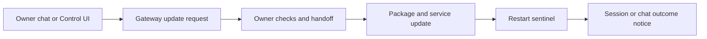

Codex review: blocked before merge. _Reviewed September 3, 2026, 2:42 AM ET / 06:42 UTC._

# ClawSweeper review

## What this changes

The branch restores owner-gated chat updates, hands managed updates to a detached service helper, and adds update acknowledgements and restart outcomes for chat and Control UI sessions.

## Regression provenance

Possible regression — suspected (reviewed change). No predecessor PR is attributed.

## Merge readiness

⛔ **Blocked before merge - 8 items remain**

Keep open: the managed update helper can execute a chat-authorized update after that sender has been removed as an owner; the PR also documents a session-less notice fallback the runtime explicitly forbids.

**Priority:** P1
**Reviewed head:** `9ffb71beff6c4e288858dc9f7ff1665b9c32c7cd`

## Review scores

| Measure | Result | What it means |
|---|---|---|
| **Overall readiness** | 🦐 gold shrimp **(3/6)** | The branch has focused coverage and substantial repair work, but a high-impact successor authority gap and a documentation mismatch remain. |
| **Proof confidence** | 🦐 gold shrimp **(3/6)** | Not applicable: Real behavior proof is not required for maintainer- or bot-authored pull requests. |
| **Patch quality** | 🦐 gold shrimp **(3/6)** | Security review found an item that needs attention. |

## Verification

| Check | Result | Evidence |
|---|---|---|
| **Real behavior** | Not applicable | Not applicable: Real behavior proof is not required for maintainer- or bot-authored pull requests. |
| **Evidence reviewed** | 9 items | Chat update authority enters the Gateway from admitted caller identity: The tool creates requester and delivery data from the admitted caller rather than model-authored destinations, then invokes update.run.<br>Parent-side recheck stops before helper creation only: The handler rechecks after the asynchronous acknowledgement immediately before startManagedServiceUpdateHandoff, but the delegated helper continues after the parent exits.<br>Detached helper has no requester or authority predicate: ManagedServiceUpdateHandoffParams and serialized helper parameters carry lifecycle/recovery data but neither requester identity nor a current-owner predicate. |
| **Findings** | 2 actionable findings | [P1] Revalidate chat ownership in the detached update helper<br>[P2] Document only the implemented session-less notice route |
| **Security** | Needs attention | Detached helper does not revalidate revocable owner authority: The helper receives no requester binding and launches the update after asynchronous parent-exit and service-stop work, allowing a sender whose ownership was revoked after acknowledgement to retain authority. |

## How this fits together

An owner request from chat or the Control UI enters the Gateway update handler, which may hand package and service work to a detached helper. After restart, the sentinel records and delivers the outcome to the initiating session or an eligible system route.



## Before merge

- [ ] **Revalidate chat ownership in the detached update helper (P1)** - The post-ack check at this call site only authorizes creation of the helper. After the parent exits, the helper waits through service-stop work and launches the update command without carrying a requester or consulting current owner configuration. A sender removed from `commands.ownerAllowFrom` during that interval can still cause package and service mutation. Carry a minimal requester binding into the helper, recheck it immediately before command launch, record a cancelled outcome, and add a helper-race regression test.
- [ ] **Document only the implemented session-less notice route (P2)** - These lines promise a fallback to the most recently used eligible direct chat, but session-less recovery unconditionally chooses the system main session and the regression test asserts that restriction. Remove the recent-chat fallback claim; implementing it would need separate routing and authorization review.
- [ ] **Resolve security concern: Detached helper does not revalidate revocable owner authority** - The helper receives no requester binding and launches the update after asynchronous parent-exit and service-stop work, allowing a sender whose ownership was revoked after acknowledgement to retain authority.
- [ ] **Resolve merge risk (P1)** - A sender removed from commands.ownerAllowFrom while the detached helper is waiting can still cause package and managed-service mutation.
- [ ] **Resolve merge risk (P1)** - The public update guide promises delivery to a recent direct chat even though session-less recovery intentionally never selects one.
- [ ] **Resolve merge risk (P1)** - Reported net production growth is substantial for a repair branch and includes an authorization boundary; the successor check should reuse the existing owner predicate rather than add a parallel update path.
- [ ] **Complete next step (P2)** - Add successor-time owner revalidation with a delayed-revocation test, then correct the session-less notice fallback documentation before merge.
- [ ] **Review config compatibility** - Confirm compatibility and upgrade impact for the changed config or default surface before merge.

## Findings

- [P1] Revalidate chat ownership in the detached update helper — `src/gateway/server-methods/update.ts:449-460`
- [P2] Document only the implemented session-less notice route — `docs/install/updating.md:472-477`
- [high] Detached helper does not revalidate revocable owner authority — `src/infra/update-managed-service-handoff.ts:1269`


<details>
<summary><strong>Agent review details</strong></summary>

### Security

Needs attention: The delegated managed-update path loses revocable chat-owner authorization before its final package and service side effect.

### PR surface

Source +350, Tests +1313, Docs +27, Other +4. Total +1694 across 63 files.

<details>
<summary>View PR surface stats</summary>

| Area | Files | Added | Removed | Net |
|---|---:|---:|---:|---:|
| Source | 33 | 775 | 425 | +350 |
| Tests | 25 | 1929 | 616 | +1313 |
| Docs | 4 | 32 | 5 | +27 |
| Config | 0 | 0 | 0 | 0 |
| Generated | 0 | 0 | 0 | 0 |
| Other | 1 | 4 | 0 | +4 |
| **Total** | **63** | **2740** | **1046** | **+1694** |

</details>

### Review metrics

| Metric | Value | Why it matters |
|---|---|---|
| **Production versus test growth** | reported: production +318 net, tests/support +1,133 net, docs +27 net, generated Swift +4 | The branch adds several update and authorization paths, so the successor authority repair should remain narrowly integrated with the existing owner check. |

### Mantis proof suggestion

A redacted Control UI chat/session capture would materially verify the claimed acknowledgement and post-restart outcome path, though it cannot replace the helper-race regression. A maintainer can ask Mantis to capture proof by posting this exact PR comment:

```text
@openclaw-mantis verify that a Control UI-initiated Gateway update shows its acknowledgement and post-restart outcome in the same active session, and return redacted screenshots and transcript evidence.
```

### Merge-risk options

**Maintainer options:**
1. **Revalidate in the detached helper (recommended)**  
   Carry the authorized external requester into the helper and fail closed if current owner configuration no longer permits that sender immediately before command launch.
2. **Pause the chat-update handoff**  
   Keep this branch unmerged until successor-time revocation has a boundary-level regression test, because the helper can mutate packages and services after the parent exits.

### Technical review

Best possible solution:

Carry a minimal revocable requester binding into the successor and recheck it immediately before launching the update command, then correct the guide to describe only the system-main-session route.

Do we have a high-confidence way to reproduce the issue?

Yes, source-reproducible: begin a managed chat update, change commands.ownerAllowFrom after helper readiness or parent exit, then observe the helper still invoke the update command; this read-only review did not execute it.

Is this the best way to solve the issue?

No: parent-side acknowledgement rechecks are insufficient because the detached successor performs the final mutation later without a revocable requester check.

Full review comments:

- [P1] Revalidate chat ownership in the detached update helper — `src/gateway/server-methods/update.ts:449-460`
  The post-ack check at this call site only authorizes creation of the helper. After the parent exits, the helper waits through service-stop work and launches the update command without carrying a requester or consulting current owner configuration. A sender removed from `commands.ownerAllowFrom` during that interval can still cause package and service mutation. Carry a minimal requester binding into the helper, recheck it immediately before command launch, record a cancelled outcome, and add a helper-race regression test.
  Confidence: 0.96
- [P2] Document only the implemented session-less notice route — `docs/install/updating.md:472-477`
  These lines promise a fallback to the most recently used eligible direct chat, but session-less recovery unconditionally chooses the system main session and the regression test asserts that restriction. Remove the recent-chat fallback claim; implementing it would need separate routing and authorization review.
  Confidence: 0.99

Overall correctness: patch is incorrect
Overall confidence: 0.96

AGENTS.md: found and applied where relevant.

Codex review notes: model internal, reasoning high; reviewed against [8327d559a3bc](https://github.com/openclaw/openclaw/commit/8327d559a3bcc0295a0973c0402111a25f49dca0).

### Labels

Label justifications:

- `P1`: A revoked external chat sender can still trigger an update that may stop and replace a managed Gateway installation.
- `merge-risk: 🚨 security-boundary`: The PR transfers a chat-authorized operation across process lifetime without revalidating revocable owner authority at the successor effect.
- `merge-risk: 🚨 availability`: The delegated operation performs package and managed-service lifecycle work, so an unauthorized delayed update can disrupt a running Gateway.
- `rating: 🦐 gold shrimp`: Overall readiness is 🦐 gold shrimp; proof is 🦐 gold shrimp and patch quality is 🦐 gold shrimp.
- `status: ⏳ waiting on author`: ClawSweeper has contributor-facing work open and is waiting for author action. Not applicable: Real behavior proof is not required for maintainer- or bot-authored pull requests.
- `proof: telegram-e2e`: This PR needs Telegram Test Server proof with the repository E2E skill. The PR changes owner-gated /update acknowledgement and restart outcome behavior that is visible in Telegram chats, while Test Server event proof is not supplied.

### Evidence

Security concerns:

- [high] Detached helper does not revalidate revocable owner authority — `src/infra/update-managed-service-handoff.ts:1269`
  The helper receives no requester binding and launches the update after asynchronous parent-exit and service-stop work, allowing a sender whose ownership was revoked after acknowledgement to retain authority.
  Confidence: 0.96

Acceptance criteria:

- [P1] Add a managed-handoff test that revokes or reassigns ownership after helper readiness and parent exit but before command launch, asserting no updater or service mutation.
- [P1] Run the focused Gateway update-owner and managed-handoff suites, plus the restart-sentinel notice tests.
- [P1] Use Telegram Test Server proof for the visible /update acknowledgement and outcome after the final head is built.

What I checked:

- **Chat update authority enters the Gateway from admitted caller identity:** The tool creates requester and delivery data from the admitted caller rather than model-authored destinations, then invokes update.run. ([`src/agents/tools/gateway-tool.ts:143`](https://github.com/openclaw/openclaw/blob/9ffb71beff6c4e288858dc9f7ff1665b9c32c7cd/src/agents/tools/gateway-tool.ts#L143), [9ffb71beff6c](https://github.com/openclaw/openclaw/commit/9ffb71beff6c4e288858dc9f7ff1665b9c32c7cd))
- **Parent-side recheck stops before helper creation only:** The handler rechecks after the asynchronous acknowledgement immediately before startManagedServiceUpdateHandoff, but the delegated helper continues after the parent exits. ([`src/gateway/server-methods/update.ts:438`](https://github.com/openclaw/openclaw/blob/9ffb71beff6c4e288858dc9f7ff1665b9c32c7cd/src/gateway/server-methods/update.ts#L438), [9ffb71beff6c](https://github.com/openclaw/openclaw/commit/9ffb71beff6c4e288858dc9f7ff1665b9c32c7cd))
- **Detached helper has no requester or authority predicate:** ManagedServiceUpdateHandoffParams and serialized helper parameters carry lifecycle/recovery data but neither requester identity nor a current-owner predicate. ([`src/infra/update-managed-service-handoff.ts:1336`](https://github.com/openclaw/openclaw/blob/9ffb71beff6c4e288858dc9f7ff1665b9c32c7cd/src/infra/update-managed-service-handoff.ts#L1336), [9ffb71beff6c](https://github.com/openclaw/openclaw/commit/9ffb71beff6c4e288858dc9f7ff1665b9c32c7cd))
- **Helper starts mutation after parent-side authorization window:** After waiting for parent exit and service-stop state, the helper invokes the update command; its lease check establishes helper lifecycle ownership, not chat-owner authorization. ([`src/infra/update-managed-service-handoff.ts:1269`](https://github.com/openclaw/openclaw/blob/9ffb71beff6c4e288858dc9f7ff1665b9c32c7cd/src/infra/update-managed-service-handoff.ts#L1269), [9ffb71beff6c](https://github.com/openclaw/openclaw/commit/9ffb71beff6c4e288858dc9f7ff1665b9c32c7cd))
- **Existing revocation test does not cover successor-time revocation:** The test changes owner configuration while acknowledgement delivery is awaited and confirms no helper starts; it mocks the helper and therefore cannot exercise revocation after handoff readiness or parent exit. ([`src/gateway/server-methods/update-owner.test.ts:92`](https://github.com/openclaw/openclaw/blob/9ffb71beff6c4e288858dc9f7ff1665b9c32c7cd/src/gateway/server-methods/update-owner.test.ts#L92), [9ffb71beff6c](https://github.com/openclaw/openclaw/commit/9ffb71beff6c4e288858dc9f7ff1665b9c32c7cd))
- **Session-less documentation promises an unimplemented fallback:** The added documentation says notice delivery falls back to the most recently used eligible direct chat. Public docs: [`docs/install/updating.md`](https://docs.openclaw.ai/install/updating). ([`docs/install/updating.md:472`](https://docs.openclaw.ai/install/updating), [0e915410061d](https://github.com/openclaw/openclaw/commit/0e915410061d240f7e7e583bacdbdfcbaa627a6e))

Likely related people:

- **steipete:** Suggested for follow-up; no historical authorship or introduction is verified. (role: unverified routing candidate; confidence: low)

### Rank-up moves

Optional improvements that raise the rating; they are not merge blockers.

- Revalidate the external requester immediately before the helper launches its update command and add the delayed-revocation regression.
- Correct the session-less notice documentation to match the system-main-only implementation.
- Provide final-head proof for the detached-helper revocation race and the visible Telegram update outcome.

### Rating scale

| Score | Internal tier | Crab rank | Meaning |
|---:|:---:|---|---|
| **6/6** | S | 🦀 challenger crab | Exceptional readiness |
| **5/6** | A | 🦞 diamond lobster | Very strong readiness |
| **4/6** | B | 🐚 platinum hermit | Good normal PR; ordinary maintainer review |
| **3/6** | C | 🦐 gold shrimp | Useful, but confidence is limited |
| **2/6** | D | 🦪 silver shellfish | Proof or implementation needs work |
| **1/6** | F | 🧂 unranked krab | Not merge-ready |
| N/A | NA | 🌊 off-meta tidepool | Rating does not apply |

Overall follows the weaker of proof and patch quality.
Shiny media proof means a screenshot, video, or linked artifact directly shows the changed behavior. Runtime, network, CSP, and security claims still need visible diagnostics.

### Workflow

- ClawSweeper keeps one durable marker-backed review comment per issue or PR.
- Re-runs edit this comment so the latest verdict, findings, and automation markers stay together instead of adding duplicate bot comments.
- A fresh review can be triggered by eligible `@clawsweeper re-review` comments, exact-item GitHub events, scheduled/background review runs, or manual workflow dispatch.
- PR/issue authors and users with repository write access can comment `@clawsweeper re-review` or `@clawsweeper re-run` on an open PR or issue to request a fresh review only.
- Maintainers can also comment `@clawsweeper review` to request a fresh review only.
- Fresh-review commands do not start repair, autofix, rebase, CI repair, or automerge.
- Maintainer-only repair and merge flows require explicit commands such as `@clawsweeper autofix`, `@clawsweeper automerge`, `@clawsweeper fix ci`, or `@clawsweeper address review`.
- Maintainers can comment `@clawsweeper explain` to ask for more context, or `@clawsweeper stop` to stop active automation.

### History

<details>
<summary>Review history (12 earlier review cycles; latest 8 shown)</summary>

<!-- clawsweeper-review-history v=1 total=12 -->
- reviewed 2026-09-02T23:30:51.059Z sha 0c648e4693083053f54f70f4482deb6d49c1d7f8 :: needs real behavior proof before merge. :: [P1] Revalidate live owner authority before synthetic update dispatch | [P1] Keep sessionless fallback wakes in the system-agent session | [P1] Do not settle restart health without a concrete runtime PID
- reviewed 2026-09-02T23:45:07.142Z sha 0c648e4693083053f54f70f4482deb6d49c1d7f8 :: needs real behavior proof before merge. :: [P1] Revalidate owner authority before starting the update | [P1] Keep fallback wakes in the system-agent session | [P1] Require a runtime PID before settling managed restart health
- reviewed 2026-09-03T00:23:38.741Z sha 0c648e4693083053f54f70f4482deb6d49c1d7f8 :: needs real behavior proof before merge. :: [P1] Revalidate live owner authority before update dispatch | [P1] Keep fallback system wakes in the system-agent session | [P1] Do not settle recovery without a concrete runtime PID
- reviewed 2026-09-03T01:17:08.287Z sha a52d83f9c4c83e687c0e11e81ded0458ec87a679 :: blocked before merge. :: [P1] Require a concrete PID before settling restart health | [P2] Document the actual sessionless notice fallback
- reviewed 2026-09-03T01:47:58.817Z sha 9d5b5133c8f3ddfab4681f2bcdaf0fa6c1170ff9 :: blocked before merge. :: [P2] Document the actual session-less fallback
- reviewed 2026-09-03T02:52:06.576Z sha a44bbe7f621dded39976710034371614e16bc7a2 :: blocked before merge. :: [P2] Correct the session-less fallback documentation
- reviewed 2026-09-03T03:58:33.268Z sha a44bbe7f621dded39976710034371614e16bc7a2 :: blocked before merge. :: [P1] Revalidate ownership after managed-handoff startup | [P2] Correct the session-less fallback documentation
- reviewed 2026-09-03T05:55:45.185Z sha 63581c7227671454dbf9a27ca791764dc1804ee4 :: needs real behavior proof before merge. :: [P1] Revalidate owner authority after the handoff awaits | [P2] Document only the implemented session-less notice route

</details>

</details>

<!-- clawsweeper-security:security-sensitive item=136588 sha=9ffb71beff6c4e288858dc9f7ff1665b9c32c7cd confidence=high updated_at=2026-09-03T06:35:56Z reviewed_at=2026-09-03T06:42:09.410Z lease_owner=github-run-33723777857-1 lease_comment_id=5521605710 source_revision=82a1c83f408dc59cea555091413a641f6bc3b8622379298f3b7a385ee520dbe9 live_verification=absent -->
<!-- clawsweeper-verdict:needs-human item=136588 sha=9ffb71beff6c4e288858dc9f7ff1665b9c32c7cd confidence=high updated_at=2026-09-03T06:35:56Z reviewed_at=2026-09-03T06:42:09.410Z lease_owner=github-run-33723777857-1 lease_comment_id=5521605710 source_revision=82a1c83f408dc59cea555091413a641f6bc3b8622379298f3b7a385ee520dbe9 live_verification=absent -->
<!-- clawsweeper-review-state:blocked item=136588 sha=9ffb71beff6c4e288858dc9f7ff1665b9c32c7cd v=1 -->

<!-- clawsweeper-review-version item=136588 reviewed_at=2026-09-03T06:42:09.410Z sha=9ffb71beff6c4e288858dc9f7ff1665b9c32c7cd source_revision=82a1c83f408dc59cea555091413a641f6bc3b8622379298f3b7a385ee520dbe9 lease_owner=github-run-33723777857-1 lease_comment_id=5521605710 v=1 -->

<!-- clawsweeper-review item=136588 -->