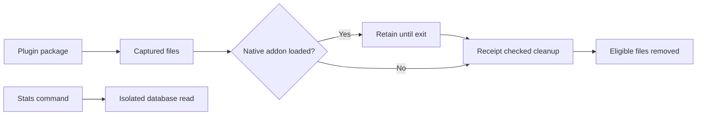

Codex review: blocked before merge. _Reviewed September 26, 2026, 2:17 PM ET / 18:17 UTC (Revision 5)._

# ClawSweeper review

## What this changes

The branch retains captured plugin files while native addons are loaded, adds startup cleanup of eligible captures, and runs LanceDB memory statistics in an isolated reader with a 60-second deadline.

## Regression provenance

Possible regression — suspected (reviewed change). No predecessor PR is attributed.

## Merge readiness

⛔ **Blocked before merge - 4 items remain**

Keep open. Current main still lacks the reported Windows capture and bounded-statistics fixes, and the PR has strong Windows evidence. The previously reported ordinary CLI lock-contention defect remains, and startup reclamation still needs existing-state upgrade proof.

**Priority:** P1
**Reviewed head:** `6b4937b24146c5c11198aa8278b67fab09ba5abc`

## Review scores

| Measure | Result | What it means |
|---|---|---|
| **Overall readiness** | 🦐 gold shrimp **(3/6)** | Strong native Windows and CLI evidence supports a useful repair, while a reproducible CLI warning and missing existing-state upgrade proof limit readiness. |
| **Proof confidence** | 🦞 diamond lobster **(5/6)** | Sufficient (live_output): The changed capture owner maps to the reported real Windows LanceDB addon: the captured evidence reports EPERM before retention, then one retention fact and successful next-startup reclamation; an exact-head Windows replay succeeded. A packaged CLI run reported zero without creating a table, and production-runner child-process tests exercise stalled connect and count cancellation. Raw run logs were unavailable to this reviewer, but the detailed captured evidence remains sufficient. Persistent capture retention changes still lack a published-updater existing-state upgrade cell, so data-model compatibility proof is insufficient. |
| **Patch quality** | 🦐 gold shrimp **(3/6)** | 1 actionable review finding remain. |

## Verification

| Check | Result | Evidence |
|---|---|---|
| **Real behavior** | Verified | Sufficient (live_output): The changed capture owner maps to the reported real Windows LanceDB addon: the captured evidence reports EPERM before retention, then one retention fact and successful next-startup reclamation; an exact-head Windows replay succeeded. A packaged CLI run reported zero without creating a table, and production-runner child-process tests exercise stalled connect and count cancellation. Raw run logs were unavailable to this reviewer, but the detailed captured evidence remains sufficient. Persistent capture retention changes still lack a published-updater existing-state upgrade cell, so data-model compatibility proof is insufficient. |
| **Evidence reviewed** | 8 items | Current main still has the reported paths: At the fetched main revision, the stats command still calls the in-process count, and capture disposal still removes the directory without the branch's native-load retention check. Introduced CLI contention path: The PR adds capture cleanup to valid non-Gateway preflight, including ordinary plugin commands. CLI caller and lock behavior: The CLI config guard sends ordinary plugin commands through non-Gateway preflight. Cleanup then attempts Doctor's exclusive maintenance lock, whose default acquisition deadline is 250 ms, and emits a warning on failure. |
| **Findings** | 1 actionable finding | [P2] Avoid maintenance locking during ordinary plugin CLI preflight |
| **Security** | None | None. |

## How this fits together

OpenClaw captures plugin files before loading them and manages those files across plugin reloads, CLI commands, and Gateway startup. The memory-lancedb plugin reads a LanceDB store to report agent-scoped statistics.

## Before merge

- [ ] **Avoid maintenance locking during ordinary plugin CLI preflight (P2)** - With a live Gateway and an existing capture directory, an ordinary `openclaw plugins` command enters this new non-Gateway cleanup path, waits for Doctor's exclusive lock deadline, and emits a deferred-cleanup warning despite valid configuration. This previously reported finding remains at the reviewed head. Keep immediate reclamation with an owner that can hold maintenance custody, or make expected CLI contention quiet.
- [ ] **Resolve merge risk (P1)** - Startup now reclaims persistent native capture artifacts immediately. A published-updater-to-candidate upgrade with existing installed-index receipts and retired captures has not shown that referenced payloads survive while eligible captures are removed.
- [ ] **Complete next step (P2)** - Fix ordinary plugin CLI maintenance contention and provide a published-updater-to-candidate upgrade result with existing native capture receipts before merge.
- [ ] **Add data-model compatibility proof** - Confirm migration or upgrade compatibility proof before merge.

## Findings

- [P2] Avoid maintenance locking during ordinary plugin CLI preflight — `src/commands/startup-config-preflight.ts:66-68`

<strong>Agent review details</strong>

### Security

None.

### PR surface

Source +230, Tests +501, Docs +19, Config +3. Total +753 across 24 files.

View PR surface stats

| Area | Files | Added | Removed | Net |
|---|---:|---:|---:|---:|
| Source | 10 | 269 | 39 | +230 |
| Tests | 11 | 714 | 213 | +501 |
| Docs | 2 | 22 | 3 | +19 |
| Config | 1 | 4 | 1 | +3 |
| Generated | 0 | 0 | 0 | 0 |
| Other | 0 | 0 | 0 | 0 |
| **Total** | **24** | **1009** | **256** | **+753** |

### Review metrics

| Metric | Value | Why it matters |
|---|---|---|
| **Production versus test growth** | production net +230; tests and support net +501 | The PR body attributes production growth to capture custody and the isolated reader; the larger test expansion exercises lifecycle and cancellation behavior. |

### Stored data model

Persistent data-model change detected: `serialized state: extensions/memory-lancedb/memory-stats.ts`, `unknown-data-model-change: extensions/memory-lancedb/memory-stats.ts`, `vector/embedding metadata: extensions/memory-lancedb/index.ts`, `vector/embedding metadata: extensions/memory-lancedb/memory-cli.ts`, `vector/embedding metadata: extensions/memory-lancedb/memory-stats-entrypoint.ts`, `vector/embedding metadata: extensions/memory-lancedb/memory-stats.ts`, and 1 more. Confirm migration or upgrade compatibility proof before merge.

### Root-cause cluster

Relationship: `fixed_by_candidate`
Canonical: https://github.com/openclaw/openclaw/issues/158795
Summary: This PR is the candidate fix for the open Windows capture-cleanup and statistics report; the cited merged changes supply adjacent capture or worker behavior.

Members:
- `canonical`: https://github.com/openclaw/openclaw/issues/158795 - The PR explicitly links the report and addresses both stated symptoms.
- `partial_overlap`: https://github.com/openclaw/openclaw/pull/158414 - Merged native materialization work supplies package-identity reuse but does not resolve mapped-addon cleanup.
- `adjacent_distinct`: https://github.com/openclaw/openclaw/pull/158769 - The merged change repairs missing capture directories, a separate failure.
- `adjacent_distinct`: https://github.com/openclaw/openclaw/pull/158959 - The merged scheduler change owns capture-maintenance timing, which this branch must preserve.

Proposal only: this assessment does not dispatch repair, suppress jobs, mutate sibling items, close, or merge anything.

### Merge-risk options

**Maintainer options:**
1. **Repair CLI contention and prove upgrade (recommended)**  
   Keep routine plugin commands free of expected lock warnings, then exercise the published updater against existing receipts and retired captures before merge.

### Technical review

Best possible solution:

Keep immediate, receipt-aware reclamation with the Gateway startup owner, leave ordinary plugin CLI commands quiet, and preserve referenced native payloads across upgrades.

Do we have a high-confidence way to reproduce the issue?

Yes for the CLI contention path: an ordinary plugin command enters non-Gateway preflight, where a live Gateway prevents the new maintenance lock acquisition. The Windows native-addon behavior has detailed linked before/after evidence, though this read-only review did not execute it.

Is this the best way to solve the issue?

No, not yet. Native capture custody and the isolated statistics reader fit their existing owners, but routine CLI preflight should avoid expected maintenance contention and the existing-state upgrade needs proof.

Full review comments:

- [P2] Avoid maintenance locking during ordinary plugin CLI preflight — `src/commands/startup-config-preflight.ts:66-68`
  With a live Gateway and an existing capture directory, an ordinary `openclaw plugins` command enters this new non-Gateway cleanup path, waits for Doctor's exclusive lock deadline, and emits a deferred-cleanup warning despite valid configuration. This previously reported finding remains at the reviewed head. Keep immediate reclamation with an owner that can hold maintenance custody, or make expected CLI contention quiet.
  Confidence: 0.96

Overall correctness: patch is incorrect
Overall confidence: 0.9

AGENTS.md: found and applied where relevant.

Codex review notes: model internal, reasoning high; reviewed against [df50212501d1](https://github.com/openclaw/openclaw/commit/df50212501d139a38d264f15f2a62b4a2ca501f8).

### Labels

Label changes:

No label changes.

Label justifications:

- `P1`: The linked Windows report describes repeated large stale captures and a statistics command that did not return within 60 seconds.
- `merge-risk: 🚨 compatibility`: Immediate startup reclamation changes the lifecycle of existing captured files whose installed-index receipts must remain authoritative.
- `merge-risk: 🚨 availability`: The introduced ordinary CLI preflight path can wait on a live Gateway's exclusive lock and warn during an otherwise valid plugin command.
- `rating: 🦐 gold shrimp`: Overall readiness is 🦐 gold shrimp; proof is 🦞 diamond lobster and patch quality is 🦐 gold shrimp.
- `status: ⏳ waiting on author`: ClawSweeper has contributor-facing work open and is waiting for author action. Sufficient (live_output): The changed capture owner maps to the reported real Windows LanceDB addon: the captured evidence reports EPERM before retention, then one retention fact and successful next-startup reclamation; an exact-head Windows replay succeeded. A packaged CLI run reported zero without creating a table, and production-runner child-process tests exercise stalled connect and count cancellation. Raw run logs were unavailable to this reviewer, but the detailed captured evidence remains sufficient. Persistent capture retention changes still lack a published-updater existing-state upgrade cell, so data-model compatibility proof is insufficient.
- `proof: sufficient`: Contributor real behavior proof is sufficient. The changed capture owner maps to the reported real Windows LanceDB addon: the captured evidence reports EPERM before retention, then one retention fact and successful next-startup reclamation; an exact-head Windows replay succeeded. A packaged CLI run reported zero without creating a table, and production-runner child-process tests exercise stalled connect and count cancellation. Raw run logs were unavailable to this reviewer, but the detailed captured evidence remains sufficient. Persistent capture retention changes still lack a published-updater existing-state upgrade cell, so data-model compatibility proof is insufficient.

### Evidence

Acceptance criteria:

- [P1] pnpm test src/commands/startup-plugin-source-captures.test.ts --maxWorkers=1.
- [P1] pnpm test src/cli/program/config-guard.test.ts --maxWorkers=1.
- [P1] pnpm test src/plugins/plugin-source-capture-directory.test.ts --maxWorkers=1.
- [P1] node scripts/check-changed.mjs -- src/commands/startup-config-preflight.ts src/commands/startup-plugin-source-captures.ts src/commands/startup-plugin-source-captures.test.ts.

What I checked:

- **Current main still has the reported paths:** At the fetched main revision, the stats command still calls the in-process count, and capture disposal still removes the directory without the branch's native-load retention check. ([`extensions/memory-lancedb/memory-cli.ts:222`](https://github.com/openclaw/openclaw/blob/df50212501d139a38d264f15f2a62b4a2ca501f8/extensions/memory-lancedb/memory-cli.ts#L222), [df50212501d1](https://github.com/openclaw/openclaw/commit/df50212501d139a38d264f15f2a62b4a2ca501f8))
- **Introduced CLI contention path:** The PR adds capture cleanup to valid non-Gateway preflight, including ordinary plugin commands. ([`src/commands/startup-config-preflight.ts:66`](https://github.com/openclaw/openclaw/blob/6b4937b24146c5c11198aa8278b67fab09ba5abc/src/commands/startup-config-preflight.ts#L66), [6b4937b24146](https://github.com/openclaw/openclaw/commit/6b4937b24146c5c11198aa8278b67fab09ba5abc))
- **CLI caller and lock behavior:** The CLI config guard sends ordinary plugin commands through non-Gateway preflight. Cleanup then attempts Doctor's exclusive maintenance lock, whose default acquisition deadline is 250 ms, and emits a warning on failure. ([`src/commands/startup-plugin-source-captures.ts:28`](https://github.com/openclaw/openclaw/blob/6b4937b24146c5c11198aa8278b67fab09ba5abc/src/commands/startup-plugin-source-captures.ts#L28), [6b4937b24146](https://github.com/openclaw/openclaw/commit/6b4937b24146c5c11198aa8278b67fab09ba5abc))
- **Capture retention and receipt check:** The capture owner records native load paths before addon initialization. Startup pruning reads installed-index receipts, checks native custody, and removes unreferenced captures. ([`src/plugins/plugin-source-capture-directory.ts:56`](https://github.com/openclaw/openclaw/blob/6b4937b24146c5c11198aa8278b67fab09ba5abc/src/plugins/plugin-source-capture-directory.ts#L56), [6b4937b24146](https://github.com/openclaw/openclaw/commit/6b4937b24146c5c11198aa8278b67fab09ba5abc))
- **Statistics cancellation boundary:** The new reader opens the existing LanceDB table without creating one and uses the Plugin SDK process runner with a 60-second timeout and process-tree extinction requirement. ([`extensions/memory-lancedb/memory-stats.ts:48`](https://github.com/openclaw/openclaw/blob/6b4937b24146c5c11198aa8278b67fab09ba5abc/extensions/memory-lancedb/memory-stats.ts#L48), [6b4937b24146](https://github.com/openclaw/openclaw/commit/6b4937b24146c5c11198aa8278b67fab09ba5abc))
- **Exact-head Windows validation:** GitHub records a successful Windows replay for the pinned PR head. The captured PR body and linked issue discussion report a real LanceDB addon producing EPERM before retention, one retention fact afterward, and successful next-startup reclamation. This review could inspect run metadata but not its raw log. ([6b4937b24146](https://github.com/openclaw/openclaw/commit/6b4937b24146c5c11198aa8278b67fab09ba5abc))

Likely related people:

- **steipete:** Suggested for follow-up; no historical authorship or introduction is verified. (role: unverified routing candidate; confidence: low)
- **Vyctor H. Brzezowski:** Suggested for follow-up; no historical authorship or introduction is verified. (role: unverified routing candidate; confidence: low)
- **Abi X Renhart:** Suggested for follow-up; no historical authorship or introduction is verified. (role: unverified routing candidate; confidence: low)

### Rank-up moves

Optional improvements that raise the rating; they are not merge blockers.

- Remove expected maintenance contention from ordinary plugin CLI preflight while preserving Gateway startup reclamation.
- Show a published-updater-to-candidate upgrade with referenced and retired native captures.

### Rating scale

| Score | Internal tier | Crab rank | Meaning |
|---:|:---:|---|---|
| **6/6** | S | 🦀 challenger crab | Exceptional readiness |
| **5/6** | A | 🦞 diamond lobster | Very strong readiness |
| **4/6** | B | 🐚 platinum hermit | Good normal PR; ordinary maintainer review |
| **3/6** | C | 🦐 gold shrimp | Useful, but confidence is limited |
| **2/6** | D | 🦪 silver shellfish | Proof or implementation needs work |
| **1/6** | F | 🧂 unranked krab | Not merge-ready |
| N/A | NA | 🌊 off-meta tidepool | Rating does not apply |

Overall follows the weaker of proof and patch quality.
Shiny media proof means a screenshot, video, or linked artifact directly shows the changed behavior. Runtime, network, CSP, and security claims still need visible diagnostics.

### Workflow

- ClawSweeper keeps one durable marker-backed review comment per issue or PR.
- Re-runs edit this comment so the latest verdict, findings, and automation markers stay together instead of adding duplicate bot comments.
- A fresh review can be triggered by eligible `@clawsweeper re-review` comments, exact-item GitHub events, scheduled/background review runs, or manual workflow dispatch.
- PR/issue authors and users with repository write access can comment `@clawsweeper re-review` or `@clawsweeper re-run` on an open PR or issue to request a fresh review only.
- Maintainers can also comment `@clawsweeper review` to request a fresh review only.
- Fresh-review commands do not start repair, autofix, rebase, CI repair, or automerge.
- Maintainer-only repair and merge flows require explicit commands such as `@clawsweeper autofix`, `@clawsweeper automerge`, `@clawsweeper fix ci`, or `@clawsweeper address review`.
- Maintainers can comment `@clawsweeper explain` to ask for more context, or `@clawsweeper stop` to stop active automation.

### History

Review history (4 earlier review cycles)

<!-- clawsweeper-review-history v=1 total=4 -->
- reviewed 2026-09-26T15:00:39.954Z sha 7607cb3894d0273ea7d36f9a4b0d748e8824b121 :: blocked before merge. :: none
- reviewed 2026-09-26T15:16:53.546Z sha 7607cb3894d0273ea7d36f9a4b0d748e8824b121 :: blocked before merge. :: [P2] Skip noisy maintenance attempts from ordinary plugin CLI preflight
- reviewed 2026-09-26T16:56:38.644Z sha 2046a132da2756dfab40b7c8be15fb25dc659432 :: blocked before merge. :: [P2] Skip maintenance contention during ordinary plugin CLI preflight
- reviewed 2026-09-26T18:09:31.821Z sha 6b4937b24146c5c11198aa8278b67fab09ba5abc :: blocked before merge. :: [P2] Skip capture maintenance during ordinary plugin CLI preflight

<!-- clawsweeper-verdict:needs-human item=158950 sha=6b4937b24146c5c11198aa8278b67fab09ba5abc confidence=high updated_at=2026-09-26T18:14:34Z reviewed_at=2026-09-26T18:17:46.917Z lease_owner=github-run-36261721845-1 lease_comment_id=5848648317 source_revision=e7a74e294df4288b13e854c866a96965330555fb47c062bdd07c91c766de094d live_verification=absent -->
<!-- clawsweeper-review-state:blocked item=158950 sha=6b4937b24146c5c11198aa8278b67fab09ba5abc v=1 -->

<!-- clawsweeper-review-version item=158950 reviewed_at=2026-09-26T18:17:46.917Z sha=6b4937b24146c5c11198aa8278b67fab09ba5abc source_revision=e7a74e294df4288b13e854c866a96965330555fb47c062bdd07c91c766de094d lease_owner=github-run-36261721845-1 lease_comment_id=5848648317 v=1 -->

<!-- clawsweeper-review item=158950 -->