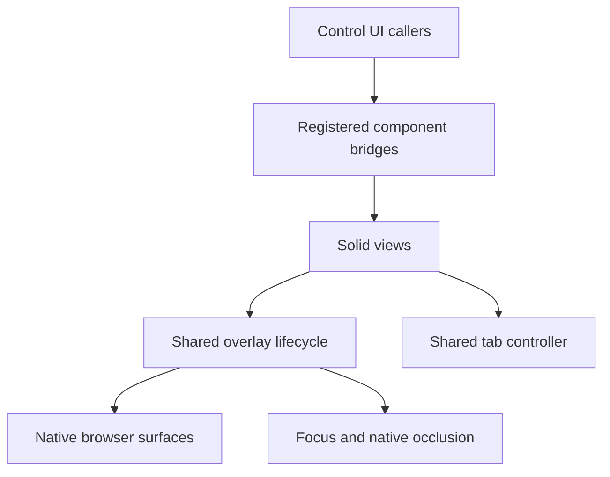

Codex review: needs changes before merge.

## What this changes

This PR moves shared Control UI overlays and tabs to native browser surfaces and Solid while preserving existing interactions.

**Example:** Open the New group dialog.
- **Before:** A Web Awesome dialog displays the focused name field and Create group and Cancel buttons.
- **After:** A native dialog displays the same field, buttons, and appearance through the Solid implementation.

## Review scores

| Measure | Result | What it means |
|---|---|---|
| **Overall readiness** | 🦪 silver shellfish **(2/6)** | Strong visual evidence and successful broad validation support the migration, but the confirmed recovery defect still blocks merge. |
| **Proof confidence** | 🦞 diamond lobster **(5/6)** ✨ media proof bonus | Sufficient (screenshot): Inspected browser captures show the migrated modal, panel tabs, and mobile rich tooltip retaining their appearance; exact-head full CI separately supports keyboard, lifecycle, and consumer coverage. |
| **Patch quality** | 🦪 silver shellfish **(2/6)** | 1 actionable review finding remain. |

## Product

**Kind:** Refactor · **Worth it:** Yes · **Fix scope:** Complete
**User problem:** Existing keyboard navigation, focus, cancellation, and appearance must survive the Control UI's Solid migration.
**Reason:** The recorded owner direction supports replacing renderer-specific primitives with shared native owners while preserving caller contracts.

## Merge readiness

⛔ **Needs changes before merge - 1 item remains**

Keep this maintainer-directed migration open; the previously reported placement-dialog recovery defect remains a merge blocker.

**Priority:** P2
**Reviewed head:** `8d0329c1e7e00163f571b49951db3d92ad9699a8`

## Before merge

- [ ] **Reset placement-dialog reentrancy when modal loading rejects (P2)** - If the first modal-dialog import rejects before registration, this failure path rejects without calling the placement caller's finish callback. showSessionPlacementTargetDialog sets its module-level active flag before calling the helper and clears it only inside finish, so every subsequent move, dispatch, or restart attempt silently resolves null until reload. This previously reported finding remains unchanged at the reviewed head. Clear the caller-owned flag in finally while preserving rejection, and cover failed loading followed by another attempt.

## Findings

- [P2] Reset placement-dialog reentrancy when modal loading rejects — `ui/src/components/promise-modal-host.ts:63-69`

### Tests

- Missing end-to-end proof: Existing loading coverage does not exercise a rejected first modal import followed by a successful second placement-dialog attempt.

<strong>Agent review details</strong>

### How this fits together

Control UI callers pass content and presentation state into shared overlay and tab owners, which manage browser surfaces, keyboard interaction, focus, and native-view occlusion.

### Technical review

Best possible solution:

Retain the shared native migration and release placement-dialog reentrancy on every promise settlement, including loading failure.

Do we have a high-confidence way to reproduce the issue?

Pinned-head source establishes the rejected-import-to-latched-active path; no target code or tests were executed during this read-only review.

Is this the best way to solve the issue?

The shared native owners follow the recorded migration direction; fixing cleanup in the placement caller preserves that ownership without expanding the modal-host API.

Full review comments:

- [P2] Reset placement-dialog reentrancy when modal loading rejects — `ui/src/components/promise-modal-host.ts:63-69`
  If the first modal-dialog import rejects before registration, this failure path rejects without calling the placement caller's finish callback. showSessionPlacementTargetDialog sets its module-level active flag before calling the helper and clears it only inside finish, so every subsequent move, dispatch, or restart attempt silently resolves null until reload. This previously reported finding remains unchanged at the reviewed head. Clear the caller-owned flag in finally while preserving rejection, and cover failed loading followed by another attempt.
  Confidence: 0.99

Overall correctness: patch is incorrect
Overall confidence: 0.97

AGENTS.md: found and applied where relevant.

Codex review notes: model internal, reasoning medium; reviewed against [006e965aa47d](https://github.com/openclaw/openclaw/commit/006e965aa47dca60acb1cd992bc28cb42b9fffe9).

### Provenance checked

- `Modal and tab renderer ownership` changes intended behavior with a stated reason (8590655190d342639b353d97ce182259b55bd27d: https://github.com/openclaw/openclaw/pull/106865 consolidated inconsistent keyboard, focus, and overlay behavior on shared Web Awesome controls.)
- `Shared tooltip policy` keeps the original intent (590c7d65bd0a23eabc2a65ab2fdb6b3d7434c837: https://github.com/openclaw/openclaw/pull/131335 established one tooltip owner for timing, modality, descriptions, pinning, and exclusivity.)
- `Imperative modal host and caller cleanup` keeps the original intent (292b304fd3def2934ffd476a27f810e561b415c0: https://github.com/openclaw/openclaw/pull/140746 centralized host settlement and teardown while deliberately retaining caller-owned reentrancy and dismissal.)
- `Standalone preview isolation` keeps the original intent (8ebf3c8bd3471b1305d85840182b97b138eb2518: https://github.com/openclaw/openclaw/pull/135724 prevented external preview connections and shared-cache interference; the configuration-reuse change retains those isolation plugins.)

### Testing

Proof path: shipped entry point.

### Security

None.

### Evidence

Acceptance criteria:

- pnpm test ui/src/components/session-placement-move-dialog.test.ts ui/src/components/promise-modal-host-loading.test.ts --maxWorkers=1
- pnpm tsgo:ui
- node scripts/check-changed.mjs -- ui/src/components/session-placement-move-dialog.tsx ui/src/components/session-placement-move-dialog.test.ts ui/src/components/promise-modal-host-loading.test.ts

What I checked:

- **Confirmed introduced failure path:** The PR replaces eager modal registration with a lazy import; fail() cleans the host and rejects without invoking caller-owned completion. ([`ui/src/components/promise-modal-host.ts:63`](https://github.com/openclaw/openclaw/blob/8d0329c1e7e00163f571b49951db3d92ad9699a8/ui/src/components/promise-modal-host.ts#L63), [8d0329c1e7e0](https://github.com/openclaw/openclaw/commit/8d0329c1e7e00163f571b49951db3d92ad9699a8))
- **Caller-owned reentrancy remains latched:** The placement caller sets active before requesting the host and clears it only in finish; rejection leaves subsequent placement requests returning null. ([`ui/src/components/session-placement-move-dialog.tsx:59`](https://github.com/openclaw/openclaw/blob/8d0329c1e7e00163f571b49951db3d92ad9699a8/ui/src/components/session-placement-move-dialog.tsx#L59), [8d0329c1e7e0](https://github.com/openclaw/openclaw/commit/8d0329c1e7e00163f571b49951db3d92ad9699a8))
- **Current main still uses the previous renderer:** Fetched main retains the Web Awesome modal implementation and tab groups, so the central migration is still distinct work. ([`ui/src/components/modal-dialog.ts:1`](https://github.com/openclaw/openclaw/blob/006e965aa47dca60acb1cd992bc28cb42b9fffe9/ui/src/components/modal-dialog.ts#L1), [006e965aa47d](https://github.com/openclaw/openclaw/commit/006e965aa47dca60acb1cd992bc28cb42b9fffe9))
- **Inspected visual proof:** Downloaded before/after images show matching New group modal, compact panel tabs, and mobile rich-tooltip presentation. ([8d0329c1e7e0](https://github.com/openclaw/openclaw/commit/8d0329c1e7e00163f571b49951db3d92ad9699a8))
- **Exact-head broad validation:** https://github.com/openclaw/openclaw/actions/runs/38314790101 completed successfully for the reviewed SHA. ([8d0329c1e7e0](https://github.com/openclaw/openclaw/commit/8d0329c1e7e00163f571b49951db3d92ad9699a8))
- **Separate context-check failures:** The inspected PR-context annotations request an authored Evidence section despite the detailed Proof section; they report no runtime test failure. ([8d0329c1e7e0](https://github.com/openclaw/openclaw/commit/8d0329c1e7e00163f571b49951db3d92ad9699a8))

Likely related people:

- **Peter Steinberger:** Raw commit 292b304fd3def2934ffd476a27f810e561b415c0 adds ui/src/components/promise-modal-host.ts:13 relative to its recorded parents. This identifies author metadata, not feature responsibility or a PR merger. (role: source-line author; confidence: high; commits: [292b304fd3de](https://github.com/openclaw/openclaw/commit/292b304fd3def2934ffd476a27f810e561b415c0); files: `ui/src/components/promise-modal-host.ts`)
- **Vyctor H. Brzezowski:** Raw commit 434fd0c106902c432a18f3842e050a8b31a76d5a adds ui/src/components/portaled-hovercard.ts:14 relative to its recorded parents. This identifies author metadata, not feature responsibility or a PR merger. (role: source-line author; confidence: medium; commits: [434fd0c10690](https://github.com/openclaw/openclaw/commit/434fd0c106902c432a18f3842e050a8b31a76d5a); files: `ui/src/components/portaled-hovercard.ts`)
- **Vincent Koc:** Raw commit dd043102149c1d9ba25ebf528b76a8a284f09b69 adds ui/src/components/portaled-hovercard.ts:24 relative to its recorded parents. This identifies author metadata, not feature responsibility or a PR merger. (role: source-line author; confidence: medium; commits: [dd043102149c](https://github.com/openclaw/openclaw/commit/dd043102149c1d9ba25ebf528b76a8a284f09b69); files: `ui/src/components/portaled-hovercard.ts`)

### PR surface

PR surface statistics unavailable: the file list is incomplete.

### Labels

Label changes:

No label changes.

Label justifications:

- `P2`: This is a normal-priority UI migration with a confirmed, limited recovery defect affecting session placement actions.
- `rating: 🦪 silver shellfish`: Overall readiness is 🦪 silver shellfish; proof is 🦞 diamond lobster and patch quality is 🦪 silver shellfish.
- `status: ⏳ waiting on author`: ClawSweeper has contributor-facing work open and is waiting for author action.
- `proof: sufficient`: Contributor real behavior proof is sufficient.
- `proof: 📸 screenshot`: Contributor real behavior proof includes screenshot evidence.

### Rating scale

6/6 🦀 challenger crab · 5/6 🦞 diamond lobster · 4/6 🐚 platinum hermit · 3/6 🦐 gold shrimp · 2/6 🦪 silver shellfish · 1/6 🧂 unranked krab. Overall follows the weaker of proof and patch quality; ✨ marks media proof (a screenshot, video, or linked artifact) that directly shows the changed behavior.

### Workflow

ClawSweeper edits this one comment on every review. Comment `@clawsweeper re-review` for a fresh review only. Repair and merge execution lanes are retired.

### History

Review history (37 earlier review cycles; latest 8 shown)

<!-- clawsweeper-review-history v=1 total=37 -->
- reviewed 2026-10-12T19:01:45.186Z sha 728b0a5c5af3395b07240bae3ff2443dd90f09b4 :: needs changes before merge. :: [P2] Release caller-owned resources when lazy modal loading rejects | [P2] Keep keyboard-highlighted menu items visible in WebKit
- reviewed 2026-10-12T19:26:27.554Z sha 0cd77115f11a61c2e8b83cea74d0dab0c71d0acb :: needs changes before merge. :: [P2] Release caller-owned resources when lazy modal loading rejects
- reviewed 2026-10-12T19:48:20.618Z sha 8760835e1fe184da2695026f566d6e5b7857fd68 :: needs changes before merge. :: [P2] Reset placement-dialog reentrancy when lazy loading rejects
- reviewed 2026-10-12T20:05:20.930Z sha 8760835e1fe184da2695026f566d6e5b7857fd68 :: needs changes before merge. :: [P2] Reset placement-dialog reentrancy when lazy loading rejects
- reviewed 2026-10-12T20:18:27.331Z sha 8760835e1fe184da2695026f566d6e5b7857fd68 :: needs changes before merge. :: [P2] Reset placement-dialog reentrancy when lazy loading rejects
- reviewed 2026-10-12T21:10:00.602Z sha ab58c083949f9357534a429c4e6e099acd1f76cf :: needs changes before merge. :: [P2] Reset placement-dialog reentrancy when lazy loading rejects
- reviewed 2026-10-12T21:31:37.941Z sha b81710ee3d288b256185b141d0270ed185ec1ed7 :: needs changes before merge. :: [P2] Reset placement-dialog reentrancy when lazy loading rejects
- reviewed 2026-10-12T22:26:25.605Z sha 8d0329c1e7e00163f571b49951db3d92ad9699a8 :: needs changes before merge. :: [P2] Reset placement-dialog reentrancy when modal loading rejects

_Reviewed October 12, 2026, 6:46 PM ET / 22:46 UTC (Revision 38)._

<!-- clawsweeper-verdict:needs-changes item=169128 sha=8d0329c1e7e00163f571b49951db3d92ad9699a8 confidence=high updated_at=2026-10-12T22:41:16Z reviewed_at=2026-10-12T22:46:41.441Z lease_owner=github-run-38317951208-1 lease_comment_id=6134003685 source_revision=ac99b7c03befb4d677a9a7bf74d2c91fec89d5e8336f80dd054667f2913efaa2 -->
<!-- clawsweeper-review-state:needs-changes item=169128 sha=8d0329c1e7e00163f571b49951db3d92ad9699a8 v=1 -->

<!-- clawsweeper-review-version item=169128 reviewed_at=2026-10-12T22:46:41.441Z sha=8d0329c1e7e00163f571b49951db3d92ad9699a8 source_revision=ac99b7c03befb4d677a9a7bf74d2c91fec89d5e8336f80dd054667f2913efaa2 lease_owner=github-run-38317951208-1 lease_comment_id=6134003685 v=1 -->

<!-- clawsweeper-review item=169128 -->