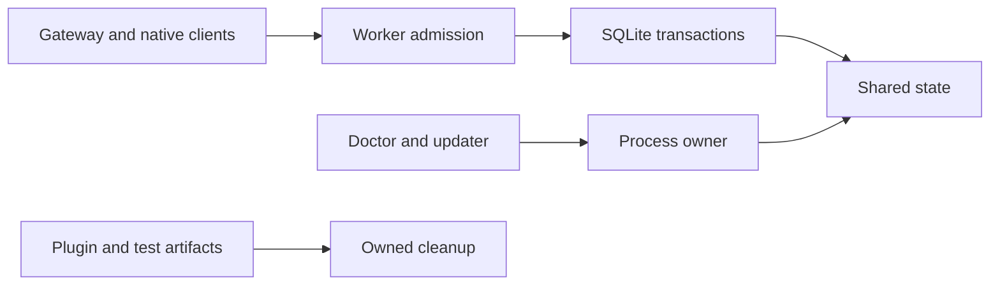

Codex review: blocked before merge. _Reviewed September 27, 2026, 8:28 AM ET / 12:28 UTC (Revision 63)._

# ClawSweeper review

## What this changes

The branch replaces separate SQLite state and device-identity coordinators with native transactions and state-local process ownership, revises worker and temporary-artifact cleanup, and fixes a stale Wear audio frame.

> [!WARNING]
> **SQLite table change**
>
> This PR modifies persisted SQLite tables in `apps/shared/OpenClawKit/Sources/OpenClawKit/DeviceIdentitySQLiteStore.swift`. Prefer a design that avoids changing persisted SQLite tables. If the change is necessary, verify migration and upgrade compatibility against an existing database before merge.

## Merge readiness

⛔ **Blocked before merge - 6 items remain**

Keep open. Current main and the latest release still use separate SQLite coordination, while this PR has substantial real-boundary proof for the replacement. The conflict-resolved head still lacks observed installed-updater automatic restart, an upgrade path identified in the prior review.

**Priority:** P1
**Reviewed head:** `cf7b08c7a82c56f766c2d01b7a805422f5a7d4d8`
**Owner decision:** Required. See [Decision needed](#decision-needed).

## Review scores

| Measure | Result | What it means |
|---|---|---|
| **Overall readiness** | 🐚 platinum hermit **(4/6)** | The branch has strong real-boundary evidence and no confirmed patch defect, with one material final-head upgrade observation still unresolved. |
| **Proof confidence** | 🦞 diamond lobster **(5/6)** | Sufficient (terminal): Real SQLite/filesystem controls exercise the introduced state owner with a foreign writer and show refusal before its write; published-updater runs on earlier candidates show state survival and rollback, and inspected images show the Wear frame result. The final-head automatic restart gap remains an independent upgrade risk. The canonical state schema version and staging-token format are unchanged, so no stored-data migration contract was introduced. |
| **Patch quality** | 🐚 platinum hermit **(4/6)** | No actionable review findings were identified. |

## Verification

| Check | Result | Evidence |
|---|---|---|
| **Real behavior** | Verified | Sufficient (terminal): Real SQLite/filesystem controls exercise the introduced state owner with a foreign writer and show refusal before its write; published-updater runs on earlier candidates show state survival and rollback, and inspected images show the Wear frame result. The final-head automatic restart gap remains an independent upgrade risk. The canonical state schema version and staging-token format are unchanged, so no stored-data migration contract was introduced. |
| **Evidence reviewed** | 10 items | Current-main boundary: Current main still imports and acquires the separate lifecycle coordinator; the central cutover remains unique to this PR. Latest-release boundary: The v2026.9.6 source also uses the separate coordinator. Introduced ownership path: The pinned diff introduces the state-local process owner and has Gateway startup acquire it before publishing its compatibility marker. |
| **Findings** | None | None. |
| **Security** | None | None. |

## How this fits together

The Gateway and native clients write shared SQLite state, while Doctor and the updater need exclusive custody for maintenance and replacement. Worker admission controls writes; plugin and test cleanup reclaim temporary artifacts after their owners settle.

## Decision needed

| Question | Recommendation |
|---|---|
| Do the earlier published-updater acceptance runs and final-head focused owner checks adequately cover automatic restart after this conflict resolution? | **Capture final-head restart:** Exercise the installed updater against the resolved candidate and record automatic restart, state survival, and rollback behavior. |

Why: The prior review requested that specific upgrade observation; the body records earlier upgrade and rollback success but expressly excludes final-head automatic restart, while the maintainer's stated CI reuse approval addresses broad CI rather than this proof gap.

## Before merge

- [ ] **Resolve merge risk (P1)** - The final conflict-resolved candidate changes Gateway, Doctor, and updater custody, but its installed-updater acceptance and rollback observations are from earlier heads. Automatic restart and the first-hop failure outcome remain unobserved, so an existing installation could finish an update without a working Gateway.
- [ ] **Complete next step (P2)** - Record the maintainer's disposition of final-head installed-updater automatic restart proof before merge.
- [ ] **Resolve review confidence** - ClawSweeper must reach high confidence before merge readiness is known.
- [ ] **Resolve maintainer decision** - Resolve the maintainer decision shown above before merge.
- [ ] **Review config compatibility** - Confirm compatibility and upgrade impact for the changed config or default surface before merge.
- [ ] **Add data-model compatibility proof** - Confirm migration or upgrade compatibility proof before merge.

<strong>Agent review details</strong>

### Security

None.

### PR surface

PR surface statistics unavailable: the file list is incomplete.

### Review metrics

None.

### Stored data model

Persistent data-model change detected: `unknown-data-model-change: apps/shared/OpenClawKit/Sources/OpenClawKit/DeviceIdentitySQLiteStore.swift`, `unknown-truncated-pull-files`, `vector/embedding metadata: extensions/memory-core/src/tools.session-catalog.test-mocks.ts`. Confirm migration or upgrade compatibility proof before merge.

### Merge-risk options

**Maintainer options:**
1. **Prove installed restart (recommended)**  
   Capture the final candidate's installed-updater restart and rollback outcomes before merge.
2. **Own the upgrade gap**  
   A maintainer may explicitly accept the unobserved first hop based on the earlier package and final-head boundary evidence.

### Technical review

Best possible solution:

Use one state-local maintenance owner and native SQLite transactions while ensuring installed updates either restore a working Gateway or preserve the previous one with a visible recovery result.

Do we have a high-confidence way to reproduce the issue?

No direct current-main execution was performed in this read-only review. Current main retains the extra coordinator path, and the PR records pre-fix and after-fix real SQLite/filesystem controls for the replacement.

Is this the best way to solve the issue?

Yes. Native transactions handle ordinary write exclusion, while a bounded process owner covers maintenance that spans transactions; final-head installed-update behavior still needs a proof disposition.

AGENTS.md: found and applied where relevant.

Codex review notes: model internal, reasoning high; reviewed against [69809d7a9427](https://github.com/openclaw/openclaw/commit/69809d7a94277d01be964bd1cbbb7aa0ebc58c9b).

### Labels

Label changes:

No label changes.

Label justifications:

- `P1`: Temporary-file exhaustion and state-custody failure can interrupt active Gateway work and updates.
- `merge-risk: 🚨 compatibility`: The new owner replaces coordination used by installed Gateways, and final-head installed-updater restart remains unobserved.
- `merge-risk: 🚨 availability`: A failed custody handoff during update could leave an existing Gateway unable to restart.
- `rating: 🐚 platinum hermit`: Overall readiness is 🐚 platinum hermit; proof is 🦞 diamond lobster and patch quality is 🐚 platinum hermit.
- `status: 👀 ready for maintainer look`: ClawSweeper has no concrete contributor-facing blocker left for this PR. Sufficient (terminal): Real SQLite/filesystem controls exercise the introduced state owner with a foreign writer and show refusal before its write; published-updater runs on earlier candidates show state survival and rollback, and inspected images show the Wear frame result. The final-head automatic restart gap remains an independent upgrade risk. The canonical state schema version and staging-token format are unchanged, so no stored-data migration contract was introduced.
- `proof: sufficient`: Contributor real behavior proof is sufficient. Real SQLite/filesystem controls exercise the introduced state owner with a foreign writer and show refusal before its write; published-updater runs on earlier candidates show state survival and rollback, and inspected images show the Wear frame result. The final-head automatic restart gap remains an independent upgrade risk. The canonical state schema version and staging-token format are unchanged, so no stored-data migration contract was introduced.

### Evidence

What I checked:

- **Current-main boundary:** Current main still imports and acquires the separate lifecycle coordinator; the central cutover remains unique to this PR. ([`src/infra/gateway-lock.ts:37`](https://github.com/openclaw/openclaw/blob/69809d7a94277d01be964bd1cbbb7aa0ebc58c9b/src/infra/gateway-lock.ts#L37), [69809d7a9427](https://github.com/openclaw/openclaw/commit/69809d7a94277d01be964bd1cbbb7aa0ebc58c9b))
- **Latest-release boundary:** The v2026.9.6 source also uses the separate coordinator. ([`src/infra/gateway-lock.ts:40`](https://github.com/openclaw/openclaw/blob/eb377ac59e6c9fd6c7705028034812becf00271b/src/infra/gateway-lock.ts#L40), [eb377ac59e6c](https://github.com/openclaw/openclaw/commit/eb377ac59e6c9fd6c7705028034812becf00271b))
- **Introduced ownership path:** The pinned diff introduces the state-local process owner and has Gateway startup acquire it before publishing its compatibility marker. ([`src/infra/gateway-state-owner.ts:373`](https://github.com/openclaw/openclaw/blob/cf7b08c7a82c56f766c2d01b7a805422f5a7d4d8/src/infra/gateway-state-owner.ts#L373), [cf7b08c7a82c](https://github.com/openclaw/openclaw/commit/cf7b08c7a82c56f766c2d01b7a805422f5a7d4d8))
- **Final write authority:** The worker admission owner checks the current job and database access when servicing native requests, including transaction and commit grants. ([`src/infra/sqlite-worker-operation-admission.ts:173`](https://github.com/openclaw/openclaw/blob/cf7b08c7a82c56f766c2d01b7a805422f5a7d4d8/src/infra/sqlite-worker-operation-admission.ts#L173), [cf7b08c7a82c](https://github.com/openclaw/openclaw/commit/cf7b08c7a82c56f766c2d01b7a805422f5a7d4d8))
- **Forbidden-writer coverage:** A real child process attempts an ordinary write while a schema lease is held; the test checks refusal and verifies that only the owner's row committed. ([`src/infra/gateway-state-owner.test.ts:428`](https://github.com/openclaw/openclaw/blob/cf7b08c7a82c56f766c2d01b7a805422f5a7d4d8/src/infra/gateway-state-owner.test.ts#L428), [cf7b08c7a82c](https://github.com/openclaw/openclaw/commit/cf7b08c7a82c56f766c2d01b7a805422f5a7d4d8))
- **Native identity cutover:** Device identity creation checks for offline maintenance and uses an immediate transaction on the identity database. ([`apps/shared/OpenClawKit/Sources/OpenClawKit/DeviceIdentitySQLiteStore.swift:35`](https://github.com/openclaw/openclaw/blob/cf7b08c7a82c56f766c2d01b7a805422f5a7d4d8/apps/shared/OpenClawKit/Sources/OpenClawKit/DeviceIdentitySQLiteStore.swift#L35), [cf7b08c7a82c](https://github.com/openclaw/openclaw/commit/cf7b08c7a82c56f766c2d01b7a805422f5a7d4d8))

Likely related people:

- **steipete:** Suggested for follow-up; no historical authorship or introduction is verified. (role: unverified routing candidate; confidence: low)
- **Vincent Koc:** Suggested for follow-up; no historical authorship or introduction is verified. (role: unverified routing candidate; confidence: low)
- **Max Xu:** Suggested for follow-up; no historical authorship or introduction is verified. (role: unverified routing candidate; confidence: low)

### Rank-up moves

Optional improvements that raise the rating; they are not merge blockers.

- Record a final-candidate installed-updater automatic restart and rollback result, or an explicit maintainer acceptance of that specific proof gap.

### Rating scale

| Score | Internal tier | Crab rank | Meaning |
|---:|:---:|---|---|
| **6/6** | S | 🦀 challenger crab | Exceptional readiness |
| **5/6** | A | 🦞 diamond lobster | Very strong readiness |
| **4/6** | B | 🐚 platinum hermit | Good normal PR; ordinary maintainer review |
| **3/6** | C | 🦐 gold shrimp | Useful, but confidence is limited |
| **2/6** | D | 🦪 silver shellfish | Proof or implementation needs work |
| **1/6** | F | 🧂 unranked krab | Not merge-ready |
| N/A | NA | 🌊 off-meta tidepool | Rating does not apply |

Overall follows the weaker of proof and patch quality.
Shiny media proof means a screenshot, video, or linked artifact directly shows the changed behavior. Runtime, network, CSP, and security claims still need visible diagnostics.

### Workflow

- ClawSweeper keeps one durable marker-backed review comment per issue or PR.
- Re-runs edit this comment so the latest verdict, findings, and automation markers stay together instead of adding duplicate bot comments.
- A fresh review can be triggered by eligible `@clawsweeper re-review` comments, exact-item GitHub events, scheduled/background review runs, or manual workflow dispatch.
- PR/issue authors and users with repository write access can comment `@clawsweeper re-review` or `@clawsweeper re-run` on an open PR or issue to request a fresh review only.
- Maintainers can also comment `@clawsweeper review` to request a fresh review only.
- Fresh-review commands do not start repair, autofix, rebase, CI repair, or automerge.
- Maintainer-only repair and merge flows require explicit commands such as `@clawsweeper autofix`, `@clawsweeper automerge`, `@clawsweeper fix ci`, or `@clawsweeper address review`.
- Maintainers can comment `@clawsweeper explain` to ask for more context, or `@clawsweeper stop` to stop active automation.

### History

Review history (62 earlier review cycles; latest 8 shown)

<!-- clawsweeper-review-history v=1 total=62 -->
- reviewed 2026-09-27T00:37:50.777Z sha dec11e38e227557edaf302e64e80698addcbbefb :: blocked before merge. :: none
- reviewed 2026-09-27T01:10:08.655Z sha dec11e38e227557edaf302e64e80698addcbbefb :: blocked before merge. :: none
- reviewed 2026-09-27T03:00:29.099Z sha 74adc789b794809881842891329f80755f7ed742 :: blocked before merge. :: none
- reviewed 2026-09-27T03:13:27.491Z sha 74adc789b794809881842891329f80755f7ed742 :: blocked before merge. :: none
- reviewed 2026-09-27T04:13:27.197Z sha 74adc789b794809881842891329f80755f7ed742 :: blocked before merge. :: none
- reviewed 2026-09-27T05:01:58.226Z sha 2b8ee0f74650f02cf1f3cd568f9c8e0290a118d3 :: blocked before merge. :: none
- reviewed 2026-09-27T10:37:38.464Z sha 5e731c1f648c99f4f4ab5c196e4b78f0be370e1c :: blocked before merge. :: none
- reviewed 2026-09-27T11:35:32.448Z sha 5e731c1f648c99f4f4ab5c196e4b78f0be370e1c :: blocked before merge. :: none

<!-- clawsweeper-verdict:needs-human item=157413 sha=cf7b08c7a82c56f766c2d01b7a805422f5a7d4d8 confidence=medium updated_at=2026-09-27T12:23:36Z reviewed_at=2026-09-27T12:28:30.172Z lease_owner=github-run-36318723547-1 lease_comment_id=5855786481 source_revision=6ea302e22c6ecaf34efaa1b4f9505cfbcaa714f8e1380ac2b3183550d35e6b31 live_verification=absent -->
<!-- clawsweeper-review-state:blocked item=157413 sha=cf7b08c7a82c56f766c2d01b7a805422f5a7d4d8 v=1 -->

<!-- clawsweeper-review-version item=157413 reviewed_at=2026-09-27T12:28:30.172Z sha=cf7b08c7a82c56f766c2d01b7a805422f5a7d4d8 source_revision=6ea302e22c6ecaf34efaa1b4f9505cfbcaa714f8e1380ac2b3183550d35e6b31 lease_owner=github-run-36318723547-1 lease_comment_id=5855786481 v=1 -->

<!-- clawsweeper-review item=157413 -->