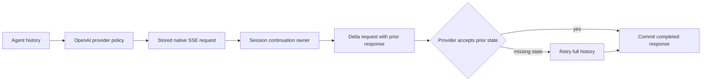

Codex review: needs maintainer review before merge. _Reviewed August 12, 2026, 12:05 PM ET / 16:05 UTC._

# ClawSweeper review

## What this changes

Adds session-scoped continuation for native OpenAI Responses HTTP/SSE turns, with suffix-only follow-ups and full-history retry when an upstream response ID is unavailable.

## Merge readiness

⚠️ **Ready for maintainer review - 2 items remain**

Keep open. No blocking patch defect was found: the existing OpenAI provider wrapper supplies the final stored-request policy, while this PR owns only native SSE continuation and same-turn recovery. Rebase and rerun exact-head validation before merge because the branch is behind and the dependency source was unavailable locally.

**Priority:** P2
**Reviewed head:** `b72e31b902a9d18a13d2ae3279abca2d6c472e95`

## Review scores

| Measure | Result | What it means |
|---|---|---|
| **Overall readiness** | 🐚 platinum hermit **(4/6)** | Strong runtime evidence and focused lifecycle coverage support the patch, with exact-head refresh and independent dependency-source inspection still desirable. |
| **Proof confidence** | 🦞 diamond lobster **(5/6)** | Sufficient (live_output): The PR body provides authenticated direct OpenAI evidence for delta continuation, same-turn recovery, and post-recovery continuation. |
| **Patch quality** | 🐚 platinum hermit **(4/6)** | No actionable review findings were identified. |

## Verification

| Check | Result | Evidence |
|---|---|---|
| **Real behavior** | Verified | Sufficient (live_output): The PR body provides authenticated direct OpenAI evidence for delta continuation, same-turn recovery, and post-recovery continuation. |
| **Evidence reviewed** | 8 items | Native continuation gate: The PR claims HTTP continuation only for non-WebSocket, unmanaged, official OpenAI Responses requests with a session and final `store: true`; it never promotes an unstored request itself.<br>Provider-owned storage policy: Current main's OpenAI Responses wrapper resolves provider policy and applies it through the payload hook; the OpenAI provider test confirms direct API-key SSE payloads receive `store: true`. This addresses the prior concern that the low-level request builder alone defaults to `store: false`.<br>Same-turn recovery: A rejected `previous_response_id` builds a full-history request, removes the rejected ID, and records the effective successful request as the next baseline. |
| **Findings** | None | None. |
| **Security** | None | None. |

## How this fits together

The OpenAI provider prepares a stored Responses request, then the AI transport streams it to the official API and produces agent output. This PR adds short-lived session state between those stages so an unchanged next turn can reference the prior provider response instead of resending history.



## Before merge

- [ ] **Resolve merge risk (P1)** - The branch is behind its base; before merge, revalidate that the current provider wrapper still applies native storage only where intended and rerun exact-head checks.
- [ ] **Resolve merge risk (P1)** - The continuation cache holds request and completed-response state in process memory for five minutes; its credential-isolation tests are sound, but independent inspection of the installed OpenAI SDK was unavailable in this workspace.


<details>
<summary><strong>Agent review details</strong></summary>

### Security

None.

### PR surface

Source +174, Tests +549. Total +723 across 11 files.

<details>
<summary>View PR surface stats</summary>

| Area | Files | Added | Removed | Net |
|---|---:|---:|---:|---:|
| Source | 6 | 354 | 180 | +174 |
| Tests | 5 | 557 | 8 | +549 |
| Docs | 0 | 0 | 0 | 0 |
| Config | 0 | 0 | 0 | 0 |
| Generated | 0 | 0 | 0 | 0 |
| Other | 0 | 0 | 0 | 0 |
| **Total** | **11** | **911** | **188** | **+723** |

</details>

### Review metrics

| Metric | Value | Why it matters |
|---|---|---|
| **Production versus test delta** | production +174 net, tests +549 net | The added lifecycle owner is substantial but supports a distinct native transport capability with focused state, failure, and cleanup coverage. |

### Stored data model

Persistent data-model change detected: `serialized state: packages/ai/src/transports/openai-responses-continuation.ts`, `vector/embedding metadata: packages/ai/src/transports/openai-responses-continuation.test.ts`, `vector/embedding metadata: packages/ai/src/transports/openai-responses-continuation.ts`. Confirm migration or upgrade compatibility proof before merge.

### Merge-risk options

**Maintainer options:**
1. **Refresh exact-head transport proof (recommended)**  
   Rebase if required by GitHub, then rerun the direct native stored-route, explicit stateless-route, and missing-response recovery checks on the resulting head.
2. **Pause for dependency verification**  
   Hold merge until a reviewer can inspect the pinned OpenAI SDK request and error contract if exact-head validation cannot provide that dependency evidence.

<details>
<summary>Copy recommended automerge instruction</summary>

```text
@clawsweeper automerge

Special instructions:
Rebase if GitHub requires it, then rerun exact-head native stored-route, stateless-route, and missing-response recovery checks.
```

</details>

### Technical review

Best possible solution:

Keep provider policy as the sole owner of `store`, keep one shared continuation comparator for HTTP and cached WebSockets, and merge only after an exact-head rebase validates the native stored and explicit-stateless routes.

Do we have a high-confidence way to reproduce the issue?

Not applicable as an issue reproduction: this is a transport capability PR, and the body supplies an authenticated after-fix OpenAI run as behavior evidence.

Is this the best way to solve the issue?

Yes. The shared continuation owner keeps provider storage policy outside the transport, reuses the repaired WebSocket comparison logic, and preserves a full-history fallback for missing upstream state.

AGENTS.md: found and applied where relevant.

Codex review notes: model internal, reasoning high; reviewed against [28a5889e9bd0](https://github.com/openclaw/openclaw/commit/28a5889e9bd0b96727e6de872feb0698498b19c6).

### Labels

Label justifications:

- `P2`: This changes request efficiency and session behavior for direct OpenAI Responses traffic without evidence of an active user-facing outage.
- `merge-risk: 🚨 compatibility`: The change alters stored native OpenAI request shape and must preserve existing stateless and non-native behavior.
- `merge-risk: 🚨 security-boundary`: Continuation state is keyed by session and effective authentication, so credential and cleanup isolation remain merge-relevant.
- `rating: 🐚 platinum hermit`: Overall readiness is 🐚 platinum hermit; proof is 🦞 diamond lobster and patch quality is 🐚 platinum hermit.
- `status: 👀 ready for maintainer look`: ClawSweeper has no concrete contributor-facing blocker left for this PR. Sufficient (live_output): The PR body provides authenticated direct OpenAI evidence for delta continuation, same-turn recovery, and post-recovery continuation.
- `proof: sufficient`: Contributor real behavior proof is sufficient. The PR body provides authenticated direct OpenAI evidence for delta continuation, same-turn recovery, and post-recovery continuation.

### Evidence

What I checked:

- **Native continuation gate:** The PR claims HTTP continuation only for non-WebSocket, unmanaged, official OpenAI Responses requests with a session and final `store: true`; it never promotes an unstored request itself. ([`packages/ai/src/transports/openai-responses-client.ts:275`](https://github.com/openclaw/openclaw/blob/b72e31b902a9/packages/ai/src/transports/openai-responses-client.ts#L275), [b72e31b902a9](https://github.com/openclaw/openclaw/commit/b72e31b902a9))
- **Provider-owned storage policy:** Current main's OpenAI Responses wrapper resolves provider policy and applies it through the payload hook; the OpenAI provider test confirms direct API-key SSE payloads receive `store: true`. This addresses the prior concern that the low-level request builder alone defaults to `store: false`. ([`src/llm/providers/stream-wrappers/openai.ts:348`](https://github.com/openclaw/openclaw/blob/28a5889e9bd0/src/llm/providers/stream-wrappers/openai.ts#L348), [28a5889e9bd0](https://github.com/openclaw/openclaw/commit/28a5889e9bd0))
- **Same-turn recovery:** A rejected `previous_response_id` builds a full-history request, removes the rejected ID, and records the effective successful request as the next baseline. ([`packages/ai/src/transports/openai-responses-replay-internal.ts:320`](https://github.com/openclaw/openclaw/blob/b72e31b902a9/packages/ai/src/transports/openai-responses-replay-internal.ts#L320), [b72e31b902a9](https://github.com/openclaw/openclaw/commit/b72e31b902a9))
- **Lifecycle and credential isolation tests:** New tests cover suffix-only continuation, explicit `store:false`, same-turn recovery, auth-header rotation, concurrent claims, cleanup fencing, and TTL expiry. ([`packages/ai/src/transports/openai-responses-client.continuation.test.ts:225`](https://github.com/openclaw/openclaw/blob/b72e31b902a9/packages/ai/src/transports/openai-responses-client.continuation.test.ts#L225), [b72e31b902a9](https://github.com/openclaw/openclaw/commit/b72e31b902a9))
- **Shared sibling behavior:** The cached WebSocket path now consumes the same continuation comparator before dispatch, avoiding divergent replay normalization between transports. ([`packages/ai/src/transports/openai-responses-websocket.ts:351`](https://github.com/openclaw/openclaw/blob/b72e31b902a9/packages/ai/src/transports/openai-responses-websocket.ts#L351), [b72e31b902a9](https://github.com/openclaw/openclaw/commit/b72e31b902a9))
- **Feature provenance:** Blame attributes the HTTP continuation eligibility and claim boundary to the maintainer rewrite commit. ([`packages/ai/src/transports/openai-responses-client.ts:275`](https://github.com/openclaw/openclaw/blob/24399fd86150/packages/ai/src/transports/openai-responses-client.ts#L275), [24399fd86150](https://github.com/openclaw/openclaw/commit/24399fd86150))

Likely related people:

- **steipete:** Authored the current continuation rewrite, the directly blamed eligibility boundary, and the adjacent merged WebSocket continuation repair. (role: continuation owner and recent area contributor; confidence: high; commits: [24399fd86150](https://github.com/openclaw/openclaw/commit/24399fd8615045b000323a9b3f8fdc4777f7d4f3), [0c8c8d95c798](https://github.com/openclaw/openclaw/commit/0c8c8d95c798cd24b5400b70468e693e64b65fec); files: `packages/ai/src/transports/openai-responses-client.ts`, `packages/ai/src/transports/openai-responses-continuation.ts`, `packages/ai/src/transports/openai-responses-websocket.ts`)

### Rank-up moves

Optional improvements that raise the rating; they are not merge blockers.

- Rebase if required and rerun exact-head native stored, stateless, and missing-state recovery validation.
- Inspect the pinned OpenAI SDK source when a dependency installation or network path is available.

### Rating scale

| Score | Internal tier | Crab rank | Meaning |
|---:|:---:|---|---|
| **6/6** | S | 🦀 challenger crab | Exceptional readiness |
| **5/6** | A | 🦞 diamond lobster | Very strong readiness |
| **4/6** | B | 🐚 platinum hermit | Good normal PR; ordinary maintainer review |
| **3/6** | C | 🦐 gold shrimp | Useful, but confidence is limited |
| **2/6** | D | 🦪 silver shellfish | Proof or implementation needs work |
| **1/6** | F | 🧂 unranked krab | Not merge-ready |
| N/A | NA | 🌊 off-meta tidepool | Rating does not apply |

Overall follows the weaker of proof and patch quality.
Shiny media proof means a screenshot, video, or linked artifact directly shows the changed behavior. Runtime, network, CSP, and security claims still need visible diagnostics.

### Workflow

- ClawSweeper keeps one durable marker-backed review comment per issue or PR.
- Re-runs edit this comment so the latest verdict, findings, and automation markers stay together instead of adding duplicate bot comments.
- A fresh review can be triggered by eligible `@clawsweeper re-review` comments, exact-item GitHub events, scheduled/background review runs, or manual workflow dispatch.
- PR/issue authors and users with repository write access can comment `@clawsweeper re-review` or `@clawsweeper re-run` on an open PR or issue to request a fresh review only.
- Maintainers can also comment `@clawsweeper review` to request a fresh review only.
- Fresh-review commands do not start repair, autofix, rebase, CI repair, or automerge.
- Maintainer-only repair and merge flows require explicit commands such as `@clawsweeper autofix`, `@clawsweeper automerge`, `@clawsweeper fix ci`, or `@clawsweeper address review`.
- Maintainers can comment `@clawsweeper explain` to ask for more context, or `@clawsweeper stop` to stop active automation.

### History

<details>
<summary>Review history (7 earlier review cycles)</summary>

<!-- clawsweeper-review-history v=1 total=7 -->
- reviewed 2026-08-11T18:52:29.329Z sha 01744fce8f9616783f2e11fe410120f45c296f5e :: needs real behavior proof before merge. :: [P1] Preserve continuation state across the full-history retry | [P2] Document the continuation compatibility flag
- reviewed 2026-08-11T20:00:57.459Z sha 4a3b4c13c81cc2e16debb4608ba82d335f9edfe7 :: needs real behavior proof before merge. :: [P1] Preserve continuation state across the full-history retry | [P2] Document the continuation compatibility flag
- reviewed 2026-08-11T23:01:15.451Z sha 2e241e100704d6f3c6eff89aea616733e140baae :: needs real behavior proof before merge. :: [P1] Keep upstream response storage opt-in | [P1] Accept the advertised compatibility flag in config | [P1] Carry continuation state through the full-history retry | [P2] Document the continuation compatibility capability
- reviewed 2026-08-12T12:11:26.627Z sha 3b6ae950f3914f3c419298837247e6d1e454adb6 :: needs real behavior proof before merge. :: [P3] Log continuation retries distinctly
- reviewed 2026-08-12T14:14:08.070Z sha 3b6ae950f3914f3c419298837247e6d1e454adb6 :: needs real behavior proof before merge. :: none
- reviewed 2026-08-12T15:10:04.888Z sha b72e31b902a9d18a13d2ae3279abca2d6c472e95 :: needs maintainer review before merge. :: none
- reviewed 2026-08-12T15:18:14.763Z sha b72e31b902a9d18a13d2ae3279abca2d6c472e95 :: found issues before merge. :: [P1] Wire normal SSE requests to the chosen storage policy

</details>

</details>

<!-- clawsweeper-verdict:needs-human item=122194 sha=b72e31b902a9d18a13d2ae3279abca2d6c472e95 confidence=medium updated_at=2026-08-12T16:01:59Z reviewed_at=2026-08-12T16:05:25.245Z lease_owner=github-run-31615391732-1 lease_comment_id=5269273117 source_revision=bd531861579f94ef39d8aaa6a16d64defb4d5c4e0d71b71e46c60504a985e4f4 -->

<!-- clawsweeper-review-version item=122194 reviewed_at=2026-08-12T16:05:25.245Z sha=b72e31b902a9d18a13d2ae3279abca2d6c472e95 source_revision=bd531861579f94ef39d8aaa6a16d64defb4d5c4e0d71b71e46c60504a985e4f4 lease_owner=github-run-31615391732-1 lease_comment_id=5269273117 v=1 -->

<!-- clawsweeper-review item=122194 -->