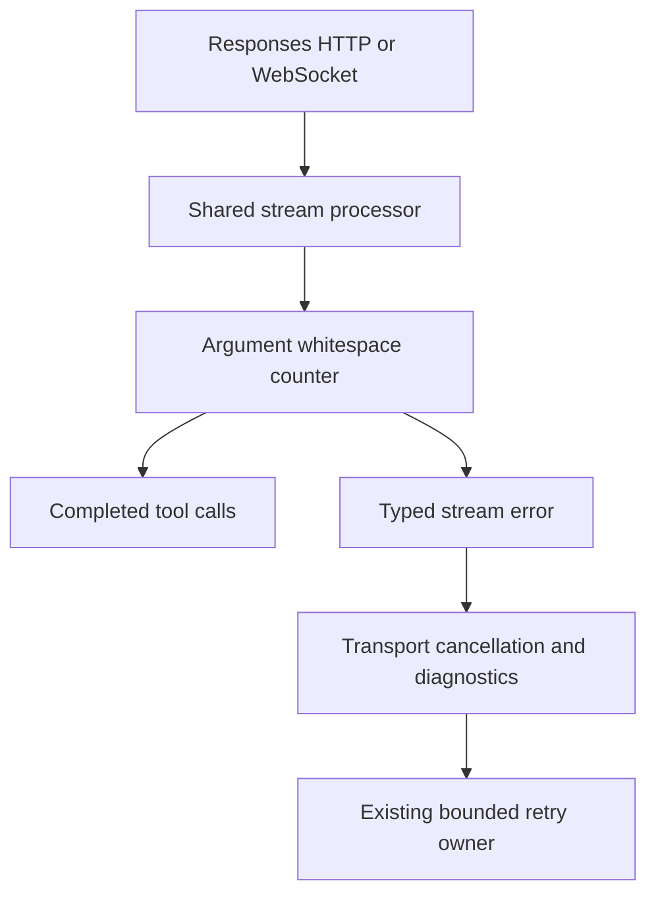

Codex review: needs maintainer review before merge.

## What this changes

Abort Responses tool arguments after 32,768 consecutive trailing whitespace characters, retry through existing recovery, and identify watchdog aborts in diagnostics.

**Example:** An exec argument streams 32 consecutive deltas containing 1,024 whitespace characters each.
- **Before:** The deltas keep the idle timer alive until the session watchdog interrupts the stalled request.
- **After:** The accumulator rejects the unfinished call with degenerate_output, closes the request, and permits bounded transient recovery.

## Review scores

| Measure | Result | What it means |
|---|---|---|
| **Overall readiness** | 🦐 gold shrimp **(3/6)** | The focused patch and exact-head gates support correctness; independently inspectable behavior evidence remains limited to the committed test composition. |
| **Proof confidence** | 🦐 gold shrimp **(3/6)** | This maintainer-authored PR is outside the ordinary contributor proof gate; its body reports successful recovery in a real isolated Gateway soak, while the inspectable committed regressions use mocked OpenAI transport and real stream/recovery owners. |
| **Patch quality** | 🐚 platinum hermit **(4/6)** | No actionable review findings were identified. |

## Product

**Kind:** Bug fix · **Worth it:** Yes · **Fix scope:** Complete
**User problem:** An embedded agent can spend minutes generating whitespace inside an unfinished tool call before watchdog recovery begins.
**Reason:** The reported production incidents justify a small bounded guard, and maintainer authorship supplies direction for the threshold without another product decision.

## Merge readiness

✅ **Ready for maintainer review**

Keep open: this maintainer-authored PR addresses a concrete agent stall using the existing stream and retry owners; no actionable correctness or security findings remain.

**Priority:** P2
**Reviewed head:** `c9c13c9d20249cd6dcc6e4577fb41fc59b45f32a`

## Before merge

None.

## Findings

None.

### Tests

- Missing end-to-end proof: The reported live Gateway soak has no attached request/abort/retry trace for independent inspection.

<strong>Agent review details</strong>

### How this fits together

The shared Responses processor converts provider events into assistant text and completed tool calls; transport errors feed the embedded runner's existing recovery policy.

### Technical review

Best possible solution:

Use the shared accumulator's bounded whitespace guard and existing recovery policy while preserving terminal tool validation and content-free diagnostics.

Do we have a high-confidence way to reproduce the issue?

Current-main source refreshes request activity for argument deltas without limiting whitespace churn, matching the reported stall; no target code was executed during this read-only review.

Is this the best way to solve the issue?

The patch is a small complete repair: one per-call counter rejects the reported runaway at the shared producer, while existing transport cancellation, terminal validation, and bounded recovery retain their responsibilities.

AGENTS.md: found and applied where relevant.

Codex review notes: model internal, reasoning medium; reviewed against [8b1ac41c3145](https://github.com/openclaw/openclaw/commit/8b1ac41c3145ae2ab1018d6c2f4ec5c43b576fc5).

### Provenance checked

- `Shared argument accumulation and terminal parsing` keeps the original intent (https://github.com/openclaw/openclaw/pull/128166: Keep large argument assembly responsive with geometric preview parsing while preserving authoritative terminal arguments; the new counter leaves that behavior intact.)
- `Diagnostic watchdog recovery` keeps the original intent (https://github.com/openclaw/openclaw/pull/141869: Interrupt eligible active model requests through the existing attempt owner so recovery can proceed without expiring the parent reply; this patch only adds structured origin attribution.)
- `Transport error diagnostics` keeps the original intent (https://github.com/openclaw/openclaw/pull/176915: Identify cancellation using fixed labels without logging provider messages or prompt/tool content; the added degenerate_output label follows that contract.)

### Testing

Proof path: in-process harness.

### Security

None.

### Evidence

What I checked:

- **Pinned introduced change:** The merge-base-to-head diff adds one counter per active call, a typed error, transport cancellation, retry classification, watchdog attribution, documentation, and focused regressions. ([`packages/ai/src/transports/openai-responses-stream-errors.ts:17`](https://github.com/openclaw/openclaw/blob/c9c13c9d20249cd6dcc6e4577fb41fc59b45f32a/packages/ai/src/transports/openai-responses-stream-errors.ts#L17), [c9c13c9d2024](https://github.com/openclaw/openclaw/commit/c9c13c9d20249cd6dcc6e4577fb41fc59b45f32a))
- **Request cancellation preserves retry classification:** The transport aborts its request-scoped controller with the typed error while projecting failure against the caller signal, preserving error rather than user-cancellation semantics. ([`packages/ai/src/transports/openai-responses-client.ts:620`](https://github.com/openclaw/openclaw/blob/c9c13c9d20249cd6dcc6e4577fb41fc59b45f32a/packages/ai/src/transports/openai-responses-client.ts#L620), [c9c13c9d2024](https://github.com/openclaw/openclaw/commit/c9c13c9d20249cd6dcc6e4577fb41fc59b45f32a))
- **Distinct regression contracts:** Added tests inspect rejection before toolcall_end, iterator closure, request abortion, content-free diagnostics, recovery classification, a legitimate 200 KiB argument, and watchdog attribution; these tests were inspected, not executed during this review. ([`packages/ai/src/transports/openai-responses-client.terminal-error.test.ts:118`](https://github.com/openclaw/openclaw/blob/c9c13c9d20249cd6dcc6e4577fb41fc59b45f32a/packages/ai/src/transports/openai-responses-client.terminal-error.test.ts#L118), [c9c13c9d2024](https://github.com/openclaw/openclaw/commit/c9c13c9d20249cd6dcc6e4577fb41fc59b45f32a))
- **Existing logging contract respected:** The merged direction in https://github.com/openclaw/openclaw/pull/176915 requires fixed abort labels without provider prose; this PR adds one fixed label and supplies the missing watchdog code at its producer. ([`packages/ai/src/transports/openai-responses-debug.ts:389`](https://github.com/openclaw/openclaw/blob/aba4ede1e9fff6ea552d72aaba7cc0bc68e5b682/packages/ai/src/transports/openai-responses-debug.ts#L389), [aba4ede1e9ff](https://github.com/openclaw/openclaw/commit/aba4ede1e9fff6ea552d72aaba7cc0bc68e5b682))
- **Current main still needs the change:** Comparison with fetched main shows an independent terminal-event refactor, without this whitespace guard or watchdog-producer attribution; the introduced hunks remain distinct. ([`packages/ai/src/transports/openai-responses-stream-internal.ts`](https://github.com/openclaw/openclaw/blob/8b1ac41c3145ae2ab1018d6c2f4ec5c43b576fc5/packages/ai/src/transports/openai-responses-stream-internal.ts), [8b1ac41c3145](https://github.com/openclaw/openclaw/commit/8b1ac41c3145ae2ab1018d6c2f4ec5c43b576fc5))
- **Exact-head gates passed:** The current head remains c9c13c9d20249cd6dcc6e4577fb41fc59b45f32a; GitHub reports a clean merge and successful CI, dependency-review, and security-sensitive-review statuses. ([c9c13c9d2024](https://github.com/openclaw/openclaw/commit/c9c13c9d20249cd6dcc6e4577fb41fc59b45f32a))

Likely related people:

- **Peter Steinberger:** Raw commit b0525e1a70b6aab46a99df78925e51493fd419ad adds packages/ai/src/transports/openai-responses-stream-internal.ts:70 relative to its recorded parents. This identifies author metadata, not feature responsibility or a PR merger. (role: source-line author; confidence: high; commits: [b0525e1a70b6](https://github.com/openclaw/openclaw/commit/b0525e1a70b6aab46a99df78925e51493fd419ad); files: `packages/ai/src/transports/openai-responses-stream-internal.ts`)
- **Vyctor H. Brzezowski:** Raw commit ddd12ca27beaea96c4055e1fa8d6300a10a99acb adds packages/ai/src/transports/openai-responses-stream-internal.ts:64 relative to its recorded parents. This identifies author metadata, not feature responsibility or a PR merger. (role: source-line author; confidence: medium; commits: [ddd12ca27bea](https://github.com/openclaw/openclaw/commit/ddd12ca27beaea96c4055e1fa8d6300a10a99acb); files: `packages/ai/src/transports/openai-responses-stream-internal.ts`)
- **von8794:** Raw commit 4a87ca5043815a24be3569c6ca47f69ae5789f25 adds src/agents/embedded-agent-runner/run/attempt-execution-phase.ts:148 relative to its recorded parents. This identifies author metadata, not feature responsibility or a PR merger. (role: source-line author; confidence: medium; commits: [4a87ca504381](https://github.com/openclaw/openclaw/commit/4a87ca5043815a24be3569c6ca47f69ae5789f25); files: `src/agents/embedded-agent-runner/run/attempt-execution-phase.ts`)

### PR surface

Source +50, Tests +110, Docs +2. Total +162 across 9 files. Added test files: 0.

View PR surface stats

| Area | Files | Added | Removed | Net |
|---|---:|---:|---:|---:|
| Source | 6 | 52 | 2 | +50 |
| Tests | 2 | 110 | 0 | +110 |
| Docs | 1 | 2 | 0 | +2 |
| Config | 0 | 0 | 0 | 0 |
| Generated | 0 | 0 | 0 | 0 |
| Other | 0 | 0 | 0 | 0 |
| **Total** | **9** | **164** | **2** | **+162** |

### Labels

Label changes:

- add `P2`: Intermittent runaway provider output delays embedded agent work for several minutes; the repair has a focused runtime boundary.
- add `rating: 🦐 gold shrimp`: Overall readiness is 🦐 gold shrimp; proof is 🦐 gold shrimp and patch quality is 🐚 platinum hermit.
- add `status: 👀 ready for maintainer look`: ClawSweeper has no concrete contributor-facing blocker left for this PR.

Label justifications:

- `P2`: Intermittent runaway provider output delays embedded agent work for several minutes; the repair has a focused runtime boundary.
- `rating: 🦐 gold shrimp`: Overall readiness is 🦐 gold shrimp; proof is 🦐 gold shrimp and patch quality is 🐚 platinum hermit.
- `status: 👀 ready for maintainer look`: ClawSweeper has no concrete contributor-facing blocker left for this PR.

### Rank-up moves

Optional improvements that raise the rating; they are not merge blockers.

- Attach a redacted abort-and-retry trace from the reported live Gateway soak.

### Rating scale

6/6 🦀 challenger crab · 5/6 🦞 diamond lobster · 4/6 🐚 platinum hermit · 3/6 🦐 gold shrimp · 2/6 🦪 silver shellfish · 1/6 🧂 unranked krab. Overall follows the weaker of proof and patch quality; ✨ marks media proof (a screenshot, video, or linked artifact) that directly shows the changed behavior.

### Workflow

ClawSweeper edits this one comment on every review. Comment `@clawsweeper re-review` for a fresh review only. Repair and merge execution lanes are retired.

_Reviewed October 19, 2026, 3:54 PM ET / 19:54 UTC._

<!-- clawsweeper-verdict:needs-human item=177659 sha=c9c13c9d20249cd6dcc6e4577fb41fc59b45f32a confidence=high updated_at=2026-10-19T19:50:00Z reviewed_at=2026-10-19T19:54:04.219Z lease_owner=github-run-39314056108-1 lease_comment_id=6275876723 source_revision=801c4fa572961e79ed2f54258107d8b812afbe261eb0ab151ea2c7ed237f207e hold=not_opted_in findings=0 -->
<!-- clawsweeper-review-state:ready item=177659 sha=c9c13c9d20249cd6dcc6e4577fb41fc59b45f32a v=1 -->

<!-- clawsweeper-review-version item=177659 reviewed_at=2026-10-19T19:54:04.219Z sha=c9c13c9d20249cd6dcc6e4577fb41fc59b45f32a source_revision=801c4fa572961e79ed2f54258107d8b812afbe261eb0ab151ea2c7ed237f207e lease_owner=github-run-39314056108-1 lease_comment_id=6275876723 v=1 -->

<!-- clawsweeper-review item=177659 -->