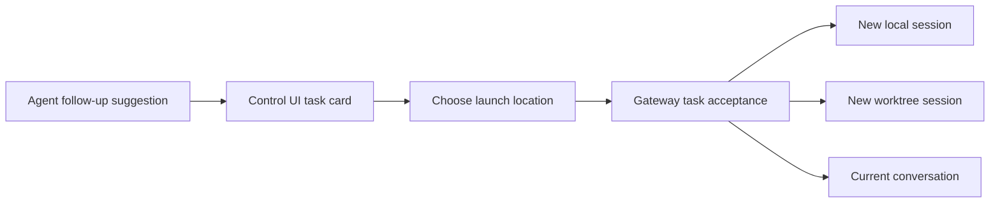

Codex review: needs maintainer review before merge. _Reviewed September 11, 2026, 11:08 AM ET / 15:08 UTC._

# ClawSweeper review

## What this changes

Adds a suggested-task menu for starting in a new worktree or the current conversation while preserving the default new-session action.

## Merge readiness

✅ **Ready for maintainer review**

Keep open: the launch choices are absent from current main, and the protected maintainer PR contains useful, focused work with no blocking correctness finding.

**Priority:** P2
**Reviewed head:** `8c05163a70b9a76980bd150fb9b0eae8dbbbbd6a`

## Review scores

| Measure | Result | What it means |
|---|---|---|
| **Overall readiness** | 🐚 platinum hermit **(4/6)** | A focused implementation with useful visual evidence and boundary coverage, with no actionable blocking defect found. |
| **Proof confidence** | 🐚 platinum hermit **(4/6)** | Not applicable: The supplied maintainer classification exempts this PR from the external-contributor proof gate. Inspected screenshots prove the visible dropdown change, and reported browser scenarios cover its Gateway requests; live worktree creation and model execution remain outside that evidence. |
| **Patch quality** | 🐚 platinum hermit **(4/6)** | No actionable review findings were identified. |

## Verification

| Check | Result | Evidence |
|---|---|---|
| **Real behavior** | Not applicable | Not applicable: The supplied maintainer classification exempts this PR from the external-contributor proof gate. Inspected screenshots prove the visible dropdown change, and reported browser scenarios cover its Gateway requests; live worktree creation and model execution remain outside that evidence. |
| **Evidence reviewed** | 7 items | Current main still has one launch action: The fetched main component exposes only the new-session button; the proposed menu remains a distinct UI capability. Latest-release comparison: The v2026.9.4 component also has only the original startSession action, without the proposed dropdown. Existing acceptance owner reused: The pane sends the selected mode through taskSuggestions.accept, retains connection/session operation guards and visible errors, and avoids navigation for current-session acceptance. |
| **Findings** | None | None. |
| **Security** | None | None. |

## How this fits together

Control UI suggested-task cards display follow-up work proposed by agents. User choices go to the Gateway’s existing task-acceptance handler, which creates a session or sends the task into its source conversation.

## Before merge

None.

<strong>Agent review details</strong>

### Security

None.

### PR surface

Source +56, Tests +44, Docs +2. Total +102 across 7 files.

View PR surface stats

| Area | Files | Added | Removed | Net |
|---|---:|---:|---:|---:|
| Source | 4 | 70 | 14 | +56 |
| Tests | 2 | 57 | 13 | +44 |
| Docs | 1 | 3 | 1 | +2 |
| Config | 0 | 0 | 0 | 0 |
| Generated | 0 | 0 | 0 | 0 |
| Other | 0 | 0 | 0 | 0 |
| **Total** | **7** | **130** | **28** | **+102** |

### Review metrics

| Metric | Value | Why it matters |
|---|---|---|
| **Launch choices** | 2 additional UI choices; existing default preserved | Both choices reuse existing Gateway modes without adding configuration or protocol parameters. |

### Technical review

Best possible solution:

Keep launch placement in the existing Gateway owner, with local sessions as the default and explicit worktree or current-conversation choices in the shared dropdown.

Do we have a high-confidence way to reproduce the issue?

Not applicable: this adds UI choices rather than repairing a reported defect; current main and the latest release confirm those choices are absent.

Is this the best way to solve the issue?

Yes: the patch uses the existing dropdown and acceptance modes, preserves the working default, and leaves session creation and steering with their existing owners.

AGENTS.md: found and applied where relevant.

Codex review notes: model internal, reasoning medium; reviewed against [af73c58582b5](https://github.com/openclaw/openclaw/commit/af73c58582b559187c94f86275402f54e5ccae58).

### Labels

Label changes:

- add `P2`: This is a bounded usability improvement to suggested-task placement without an established urgent regression.
- add `proof: 📸 screenshot`: Contributor real behavior proof includes screenshot evidence. The supplied maintainer classification exempts this PR from the external-contributor proof gate. Inspected screenshots prove the visible dropdown change, and reported browser scenarios cover its Gateway requests; live worktree creation and model execution remain outside that evidence.
- add `rating: 🐚 platinum hermit`: Overall readiness is 🐚 platinum hermit; proof is 🐚 platinum hermit and patch quality is 🐚 platinum hermit.
- add `status: 👀 ready for maintainer look`: ClawSweeper has no concrete contributor-facing blocker left for this PR. Not applicable: The supplied maintainer classification exempts this PR from the external-contributor proof gate. Inspected screenshots prove the visible dropdown change, and reported browser scenarios cover its Gateway requests; live worktree creation and model execution remain outside that evidence.

Label justifications:

- `P2`: This is a bounded usability improvement to suggested-task placement without an established urgent regression.
- `rating: 🐚 platinum hermit`: Overall readiness is 🐚 platinum hermit; proof is 🐚 platinum hermit and patch quality is 🐚 platinum hermit.
- `status: 👀 ready for maintainer look`: ClawSweeper has no concrete contributor-facing blocker left for this PR. Not applicable: The supplied maintainer classification exempts this PR from the external-contributor proof gate. Inspected screenshots prove the visible dropdown change, and reported browser scenarios cover its Gateway requests; live worktree creation and model execution remain outside that evidence.
- `proof: 📸 screenshot`: Contributor real behavior proof includes screenshot evidence. The supplied maintainer classification exempts this PR from the external-contributor proof gate. Inspected screenshots prove the visible dropdown change, and reported browser scenarios cover its Gateway requests; live worktree creation and model execution remain outside that evidence.

### Evidence

What I checked:

- **Current main still has one launch action:** The fetched main component exposes only the new-session button; the proposed menu remains a distinct UI capability. ([`ui/src/pages/chat/components/chat-task-suggestions.ts:194`](https://github.com/openclaw/openclaw/blob/af73c58582b559187c94f86275402f54e5ccae58/ui/src/pages/chat/components/chat-task-suggestions.ts#L194), [af73c58582b5](https://github.com/openclaw/openclaw/commit/af73c58582b559187c94f86275402f54e5ccae58))
- **Latest-release comparison:** The v2026.9.4 component also has only the original startSession action, without the proposed dropdown. ([`ui/src/pages/chat/components/chat-task-suggestions.ts:205`](https://github.com/openclaw/openclaw/blob/3a9d69db306cd7f081e06254cb89c4bcc14a7107/ui/src/pages/chat/components/chat-task-suggestions.ts#L205), [3a9d69db306c](https://github.com/openclaw/openclaw/commit/3a9d69db306cd7f081e06254cb89c4bcc14a7107))
- **Existing acceptance owner reused:** The pane sends the selected mode through taskSuggestions.accept, retains connection/session operation guards and visible errors, and avoids navigation for current-session acceptance. ([`ui/src/pages/chat/chat-pane-task-suggestions.ts:191`](https://github.com/openclaw/openclaw/blob/8c05163a70b9a76980bd150fb9b0eae8dbbbbd6a/ui/src/pages/chat/chat-pane-task-suggestions.ts#L191), [8c05163a70b9](https://github.com/openclaw/openclaw/commit/8c05163a70b9a76980bd150fb9b0eae8dbbbbd6a))
- **Current-session semantics match the menu:** The Gateway resolves the suggestion’s source session and sends its prompt through the existing chat handler with queueMode steer and an idempotency key. Session creation and worktree handling remain Gateway-owned. ([`src/gateway/server-methods/task-suggestions.ts:219`](https://github.com/openclaw/openclaw/blob/8c05163a70b9a76980bd150fb9b0eae8dbbbbd6a/src/gateway/server-methods/task-suggestions.ts#L219), [8c05163a70b9](https://github.com/openclaw/openclaw/commit/8c05163a70b9a76980bd150fb9b0eae8dbbbbd6a))
- **Previous session-first decision preserved:** Merged https://github.com/openclaw/openclaw/pull/139731 deliberately made local sessions the default to avoid mandatory Git setup while retaining explicit RPC modes. This PR preserves that default and exposes optional choices.
- **Inspected visual evidence and bounded browser coverage:** Inspected all three prepared images: the original button and the light/dark dropdown captures. They visibly demonstrate the joined control and three choices. The complete supplied body explicitly identifies mocked-Gateway data and reports six browser scenarios; the reviewed tests assert explicit modes, busy controls, Escape focus return, and current-session URL preservation. These do not demonstrate live worktree creation or model execution. ([`ui/src/e2e/chat-flow.task-suggestions.e2e.test.ts:17`](https://github.com/openclaw/openclaw/blob/8c05163a70b9a76980bd150fb9b0eae8dbbbbd6a/ui/src/e2e/chat-flow.task-suggestions.e2e.test.ts#L17), [8c05163a70b9](https://github.com/openclaw/openclaw/commit/8c05163a70b9a76980bd150fb9b0eae8dbbbbd6a))

Likely related people:

- **steipete:** Suggested for follow-up; no historical authorship or introduction is verified. (role: unverified routing candidate; confidence: low)
- **fuller-stack-dev:** Suggested for follow-up; no historical authorship or introduction is verified. (role: unverified routing candidate; confidence: low)

### Rating scale

| Score | Internal tier | Crab rank | Meaning |
|---:|:---:|---|---|
| **6/6** | S | 🦀 challenger crab | Exceptional readiness |
| **5/6** | A | 🦞 diamond lobster | Very strong readiness |
| **4/6** | B | 🐚 platinum hermit | Good normal PR; ordinary maintainer review |
| **3/6** | C | 🦐 gold shrimp | Useful, but confidence is limited |
| **2/6** | D | 🦪 silver shellfish | Proof or implementation needs work |
| **1/6** | F | 🧂 unranked krab | Not merge-ready |
| N/A | NA | 🌊 off-meta tidepool | Rating does not apply |

Overall follows the weaker of proof and patch quality.
Shiny media proof means a screenshot, video, or linked artifact directly shows the changed behavior. Runtime, network, CSP, and security claims still need visible diagnostics.

### Workflow

- ClawSweeper keeps one durable marker-backed review comment per issue or PR.
- Re-runs edit this comment so the latest verdict, findings, and automation markers stay together instead of adding duplicate bot comments.
- A fresh review can be triggered by eligible `@clawsweeper re-review` comments, exact-item GitHub events, scheduled/background review runs, or manual workflow dispatch.
- PR/issue authors and users with repository write access can comment `@clawsweeper re-review` or `@clawsweeper re-run` on an open PR or issue to request a fresh review only.
- Maintainers can also comment `@clawsweeper review` to request a fresh review only.
- Fresh-review commands do not start repair, autofix, rebase, CI repair, or automerge.
- Maintainer-only repair and merge flows require explicit commands such as `@clawsweeper autofix`, `@clawsweeper automerge`, `@clawsweeper fix ci`, or `@clawsweeper address review`.
- Maintainers can comment `@clawsweeper explain` to ask for more context, or `@clawsweeper stop` to stop active automation.

<!-- clawsweeper-verdict:needs-human item=145019 sha=8c05163a70b9a76980bd150fb9b0eae8dbbbbd6a confidence=high updated_at=2026-09-11T15:06:19Z reviewed_at=2026-09-11T15:08:59.461Z lease_owner=github-run-34613898370-1 lease_comment_id=5636476252 source_revision=deea68da0b9ac8d5e0cc30c055f07695452f3ca7162bea9b425697e65be1bfa4 live_verification=absent -->
<!-- clawsweeper-review-state:ready item=145019 sha=8c05163a70b9a76980bd150fb9b0eae8dbbbbd6a v=1 -->

<!-- clawsweeper-review-version item=145019 reviewed_at=2026-09-11T15:08:59.461Z sha=8c05163a70b9a76980bd150fb9b0eae8dbbbbd6a source_revision=deea68da0b9ac8d5e0cc30c055f07695452f3ca7162bea9b425697e65be1bfa4 lease_owner=github-run-34613898370-1 lease_comment_id=5636476252 v=1 -->

<!-- clawsweeper-review item=145019 -->