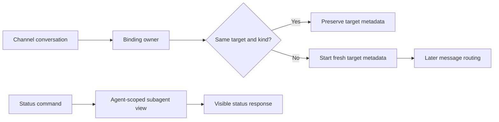

Codex review: needs maintainer review before merge. _Reviewed August 30, 2026, 7:09 PM ET / 23:09 UTC._

# ClawSweeper review

## What this changes

The PR resets target-owned binding metadata on conversation replacement and forwards the prepared agent identity so global subagent status is correctly scoped.

## Merge readiness

⚠️ **Ready for maintainer review - 4 items remain**

No introduced correctness defect was found. The repair remains necessary because fetched current main retains the stale-metadata behavior; this maintainer-authored, protected PR should stay open for owner review and exact-head CI completion.

**Priority:** P2
**Reviewed head:** `2652ffb91911a10473d77012e4f6ec21bc777f7a`
**Owner decision:** Required. See [Decision needed](#decision-needed).

## Review scores

| Measure | Result | What it means |
|---|---|---|
| **Overall readiness** | 🐚 platinum hermit **(4/6)** | The patch is a focused, well-covered owner-bound repair with partial real routing evidence and no actionable correctness finding. |
| **Proof confidence** | 🐚 platinum hermit **(4/6)** | Not applicable: This MEMBER-authored PR is exempt from the external-contributor proof gate. Its body nevertheless records an after-fix ephemeral Gateway routing trace for binding replacement; global-session live tracing remains a stated, non-gating coverage gap. |
| **Patch quality** | 🐚 platinum hermit **(4/6)** | No actionable review findings were identified. |

## Verification

| Check | Result | Evidence |
|---|---|---|
| **Real behavior** | Not applicable | Not applicable: This MEMBER-authored PR is exempt from the external-contributor proof gate. Its body nevertheless records an after-fix ephemeral Gateway routing trace for binding replacement; global-session live tracing remains a stated, non-gating coverage gap. |
| **Evidence reviewed** | 5 items | Binding owner boundary: Replacement guards retain target-owned metadata only for the same target session and kind. The routing consumer treats plugin ownership metadata as a reason not to rewrite the route, establishing the stale-owner failure mode this addresses. Status ownership path: Status resolves the supplied agent identity for a bare global key and passes it into the existing controlled-run filter, which requires both the session key and agent identity. Regression coverage: The introduced tests cover replacement versus same-target refresh across durable generic/account-scoped and Telegram bindings, plus global-agent isolation and stale-run status accounting. |
| **Findings** | None | None. |
| **Security** | None | None. |

## How this fits together

Channel binding owners persist the session target and routing metadata for a conversation, which later determines where messages go. Status commands use the current agent and session identity to select subagent runs for display.

## Decision needed

| Question | Recommendation |
|---|---|
| Should the binding and agent-status owner accept this targeted replacement-metadata and global-agent scoping repair after exact-head CI completes? | **Approve after exact-head validation:** Accept the owner-bound repair once the current head's relevant checks finish green and merge validation is refreshed. |

Why: The PR changes persisted routing behavior across several channel owners and carries the protected maintainer label, so automated review should not make the landing decision.

## Before merge

- [ ] **Resolve merge risk (P2)** - The patch adds 12 net production lines to a bug fix; the added agent-owner propagation is localized and avoids rediscovery, but a maintainer should confirm no simpler canonical owner path exists.
- [ ] **Resolve merge risk (P1)** - Exact-head CI is still running and the recorded test merge is stale, so the final merged result has not yet been validated.
- [ ] **Complete next step (P2)** - No mechanical repair remains; protected maintainer handling and completion of the current exact-head validation are required before landing.

<strong>Agent review details</strong>

### Security

None.

### PR surface

Source +12, Tests +292, Docs +3. Total +307 across 24 files.

View PR surface stats

| Area | Files | Added | Removed | Net |
|---|---:|---:|---:|---:|
| Source | 15 | 84 | 72 | +12 |
| Tests | 7 | 411 | 119 | +292 |
| Docs | 2 | 6 | 3 | +3 |
| Config | 0 | 0 | 0 | 0 |
| Generated | 0 | 0 | 0 | 0 |
| Other | 0 | 0 | 0 | 0 |
| **Total** | **24** | **501** | **194** | **+307** |

### Review metrics

| Metric | Value | Why it matters |
|---|---|---|
| **Production versus test delta** | production +84/-72 (net +12); tests +411/-119 (net +292); docs +6/-3 | The production increase is concentrated in target-comparison and prepared-owner forwarding, while the larger test delta covers replacement, persistence, status, and command paths. |

### Stored data model

Persistent data-model change detected: `vector/embedding metadata: extensions/discord/src/monitor/thread-bindings.manager.ts`, `vector/embedding metadata: extensions/feishu/src/thread-bindings.ts`, `vector/embedding metadata: extensions/telegram/src/thread-bindings.ts`, `vector/embedding metadata: src/infra/outbound/account-scoped-conversation-bindings.ts`, `vector/embedding metadata: src/infra/outbound/current-conversation-bindings.ts`. Confirm migration or upgrade compatibility proof before merge.

### Merge-risk options

**Maintainer options:**
1. **Decide the mitigation before merge**  
   Keep the producer-side metadata reset and prepared-agent propagation, then land only after an owner accepts the bounded production growth and the exact PR head has a green merge validation.
2. **Pause or close**  
   Do not merge this PR until maintainers decide whether the risk is worth taking.

### Technical review

Best possible solution:

Keep the producer-side metadata reset and prepared-agent propagation, then land only after an owner accepts the bounded production growth and the exact PR head has a green merge validation.

Do we have a high-confidence way to reproduce the issue?

Yes, source and focused regression coverage define high-confidence replacement-binding, global-agent scoping, and stale-run scenarios; this read-only review did not rerun them.

Is this the best way to solve the issue?

Yes. Resetting metadata at the binding producer prevents the routing consumer from acting on a prior plugin owner, and forwarding the already-prepared agent identity reuses the canonical scope filter.

AGENTS.md: found and applied where relevant.

Codex review notes: model internal, reasoning high; reviewed against [8f5d47ae9db0](https://github.com/openclaw/openclaw/commit/8f5d47ae9db06c35739ba023220d6b5fd522bcdb).

### Labels

Label justifications:

- `P2`: This is a bounded reliability repair for channel routing and subagent status, with user-visible but non-emergency impact.
- `rating: 🐚 platinum hermit`: Overall readiness is 🐚 platinum hermit; proof is 🐚 platinum hermit and patch quality is 🐚 platinum hermit.
- `status: 👀 ready for maintainer look`: ClawSweeper has no concrete contributor-facing blocker left for this PR. Not applicable: This MEMBER-authored PR is exempt from the external-contributor proof gate. Its body nevertheless records an after-fix ephemeral Gateway routing trace for binding replacement; global-session live tracing remains a stated, non-gating coverage gap.
- `proof: telegram-e2e`: This PR needs Telegram Test Server proof with the repository E2E skill. Telegram binding replacement can change where a user’s subsequent chat message is delivered and is observable on the Telegram Test Server.

### Evidence

What I checked:

- **Binding owner boundary:** Replacement guards retain target-owned metadata only for the same target session and kind. The routing consumer treats plugin ownership metadata as a reason not to rewrite the route, establishing the stale-owner failure mode this addresses. ([`src/infra/outbound/current-conversation-bindings.ts:469`](https://github.com/openclaw/openclaw/blob/2652ffb91911/src/infra/outbound/current-conversation-bindings.ts#L469), [2652ffb91911](https://github.com/openclaw/openclaw/commit/2652ffb91911))
- **Status ownership path:** Status resolves the supplied agent identity for a bare global key and passes it into the existing controlled-run filter, which requires both the session key and agent identity. ([`src/status/status-text.ts:323`](https://github.com/openclaw/openclaw/blob/2652ffb91911/src/status/status-text.ts#L323), [2652ffb91911](https://github.com/openclaw/openclaw/commit/2652ffb91911))
- **Regression coverage:** The introduced tests cover replacement versus same-target refresh across durable generic/account-scoped and Telegram bindings, plus global-agent isolation and stale-run status accounting. ([`src/auto-reply/reply/commands-subagents.test.ts:55`](https://github.com/openclaw/openclaw/blob/2652ffb91911/src/auto-reply/reply/commands-subagents.test.ts#L55), [2652ffb91911](https://github.com/openclaw/openclaw/commit/2652ffb91911))
- **Current-main necessity:** Fetched main still unconditionally spreads existing binding metadata and resolves global status without the prepared owner, so it does not yet contain this repair. ([`src/infra/outbound/current-conversation-bindings.ts:469`](https://github.com/openclaw/openclaw/blob/8f5d47ae9db0/src/infra/outbound/current-conversation-bindings.ts#L469), [8f5d47ae9db0](https://github.com/openclaw/openclaw/commit/8f5d47ae9db0))
- **Patch provenance:** The functional repair was introduced by the initial PR commit; later commits only integrate the main-branch documentation-navigation update. ([`src/infra/outbound/account-scoped-conversation-bindings.ts:194`](https://github.com/openclaw/openclaw/blob/985aa669a148/src/infra/outbound/account-scoped-conversation-bindings.ts#L194), [985aa669a148](https://github.com/openclaw/openclaw/commit/985aa669a148))

Likely related people:

- **steipete:** Suggested for follow-up; no historical authorship or introduction is verified. (role: unverified routing candidate; confidence: low)

### Rating scale

| Score | Internal tier | Crab rank | Meaning |
|---:|:---:|---|---|
| **6/6** | S | 🦀 challenger crab | Exceptional readiness |
| **5/6** | A | 🦞 diamond lobster | Very strong readiness |
| **4/6** | B | 🐚 platinum hermit | Good normal PR; ordinary maintainer review |
| **3/6** | C | 🦐 gold shrimp | Useful, but confidence is limited |
| **2/6** | D | 🦪 silver shellfish | Proof or implementation needs work |
| **1/6** | F | 🧂 unranked krab | Not merge-ready |
| N/A | NA | 🌊 off-meta tidepool | Rating does not apply |

Overall follows the weaker of proof and patch quality.
Shiny media proof means a screenshot, video, or linked artifact directly shows the changed behavior. Runtime, network, CSP, and security claims still need visible diagnostics.

### Workflow

- ClawSweeper keeps one durable marker-backed review comment per issue or PR.
- Re-runs edit this comment so the latest verdict, findings, and automation markers stay together instead of adding duplicate bot comments.
- A fresh review can be triggered by eligible `@clawsweeper re-review` comments, exact-item GitHub events, scheduled/background review runs, or manual workflow dispatch.
- PR/issue authors and users with repository write access can comment `@clawsweeper re-review` or `@clawsweeper re-run` on an open PR or issue to request a fresh review only.
- Maintainers can also comment `@clawsweeper review` to request a fresh review only.
- Fresh-review commands do not start repair, autofix, rebase, CI repair, or automerge.
- Maintainer-only repair and merge flows require explicit commands such as `@clawsweeper autofix`, `@clawsweeper automerge`, `@clawsweeper fix ci`, or `@clawsweeper address review`.
- Maintainers can comment `@clawsweeper explain` to ask for more context, or `@clawsweeper stop` to stop active automation.

### History

Review history (2 earlier review cycles)

<!-- clawsweeper-review-history v=1 total=2 -->
- reviewed 2026-08-30T22:05:13.190Z sha 985aa669a1486659c163528e2a8e1c58794ec191 :: needs maintainer review before merge. :: none
- reviewed 2026-08-30T22:44:41.400Z sha 85602d43343559bd5aa652bdaa32de38dbb19af1 :: needs maintainer review before merge. :: none

<!-- clawsweeper-verdict:needs-human item=133578 sha=2652ffb91911a10473d77012e4f6ec21bc777f7a confidence=high updated_at=2026-08-30T23:05:07Z reviewed_at=2026-08-30T23:09:20.594Z lease_owner=github-run-33340761666-1 lease_comment_id=5471816631 source_revision=91553107ae2be700010d4989eec7aa5a08e8eeed82eb429aac25363d24ae8cef live_verification=absent -->

<!-- clawsweeper-review-version item=133578 reviewed_at=2026-08-30T23:09:20.594Z sha=2652ffb91911a10473d77012e4f6ec21bc777f7a source_revision=91553107ae2be700010d4989eec7aa5a08e8eeed82eb429aac25363d24ae8cef lease_owner=github-run-33340761666-1 lease_comment_id=5471816631 v=1 -->

<!-- clawsweeper-review item=133578 -->