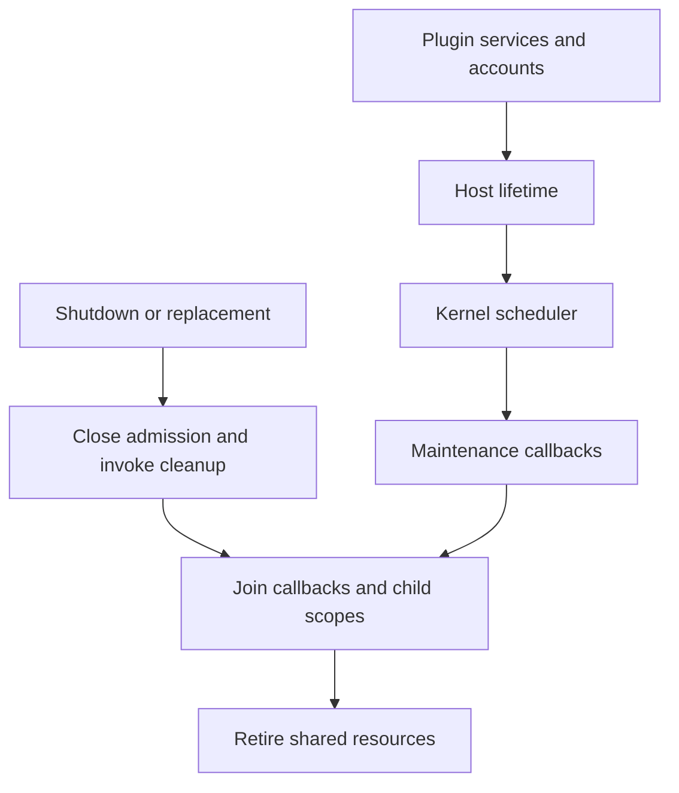

Codex review: blocked before merge. _Reviewed October 2, 2026, 8:40 PM ET / October 3, 2026, 00:40 UTC (Revision 30)._

# ClawSweeper review

## What this changes

The PR gives plugin services, channel accounts, and standalone commands host-owned scheduling that joins running work during retirement, while replacing retired legacy imports with recovery guidance.

## Merge readiness

⛔ **Blocked before merge - 1 item remains**

This remains useful, distinct work absent from current main. No blocking introduced defect was found; source-matched shutdown and installed-update evidence resolves the previous generic compatibility concern.

**Priority:** P2
**Reviewed head:** `52c225c8087834f0008b233a13a7dfd43b131062`

## Review scores

| Measure | Result | What it means |
|---|---|---|
| **Overall readiness** | 🦞 diamond lobster **(5/6)** | Strong, source-matched runtime and upgrade evidence supports a coherent owner-bound implementation with no blocking finding. |
| **Proof confidence** | 🦞 diamond lobster **(5/6)** | Sufficient (terminal): Recorded native Voice Call, Device Pair, and Reef scheduling plus the public SDK probe demonstrate joined shutdown, rejected late admission, and released processes/listeners. Eleven central production owners match the proven artifact; the published 2026.9.7 update cell verifies preserved canonical state and supported config repair, while retired-input checks preserve source bytes. |
| **Patch quality** | 🦞 diamond lobster **(5/6)** | No actionable review findings were identified. |

## Verification

| Check | Result | Evidence |
|---|---|---|
| **Real behavior** | Verified | Sufficient (terminal): Recorded native Voice Call, Device Pair, and Reef scheduling plus the public SDK probe demonstrate joined shutdown, rejected late admission, and released processes/listeners. Eleven central production owners match the proven artifact; the published 2026.9.7 update cell verifies preserved canonical state and supported config repair, while retired-input checks preserve source bytes. |
| **Evidence reviewed** | 10 items | Pinned introduction and review continuity: Reviewed the merge-base 810018486a558c441822580f42e368ec326a576c to pinned head delta. Since the previous reviewed head, changes repair a File Transfer scheduler fixture and change the channels resolve command's type import; neither introduces a new runtime policy. The supplied stale test merge was not used to infer removal of main behavior. Still necessary on main: Current main's service owner does not contain the new lifetime scheduler integration. The merged Code Mode and WAL retirement changes address separate resource owners rather than replacing this implementation. Release boundary checked: GitHub identifies v2026.9.7 as published on September 30. Its service source also lacks the new lifetime scheduler integration, so the requested central behavior is not established as shipped. |
| **Findings** | None | None. |
| **Security** | None | None. |

## How this fits together

The plugin host starts background services and channel accounts inside the Gateway or CLI. Its scheduler dispatches maintenance callbacks, and retirement coordinates their completion before shared resources close.

## Before merge

- [ ] **Review config compatibility** - Confirm compatibility and upgrade impact for the changed config or default surface before merge.

<strong>Agent review details</strong>

### Security

None.

### PR surface

PR surface statistics unavailable: the file list is incomplete.

### Review metrics

| Metric | Value | Why it matters |
|---|---|---|
| **Production versus test growth** | Production +1954/-1811, net +143; tests/support +3781/-1717, net +2064 | Production growth has a stated ownership justification: admission, joined retirement, and retained cleanup replace consumer timer plumbing. |
| **Public SDK expansion** | 10 qualified type exports and 1 callable | The added surface versions required scheduling while retaining the shipped V1 contract. |

### Stored data model

Persistent data-model change detected: `migration/backfill/repair: extensions/device-pair/doctor-contract-api.ts`, `migration/backfill/repair: extensions/discord/doctor-contract-api.ts`, `unknown-data-model-change: extensions/device-pair/doctor-contract-api.ts`, `unknown-truncated-pull-files`. Migration or upgrade compatibility proof is recorded; maintainers should verify it before merge.

### Root-cause cluster

Relationship: `canonical`
Canonical: https://github.com/openclaw/openclaw/pull/162669
Summary: This is the active service/account scheduler cut from the held umbrella proposal; the merged resource-retirement work remains distinct.

Members:
- `partial_overlap`: https://github.com/openclaw/openclaw/pull/162502 - The draft explicitly holds its combined implementation for splitting; this PR owns the service/account subset.
- `adjacent_distinct`: https://github.com/openclaw/openclaw/pull/162141 - The merged change retires Code Mode workers rather than plugin maintenance callbacks.
- `adjacent_distinct`: https://github.com/openclaw/openclaw/pull/162166 - The merged change joins database-owned WAL maintenance, a separate lifetime owner.
- `adjacent_distinct`: https://github.com/openclaw/openclaw/pull/163205 - The merged Reef change retires historical receipt reconstruction; its discussion identifies separate scheduler-fixture overlap.

Proposal only: this assessment does not dispatch repair, suppress jobs, mutate sibling items, close, or merge anything.

### Technical review

Best possible solution:

Use the kernel scheduler as the single lifetime owner, retain the published V1 contract, and preserve supported upgrade inputs with explicit recovery for retired formats.

Do we have a high-confidence way to reproduce the issue?

Not applicable as a new capability review; the recorded native shutdown failure and production Gateway regression provide concrete evidence for the underlying retirement defect.

Is this the best way to solve the issue?

Yes. Extending the existing kernel scheduler with versioned, owner-bound contracts removes competing timer ownership while preserving domain cleanup and published V1 compatibility.

AGENTS.md: found and applied where relevant.

Codex review notes: model internal, reasoning medium; reviewed against [408fc041b6e5](https://github.com/openclaw/openclaw/commit/408fc041b6e5e08cf830a66abb6238a6d594731d).

### Labels

Label changes:

- add `rating: 🦞 diamond lobster`: Overall readiness is 🦞 diamond lobster; proof is 🦞 diamond lobster and patch quality is 🦞 diamond lobster.
- remove `rating: 🐚 platinum hermit`: Current PR rating is `rating: 🦞 diamond lobster`, so this older rating label is no longer current.

Label justifications:

- `P2`: This is a bounded reliability improvement to plugin maintenance and retirement, without evidence of an urgent user-facing outage.
- `merge-risk: 🚨 compatibility`: The V2 SDK and legacy-import retirement are compatibility-sensitive; the explicit owner decision and installed-update proof cover the accepted tradeoff.
- `rating: 🦞 diamond lobster`: Overall readiness is 🦞 diamond lobster; proof is 🦞 diamond lobster and patch quality is 🦞 diamond lobster.
- `status: 👀 ready for maintainer look`: ClawSweeper has no concrete contributor-facing blocker left for this PR. Sufficient (terminal): Recorded native Voice Call, Device Pair, and Reef scheduling plus the public SDK probe demonstrate joined shutdown, rejected late admission, and released processes/listeners. Eleven central production owners match the proven artifact; the published 2026.9.7 update cell verifies preserved canonical state and supported config repair, while retired-input checks preserve source bytes.
- `proof: sufficient`: Contributor real behavior proof is sufficient. Recorded native Voice Call, Device Pair, and Reef scheduling plus the public SDK probe demonstrate joined shutdown, rejected late admission, and released processes/listeners. Eleven central production owners match the proven artifact; the published 2026.9.7 update cell verifies preserved canonical state and supported config repair, while retired-input checks preserve source bytes.

### Evidence

What I checked:

- **Pinned introduction and review continuity:** Reviewed the merge-base 810018486a558c441822580f42e368ec326a576c to pinned head delta. Since the previous reviewed head, changes repair a File Transfer scheduler fixture and change the channels resolve command's type import; neither introduces a new runtime policy. The supplied stale test merge was not used to infer removal of main behavior. ([`src/commands/channels/resolve.ts:11`](https://github.com/openclaw/openclaw/blob/52c225c8087834f0008b233a13a7dfd43b131062/src/commands/channels/resolve.ts#L11), [52c225c80878](https://github.com/openclaw/openclaw/commit/52c225c8087834f0008b233a13a7dfd43b131062))
- **Still necessary on main:** Current main's service owner does not contain the new lifetime scheduler integration. The merged Code Mode and WAL retirement changes address separate resource owners rather than replacing this implementation. ([`src/plugins/services.ts:180`](https://github.com/openclaw/openclaw/blob/408fc041b6e5e08cf830a66abb6238a6d594731d/src/plugins/services.ts#L180), [408fc041b6e5](https://github.com/openclaw/openclaw/commit/408fc041b6e5e08cf830a66abb6238a6d594731d))
- **Release boundary checked:** GitHub identifies v2026.9.7 as published on September 30. Its service source also lacks the new lifetime scheduler integration, so the requested central behavior is not established as shipped. ([`src/plugins/services.ts`](https://github.com/openclaw/openclaw/blob/c074824a27c96d3983043f9eeb33823cd1772d8c/src/plugins/services.ts), [c074824a27c9](https://github.com/openclaw/openclaw/commit/c074824a27c96d3983043f9eeb33823cd1772d8c))
- **Versioned SDK compatibility:** V1 keeps its optional scheduler and original callback context; V2 requires scheduling explicitly. The compile-only contract covers legacy calls, inline registrations, account generics, and required V2 contexts, while the full body reports external V1/V2 consumer compilation. ([`src/plugins/plugin-registration.types.ts:430`](https://github.com/openclaw/openclaw/blob/52c225c8087834f0008b233a13a7dfd43b131062/src/plugins/plugin-registration.types.ts#L430), [52c225c80878](https://github.com/openclaw/openclaw/commit/52c225c8087834f0008b233a13a7dfd43b131062))
- **Captured proof body fully recovered:** The full GitHub body matches captured SHA256 5fb64e2f2e5a383ce66cf6992d6d826cd7a001c7c29638c65f580efc08704d34. It records three-plugin native scheduled dispatch, late-admission rejection, joined SIGTERM with exit 0 and released listeners, plus a published 2026.9.7 updater cell preserving config, workspace, Device Pair/cron state, call payloads, and SQLite integrity. Standalone Voice Call dispatched its native reaper and exited 143 after cleanup. External telephony and messaging calls are expressly outside that proof. ([bb9a23a6bf53](https://github.com/openclaw/openclaw/commit/bb9a23a6bf5387569958a9f64b57370b7499d649))
- **Proof remains applicable after rebase:** GitHub blob comparisons found eleven central lifecycle and upgrade owners byte-identical between the proven bb9 artifact and this head, including service/account scheduling, root shutdown, retired-state handling, Voice Call CLI, and Device Pair notifications. For services.ts, both revisions have blob 21c540b2f923f1ff28c4890cdf49fca3e94f8424. ([`src/plugins/services.ts:274`](https://github.com/openclaw/openclaw/blob/52c225c8087834f0008b233a13a7dfd43b131062/src/plugins/services.ts#L274), [52c225c80878](https://github.com/openclaw/openclaw/commit/52c225c8087834f0008b233a13a7dfd43b131062))

Likely related people:

- **steipete:** Suggested for follow-up; no historical authorship or introduction is verified. (role: unverified routing candidate; confidence: low)
- **Kimiyu-186:** Suggested for follow-up; no historical authorship or introduction is verified. (role: unverified routing candidate; confidence: low)

### Rating scale

| Score | Internal tier | Crab rank | Meaning |
|---:|:---:|---|---|
| **6/6** | S | 🦀 challenger crab | Exceptional readiness |
| **5/6** | A | 🦞 diamond lobster | Very strong readiness |
| **4/6** | B | 🐚 platinum hermit | Good normal PR; ordinary maintainer review |
| **3/6** | C | 🦐 gold shrimp | Useful, but confidence is limited |
| **2/6** | D | 🦪 silver shellfish | Proof or implementation needs work |
| **1/6** | F | 🧂 unranked krab | Not merge-ready |
| N/A | NA | 🌊 off-meta tidepool | Rating does not apply |

Overall follows the weaker of proof and patch quality.
Shiny media proof means a screenshot, video, or linked artifact directly shows the changed behavior. Runtime, network, CSP, and security claims still need visible diagnostics.

### Workflow

- ClawSweeper keeps one durable marker-backed review comment per issue or PR.
- Re-runs edit this comment so the latest verdict, findings, and automation markers stay together instead of adding duplicate bot comments.
- A fresh review can be triggered by eligible `@clawsweeper re-review` comments, exact-item GitHub events, scheduled/background review runs, or manual workflow dispatch.
- PR/issue authors and users with repository write access can comment `@clawsweeper re-review` or `@clawsweeper re-run` on an open PR or issue to request a fresh review only.
- Maintainers can also comment `@clawsweeper review` to request a fresh review only.
- Fresh-review commands do not start repair, autofix, rebase, CI repair, or automerge.
- Maintainer-only repair and merge flows require explicit commands such as `@clawsweeper autofix`, `@clawsweeper automerge`, `@clawsweeper fix ci`, or `@clawsweeper address review`.
- Maintainers can comment `@clawsweeper explain` to ask for more context, or `@clawsweeper stop` to stop active automation.

### History

Review history (29 earlier review cycles; latest 8 shown)

<!-- clawsweeper-review-history v=1 total=29 -->
- reviewed 2026-10-02T17:47:22.621Z sha 6ff86758d6ccd67e66d0419ccdc9a479fd2805bd :: blocked before merge. :: none
- reviewed 2026-10-02T18:12:52.754Z sha 6ff86758d6ccd67e66d0419ccdc9a479fd2805bd :: blocked before merge. :: none
- reviewed 2026-10-02T21:48:14.980Z sha bb9a23a6bf5387569958a9f64b57370b7499d649 :: blocked before merge. :: none
- reviewed 2026-10-02T21:57:35.856Z sha bb9a23a6bf5387569958a9f64b57370b7499d649 :: blocked before merge. :: none
- reviewed 2026-10-02T22:51:45.771Z sha dbb9b2566e8b06f266000de93e89ed6a660c9de9 :: blocked before merge. :: none
- reviewed 2026-10-02T23:36:57.382Z sha dbb9b2566e8b06f266000de93e89ed6a660c9de9 :: blocked before merge. :: none
- reviewed 2026-10-02T23:46:32.839Z sha dbb9b2566e8b06f266000de93e89ed6a660c9de9 :: blocked before merge. :: none
- reviewed 2026-10-03T00:04:01.912Z sha 2def714340ecd935665f2b06b4c943a35bcd2e29 :: blocked before merge. :: none

<!-- clawsweeper-verdict:needs-human item=162669 sha=52c225c8087834f0008b233a13a7dfd43b131062 confidence=high updated_at=2026-10-03T00:35:28Z reviewed_at=2026-10-03T00:40:27.909Z lease_owner=github-run-37082634695-1 lease_comment_id=5963681545 source_revision=793851417a72da3933ad2357fd5dd7f6abaa5561ef92748bdf7bca53ec9d4985 live_verification=absent -->
<!-- clawsweeper-review-state:blocked item=162669 sha=52c225c8087834f0008b233a13a7dfd43b131062 v=1 -->

<!-- clawsweeper-review-version item=162669 reviewed_at=2026-10-03T00:40:27.909Z sha=52c225c8087834f0008b233a13a7dfd43b131062 source_revision=793851417a72da3933ad2357fd5dd7f6abaa5561ef92748bdf7bca53ec9d4985 lease_owner=github-run-37082634695-1 lease_comment_id=5963681545 v=1 -->

<!-- clawsweeper-review item=162669 -->