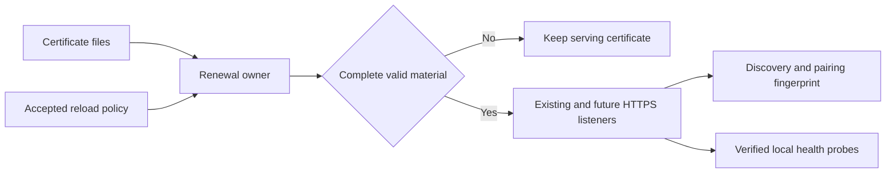

Codex review: blocked before merge. _Reviewed September 12, 2026, 3:22 PM ET / 19:22 UTC (Revision 5)._

# ClawSweeper review

## What this changes

The PR renews Gateway TLS certificates without restarting HTTPS listeners, refreshes advertised fingerprints, and preserves verified local health checks during deferred renewals.

## Merge readiness

⛔ **Blocked before merge - 1 item remains**

The PR remains useful and fixes the previously reported deferred-renewal probe defect. No blocking correctness finding remains in the inspected changes; current main still lacks this renewal lifecycle.

**Priority:** P2
**Reviewed head:** `b59a26fc93180dd6fe6f3fbdd1877c66997e6b40`

## Review scores

| Measure | Result | What it means |
|---|---|---|
| **Overall readiness** | 🐚 platinum hermit **(4/6)** | A coherent implementation with meaningful compatibility coverage and the previous blocker repaired. |
| **Proof confidence** | 🌊 off-meta tidepool | Not applicable: The supplied repository state identifies this as maintainer-authored, so the ordinary contributor-proof gate does not apply. The captured body reports real-Gateway renewal success, and the inspected scenario exercises the changed listener and probe owners; this review did not independently execute that scenario. |
| **Patch quality** | 🐚 platinum hermit **(4/6)** | No actionable review findings were identified. |

## Verification

| Check | Result | Evidence |
|---|---|---|
| **Real behavior** | Not applicable | Not applicable: The supplied repository state identifies this as maintainer-authored, so the ordinary contributor-proof gate does not apply. The captured body reports real-Gateway renewal success, and the inspected scenario exercises the changed listener and probe owners; this review did not independently execute that scenario. |
| **Evidence reviewed** | 7 items | Renewal publication and shutdown fencing: The renewal owner reads accepted paths without generation, validates candidate material, rechecks its observation epoch after reading, and synchronously updates HTTPS listeners and their shared options before publishing the fingerprint. Prior finding addressed: The earlier reviewed resolver selected the current file's pin even while the listener retained its previous certificate. The current implementation combines the configured candidate with the endpoint's last verified pin and orders cache updates by certificate observation, addressing deferred renewal and concurrent response completion. Both prior follow-ups have scenario coverage: The inspected real-Gateway scenario checks retained HTTP and WebSocket probes during incomplete pairs and reload-off, cold and missed-renewal rejection, retained connections, sibling listeners, old remote-pin rejection, and reconnection through the configured replacement pin. The captured PR body reports a passing full network scenario, but no execution was performed during this review. |
| **Findings** | None | None. |
| **Security** | None | None. |

## How this fits together

The Gateway's TLS lifecycle turns configured certificate files into HTTPS listener identity. Renewal updates existing and future listeners, while discovery, pairing, and local health probes consume the serving certificate fingerprint.

## Before merge

- [ ] **Resolve merge risk (P1)** - Automatic renewal advances when existing remote clients need updated certificate pins: clients retaining the old pin cannot reconnect after renewal. The PR explicitly accepts operator-managed pin updates, so deployment coordination remains necessary.

<strong>Agent review details</strong>

### Security

None.

### PR surface

Source +184, Tests +707, Docs +28, Other +6. Total +925 across 20 files.

View PR surface stats

| Area | Files | Added | Removed | Net |
|---|---:|---:|---:|---:|
| Source | 10 | 240 | 56 | +184 |
| Tests | 7 | 751 | 44 | +707 |
| Docs | 2 | 28 | 0 | +28 |
| Config | 0 | 0 | 0 | 0 |
| Generated | 0 | 0 | 0 | 0 |
| Other | 1 | 7 | 1 | +6 |
| **Total** | **20** | **1026** | **101** | **+925** |

### Review metrics

| Metric | Value | Why it matters |
|---|---|---|
| **Production versus regression coverage** | Production +184 net lines; tests/support +707 net lines | Production growth implements certificate observation and verified probe identity; most added code exercises lifecycle and compatibility behavior. |

### Merge-risk options

**Maintainer options:**
1. **Retain the documented pin-update contract (recommended)**  
   Accept automatic renewal with operator-coordinated remote pin updates, preserving exact-pin rejection and the added reconnection coverage.

### Technical review

Best possible solution:

Keep the documented operator-managed pin policy and use the added old-pin rejection, replacement-pin reconnection, and deferred-probe scenarios as the compatibility checks.

Do we have a high-confidence way to reproduce the issue?

Not applicable to the central feature request; source inspection confirms current main lacks automatic listener renewal. The earlier probe defect is addressed in this head, with focused and real-Gateway scenario coverage inspected but not executed here.

Is this the best way to solve the issue?

Yes. The implementation reuses existing listener, discovery, configuration-acceptance, and shutdown owners while keeping TLS topology changes restart-owned.

AGENTS.md: found and applied where relevant.

Codex review notes: model internal, reasoning medium; reviewed against [7b374192653d](https://github.com/openclaw/openclaw/commit/7b374192653da4e57cb7487c67711c1a8b3d543b).

### Labels

Label changes:

- add `rating: 🐚 platinum hermit`: Overall readiness is 🐚 platinum hermit; proof is 🌊 off-meta tidepool and patch quality is 🐚 platinum hermit.
- add `status: 👀 ready for maintainer look`: ClawSweeper has no concrete contributor-facing blocker left for this PR. Not applicable: The supplied repository state identifies this as maintainer-authored, so the ordinary contributor-proof gate does not apply. The captured body reports real-Gateway renewal success, and the inspected scenario exercises the changed listener and probe owners; this review did not independently execute that scenario.
- remove `rating: 🦐 gold shrimp`: Current PR rating is `rating: 🐚 platinum hermit`, so this older rating label is no longer current.
- remove `status: ⏳ waiting on author`: Current PR status label is `status: 👀 ready for maintainer look`.

Label justifications:

- `P2`: This is a bounded operational improvement for Gateways using direct TLS.
- `merge-risk: 🚨 compatibility`: Automatic certificate acceptance can make saved remote pins fail on reconnect until operators update them.
- `rating: 🐚 platinum hermit`: Overall readiness is 🐚 platinum hermit; proof is 🌊 off-meta tidepool and patch quality is 🐚 platinum hermit.
- `status: 👀 ready for maintainer look`: ClawSweeper has no concrete contributor-facing blocker left for this PR. Not applicable: The supplied repository state identifies this as maintainer-authored, so the ordinary contributor-proof gate does not apply. The captured body reports real-Gateway renewal success, and the inspected scenario exercises the changed listener and probe owners; this review did not independently execute that scenario.

### Evidence

What I checked:

- **Renewal publication and shutdown fencing:** The renewal owner reads accepted paths without generation, validates candidate material, rechecks its observation epoch after reading, and synchronously updates HTTPS listeners and their shared options before publishing the fingerprint. ([`src/gateway/server-tls-renewal.ts:42`](https://github.com/openclaw/openclaw/blob/b59a26fc93180dd6fe6f3fbdd1877c66997e6b40/src/gateway/server-tls-renewal.ts#L42), [b59a26fc9318](https://github.com/openclaw/openclaw/commit/b59a26fc93180dd6fe6f3fbdd1877c66997e6b40))
- **Prior finding addressed:** The earlier reviewed resolver selected the current file's pin even while the listener retained its previous certificate. The current implementation combines the configured candidate with the endpoint's last verified pin and orders cache updates by certificate observation, addressing deferred renewal and concurrent response completion. ([`src/gateway/local-http-probe.ts:150`](https://github.com/openclaw/openclaw/blob/b59a26fc93180dd6fe6f3fbdd1877c66997e6b40/src/gateway/local-http-probe.ts#L150), [b59a26fc9318](https://github.com/openclaw/openclaw/commit/b59a26fc93180dd6fe6f3fbdd1877c66997e6b40))
- **Both prior follow-ups have scenario coverage:** The inspected real-Gateway scenario checks retained HTTP and WebSocket probes during incomplete pairs and reload-off, cold and missed-renewal rejection, retained connections, sibling listeners, old remote-pin rejection, and reconnection through the configured replacement pin. The captured PR body reports a passing full network scenario, but no execution was performed during this review. ([`test/e2e/qa-lab/runtime/gateway-tls-pinning.ts`](https://github.com/openclaw/openclaw/blob/b59a26fc93180dd6fe6f3fbdd1877c66997e6b40/test/e2e/qa-lab/runtime/gateway-tls-pinning.ts), [b59a26fc9318](https://github.com/openclaw/openclaw/commit/b59a26fc93180dd6fe6f3fbdd1877c66997e6b40))
- **Current-main necessity and release check:** Pinned current-main source still caches the initial local probe fingerprint and has no renewal startup registration. The renewal module is absent at both fetched main and the supplied latest-release commit for v2026.9.4. No merged replacement was established. ([`src/gateway/local-http-probe.ts:120`](https://github.com/openclaw/openclaw/blob/7b374192653da4e57cb7487c67711c1a8b3d543b/src/gateway/local-http-probe.ts#L120), [7b374192653d](https://github.com/openclaw/openclaw/commit/7b374192653da4e57cb7487c67711c1a8b3d543b))
- **Explicit remote-pin compatibility policy:** The PR body and documentation explicitly keep saved remote pins operator-controlled. The new documentation also explains why cold probes cannot trust an unavailable serving certificate and how completing or re-enabling renewal restores agreement. Public docs: [`docs/gateway/config-gateway.md`](https://docs.openclaw.ai/gateway/config-gateway). ([`docs/gateway/config-gateway.md:279`](https://docs.openclaw.ai/gateway/config-gateway), [b59a26fc9318](https://github.com/openclaw/openclaw/commit/b59a26fc93180dd6fe6f3fbdd1877c66997e6b40))
- **Historical routing:** Current-main history connects steipete to public-only TLS inspection, fingerprint normalization, and discovery reload work. The public-certificate inspector's source-line change was checked against commit 31502ab and its raw recorded parent 6704da366a2b5e81f7f5720761af6c60052cadf5. ([`src/infra/tls/gateway.ts:202`](https://github.com/openclaw/openclaw/blob/31502abcb7113f044a69daaa412188e1bda41b21/src/infra/tls/gateway.ts#L202), [31502abcb711](https://github.com/openclaw/openclaw/commit/31502abcb7113f044a69daaa412188e1bda41b21))

Likely related people:

- **unknown:** The claimed source-line change could not be verified from bounded local history. (role: source history unknown; confidence: low)

### Rating scale

| Score | Internal tier | Crab rank | Meaning |
|---:|:---:|---|---|
| **6/6** | S | 🦀 challenger crab | Exceptional readiness |
| **5/6** | A | 🦞 diamond lobster | Very strong readiness |
| **4/6** | B | 🐚 platinum hermit | Good normal PR; ordinary maintainer review |
| **3/6** | C | 🦐 gold shrimp | Useful, but confidence is limited |
| **2/6** | D | 🦪 silver shellfish | Proof or implementation needs work |
| **1/6** | F | 🧂 unranked krab | Not merge-ready |
| N/A | NA | 🌊 off-meta tidepool | Rating does not apply |

Overall follows the weaker of proof and patch quality.
Shiny media proof means a screenshot, video, or linked artifact directly shows the changed behavior. Runtime, network, CSP, and security claims still need visible diagnostics.

### Workflow

- ClawSweeper keeps one durable marker-backed review comment per issue or PR.
- Re-runs edit this comment so the latest verdict, findings, and automation markers stay together instead of adding duplicate bot comments.
- A fresh review can be triggered by eligible `@clawsweeper re-review` comments, exact-item GitHub events, scheduled/background review runs, or manual workflow dispatch.
- PR/issue authors and users with repository write access can comment `@clawsweeper re-review` or `@clawsweeper re-run` on an open PR or issue to request a fresh review only.
- Maintainers can also comment `@clawsweeper review` to request a fresh review only.
- Fresh-review commands do not start repair, autofix, rebase, CI repair, or automerge.
- Maintainer-only repair and merge flows require explicit commands such as `@clawsweeper autofix`, `@clawsweeper automerge`, `@clawsweeper fix ci`, or `@clawsweeper address review`.
- Maintainers can comment `@clawsweeper explain` to ask for more context, or `@clawsweeper stop` to stop active automation.

### History

Review history (4 earlier review cycles)

<!-- clawsweeper-review-history v=1 total=4 -->
- reviewed 2026-09-12T17:56:09.883Z sha ec13d611bf119328edfd91c8a7e4b5fda80fe91e :: needs real behavior proof before merge. :: [P2] [P2] Preserve probe health while certificate renewal is deferred
- reviewed 2026-09-12T18:09:09.523Z sha ec13d611bf119328edfd91c8a7e4b5fda80fe91e :: blocked before merge. :: [P2] [P2] Preserve probe health while certificate renewal is deferred
- reviewed 2026-09-12T18:26:41.615Z sha 305023ab802d6fbfa480fa305dfd169ddcaa469f :: blocked before merge. :: [P2] [P2] Preserve probe health while certificate renewal is deferred
- reviewed 2026-09-12T18:51:20.816Z sha 1a842e5440f0bd5e7a881bb4d5c350a38d4c29b0 :: blocked before merge. :: [P2] Preserve probe health while certificate renewal is deferred

<!-- clawsweeper-verdict:needs-human item=146267 sha=b59a26fc93180dd6fe6f3fbdd1877c66997e6b40 confidence=high updated_at=2026-09-12T19:20:09Z reviewed_at=2026-09-12T19:22:48.526Z lease_owner=github-run-34713769061-1 lease_comment_id=5648126096 source_revision=66969356a5a9fa09b125c93f9f8563b72ee57ec9f3642dc1c1afeeb12addd361 live_verification=absent -->
<!-- clawsweeper-review-state:blocked item=146267 sha=b59a26fc93180dd6fe6f3fbdd1877c66997e6b40 v=1 -->

<!-- clawsweeper-review-version item=146267 reviewed_at=2026-09-12T19:22:48.526Z sha=b59a26fc93180dd6fe6f3fbdd1877c66997e6b40 source_revision=66969356a5a9fa09b125c93f9f8563b72ee57ec9f3642dc1c1afeeb12addd361 lease_owner=github-run-34713769061-1 lease_comment_id=5648126096 v=1 -->

<!-- clawsweeper-review item=146267 -->