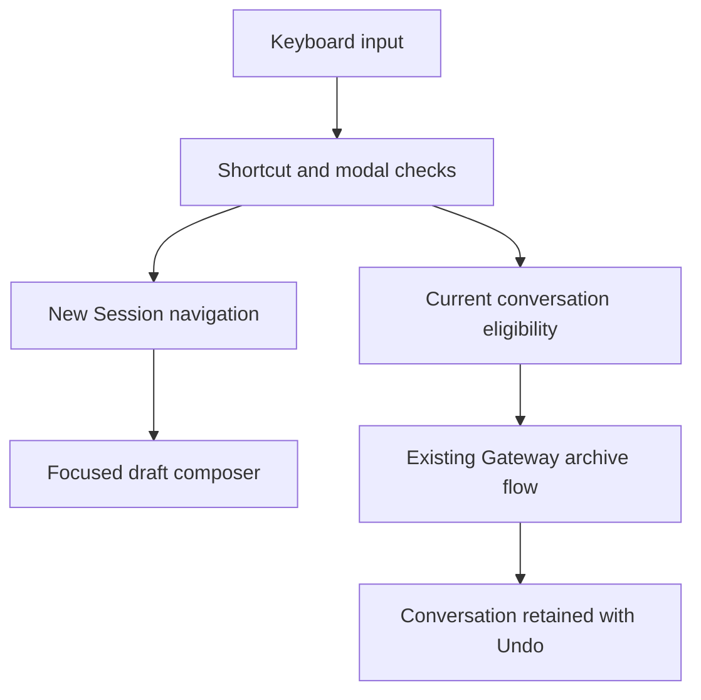

Codex review: needs maintainer review before merge. _Reviewed September 20, 2026, 5:48 AM ET / 09:48 UTC (Revision 2)._

# ClawSweeper review

## What this changes

Adds keyboard shortcuts for opening a focused New Session draft and archiving the current conversation, with matching help, tooltips, documentation, and browser/native coverage.

## Merge readiness

✅ **Ready for maintainer review**

Keep open: the capability remains absent from current main and the latest release. The introduced changes have no actionable correctness or security findings, and the inspected evidence supports the documented behavior.

**Priority:** P3
**Reviewed head:** `1bc5c977098418d9350b7d5faddd8fcf60700e6d`

## Review scores

| Measure | Result | What it means |
|---|---|---|
| **Overall readiness** | 🐚 platinum hermit **(4/6)** | A focused implementation with useful inspected visual proof, meaningful boundary coverage, and no actionable findings. |
| **Proof confidence** | 🦞 diamond lobster **(5/6)** ✨ media proof bonus | Sufficient (screenshot): Inspected screenshots from the reported isolated real-Gateway browser flow show both helper entries and successful Archive with the conversation retained and Undo available; the matching scenario also checks focused draft navigation, preserved text, and no unintended create/send effects. Physical OS accelerators and full native menu dispatch are explicitly outside the evidence claim. |
| **Patch quality** | 🐚 platinum hermit **(4/6)** | No actionable review findings were identified. |

## Verification

| Check | Result | Evidence |
|---|---|---|
| **Real behavior** | Verified | Sufficient (screenshot): Inspected screenshots from the reported isolated real-Gateway browser flow show both helper entries and successful Archive with the conversation retained and Undo available; the matching scenario also checks focused draft navigation, preserved text, and no unintended create/send effects. Physical OS accelerators and full native menu dispatch are explicitly outside the evidence claim. |
| **Evidence reviewed** | 8 items | Current main still lacks the shortcuts: The shortcut contract at the supplied main revision contains neither new binding; the existing native navigation and header archive operations remain the underlying supported paths. Latest release comparison: The shortcut contract retrieved at the supplied v2026.9.5 release commit also lacks both bindings; no shipped implementation was established. Archive preserves the existing mutation owner: The introduced handler selects the active pane's conversation, checks eligibility and modal/input state, and invokes the existing header action. The existing archive owner rechecks mutation scope and method access, carries the expected session identity, deduplicates pending requests, and supplies Undo. |
| **Findings** | None | None. |
| **Security** | None | None. |

## How this fits together

The Control UI routes keyboard input through its application shell and active chat pane. These shortcuts invoke existing draft navigation and Gateway-backed session actions, preserving archive recovery through Undo.

## Before merge

None.

<strong>Agent review details</strong>

### Security

None.

### PR surface

Source +164, Tests +640, Docs +29, Other +112. Total +945 across 34 files.

View PR surface stats

| Area | Files | Added | Removed | Net |
|---|---:|---:|---:|---:|
| Source | 21 | 220 | 56 | +164 |
| Tests | 11 | 681 | 41 | +640 |
| Docs | 1 | 29 | 0 | +29 |
| Config | 0 | 0 | 0 | 0 |
| Generated | 0 | 0 | 0 | 0 |
| Other | 1 | 112 | 0 | +112 |
| **Total** | **34** | **1042** | **97** | **+945** |

### Review metrics

| Metric | Value | Why it matters |
|---|---|---|
| **Production versus test growth** | Net production +156 lines; tests/support +752 lines; excludes docs and generated manifest | Production growth supports shortcut routing and discoverability, while most growth covers input ownership, recovery, and platform delivery. |

### Technical review

Best possible solution:

Keep shortcut matching centralized and route both actions through the existing navigation and archive owners, retaining visible control fallbacks and Undo.

Do we have a high-confidence way to reproduce the issue?

Not applicable as a bug reproduction: this adds shortcuts absent from current main; source and supplied browser evidence establish the intended interaction.

Is this the best way to solve the issue?

Yes. The patch extends the shared shortcut contract and reuses existing operations without adding a competing archive implementation, native command queue, or persisted setting.

AGENTS.md: found and applied where relevant.

Codex review notes: model internal, reasoning medium; reviewed against [244450952c01](https://github.com/openclaw/openclaw/commit/244450952c019eaffeced152f7c74ebaed1b8c6f).

### Labels

Label justifications:

- `P3`: This is a keyboard ergonomics improvement with existing clickable paths preserved.
- `rating: 🐚 platinum hermit`: Overall readiness is 🐚 platinum hermit; proof is 🦞 diamond lobster and patch quality is 🐚 platinum hermit.
- `status: 👀 ready for maintainer look`: ClawSweeper has no concrete contributor-facing blocker left for this PR. Sufficient (screenshot): Inspected screenshots from the reported isolated real-Gateway browser flow show both helper entries and successful Archive with the conversation retained and Undo available; the matching scenario also checks focused draft navigation, preserved text, and no unintended create/send effects. Physical OS accelerators and full native menu dispatch are explicitly outside the evidence claim.
- `proof: sufficient`: Contributor real behavior proof is sufficient. Inspected screenshots from the reported isolated real-Gateway browser flow show both helper entries and successful Archive with the conversation retained and Undo available; the matching scenario also checks focused draft navigation, preserved text, and no unintended create/send effects. Physical OS accelerators and full native menu dispatch are explicitly outside the evidence claim.
- `proof: 📸 screenshot`: Contributor real behavior proof includes screenshot evidence. Inspected screenshots from the reported isolated real-Gateway browser flow show both helper entries and successful Archive with the conversation retained and Undo available; the matching scenario also checks focused draft navigation, preserved text, and no unintended create/send effects. Physical OS accelerators and full native menu dispatch are explicitly outside the evidence claim.

### Evidence

What I checked:

- **Current main still lacks the shortcuts:** The shortcut contract at the supplied main revision contains neither new binding; the existing native navigation and header archive operations remain the underlying supported paths. ([`ui/src/lib/keyboard-shortcut-contract.ts:10`](https://github.com/openclaw/openclaw/blob/244450952c019eaffeced152f7c74ebaed1b8c6f/ui/src/lib/keyboard-shortcut-contract.ts#L10), [244450952c01](https://github.com/openclaw/openclaw/commit/244450952c019eaffeced152f7c74ebaed1b8c6f))
- **Latest release comparison:** The shortcut contract retrieved at the supplied v2026.9.5 release commit also lacks both bindings; no shipped implementation was established. ([`ui/src/lib/keyboard-shortcut-contract.ts:10`](https://github.com/openclaw/openclaw/blob/ec9c1a13db8938e5a3eaa51fca2e981cde2395a9/ui/src/lib/keyboard-shortcut-contract.ts#L10), [ec9c1a13db89](https://github.com/openclaw/openclaw/commit/ec9c1a13db8938e5a3eaa51fca2e981cde2395a9))
- **Archive preserves the existing mutation owner:** The introduced handler selects the active pane's conversation, checks eligibility and modal/input state, and invokes the existing header action. The existing archive owner rechecks mutation scope and method access, carries the expected session identity, deduplicates pending requests, and supplies Undo. ([`ui/src/pages/chat/chat-pane-session-menu.ts:62`](https://github.com/openclaw/openclaw/blob/1bc5c977098418d9350b7d5faddd8fcf60700e6d/ui/src/pages/chat/chat-pane-session-menu.ts#L62), [1bc5c9770984](https://github.com/openclaw/openclaw/commit/1bc5c977098418d9350b7d5faddd8fcf60700e6d))
- **Inspected visual and real-Gateway evidence:** All three prepared images were inspected: the keyboard helper displays both shortcuts, and the before/after conversation images show successful Archive with the transcript retained and Undo visible. The supplied proof comment reports an isolated real Gateway with synthetic conversations; the corresponding browser scenario checks New Session focus, successful archive/restore responses, draft preservation, and absence of creation/send requests. Screenshot delivery to the originating chat is attested in the captured PR body. ([`ui/src/e2e/command-palette-search.real-gateway.e2e.test.ts:622`](https://github.com/openclaw/openclaw/blob/1bc5c977098418d9350b7d5faddd8fcf60700e6d/ui/src/e2e/command-palette-search.real-gateway.e2e.test.ts#L622), [1bc5c9770984](https://github.com/openclaw/openclaw/commit/1bc5c977098418d9350b7d5faddd8fcf60700e6d))
- **Re-review continuity:** The GitHub comparison against the previously reviewed head confirms subsequent changes are host-contract dependency cleanup, archive-hint dependency cleanup, the tooltip expectation, and the native delivery fixture. The previous review retained no findings. Missing local historical blobs prevented the local comparison, so the exact pinned GitHub comparison was inspected instead. ([1bc5c9770984](https://github.com/openclaw/openclaw/commit/1bc5c977098418d9350b7d5faddd8fcf60700e6d))
- **Native proof boundary:** The test exercises both chords against body and composer focus through the owned Dashboard window, checking trusted WebKit events and unchanged draft text. It explicitly excludes physical keyboard input and NSApplication/menu dispatch; no production Swift bridge changes are introduced. ([`apps/macos/Tests/OpenClawIPCTests/DashboardSessionShortcutDeliveryTests.swift:65`](https://github.com/openclaw/openclaw/blob/1bc5c977098418d9350b7d5faddd8fcf60700e6d/apps/macos/Tests/OpenClawIPCTests/DashboardSessionShortcutDeliveryTests.swift#L65), [1bc5c9770984](https://github.com/openclaw/openclaw/commit/1bc5c977098418d9350b7d5faddd8fcf60700e6d))

Likely related people:

- **unknown:** The claimed source-line change could not be verified from bounded local history. (role: source history unknown; confidence: low)
- **unknown:** The claimed source-line change could not be verified from bounded local history. (role: source history unknown; confidence: low)

### Rating scale

| Score | Internal tier | Crab rank | Meaning |
|---:|:---:|---|---|
| **6/6** | S | 🦀 challenger crab | Exceptional readiness |
| **5/6** | A | 🦞 diamond lobster | Very strong readiness |
| **4/6** | B | 🐚 platinum hermit | Good normal PR; ordinary maintainer review |
| **3/6** | C | 🦐 gold shrimp | Useful, but confidence is limited |
| **2/6** | D | 🦪 silver shellfish | Proof or implementation needs work |
| **1/6** | F | 🧂 unranked krab | Not merge-ready |
| N/A | NA | 🌊 off-meta tidepool | Rating does not apply |

Overall follows the weaker of proof and patch quality.
Shiny media proof means a screenshot, video, or linked artifact directly shows the changed behavior. Runtime, network, CSP, and security claims still need visible diagnostics.

### Workflow

- ClawSweeper keeps one durable marker-backed review comment per issue or PR.
- Re-runs edit this comment so the latest verdict, findings, and automation markers stay together instead of adding duplicate bot comments.
- A fresh review can be triggered by eligible `@clawsweeper re-review` comments, exact-item GitHub events, scheduled/background review runs, or manual workflow dispatch.
- PR/issue authors and users with repository write access can comment `@clawsweeper re-review` or `@clawsweeper re-run` on an open PR or issue to request a fresh review only.
- Maintainers can also comment `@clawsweeper review` to request a fresh review only.
- Fresh-review commands do not start repair, autofix, rebase, CI repair, or automerge.
- Maintainer-only repair and merge flows require explicit commands such as `@clawsweeper autofix`, `@clawsweeper automerge`, `@clawsweeper fix ci`, or `@clawsweeper address review`.
- Maintainers can comment `@clawsweeper explain` to ask for more context, or `@clawsweeper stop` to stop active automation.

### History

Review history (1 earlier review cycle)

<!-- clawsweeper-review-history v=1 total=1 -->
- reviewed 2026-09-20T07:38:13.285Z sha ef49564d2621a46d2600bfef2e57871c9beb7a8f :: needs maintainer review before merge. :: none

<!-- clawsweeper-verdict:needs-human item=153537 sha=1bc5c977098418d9350b7d5faddd8fcf60700e6d confidence=high updated_at=2026-09-20T09:45:00Z reviewed_at=2026-09-20T09:48:14.545Z lease_owner=github-run-35503093740-1 lease_comment_id=5749029066 source_revision=a823d8fe0000b7c4d60242bbac49fb3949b57a9bbcf192b15bc3d1272f319d32 live_verification=absent -->
<!-- clawsweeper-review-state:ready item=153537 sha=1bc5c977098418d9350b7d5faddd8fcf60700e6d v=1 -->

<!-- clawsweeper-review-version item=153537 reviewed_at=2026-09-20T09:48:14.545Z sha=1bc5c977098418d9350b7d5faddd8fcf60700e6d source_revision=a823d8fe0000b7c4d60242bbac49fb3949b57a9bbcf192b15bc3d1272f319d32 lease_owner=github-run-35503093740-1 lease_comment_id=5749029066 v=1 -->

<!-- clawsweeper-review item=153537 -->