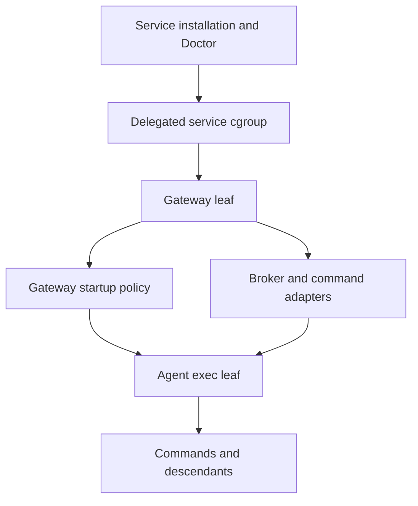

Codex review: blocked before merge.

## What this changes

This PR separates Linux agent commands from Gateway processes using delegated cgroups with aggregate IO and memory pressure limits and lower CPU priority.

**Example:** A Linux Gateway has a 4 GiB exec memory allowance and one backing device.
- **Before:** Agent disk writers share the Gateway cgroup without a separate aggregate IO ceiling.
- **After:** Agent commands receive approximately 6.8 MiB/s per direction while Gateway processes remain outside that ceiling.

## Review scores

| Measure | Result | What it means |
|---|---|---|
| **Overall readiness** | 🧂 unranked krab **(1/6)** | Useful direction, but concrete cleanup regressions and failed consumer checks remain, and the declared runtime and upgrade evidence is unfinished. |
| **Proof confidence** | 🧂 unranked krab **(1/6)** | Real behavior proof is not required for maintainer- or bot-authored pull requests. |
| **Patch quality** | 🦪 silver shellfish **(2/6)** | 6 actionable review findings remain. |

## Product

**Kind:** Performance · **Worth it:** Yes · **Fix scope:** Complete
**User problem:** Disk-heavy agent commands can delay Gateway SQLite writes and interactive requests.
**Reason:** The maintainer-authored direction explicitly accepts slower command IO to protect interactive service responsiveness.

## Merge readiness

⛔ **Blocked before merge - 8 items remain**

Keep open: this maintainer-directed performance improvement has value, but execution-cleanup regressions and unmigrated consumers block merge.

**Priority:** P2
**Reviewed head:** `3c9b1b3071a1fd8d4ab7137157df84648457dcb6`

## Before merge

- [ ] **Restore forced cancellation for the Windows fallback (P2)** - When native Job support or its launcher is unavailable, createChildAdapter uses an ordinary Windows child. Its SIGTERM branch only invokes non-forced taskkill and schedules neither escalation nor the hard-kill settlement deadline. This caller now invokes that branch once, so an uncooperative command can survive timeout or abort indefinitely while wait and cleanup remain pending. Preserve the previous bounded forced cancellation; this confirms the concern at https://github.com/openclaw/openclaw/pull/188379#discussion_r4424284824.
- [ ] **Preserve canonical errors when extinction confirmation rejects (P2)** - A POSIX relay that cannot confirm descendant extinction rejects waitForExtinction with an ordinary error. This join only converts a resolved Windows uncertain outcome, then rethrows rejected cleanup unchanged. Consequently a cancelled extension command loses ERR_COMMAND_PROCESS_CLEANUP_UNCERTAIN and its captured result, violating the contract established by https://github.com/openclaw/openclaw/pull/169629. Convert failed extinction confirmation to the canonical cleanup error and retain the command result and underlying failure.
- [ ] **Migrate the extension cleanup regression to the adapter owner (P2)** - loader.exec-cleanup.real.test.ts still spies on commands.spawnCommand and immediately extracts its returned child before entering cleanup. This path now calls createChildAdapter instead, so both cases fail before exercising cleanup classification and can leave the asynchronous fixture running. Exact-head CI confirms both failures. Update this consumer to observe the new owner while retaining real successful-cleanup and denied-forced-stop assertions.
- [ ] **Teach the survivor manager the new generated directives (P2)** - Every generated Gateway unit now includes Delegate and DelegateSubgroup, but scripts/e2e/lib/upgrade-survivor/systemd-fixture.mjs rejects any Service directive outside its fixed supported set, which lacks both keys. Newly generated units therefore fail installation or inspection with 'Unsupported survivor manager request or generated unit grammar'; exact-head upgrade-survivor CI confirms this. Update the copied manager contract and its relevant installation and lifecycle coverage.
- [ ] **Update audit fixtures for the expanded systemd query (P2)** - The new query and delegation audit leave two existing consumers stale: install.definition-repair.test.ts matches the old exact property string, so its concurrent-edit injection never runs, and systemd.environment-preservation.test.ts returns no delegation properties, producing a new unexpected audit issue. Exact-head CI confirms both failures. Update those fixtures while preserving the concurrent-edit refusal and operator-environment assertions.
- [ ] **Replace the relay test's obsolete argument-count assertion (P3)** - The Homebrew runtime regression in relay-integration.test.ts expects exactly three spawnProcess arguments. This call now supplies five, including undefined optional arguments for the ordinary route, so that existing check fails despite selecting the correct executable. Update or replace the assertion to protect stable-runtime selection without pinning incidental trailing argument count; exact-head CI reports this failure.
- [ ] **Add data-model compatibility proof** - The review found that existing stored data may not work after upgrade. Show that existing data still loads and works with this change.
- [ ] **Explain or restore the original intent of Extension execution and cleanup** - https://github.com/openclaw/openclaw/pull/169629: Uncertain descendant cleanup must produce a canonical error while preserving captured output and the root result.

## Findings

- [P2] Restore forced cancellation for the Windows fallback — `src/agents/sessions/exec.ts:102-105`
- [P2] Preserve canonical errors when extinction confirmation rejects — `src/agents/sessions/exec.ts:249-257`
- [P2] Migrate the extension cleanup regression to the adapter owner — `src/agents/sessions/exec.ts:130-141`

### Provenance

- `Extension execution and cleanup` changes intended behavior without addressing why it exists (https://github.com/openclaw/openclaw/pull/169629: Uncertain descendant cleanup must produce a canonical error while preserving captured output and the root result.)

### Tests

- Missing end-to-end proof: Supply the pending production-route kernel and comparative Gateway measurements plus fresh-install and latest-stable Doctor upgrade evidence; the placement regression's base-fail/head-pass result is not yet shown.

<strong>Agent review details</strong>

### How this fits together

Gateway startup prepares kernel resource policy; process brokers, command adapters, and PTY helpers place command trees into the exec cgroup while service installation and Doctor manage delegation.

### Technical review

Best possible solution:

Keep the shared cgroup placement design, restore bounded cancellation and canonical cleanup errors, and complete the existing consumer cutover.

Do we have a high-confidence way to reproduce the issue?

Source establishes the Windows cancellation and cleanup-classification regressions, and exact-head CI confirms several consumer failures; no target code was executed during this review.

Is this the best way to solve the issue?

One startup policy owner with placement at existing process boundaries is appropriate, but replacing extension execution must preserve its established cancellation and error contracts.

Full review comments:

- [P2] Restore forced cancellation for the Windows fallback — `src/agents/sessions/exec.ts:102-105`
  When native Job support or its launcher is unavailable, createChildAdapter uses an ordinary Windows child. Its SIGTERM branch only invokes non-forced taskkill and schedules neither escalation nor the hard-kill settlement deadline. This caller now invokes that branch once, so an uncooperative command can survive timeout or abort indefinitely while wait and cleanup remain pending. Preserve the previous bounded forced cancellation; this confirms the concern at https://github.com/openclaw/openclaw/pull/188379#discussion_r4424284824.
  Confidence: 0.99
- [P2] Preserve canonical errors when extinction confirmation rejects — `src/agents/sessions/exec.ts:249-257`
  A POSIX relay that cannot confirm descendant extinction rejects waitForExtinction with an ordinary error. This join only converts a resolved Windows uncertain outcome, then rethrows rejected cleanup unchanged. Consequently a cancelled extension command loses ERR_COMMAND_PROCESS_CLEANUP_UNCERTAIN and its captured result, violating the contract established by https://github.com/openclaw/openclaw/pull/169629. Convert failed extinction confirmation to the canonical cleanup error and retain the command result and underlying failure.
  Confidence: 0.98
- [P2] Migrate the extension cleanup regression to the adapter owner — `src/agents/sessions/exec.ts:130-141`
  loader.exec-cleanup.real.test.ts still spies on commands.spawnCommand and immediately extracts its returned child before entering cleanup. This path now calls createChildAdapter instead, so both cases fail before exercising cleanup classification and can leave the asynchronous fixture running. Exact-head CI confirms both failures. Update this consumer to observe the new owner while retaining real successful-cleanup and denied-forced-stop assertions.
  Confidence: 1
- [P2] Teach the survivor manager the new generated directives — `src/daemon/systemd-unit.ts:68-70`
  Every generated Gateway unit now includes Delegate and DelegateSubgroup, but scripts/e2e/lib/upgrade-survivor/systemd-fixture.mjs rejects any Service directive outside its fixed supported set, which lacks both keys. Newly generated units therefore fail installation or inspection with 'Unsupported survivor manager request or generated unit grammar'; exact-head upgrade-survivor CI confirms this. Update the copied manager contract and its relevant installation and lifecycle coverage.
  Confidence: 1
- [P2] Update audit fixtures for the expanded systemd query — `src/daemon/service-audit-systemd.ts:279-280`
  The new query and delegation audit leave two existing consumers stale: install.definition-repair.test.ts matches the old exact property string, so its concurrent-edit injection never runs, and systemd.environment-preservation.test.ts returns no delegation properties, producing a new unexpected audit issue. Exact-head CI confirms both failures. Update those fixtures while preserving the concurrent-edit refusal and operator-environment assertions.
  Confidence: 1
- [P3] Replace the relay test's obsolete argument-count assertion — `src/process/spawn-broker/relay-integration.ts:176-177`
  The Homebrew runtime regression in relay-integration.test.ts expects exactly three spawnProcess arguments. This call now supplies five, including undefined optional arguments for the ordinary route, so that existing check fails despite selecting the correct executable. Update or replace the assertion to protect stable-runtime selection without pinning incidental trailing argument count; exact-head CI reports this failure.
  Confidence: 1

Overall correctness: patch is incorrect
Overall confidence: 0.97

AGENTS.md: found and applied where relevant.

Codex review notes: model internal, reasoning medium; reviewed against [b186cf209834](https://github.com/openclaw/openclaw/commit/b186cf209834b649900be37cbbfd0ee22946cebf).

### Provenance checked

- `Broker execution ownership` keeps the original intent (https://github.com/openclaw/openclaw/pull/150564: Move native spawning off the large Gateway process while retaining admission, output, cancellation, and cleanup ownership.)
- `Systemd installer and audit policy` changes intended behavior with a stated reason (https://github.com/openclaw/openclaw/pull/151777: Distinguish stale installer policy from operator edits and report effective service-policy drift.)
- `PTY deferred launch` keeps the original intent (https://github.com/openclaw/openclaw/pull/164864: Keep launch admission tied to live owner-held authority through asynchronous preparation.)

### Testing

Proof path: in-process harness.

### Security

None.

### Evidence

Acceptance criteria:

- pnpm test src/agents/sessions/exec.test.ts src/agents/sessions/exec.real.test.ts src/agents/sessions/extensions/loader.exec-cleanup.real.test.ts --maxWorkers=1
- pnpm test src/process/supervisor/adapters/child.test.ts src/process/spawn-broker/relay-integration.test.ts --maxWorkers=1
- pnpm test src/daemon/systemd.environment-preservation.test.ts src/cli/daemon-cli/install.definition-repair.test.ts --maxWorkers=1
- pnpm test test/scripts/upgrade-survivor-systemd.test.ts test/scripts/docker-build-helper.test.ts --maxWorkers=1
- node scripts/check-changed.mjs

What I checked:

- **Pinned introduction and current main:** Reviewed the introduced parent-to-head diff at 3c9b1b3071a1fd8d4ab7137157df84648457dcb6; fetched main still uses the previous extension execution path. ([`src/agents/sessions/exec.ts:130`](https://github.com/openclaw/openclaw/blob/b186cf209834b649900be37cbbfd0ee22946cebf/src/agents/sessions/exec.ts#L130), [b186cf209834](https://github.com/openclaw/openclaw/commit/b186cf209834b649900be37cbbfd0ee22946cebf))
- **Maintainer direction and accepted tradeoff:** The maintainer-authored body deliberately accepts slower disk-heavy commands and the changed service layout, preserves unsupported-host execution, and explicitly marks route, repair, and comparative performance proof pending. ([3c9b1b3071a1](https://github.com/openclaw/openclaw/commit/3c9b1b3071a1fd8d4ab7137157df84648457dcb6))
- **Windows cancellation regression:** The new caller requests only SIGTERM; the ordinary Windows adapter sends non-forced taskkill without scheduling escalation, and portable installations explicitly support this fallback. ([`src/agents/sessions/exec.ts:105`](https://github.com/openclaw/openclaw/blob/3c9b1b3071a1fd8d4ab7137157df84648457dcb6/src/agents/sessions/exec.ts#L105), [3c9b1b3071a1](https://github.com/openclaw/openclaw/commit/3c9b1b3071a1fd8d4ab7137157df84648457dcb6))
- **Established cleanup classification:** https://github.com/openclaw/openclaw/pull/169629 established canonical uncertain-cleanup errors with captured results; the new extinction join forwards rejected relay errors without that classification. ([`src/agents/sessions/exec.ts:249`](https://github.com/openclaw/openclaw/blob/b82b033920ee7a4df6323e3ee2b04ac8c6037fe0/src/agents/sessions/exec.ts#L249), [b82b033920ee](https://github.com/openclaw/openclaw/commit/b82b033920ee7a4df6323e3ee2b04ac8c6037fe0))
- **Exact-head extension consumer failure:** CI reports both cleanup-classification cases failing with 'expected spawned command to be defined'; source confirms they still spy on the removed spawnCommand path, as previously reported at https://github.com/openclaw/openclaw/pull/188379#discussion_r4424284841. ([`src/agents/sessions/extensions/loader.exec-cleanup.real.test.ts:40`](https://github.com/openclaw/openclaw/blob/3c9b1b3071a1fd8d4ab7137157df84648457dcb6/src/agents/sessions/extensions/loader.exec-cleanup.real.test.ts#L40), [3c9b1b3071a1](https://github.com/openclaw/openclaw/commit/3c9b1b3071a1fd8d4ab7137157df84648457dcb6))
- **Exact-head service and relay consumer failures:** CI annotations and source agree that generated delegation directives exceed the survivor fixture grammar, audit fixtures omit the new properties or match the old query, and the relay assertion rejects the added optional arguments. ([`scripts/e2e/lib/upgrade-survivor/systemd-fixture.mjs:121`](https://github.com/openclaw/openclaw/blob/3c9b1b3071a1fd8d4ab7137157df84648457dcb6/scripts/e2e/lib/upgrade-survivor/systemd-fixture.mjs#L121), [3c9b1b3071a1](https://github.com/openclaw/openclaw/commit/3c9b1b3071a1fd8d4ab7137157df84648457dcb6))

### PR surface

Source +452, Tests +278, Docs +66, Other +553. Total +1349 across 38 files. Added test files: 2.

View PR surface stats

| Area | Files | Added | Removed | Net |
|---|---:|---:|---:|---:|
| Source | 21 | 628 | 176 | +452 |
| Tests | 9 | 492 | 214 | +278 |
| Docs | 2 | 66 | 0 | +66 |
| Config | 0 | 0 | 0 | 0 |
| Generated | 0 | 0 | 0 | 0 |
| Other | 6 | 553 | 0 | +553 |
| **Total** | **38** | **1739** | **390** | **+1349** |

### Review metrics

| Metric | Value | Why it matters |
|---|---|---|
| **New benchmark flag** | 1: --exec-io-storm | Adds an opt-in disk-contention workload to the existing performance harness; introduces no production configuration knob. |

### Labels

Label changes:

- add `P2`: Resource isolation is a useful performance improvement with platform-specific execution regressions requiring normal-priority repair.
- add `merge-risk: 🚨 compatibility`: Changes generated service layout and extension cleanup behavior; the service-layout tradeoff is explicitly accepted in the maintainer-authored body.
- add `merge-risk: 🚨 availability`: Windows fallback commands can remain running indefinitely after timeout or abort.
- add `merge-risk: 🚨 automation`: Generated units now fail the copied survivor manager's grammar, breaking install and upgrade proof paths.
- add `rating: 🧂 unranked krab`: Overall readiness is 🧂 unranked krab; proof is 🧂 unranked krab and patch quality is 🦪 silver shellfish.
- add `status: ⏳ waiting on author`: ClawSweeper has contributor-facing work open and is waiting for author action.

Label justifications:

- `P2`: Resource isolation is a useful performance improvement with platform-specific execution regressions requiring normal-priority repair.
- `merge-risk: 🚨 compatibility`: Changes generated service layout and extension cleanup behavior; the service-layout tradeoff is explicitly accepted in the maintainer-authored body.
- `merge-risk: 🚨 availability`: Windows fallback commands can remain running indefinitely after timeout or abort.
- `merge-risk: 🚨 automation`: Generated units now fail the copied survivor manager's grammar, breaking install and upgrade proof paths.
- `rating: 🧂 unranked krab`: Overall readiness is 🧂 unranked krab; proof is 🧂 unranked krab and patch quality is 🦪 silver shellfish.
- `status: ⏳ waiting on author`: ClawSweeper has contributor-facing work open and is waiting for author action.

### Rating scale

6/6 🦀 challenger crab · 5/6 🦞 diamond lobster · 4/6 🐚 platinum hermit · 3/6 🦐 gold shrimp · 2/6 🦪 silver shellfish · 1/6 🧂 unranked krab. Overall follows the weaker of proof and patch quality; ✨ marks media proof (a screenshot, video, or linked artifact) that directly shows the changed behavior.

### Workflow

ClawSweeper edits this one comment on every review. Comment `@clawsweeper re-review` for a fresh review only. Repair and merge execution lanes are retired.

_Reviewed October 30, 2026, 9:59 AM ET / 13:59 UTC._

<!-- clawsweeper-verdict:needs-human item=188379 sha=3c9b1b3071a1fd8d4ab7137157df84648457dcb6 confidence=high updated_at=2026-10-30T13:53:36Z reviewed_at=2026-10-30T13:59:46.596Z lease_owner=github-run-41066865385-1 lease_comment_id=6524475718 source_revision=89d4bce2ac03589a69a3651b90f4be4845c8a365a5c1dbbe8f94410041e0edf5 hold=blocked findings=6 -->
<!-- clawsweeper-review-state:blocked item=188379 sha=3c9b1b3071a1fd8d4ab7137157df84648457dcb6 v=1 -->

<!-- clawsweeper-review-version item=188379 reviewed_at=2026-10-30T13:59:46.596Z sha=3c9b1b3071a1fd8d4ab7137157df84648457dcb6 source_revision=89d4bce2ac03589a69a3651b90f4be4845c8a365a5c1dbbe8f94410041e0edf5 lease_owner=github-run-41066865385-1 lease_comment_id=6524475718 v=1 -->

<!-- clawsweeper-review item=188379 -->