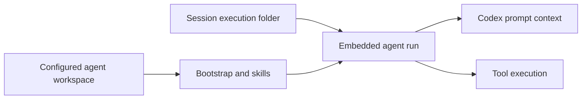

Codex review: needs changes before merge. _Reviewed August 18, 2026, 3:19 AM ET / 07:19 UTC._

# ClawSweeper review

## What this changes

The PR makes configured agent bootstrap files, memory guidance, and skill snapshots available when a session executes from a separate folder or managed worktree.

## Merge readiness

⛔ **Blocked by patch quality or review findings - 9 items remain**

Keep open: the patch leaves non-sandboxed embedded runs without a skill snapshot loading skills from the execution folder, contrary to its configured-agent workspace invariant. The prior release-owned changelog finding also remains unresolved.

**Priority:** P2
**Reviewed head:** `e9bbdeca190e39ffef0ae1695ab123644f3a1630`

## Review scores

| Measure | Result | What it means |
|---|---|---|
| **Overall readiness** | 🦪 silver shellfish **(2/6)** | The patch has focused tests but a concrete fallback-path defect and an unresolved native-Codex contract check. |
| **Proof confidence** | 🌊 off-meta tidepool | Not applicable: The repository metadata classifies this as a member-authored PR, so the external-contributor proof gate does not apply; repository policy still calls for real split-workspace validation before landing. |
| **Patch quality** | 🦪 silver shellfish **(2/6)** | 2 actionable review findings remain. |

## Verification

| Check | Result | Evidence |
|---|---|---|
| **Real behavior** | Not applicable | Not applicable: The repository metadata classifies this as a member-authored PR, so the external-contributor proof gate does not apply; repository policy still calls for real split-workspace validation before landing. |
| **Evidence reviewed** | 8 items | Bootstrap owner is threaded only to bootstrap preparation: The branch passes the canonical agent workspace as bootstrapWorkspaceDir into the embedded run, but not to skill preparation.<br>Fallback skill discovery still uses execution workspace: When no snapshot is supplied, prepareEmbeddedAttemptSkills passes effectiveWorkspace to resolveSandboxSkillRuntimeInputs, which uses it as both skill source and prompt workspace for non-sandboxed runs.<br>Auto-reply path is only one caller path: The new configured workspace is used when auto-reply persists a reusable snapshot, but embedded-run callers without that snapshot retain the fallback behavior. |
| **Findings** | 2 actionable findings | [P2] Route fallback skill discovery through the bootstrap workspace<br>[P3] Remove the release-owned changelog entry |
| **Security** | None | None. |


### Live Verification

**Command:** `pnpm openclaw --help`

**Result:** PASS (completed)

```text
pnpm openclaw --help
runner@runnervmzvulz:~/work/clawsweeper/clawsweeper/target-pr$ pnpm openclaw --help
$ node scripts/run-node.mjs --help
pnpm openclaw --help
[openclaw] Building TypeScript (dist is stale: missing_build_stamp - build stamp missing).
[openclaw] Building bundled plugin assets.
[canvas] build: node scripts/bundle-a2ui.mjs
[log] ‹DIR›/a2ui.bundle.js  chunk │ size: 399.88 kB
[log]
[success] rolldown v1.2.0 Finished in 64.67 ms
[diffs] build: node --import tsx ../../scripts/build-diffs-viewer-runtime.mts curated
[diffs-language-pack] build: node --import tsx ../../scripts/build-diffs-viewer-runtime.mts full
[discord] build: node --import tsx ../../scripts/build-discord-activity-sdk.mts
[tsdown-build] invocation 1/2 finished in 0.7s
node_modules/playwright-core/lib/coreBundle.js (65821:28) [EVAL] Use of direct ˋevalˋ function is strongly discouraged as it poses security risks and may cause
issues with minification.
       ╭─[ node_modules/playwright-core/lib/coreBundle.js:65821:29 ]
       │
 65821 │               const value = eval(ˋ(${expr})ˋ);
       │                             ──┬─
       │                               ╰─── Use of direct ˋevalˋ here.
       │
       │ Help: Consider using indirect eval. For more information, check the documentation: https://rolldown.rs/guide/troubleshooting#avoiding-direct-eval
───────╯

node_modules/playwright-core/lib/coreBundle.js (65828:28) [EVAL] Use of direct ˋevalˋ function is strongly discouraged as it poses security risks and may cause
issues with minification.
       ╭─[ node_modules/playwright-core/lib/coreBundle.js:65828:29 ]
       │
 65828 │               const value = eval(ˋ(${expr})ˋ);
       │                             ──┬─
       │                               ╰─── Use of direct ˋevalˋ here.
       │
       │ Help: Consider using indirect eval. For more information, check the documentation: https://rolldown.rs/guide/troubleshooting#avoiding-direct-eval
───────╯

node_modules/web-tree-sitter/web-tree-sitter.js (2343:30) [EVAL] Use of direct ˋevalˋ function is strongly discouraged as it poses security risks and may cause
issues with minification.
      ╭─[ node_modules/web-tree-sitter/web-tree-sitter.js:2343:31 ]
      │
 2343 │           ASM_CONSTS[start] = eval(func);
      │                               ──┬─
      │                                 ╰─── Use of direct ˋevalˋ here.
      │
      │ Help: Consider using indirect eval. For more information, check the documentation: https://rolldown.rs/guide/troubleshooting#avoiding-direct-eval
──────╯

node_modules/web-tree-sitter/web-tree-sitter.js (2366:32) [EVAL] Use of direct ˋevalˋ function is strongly discouraged as it poses security risks and may cause
issues with minification.
      ╭─[ node_modules/web-tree-sitter/web-tree-sitter.js:2366:33 ]
      │
 2366 │           moduleExports[name] = eval(func);
      │                                 ──┬─
      │                                   ╰─── Use of direct ˋevalˋ here.
      │
      │ Help: Consider using indirect eval. For more information, check the documentation: https://rolldown.rs/guide/troubleshooting#avoiding-direct-eval
──────╯

[tsdown-build] invocation 2/2 finished in 12.8s
[plugin-control-plane-loads] verified 36 built modules with native require and checked doctor closures
runtime-postbuild: 10 phases completed in 4298ms (slowest: built plugin control-plane loads 3406ms)

OpenClaw 2026.8.1 (e9bbdec) — All your chats, one OpenClaw.

Usage: openclaw [options] [command]

Options:
  --container ‹name›   Run the CLI inside a running Podman/Docker container named ‹name› (default: env OPENCLAW_CONTAINER)
  --dev                Dev profile: isolate state under ~/.openclaw-dev, default gateway port 19001, and shift derived ports (browser/canvas)
  -h, --help           Display help for command
  --log-level ‹level›  Global log level override for file + console (silent|fatal|error|warn|info|debug|trace)
  --no-color          
… output truncated …
```

**Assertions:**

- PASS `expect_output`: Usage:

## How this fits together

Embedded runs execute tools in a session-selected folder, while agent bootstrap files and skills define the configured agent’s identity. The Codex plugin consumes that prepared context to build native-harness instructions.



## Before merge

- [ ] **Route fallback skill discovery through the bootstrap workspace (P2)** - `bootstrapWorkspaceDir` reaches bootstrap preparation, but `prepareEmbeddedAttemptSkills` still resolves non-sandboxed skills from `effectiveWorkspace`. External embedded runs without `skillsSnapshot` therefore keep loading skills from the session execution folder, contradicting the configured-agent workspace rule. Thread the bootstrap workspace into this fallback and cover it with a regression test.
- [ ] **Remove the release-owned changelog entry (P3)** - The earlier review requested removal of this normal-PR changelog entry, and it is unchanged on the reviewed head. Keep release-note context in the PR body or commit message instead.
- [ ] **Resolve merge risk (P1)** - The branch leaves direct external embedded runs without a persisted skills snapshot reading skills from the session execution workspace rather than the configured agent workspace.
- [ ] **Resolve merge risk (P2)** - This bug fix has a production delta of +47/-15; the remaining growth is not justified while the fallback owner boundary is incomplete.
- [ ] **Resolve merge risk (P1)** - Direct native Codex behavior still needs authoritative sibling-Codex contract inspection before merge.
- [ ] **Complete next step (P2)** - A focused repair can complete the missing fallback owner boundary and remove the release-owned file without product-direction choices.
- [ ] **Improve patch quality** - Route fallback skill discovery through bootstrapWorkspaceDir and add an owner-boundary regression test.
- [ ] **Improve patch quality** - Remove the release-owned changelog entry.
- [ ] **Improve patch quality** - Attach a redacted external-session validation transcript before marking the draft ready.

## Findings

- [P2] Route fallback skill discovery through the bootstrap workspace — `src/agents/embedded-agent-runner/run-orchestrator.ts:424`
- [P3] Remove the release-owned changelog entry — `CHANGELOG.md:72`


<details>
<summary><strong>Agent review details</strong></summary>

### Security

None.

### PR surface

Source +32, Tests +106, Docs +1. Total +139 across 16 files.

<details>
<summary>View PR surface stats</summary>

| Area | Files | Added | Removed | Net |
|---|---:|---:|---:|---:|
| Source | 11 | 47 | 15 | +32 |
| Tests | 3 | 106 | 0 | +106 |
| Docs | 2 | 3 | 2 | +1 |
| Config | 0 | 0 | 0 | 0 |
| Generated | 0 | 0 | 0 | 0 |
| Other | 0 | 0 | 0 | 0 |
| **Total** | **16** | **156** | **17** | **+139** |

</details>

### Review metrics

| Metric | Value | Why it matters |
|---|---|---|
| **Production versus test delta** | production +47/-15, tests +106/-0, docs +2/-2, release file +1/-0 | Positive production growth for this bug fix is only warranted once all bootstrap and skill-owner paths share the same workspace invariant. |

### Stored data model

Persistent data-model change detected: `serialized state: extensions/codex/src/app-server/attempt-context.test.ts`, `serialized state: src/agents/embedded-agent-runner/run/attempt-bootstrap-prepare.test.ts`. Confirm migration or upgrade compatibility proof before merge.

### Merge-risk options

**Maintainer options:**
1. **Complete split-workspace skill ownership (recommended)**  
   Route non-sandboxed fallback skill discovery through the configured bootstrap workspace and add regression coverage before merge.

### Technical review

Best possible solution:

Make unsandboxed fallback skill discovery derive its source from bootstrapWorkspaceDir, preserve sandbox materialization and execution CWD, remove the release-owned changelog entry, and prove the split in a real external-session run.

Do we have a high-confidence way to reproduce the issue?

Yes—source inspection shows that an external embedded run without skillsSnapshot reaches fallback skill resolution rooted at effectiveWorkspace, not bootstrapWorkspaceDir.

Is this the best way to solve the issue?

No—the workspace split is only partially propagated; the fallback skill owner must follow the configured agent workspace too.

Full review comments:

- [P2] Route fallback skill discovery through the bootstrap workspace — `src/agents/embedded-agent-runner/run-orchestrator.ts:424`
  `bootstrapWorkspaceDir` reaches bootstrap preparation, but `prepareEmbeddedAttemptSkills` still resolves non-sandboxed skills from `effectiveWorkspace`. External embedded runs without `skillsSnapshot` therefore keep loading skills from the session execution folder, contradicting the configured-agent workspace rule. Thread the bootstrap workspace into this fallback and cover it with a regression test.
  Confidence: 0.91
- [P3] Remove the release-owned changelog entry — `CHANGELOG.md:72`
  The earlier review requested removal of this normal-PR changelog entry, and it is unchanged on the reviewed head. Keep release-note context in the PR body or commit message instead.
  Confidence: 0.99

Overall correctness: patch is incorrect
Overall confidence: 0.91

AGENTS.md: found and applied where relevant.

Codex review notes: model internal, reasoning high; reviewed against [abd4f6712c12](https://github.com/openclaw/openclaw/commit/abd4f6712c12c69a79c4b8512fc96f137025d686).

### Labels

Label changes:

- add `rating: 🦪 silver shellfish`: Overall readiness is 🦪 silver shellfish; proof is 🌊 off-meta tidepool and patch quality is 🦪 silver shellfish. Replaced prior `rating: 🦐 gold shrimp`.
- remove `rating: 🦐 gold shrimp`: Current PR rating is `rating: 🦪 silver shellfish`, so this older rating label is no longer current.

Label justifications:

- `P2`: The patch addresses a bounded session-context bug but leaves a reachable fallback skill path inconsistent with the intended behavior.
- `merge-risk: 🚨 compatibility`: Merging changes which existing external-session runs receive agent bootstrap, memory, and skill inputs.
- `rating: 🦪 silver shellfish`: Overall readiness is 🦪 silver shellfish; proof is 🌊 off-meta tidepool and patch quality is 🦪 silver shellfish. Replaced prior `rating: 🦐 gold shrimp`.
- `status: 👀 ready for maintainer look`: ClawSweeper has no concrete contributor-facing blocker left for this PR. Not applicable: The repository metadata classifies this as a member-authored PR, so the external-contributor proof gate does not apply; repository policy still calls for real split-workspace validation before landing.

### Evidence

Acceptance criteria:

- [P1] pnpm test src/agents/embedded-agent-runner/run/attempt-setup.test.ts.
- [P1] pnpm test src/agents/embedded-agent-runner/run/attempt-bootstrap-prepare.test.ts.
- [P1] pnpm test src/auto-reply/reply/get-reply-run.media-only.test.ts.
- [P1] pnpm test extensions/codex/src/app-server/attempt-context.test.ts.

What I checked:

- **Bootstrap owner is threaded only to bootstrap preparation:** The branch passes the canonical agent workspace as bootstrapWorkspaceDir into the embedded run, but not to skill preparation. ([`src/agents/embedded-agent-runner/run-orchestrator.ts:424`](https://github.com/openclaw/openclaw/blob/e9bbdeca190e/src/agents/embedded-agent-runner/run-orchestrator.ts#L424), [e9bbdeca190e](https://github.com/openclaw/openclaw/commit/e9bbdeca190e))
- **Fallback skill discovery still uses execution workspace:** When no snapshot is supplied, prepareEmbeddedAttemptSkills passes effectiveWorkspace to resolveSandboxSkillRuntimeInputs, which uses it as both skill source and prompt workspace for non-sandboxed runs. ([`src/agents/embedded-agent-runner/run/attempt-setup.ts:509`](https://github.com/openclaw/openclaw/blob/e9bbdeca190e/src/agents/embedded-agent-runner/run/attempt-setup.ts#L509), [e9bbdeca190e](https://github.com/openclaw/openclaw/commit/e9bbdeca190e))
- **Auto-reply path is only one caller path:** The new configured workspace is used when auto-reply persists a reusable snapshot, but embedded-run callers without that snapshot retain the fallback behavior. ([`src/auto-reply/reply/get-reply-run-admission.ts:198`](https://github.com/openclaw/openclaw/blob/e9bbdeca190e/src/auto-reply/reply/get-reply-run-admission.ts#L198), [e9bbdeca190e](https://github.com/openclaw/openclaw/commit/e9bbdeca190e))
- **Current main does not already contain the branch behavior:** Direct tree comparison against current main shows this branch adds the separate bootstrap workspace routing; it is not already implemented on main. ([`src/agents/embedded-agent-runner/run/attempt-bootstrap-prepare.ts:37`](https://github.com/openclaw/openclaw/blob/abd4f6712c12/src/agents/embedded-agent-runner/run/attempt-bootstrap-prepare.ts#L37), [abd4f6712c12](https://github.com/openclaw/openclaw/commit/abd4f6712c12))
- **Coverage does not exercise the fallback owner path:** The added tests verify bootstrap files, Codex context, and auto-reply context fields, but none constructs an external embedded run without skillsSnapshot and observes its skill source. ([`src/agents/embedded-agent-runner/run/attempt-bootstrap-prepare.test.ts:15`](https://github.com/openclaw/openclaw/blob/e9bbdeca190e/src/agents/embedded-agent-runner/run/attempt-bootstrap-prepare.test.ts#L15), [e9bbdeca190e](https://github.com/openclaw/openclaw/commit/e9bbdeca190e))
- **Prior changelog finding remains on the same head:** The release-owned changelog entry remains present on the current reviewed SHA after the earlier ClawSweeper review requested its removal. ([`CHANGELOG.md:72`](https://github.com/openclaw/openclaw/blob/e9bbdeca190e/CHANGELOG.md#L72), [e9bbdeca190e](https://github.com/openclaw/openclaw/commit/e9bbdeca190e))

Likely related people:

- **steipete:** The current changed owner boundary is blamed to Peter Steinberger’s PR-head commit; the supplied local history contains no earlier commits for stronger attribution. (role: recent area contributor; confidence: medium; commits: [e9bbdeca190e](https://github.com/openclaw/openclaw/commit/e9bbdeca190e39ffef0ae1695ab123644f3a1630); files: `src/agents/embedded-agent-runner/run-orchestrator.ts`, `src/agents/embedded-agent-runner/run/attempt-setup.ts`, `extensions/codex/src/app-server/attempt-context.ts`)

### Rating scale

| Score | Internal tier | Crab rank | Meaning |
|---:|:---:|---|---|
| **6/6** | S | 🦀 challenger crab | Exceptional readiness |
| **5/6** | A | 🦞 diamond lobster | Very strong readiness |
| **4/6** | B | 🐚 platinum hermit | Good normal PR; ordinary maintainer review |
| **3/6** | C | 🦐 gold shrimp | Useful, but confidence is limited |
| **2/6** | D | 🦪 silver shellfish | Proof or implementation needs work |
| **1/6** | F | 🧂 unranked krab | Not merge-ready |
| N/A | NA | 🌊 off-meta tidepool | Rating does not apply |

Overall follows the weaker of proof and patch quality.
Shiny media proof means a screenshot, video, or linked artifact directly shows the changed behavior. Runtime, network, CSP, and security claims still need visible diagnostics.

### Workflow

- ClawSweeper keeps one durable marker-backed review comment per issue or PR.
- Re-runs edit this comment so the latest verdict, findings, and automation markers stay together instead of adding duplicate bot comments.
- A fresh review can be triggered by eligible `@clawsweeper re-review` comments, exact-item GitHub events, scheduled/background review runs, or manual workflow dispatch.
- PR/issue authors and users with repository write access can comment `@clawsweeper re-review` or `@clawsweeper re-run` on an open PR or issue to request a fresh review only.
- Maintainers can also comment `@clawsweeper review` to request a fresh review only.
- Fresh-review commands do not start repair, autofix, rebase, CI repair, or automerge.
- Maintainer-only repair and merge flows require explicit commands such as `@clawsweeper autofix`, `@clawsweeper automerge`, `@clawsweeper fix ci`, or `@clawsweeper address review`.
- Maintainers can comment `@clawsweeper explain` to ask for more context, or `@clawsweeper stop` to stop active automation.

</details>

<!-- clawsweeper-verdict:needs-human item=125675 sha=e9bbdeca190e39ffef0ae1695ab123644f3a1630 confidence=high updated_at=2026-08-18T07:16:16Z reviewed_at=2026-08-18T07:19:26.878Z lease_owner=github-run-32110052685-1 lease_comment_id=5324885621 source_revision=c8184c5c565f7a567df9fb059f4a8d6c39fef3a96acd450f9496d24d4337fc9e -->

<!-- clawsweeper-review-version item=125675 reviewed_at=2026-08-18T07:19:26.878Z sha=e9bbdeca190e39ffef0ae1695ab123644f3a1630 source_revision=c8184c5c565f7a567df9fb059f4a8d6c39fef3a96acd450f9496d24d4337fc9e lease_owner=github-run-32110052685-1 lease_comment_id=5324885621 v=1 -->

<!-- clawsweeper-review item=125675 -->