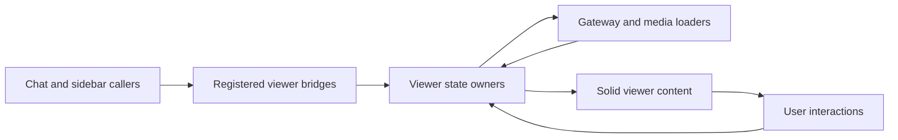

Codex review: needs changes before merge.

## What this changes

This PR migrates shared link readers, file previews, and media lightboxes from Lit to Solid while retaining their registered tags and interaction contracts.

**Example:** Open src/viewer.ts in the shared file preview.
- **Before:** Lit renders the file list, source contents, Copy action, and keyboard controls.
- **After:** Solid renders those controls through the existing openclaw-file-preview-modal tag.

## Review scores

| Measure | Result | What it means |
|---|---|---|
| **Overall readiness** | 🦐 gold shrimp **(3/6)** | Useful migration with inspected component proof and passing checks, held by one concrete keyboard dismissal defect. |
| **Proof confidence** | 🦐 gold shrimp **(3/6)** ✨ media proof bonus | Sufficient (screenshot): Supplied Chrome fixtures exercise the migrated production viewer components with synthetic inputs; inspected before/after screenshots cover reader, file preview, lightbox, hovercard, and shadow-root presentation, while CI supports interaction coverage without proving the newly identified mounting case. |
| **Patch quality** | 🦐 gold shrimp **(3/6)** | 1 actionable review finding remain. |

## Product

**Kind:** Refactor · **Worth it:** Yes · **Fix scope:** Complete
**User problem:** Existing shared viewers must retain their interactions as the Control UI adopts Solid.
**Reason:** The established migration direction preserves current viewer capabilities and keeps transport ownership intact without introducing settings or public plugin API changes.

## Merge readiness

⛔ **Needs changes before merge - 1 item remains**

Keep this PR open: it advances the approved Solid migration, but the latest focus-recovery change can leave keyboard hovercards stuck open.

**Priority:** P2
**Reviewed head:** `5a23a721f26774dccdf4856e1385b86014b42a86`

## Before merge

- [ ] **Recover focused anchors with keyboard intent (P2)** - When an already-registered provider is appended and its anchor is focused before the bridge's mounting microtask, this recovery calls activateFocusedAnchor, which always activates with trigger "pointer" and the hover delay. That sets hovercard.pointerInside=true although the pointer never entered the anchor. Moving focus to an outside control clears only focusInside, so PortaledHovercardController.scheduleClose sees the card as held and leaves it open; moving focus away before the delay can also allow a late card to appear. The existing keyboard-exit tests await mounting before focusing and miss this path. Recover through the focus activation rules, including the ordinary-page focus-visible check, and extend the dismissal regression to focus before mounting without pointer events.

## Findings

- [P2] Recover focused anchors with keyboard intent — `ui/src/components/link-reader-hovercard-owner.ts:287-290`

### Tests

- Missing end-to-end proof: The supplied component captures do not exercise pre-mount keyboard focus followed by leaving the recovered hovercard.

<strong>Agent review details</strong>

### How this fits together

Control UI callers supply documents, files, and media to registered viewers; existing owners manage requests and resource lifetimes while Solid presents content and dispatches interactions.

### Technical review

Best possible solution:

Preserve the single-renderer migration and recover pre-mount focus through the existing keyboard-intent and dismissal rules.

Do we have a high-confidence way to reproduce the issue?

Source establishes the failure when an already-registered provider is appended and its link receives focus before the bridge mounts; no target code was executed during this read-only review.

Is this the best way to solve the issue?

The migration uses the established bridge and preserves request owners, but recovered focus must retain its actual trigger instead of fabricating pointer intent.

Full review comments:

- [P2] Recover focused anchors with keyboard intent — `ui/src/components/link-reader-hovercard-owner.ts:287-290`
  When an already-registered provider is appended and its anchor is focused before the bridge's mounting microtask, this recovery calls activateFocusedAnchor, which always activates with trigger "pointer" and the hover delay. That sets hovercard.pointerInside=true although the pointer never entered the anchor. Moving focus to an outside control clears only focusInside, so PortaledHovercardController.scheduleClose sees the card as held and leaves it open; moving focus away before the delay can also allow a late card to appear. The existing keyboard-exit tests await mounting before focusing and miss this path. Recover through the focus activation rules, including the ordinary-page focus-visible check, and extend the dismissal regression to focus before mounting without pointer events.
  Confidence: 0.99

Overall correctness: patch is incorrect
Overall confidence: 0.98

AGENTS.md: found and applied where relevant.

Codex review notes: model internal, reasoning medium; reviewed against [fc0720162ede](https://github.com/openclaw/openclaw/commit/fc0720162ede7718b7b3ce6af28da9fc41cbc8f8).

### Provenance checked

- `Shared bridge` keeps the original intent (eca633a8801b0b884d88fe65e7096a4760102b83: Bridge remaining Lit callers to one Solid implementation while preserving properties, caller content, context, and lifecycle timing.)
- `Link reader and hover ownership` keeps the original intent (https://github.com/openclaw/openclaw/pull/148464: Present read-only documents beside chat while keeping transport and caller authority with their existing owners.)
- `Image viewer` keeps the original intent (0226ad50fac70e3dd428ad3f674a12af539f92b0: Present already-authorized media through the shared modal while retaining focus and source lifetimes.)
- `Skill-bundle file viewer` keeps the original intent (a11a431e380ff7272b8deee44f494e16a9de6692: Browse complete skill bundles with relative document navigation and consumer-specific controls.)

### Testing

Proof path: in-process harness.

### Security

None.

### Evidence

Acceptance criteria:

- pnpm test ui/src/components/link-reader-hovercard-interactions.test.ts --maxWorkers=1
- pnpm test ui/src/components/link-reader-hovercard-seeds.test.ts --maxWorkers=1
- pnpm test ui/src/app/native-link-routing.test.ts --maxWorkers=1
- git diff --check

What I checked:

- **Approved migration contract:** The UI policy requires Solid migration, synchronous domain owners, and one implementation per registered tag; the change follows that established direction. ([`ui/AGENTS.md:5`](https://github.com/openclaw/openclaw/blob/5a23a721f26774dccdf4856e1385b86014b42a86/ui/AGENTS.md#L5), [5a23a721f267](https://github.com/openclaw/openclaw/commit/5a23a721f26774dccdf4856e1385b86014b42a86))
- **New focus-recovery defect:** The latest commit invokes a pointer-intent helper for an already-focused anchor after mounting, setting pointerInside without a pointer event. ([`ui/src/components/link-reader-hovercard-owner.ts:290`](https://github.com/openclaw/openclaw/blob/5a23a721f26774dccdf4856e1385b86014b42a86/ui/src/components/link-reader-hovercard-owner.ts#L290), [5a23a721f267](https://github.com/openclaw/openclaw/commit/5a23a721f26774dccdf4856e1385b86014b42a86))
- **Dismissal causal chain:** Focus-out clears focusInside only; the portal's held predicate still sees pointerInside, so scheduleClose returns without dismissing the recovered card. ([`ui/src/components/portaled-hovercard.ts:137`](https://github.com/openclaw/openclaw/blob/5a23a721f26774dccdf4856e1385b86014b42a86/ui/src/components/portaled-hovercard.ts#L137), [5a23a721f267](https://github.com/openclaw/openclaw/commit/5a23a721f26774dccdf4856e1385b86014b42a86))
- **Existing coverage misses the mounting case:** Keyboard dismissal tests await provider.updateComplete before focusing, bypassing the new recovery path. ([`ui/src/components/link-reader-hovercard-interactions.test.ts:533`](https://github.com/openclaw/openclaw/blob/5a23a721f26774dccdf4856e1385b86014b42a86/ui/src/components/link-reader-hovercard-interactions.test.ts#L533), [5a23a721f267](https://github.com/openclaw/openclaw/commit/5a23a721f26774dccdf4856e1385b86014b42a86))
- **Prior fixes and validation:** Containing-root hit testing, reactive translations, inherited theme tokens, light-DOM queries, and connected-child adoption are present; CI run https://github.com/openclaw/openclaw/actions/runs/38131082563 completed successfully on the reviewed head, resolving the previous check blocker. ([5a23a721f267](https://github.com/openclaw/openclaw/commit/5a23a721f26774dccdf4856e1385b86014b42a86))
- **Inspected visual evidence:** All five supplied Chrome before/after pairs were inspected: reader, file preview, image lightbox, hovercard, and shadow-root lightbox; they show component presentation with synthetic content, not keyboard dismissal during mounting. ([5a23a721f267](https://github.com/openclaw/openclaw/commit/5a23a721f26774dccdf4856e1385b86014b42a86))

Likely related people:

- **Peter Steinberger:** Raw commit eca633a8801b0b884d88fe65e7096a4760102b83 adds ui/src/lit/solid-bridge.ts:13 relative to its recorded parents. This identifies author metadata, not feature responsibility or a PR merger. (role: source-line author; confidence: high; commits: [eca633a8801b](https://github.com/openclaw/openclaw/commit/eca633a8801b0b884d88fe65e7096a4760102b83); files: `ui/src/lit/solid-bridge.ts`)

### PR surface

Source +817, Tests +151, Docs +5, Other -1. Total +972 across 44 files. Added test files: 0.

View PR surface stats

| Area | Files | Added | Removed | Net |
|---|---:|---:|---:|---:|
| Source | 28 | 4725 | 3908 | +817 |
| Tests | 14 | 462 | 311 | +151 |
| Docs | 1 | 5 | 0 | +5 |
| Config | 0 | 0 | 0 | 0 |
| Generated | 0 | 0 | 0 | 0 |
| Other | 1 | 0 | 1 | -1 |
| **Total** | **44** | **5192** | **4220** | **+972** |

### Review metrics

| Metric | Value | Why it matters |
|---|---|---|
| **Production versus test growth** | Production +817 net lines; tests +151 net lines | The pinned diff confirms the reported growth, principally from Solid bindings and separated lifecycle owners; retained Lit adapters have documented remaining callers. |

### Labels

Label changes:

No label changes.

Label justifications:

- `P2`: This is a normal-priority renderer migration with a bounded keyboard hovercard regression.
- `rating: 🦐 gold shrimp`: Overall readiness is 🦐 gold shrimp; proof is 🦐 gold shrimp and patch quality is 🦐 gold shrimp.
- `status: ⏳ waiting on author`: ClawSweeper has contributor-facing work open and is waiting for author action.
- `proof: sufficient`: Contributor real behavior proof is sufficient.
- `proof: 📸 screenshot`: Contributor real behavior proof includes screenshot evidence.

### Rating scale

6/6 🦀 challenger crab · 5/6 🦞 diamond lobster · 4/6 🐚 platinum hermit · 3/6 🦐 gold shrimp · 2/6 🦪 silver shellfish · 1/6 🧂 unranked krab. Overall follows the weaker of proof and patch quality; ✨ marks media proof (a screenshot, video, or linked artifact) that directly shows the changed behavior.

### Workflow

ClawSweeper edits this one comment on every review. Comment `@clawsweeper re-review` for a fresh review only; repair and merge need explicit maintainer commands such as `@clawsweeper autofix` or `@clawsweeper automerge`.

### History

Review history (13 earlier review cycles; latest 8 shown)

<!-- clawsweeper-review-history v=1 total=13 -->
- reviewed 2026-10-11T04:57:23.340Z sha c6067c26ba41b908a2efed0bf13b374f7038c280 :: needs changes before merge. :: [P2] Hit-test the lightbox's containing root for backdrop dismissal | [P2] Import LoadImage from its declaring module | [P3] Use reactive translations in both hover renderers | [P3] Preserve dark-theme colors beneath shadow-root callers | [P2] Migrate the remaining lightbox E2E queries to light DOM
- reviewed 2026-10-11T06:03:56.832Z sha c6067c26ba41b908a2efed0bf13b374f7038c280 :: needs changes before merge. :: [P2] Hit-test the lightbox's containing root for backdrop dismissal | [P2] Import LoadImage from its declaring module | [P3] Use reactive translations in both hover renderers | [P3] Preserve dark-theme colors beneath shadow-root callers | [P2] Migrate the remaining lightbox E2E queries to light DOM | [P2] Preserve focused caller nodes during cold hover-provider mounting
- reviewed 2026-10-11T06:11:42.942Z sha a981fc674950069f98b122b934db0dd57fd56208 :: needs changes before merge. :: [P2] Hit-test the lightbox's containing root for backdrop dismissal | [P2] Import LoadImage from its declaring module | [P3] Use reactive translations in both hover renderers | [P3] Preserve dark-theme colors beneath shadow-root callers
- reviewed 2026-10-11T07:15:37.227Z sha 56beea882dc83a71c8f4009adbe33e720b133349 :: needs changes before merge. :: none
- reviewed 2026-10-11T07:43:28.228Z sha 56beea882dc83a71c8f4009adbe33e720b133349 :: needs changes before merge. :: none
- reviewed 2026-10-11T08:37:43.031Z sha 56beea882dc83a71c8f4009adbe33e720b133349 :: needs changes before merge. :: none
- reviewed 2026-10-11T09:22:56.196Z sha f31a4e294f439722432d5bce9e91013c67dd75f8 :: needs changes before merge. :: none
- reviewed 2026-10-11T09:57:09.286Z sha aafc219bfc9c0bef7649bcfd8752e6e93ad28d01 :: needs changes before merge. :: none

_Reviewed October 11, 2026, 6:32 AM ET / 10:32 UTC (Revision 14)._

<!-- clawsweeper-verdict:needs-changes item=168790 sha=5a23a721f26774dccdf4856e1385b86014b42a86 confidence=high updated_at=2026-10-11T10:27:32Z reviewed_at=2026-10-11T10:32:42.331Z lease_owner=github-run-38131969947-1 lease_comment_id=6108069916 source_revision=330cce08328ebf630b605e09a2970b5e5b2a5743793ed2a19a21e80320eaa25b live_verification=absent -->
<!-- clawsweeper-action:fix-required item=168790 sha=5a23a721f26774dccdf4856e1385b86014b42a86 confidence=high updated_at=2026-10-11T10:27:32Z reviewed_at=2026-10-11T10:32:42.331Z lease_owner=github-run-38131969947-1 lease_comment_id=6108069916 source_revision=330cce08328ebf630b605e09a2970b5e5b2a5743793ed2a19a21e80320eaa25b live_verification=absent finding=review-feedback -->
<!-- clawsweeper-review-state:needs-changes item=168790 sha=5a23a721f26774dccdf4856e1385b86014b42a86 v=1 -->

<!-- clawsweeper-review-version item=168790 reviewed_at=2026-10-11T10:32:42.331Z sha=5a23a721f26774dccdf4856e1385b86014b42a86 source_revision=330cce08328ebf630b605e09a2970b5e5b2a5743793ed2a19a21e80320eaa25b lease_owner=github-run-38131969947-1 lease_comment_id=6108069916 v=1 -->

<!-- clawsweeper-review item=168790 -->