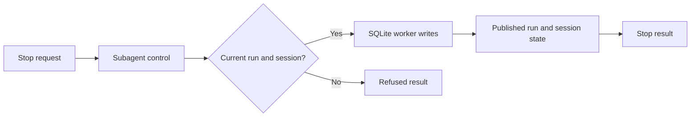

Codex review: blocked before merge. _Reviewed September 28, 2026, 10:15 PM ET / September 29, 2026, 02:15 UTC (Revision 18)._

# ClawSweeper review

## What this changes

Moves file-backed subagent Stop persistence to existing SQLite workers and holds cancellation authority and queue reservations until the writes settle.

## Merge readiness

⛔ **Blocked before merge - 2 items remain**

Keep open. Current main still performs synchronous persistence during subagent Stop, while this PR has a distinct, tested repair. The prior config/default upgrade concern is unsupported by the pinned diff.

**Priority:** P1
**Reviewed head:** `46b6f52f0e40e3f53d6785892ec74aed1f4d86f3`

## Review scores

| Measure | Result | What it means |
|---|---|---|
| **Overall readiness** | 🐚 platinum hermit **(4/6)** | Production-path SQLite and Gateway proof is strong, and the reviewed patch has no established correctness or security finding despite its substantial scope. |
| **Proof confidence** | 🦞 diamond lobster **(5/6)** | Sufficient (terminal): The changed Stop owner is exercised through the registered subagents tool with real SQLite worker writes and through Gateway create/Stop/describe tests. The recorded after-fix results include zero observed host SQLite calls in the covered Stop windows, persisted cancellation state, and refusal before foreign or replacement effects. The schema and row codec are unchanged, so no stored-data migration contract changes. |
| **Patch quality** | 🐚 platinum hermit **(4/6)** | No actionable review findings were identified. |

## Verification

| Check | Result | Evidence |
|---|---|---|
| **Real behavior** | Verified | Sufficient (terminal): The changed Stop owner is exercised through the registered subagents tool with real SQLite worker writes and through Gateway create/Stop/describe tests. The recorded after-fix results include zero observed host SQLite calls in the covered Stop windows, persisted cancellation state, and refusal before foreign or replacement effects. The schema and row codec are unchanged, so no stored-data migration contract changes. |
| **Evidence reviewed** | 9 items | Current main still has the synchronous Stop path: The current-main kill runtime reads the session entry directly and calls the existing session patch path during Stop; the worker-backed change remains absent from main. Worker write and final commit authority: The branch sends the existing subagent row format to the state worker and checks the selected source at transaction and commit admission. Cancellation selection and session custody: The branch captures run retirement and prepares a session generation before awaited discovery, then retains queue holds through publication and release. |
| **Findings** | None | None. |
| **Security** | None | None. |

## How this fits together

The Gateway receives Stop requests for child agents and passes them to subagent control. That control updates the child run and session records, then publishes the result to the requester.

## Before merge

- [ ] **Review config compatibility** - Confirm compatibility and upgrade impact for the changed config or default surface before merge.
- [ ] **Add data-model compatibility proof** - Confirm migration or upgrade compatibility proof before merge.

<strong>Agent review details</strong>

### Security

None.

### PR surface

PR surface statistics unavailable: the file list is incomplete.

### Review metrics

| Metric | Value | Why it matters |
|---|---|---|
| **Production versus test code** | production +3,129/−1,385; tests and support +2,836/−1,001 | The production growth is attributed to worker write custody and run/session authority fencing; the separate test growth covers those boundaries. |
| **Upgrade contract changes** | 0 config defaults, 0 schema edits, 0 run-codec edits | These pinned-diff facts resolve the prior config/default upgrade question without treating ordinary worker-request types as persisted state. |

### Stored data model

Persistent data-model change detected: `migration/backfill/repair: src/config/sessions/session-transcript-worker.types.ts`, `unknown-truncated-pull-files`. Confirm migration or upgrade compatibility proof before merge.

### Technical review

Best possible solution:

Keep Stop writes with the existing worker owners while preserving exact run, session, and caller checks through commit and publication.

Do we have a high-confidence way to reproduce the issue?

Yes, from current-main source: Stop still uses synchronous session persistence, and the branch documents a registered-tool before/after observation. I did not execute code in this read-only review.

Is this the best way to solve the issue?

Yes. Reusing the existing SQLite worker and retaining source, session, and caller authority is a focused repair for the blocking Stop path.

AGENTS.md: found and applied where relevant.

Codex review notes: model internal, reasoning high; reviewed against [80597756d891](https://github.com/openclaw/openclaw/commit/80597756d891bf2d03263e25b7a89200018b0d9d).

### Labels

Label changes:

No label changes.

Label justifications:

- `P1`: Gateway-thread persistence during Stop affects an active agent workflow, and the repair has direct registered-tool and Gateway-path evidence.
- `merge-risk: 🚨 session-state`: Stop now awaits run and session writes, where a stale publication could otherwise associate cancellation with replacement work; the reviewed controls cover those cases.
- `rating: 🐚 platinum hermit`: Overall readiness is 🐚 platinum hermit; proof is 🦞 diamond lobster and patch quality is 🐚 platinum hermit.
- `status: 👀 ready for maintainer look`: ClawSweeper has no concrete contributor-facing blocker left for this PR. Sufficient (terminal): The changed Stop owner is exercised through the registered subagents tool with real SQLite worker writes and through Gateway create/Stop/describe tests. The recorded after-fix results include zero observed host SQLite calls in the covered Stop windows, persisted cancellation state, and refusal before foreign or replacement effects. The schema and row codec are unchanged, so no stored-data migration contract changes.
- `proof: sufficient`: Contributor real behavior proof is sufficient. The changed Stop owner is exercised through the registered subagents tool with real SQLite worker writes and through Gateway create/Stop/describe tests. The recorded after-fix results include zero observed host SQLite calls in the covered Stop windows, persisted cancellation state, and refusal before foreign or replacement effects. The schema and row codec are unchanged, so no stored-data migration contract changes.

### Evidence

What I checked:

- **Current main still has the synchronous Stop path:** The current-main kill runtime reads the session entry directly and calls the existing session patch path during Stop; the worker-backed change remains absent from main. ([`src/agents/subagents/registry/subagent-control-kill-runtime.ts:84`](https://github.com/openclaw/openclaw/blob/80597756d891bf2d03263e25b7a89200018b0d9d/src/agents/subagents/registry/subagent-control-kill-runtime.ts#L84), [80597756d891](https://github.com/openclaw/openclaw/commit/80597756d891bf2d03263e25b7a89200018b0d9d))
- **Worker write and final commit authority:** The branch sends the existing subagent row format to the state worker and checks the selected source at transaction and commit admission. ([`src/agents/subagents/registry/subagent-registry-persistence.ts:268`](https://github.com/openclaw/openclaw/blob/46b6f52f0e40e3f53d6785892ec74aed1f4d86f3/src/agents/subagents/registry/subagent-registry-persistence.ts#L268), [46b6f52f0e40](https://github.com/openclaw/openclaw/commit/46b6f52f0e40e3f53d6785892ec74aed1f4d86f3))
- **Cancellation selection and session custody:** The branch captures run retirement and prepares a session generation before awaited discovery, then retains queue holds through publication and release. ([`src/agents/subagents/registry/subagent-control-kill-scope.ts:149`](https://github.com/openclaw/openclaw/blob/46b6f52f0e40e3f53d6785892ec74aed1f4d86f3/src/agents/subagents/registry/subagent-control-kill-scope.ts#L149), [46b6f52f0e40](https://github.com/openclaw/openclaw/commit/46b6f52f0e40e3f53d6785892ec74aed1f4d86f3))
- **Registered Stop after-fix proof:** The registered subagents tool test checks the Stop result, independently reloads persisted run and session state, protects an untouched sibling, and asserts zero observed host SQLite calls on the covered Stop paths. The PR body reports this and related Gateway cases passing on the reviewed head. ([`src/agents/subagents/registry/subagent-control.worker.test.ts:441`](https://github.com/openclaw/openclaw/blob/46b6f52f0e40e3f53d6785892ec74aed1f4d86f3/src/agents/subagents/registry/subagent-control.worker.test.ts#L441), [46b6f52f0e40](https://github.com/openclaw/openclaw/commit/46b6f52f0e40e3f53d6785892ec74aed1f4d86f3))
- **Gateway and forbidden-principal controls:** The Gateway test creates a non-main parent, sends Stop, then describes the child and reads persisted runs. The native authority test allows the owner while refusing foreign and replaced runs before termination; its ACP control checks that a stale request sends no interrupt. ([`test/e2e/qa-lab/runtime/native-cancellation-authz.e2e.test.ts:200`](https://github.com/openclaw/openclaw/blob/46b6f52f0e40e3f53d6785892ec74aed1f4d86f3/test/e2e/qa-lab/runtime/native-cancellation-authz.e2e.test.ts#L200), [46b6f52f0e40](https://github.com/openclaw/openclaw/commit/46b6f52f0e40e3f53d6785892ec74aed1f4d86f3))
- **Stored contract unchanged:** The introduced diff does not edit config defaults, the state schema, the subagent run type, or the existing SQLite codec. The new worker request binds rows through that codec, so this is a write-path change rather than a stored-data-model change. ([`src/agents/subagents/registry/subagent-registry.store.codec.ts:88`](https://github.com/openclaw/openclaw/blob/46b6f52f0e40e3f53d6785892ec74aed1f4d86f3/src/agents/subagents/registry/subagent-registry.store.codec.ts#L88), [46b6f52f0e40](https://github.com/openclaw/openclaw/commit/46b6f52f0e40e3f53d6785892ec74aed1f4d86f3))

Likely related people:

- **steipete:** Suggested for follow-up; no historical authorship or introduction is verified. (role: unverified routing candidate; confidence: low)
- **shakkernerd:** Suggested for follow-up; no historical authorship or introduction is verified. (role: unverified routing candidate; confidence: low)

### Rating scale

| Score | Internal tier | Crab rank | Meaning |
|---:|:---:|---|---|
| **6/6** | S | 🦀 challenger crab | Exceptional readiness |
| **5/6** | A | 🦞 diamond lobster | Very strong readiness |
| **4/6** | B | 🐚 platinum hermit | Good normal PR; ordinary maintainer review |
| **3/6** | C | 🦐 gold shrimp | Useful, but confidence is limited |
| **2/6** | D | 🦪 silver shellfish | Proof or implementation needs work |
| **1/6** | F | 🧂 unranked krab | Not merge-ready |
| N/A | NA | 🌊 off-meta tidepool | Rating does not apply |

Overall follows the weaker of proof and patch quality.
Shiny media proof means a screenshot, video, or linked artifact directly shows the changed behavior. Runtime, network, CSP, and security claims still need visible diagnostics.

### Workflow

- ClawSweeper keeps one durable marker-backed review comment per issue or PR.
- Re-runs edit this comment so the latest verdict, findings, and automation markers stay together instead of adding duplicate bot comments.
- A fresh review can be triggered by eligible `@clawsweeper re-review` comments, exact-item GitHub events, scheduled/background review runs, or manual workflow dispatch.
- PR/issue authors and users with repository write access can comment `@clawsweeper re-review` or `@clawsweeper re-run` on an open PR or issue to request a fresh review only.
- Maintainers can also comment `@clawsweeper review` to request a fresh review only.
- Fresh-review commands do not start repair, autofix, rebase, CI repair, or automerge.
- Maintainer-only repair and merge flows require explicit commands such as `@clawsweeper autofix`, `@clawsweeper automerge`, `@clawsweeper fix ci`, or `@clawsweeper address review`.
- Maintainers can comment `@clawsweeper explain` to ask for more context, or `@clawsweeper stop` to stop active automation.

### History

Review history (17 earlier review cycles; latest 8 shown)

<!-- clawsweeper-review-history v=1 total=17 -->
- reviewed 2026-09-28T17:18:43.611Z sha a51a47e3091079fc79a383e54fbd42924cb4b409 :: blocked before merge. :: none
- reviewed 2026-09-28T17:54:17.023Z sha a51a47e3091079fc79a383e54fbd42924cb4b409 :: blocked before merge. :: none
- reviewed 2026-09-28T19:32:21.151Z sha 6a7b34a59bdb58f9245fac5495e152aef7b7273e :: blocked before merge. :: none
- reviewed 2026-09-28T20:49:29.283Z sha 6a7b34a59bdb58f9245fac5495e152aef7b7273e :: blocked before merge. :: none
- reviewed 2026-09-28T22:39:05.289Z sha 134751ce7cb83f4f7fa138e422f2a605a4305e2c :: blocked before merge. :: none
- reviewed 2026-09-28T23:12:09.230Z sha 134751ce7cb83f4f7fa138e422f2a605a4305e2c :: blocked before merge. :: none
- reviewed 2026-09-29T00:56:30.923Z sha d3e978f563bef526f8af6a7a63b198faa17d0a0b :: blocked before merge. :: none
- reviewed 2026-09-29T01:43:34.302Z sha 46b6f52f0e40e3f53d6785892ec74aed1f4d86f3 :: blocked before merge. :: none

<!-- clawsweeper-verdict:needs-human item=160203 sha=46b6f52f0e40e3f53d6785892ec74aed1f4d86f3 confidence=high updated_at=2026-09-29T02:11:52Z reviewed_at=2026-09-29T02:15:47.617Z lease_owner=github-run-36511266394-1 lease_comment_id=5882323344 source_revision=4358e647e4fc68f73f709746764cd7d5bdcd9f423f9ab1d196d88467e08945fa live_verification=absent -->
<!-- clawsweeper-review-state:blocked item=160203 sha=46b6f52f0e40e3f53d6785892ec74aed1f4d86f3 v=1 -->

<!-- clawsweeper-review-version item=160203 reviewed_at=2026-09-29T02:15:47.617Z sha=46b6f52f0e40e3f53d6785892ec74aed1f4d86f3 source_revision=4358e647e4fc68f73f709746764cd7d5bdcd9f423f9ab1d196d88467e08945fa lease_owner=github-run-36511266394-1 lease_comment_id=5882323344 v=1 -->

<!-- clawsweeper-review item=160203 -->