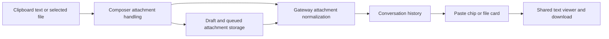

Codex review: needs maintainer review before merge. _Reviewed September 18, 2026, 7:18 PM ET / 23:18 UTC (Revision 12)._

# ClawSweeper review

## What this changes

Displays long clipboard pastes as compact excerpt chips, reuses the attachment viewer, and preserves their distinction from uploaded files through drafts, queued sends, and history.

## Merge readiness

✅ **Ready for maintainer review**

Keep open: current main does not provide the requested presentation, and no blocking defect was found in the reviewed head. The maintainer-authored work has relevant visual evidence and focused recovery coverage.

**Priority:** P3
**Reviewed head:** `150c306bba0e2661f59825a5b1ba52666e9354e5`

## Review scores

| Measure | Result | What it means |
|---|---|---|
| **Overall readiness** | 🐚 platinum hermit **(4/6)** | Useful, coherent implementation with directly relevant visual proof, recovery coverage, and no blocking findings. |
| **Proof confidence** | 🦞 diamond lobster **(5/6)** ✨ media proof bonus | Sufficient (screenshot): Inspected before/after production-browser captures show the changed composer and transcript rendering and shared viewer. The body identifies the earlier capture revision and reports current-head integration coverage for upload distinction, recovery, Copy, and downloads; the environment uses a mock Gateway, with no live-provider claim. |
| **Patch quality** | 🐚 platinum hermit **(4/6)** | No actionable review findings were identified. |

## Verification

| Check | Result | Evidence |
|---|---|---|
| **Real behavior** | Verified | Sufficient (screenshot): Inspected before/after production-browser captures show the changed composer and transcript rendering and shared viewer. The body identifies the earlier capture revision and reports current-head integration coverage for upload distinction, recovery, Copy, and downloads; the environment uses a mock Gateway, with no live-provider claim. |
| **Evidence reviewed** | 8 items | Current main still needs the change: Current main retains the in-memory pasted-text preview implementation and ordinary transcript attachment cards; the new pasted-text chip implementation is absent. The related issue remains an explicit feature request, not an already-merged replacement. Additive metadata and legacy recovery: The protocol adds one optional paste/file origin field. Stored draft readers still accept absent origin, while browser scenarios exercise restored legacy drafts, unchanged send bytes, and uploaded files with generated-looking names. The linked maintainer request explicitly asks that the distinction survive serialization: https://github.com/openclaw/openclaw/issues/151554. Meaningful browser coverage: The reviewed browser cases cover keyboard opening, exact clipboard text, restoring drafts without origin, ordinary uploads, mixed history, failed-source retry, and downloading every byte of an oversized paste. These are supplied test coverage and reported execution results; this read-only review did not execute them. |
| **Findings** | None | None. |
| **Security** | None | None. |

## How this fits together

Control UI attachment handling turns clipboard text and selected files into chat attachments. The Gateway preserves attachment metadata so the composer, recovered drafts, and conversation history can render the appropriate presentation.

## Before merge

None.

<strong>Agent review details</strong>

### Security

None.

### PR surface

Source +567, Tests +854, Docs +12. Total +1433 across 74 files.

View PR surface stats

| Area | Files | Added | Removed | Net |
|---|---:|---:|---:|---:|
| Source | 49 | 916 | 349 | +567 |
| Tests | 24 | 1281 | 427 | +854 |
| Docs | 1 | 15 | 3 | +12 |
| Config | 0 | 0 | 0 | 0 |
| Generated | 0 | 0 | 0 | 0 |
| Other | 0 | 0 | 0 | 0 |
| **Total** | **74** | **2212** | **779** | **+1433** |

### Review metrics

| Metric | Value | Why it matters |
|---|---|---|
| **Attachment contract** | 1 optional origin field; 2 accepted values | Paste/file provenance crosses the protocol and existing persistence boundaries while older entries remain readable. |
| **Production versus test growth** | Production net +567 lines; tests and test support net +854 lines | Production growth supports shared chip presentation, viewer integration, and durable provenance; test growth covers recovery and browser behavior. |

### Root-cause cluster

Relationship: `fixed_by_candidate`
Canonical: https://github.com/openclaw/openclaw/issues/151554
Summary: This PR implements the linked paste-chip request; comments-only shell work overlaps only part of the presentation.

Members:
- `canonical`: https://github.com/openclaw/openclaw/issues/151554 - The linked maintainer request defines paste chips, uploaded-file distinction, and byte preservation.
- `partial_overlap`: https://github.com/openclaw/openclaw/pull/151445 - Shares transparent message-shell behavior but separately addresses comment grouping and avatars.

Proposal only: this assessment does not dispatch repair, suppress jobs, mutate sibling items, close, or merge anything.

### Technical review

Best possible solution:

Keep paste provenance with the existing attachment owners and use one shared viewer that preserves original bytes across fresh input and recovered history.

Do we have a high-confidence way to reproduce the issue?

Not applicable as a defect reproduction: this is a presentation enhancement. The supplied before captures and current-main source establish the existing file-card behavior.

Is this the best way to solve the issue?

Yes: the implementation extends existing attachment storage and viewer owners, with explicit origin metadata and bounded display-only excerpts.

AGENTS.md: found and applied where relevant.

Codex review notes: model internal, reasoning medium; reviewed against [652da011e926](https://github.com/openclaw/openclaw/commit/652da011e92670ca2d30a5b046245f90bdfce614).

### Labels

Label justifications:

- `P3`: This improves chat presentation and usability without evidence of a currently blocked core workflow.
- `rating: 🐚 platinum hermit`: Overall readiness is 🐚 platinum hermit; proof is 🦞 diamond lobster and patch quality is 🐚 platinum hermit.
- `status: 👀 ready for maintainer look`: ClawSweeper has no concrete contributor-facing blocker left for this PR. Sufficient (screenshot): Inspected before/after production-browser captures show the changed composer and transcript rendering and shared viewer. The body identifies the earlier capture revision and reports current-head integration coverage for upload distinction, recovery, Copy, and downloads; the environment uses a mock Gateway, with no live-provider claim.
- `proof: sufficient`: Contributor real behavior proof is sufficient. Inspected before/after production-browser captures show the changed composer and transcript rendering and shared viewer. The body identifies the earlier capture revision and reports current-head integration coverage for upload distinction, recovery, Copy, and downloads; the environment uses a mock Gateway, with no live-provider claim.
- `proof: 📸 screenshot`: Contributor real behavior proof includes screenshot evidence. Inspected before/after production-browser captures show the changed composer and transcript rendering and shared viewer. The body identifies the earlier capture revision and reports current-head integration coverage for upload distinction, recovery, Copy, and downloads; the environment uses a mock Gateway, with no live-provider claim.

### Evidence

What I checked:

- **Current main still needs the change:** Current main retains the in-memory pasted-text preview implementation and ordinary transcript attachment cards; the new pasted-text chip implementation is absent. The related issue remains an explicit feature request, not an already-merged replacement. ([`ui/src/pages/chat/components/chat-attachments.ts:34`](https://github.com/openclaw/openclaw/blob/652da011e92670ca2d30a5b046245f90bdfce614/ui/src/pages/chat/components/chat-attachments.ts#L34), [652da011e926](https://github.com/openclaw/openclaw/commit/652da011e92670ca2d30a5b046245f90bdfce614))
- **Additive metadata and legacy recovery:** The protocol adds one optional paste/file origin field. Stored draft readers still accept absent origin, while browser scenarios exercise restored legacy drafts, unchanged send bytes, and uploaded files with generated-looking names. The linked maintainer request explicitly asks that the distinction survive serialization: https://github.com/openclaw/openclaw/issues/151554. ([`packages/gateway-protocol/src/schema/logs-chat.ts:249`](https://github.com/openclaw/openclaw/blob/150c306bba0e2661f59825a5b1ba52666e9354e5/packages/gateway-protocol/src/schema/logs-chat.ts#L249), [150c306bba0e](https://github.com/openclaw/openclaw/commit/150c306bba0e2661f59825a5b1ba52666e9354e5))
- **Meaningful browser coverage:** The reviewed browser cases cover keyboard opening, exact clipboard text, restoring drafts without origin, ordinary uploads, mixed history, failed-source retry, and downloading every byte of an oversized paste. These are supplied test coverage and reported execution results; this read-only review did not execute them. ([`ui/src/e2e/chat-pasted-text-show-in-text-field.e2e.test.ts:40`](https://github.com/openclaw/openclaw/blob/150c306bba0e2661f59825a5b1ba52666e9354e5/ui/src/e2e/chat-pasted-text-show-in-text-field.e2e.test.ts#L40), [150c306bba0e](https://github.com/openclaw/openclaw/commit/150c306bba0e2661f59825a5b1ba52666e9354e5))
- **Inspected visual evidence:** Inspected all four prepared images from the media manifest: desktop dark before/after and desktop light before/after. They visibly show file cards becoming compact composer/transcript chips and the shared text viewer retaining readable original text. The captured PR body attributes these images to ae8524d83428ce420eb3fcff4be4f7b472996409 and separately reports integration checks for the reviewed head. Image pairs: https://github.com/user-attachments/assets/d1c4e37a-80aa-4f7c-846d-16ccd3cbd839 and https://github.com/user-attachments/assets/cb25f293-ce32-4148-8c6c-f8d1caf9f6ec; https://github.com/user-attachments/assets/8d6aa676-25f3-4064-b176-6704821a1c66 and https://github.com/user-attachments/assets/4ed1d5ce-c831-45e1-b02e-5e1d84b4576b. ([ae8524d83428](https://github.com/openclaw/openclaw/commit/ae8524d83428ce420eb3fcff4be4f7b472996409))
- **Security and resource boundaries:** Pasted markup is reduced to text inside an inert template and rendered as escaped text. Preview fetches retain same-origin credentials, redirect rejection, cancellation, and the 256 KiB bound; automatic excerpts reject cross-origin HTTP sources. Origin metadata does not grant authorization. ([`ui/src/pages/chat/components/chat-attachment-text-reader.ts:6`](https://github.com/openclaw/openclaw/blob/150c306bba0e2661f59825a5b1ba52666e9354e5/ui/src/pages/chat/components/chat-attachment-text-reader.ts#L6), [150c306bba0e](https://github.com/openclaw/openclaw/commit/150c306bba0e2661f59825a5b1ba52666e9354e5))
- **Related work is partial overlap:** https://github.com/openclaw/openclaw/pull/151445 remains open and addresses comments-only shells and grouped avatar placement. Its supplied body and this PR's body explicitly describe independent work with overlapping shell changes; it does not replace paste provenance or excerpt rendering.

Likely related people:

- **Vyctor H. Brzezowski:** Raw commit bad41dcdbd608c8daf23c009012fc21c0b7baf52 adds ui/src/pages/chat/components/chat-attachment-reads.ts:30 relative to its recorded parents. This identifies author metadata, not feature responsibility or a PR merger. (role: source-line author; confidence: high; commits: [bad41dcdbd60](https://github.com/openclaw/openclaw/commit/bad41dcdbd608c8daf23c009012fc21c0b7baf52); files: `ui/src/pages/chat/components/chat-attachment-reads.ts`)
- **Peter Steinberger:** Suggested for follow-up; no historical authorship or introduction is verified. (role: unverified routing candidate; confidence: low)

### Rating scale

| Score | Internal tier | Crab rank | Meaning |
|---:|:---:|---|---|
| **6/6** | S | 🦀 challenger crab | Exceptional readiness |
| **5/6** | A | 🦞 diamond lobster | Very strong readiness |
| **4/6** | B | 🐚 platinum hermit | Good normal PR; ordinary maintainer review |
| **3/6** | C | 🦐 gold shrimp | Useful, but confidence is limited |
| **2/6** | D | 🦪 silver shellfish | Proof or implementation needs work |
| **1/6** | F | 🧂 unranked krab | Not merge-ready |
| N/A | NA | 🌊 off-meta tidepool | Rating does not apply |

Overall follows the weaker of proof and patch quality.
Shiny media proof means a screenshot, video, or linked artifact directly shows the changed behavior. Runtime, network, CSP, and security claims still need visible diagnostics.

### Workflow

- ClawSweeper keeps one durable marker-backed review comment per issue or PR.
- Re-runs edit this comment so the latest verdict, findings, and automation markers stay together instead of adding duplicate bot comments.
- A fresh review can be triggered by eligible `@clawsweeper re-review` comments, exact-item GitHub events, scheduled/background review runs, or manual workflow dispatch.
- PR/issue authors and users with repository write access can comment `@clawsweeper re-review` or `@clawsweeper re-run` on an open PR or issue to request a fresh review only.
- Maintainers can also comment `@clawsweeper review` to request a fresh review only.
- Fresh-review commands do not start repair, autofix, rebase, CI repair, or automerge.
- Maintainer-only repair and merge flows require explicit commands such as `@clawsweeper autofix`, `@clawsweeper automerge`, `@clawsweeper fix ci`, or `@clawsweeper address review`.
- Maintainers can comment `@clawsweeper explain` to ask for more context, or `@clawsweeper stop` to stop active automation.

### History

Review history (11 earlier review cycles; latest 8 shown)

<!-- clawsweeper-review-history v=1 total=11 -->
- reviewed 2026-09-18T18:52:38.130Z sha 25679ec23e61004c99779fff4585b761a9312a75 :: needs maintainer review before merge. :: none
- reviewed 2026-09-18T19:01:14.167Z sha 2f187f583033969ce80ba84a097a9eae3632670d :: needs maintainer review before merge. :: none
- reviewed 2026-09-18T19:22:33.020Z sha 2f187f583033969ce80ba84a097a9eae3632670d :: blocked before merge. :: none
- reviewed 2026-09-18T21:24:39.809Z sha afe9a5068a45f2239ee424870c49f08664e8050d :: needs maintainer review before merge. :: none
- reviewed 2026-09-18T21:40:35.542Z sha dccb4ee1c792319a35d9494285ad3953c7d12fe2 :: needs maintainer review before merge. :: none
- reviewed 2026-09-18T22:06:41.511Z sha 7e6175467cbe0e299401cfde354284d7b80c8d86 :: needs maintainer review before merge. :: none
- reviewed 2026-09-18T22:59:00.381Z sha a109995ceaff0428b2086031cbcaef24487e7885 :: needs maintainer review before merge. :: none
- reviewed 2026-09-18T23:11:33.777Z sha 150c306bba0e2661f59825a5b1ba52666e9354e5 :: needs maintainer review before merge. :: none

<!-- clawsweeper-verdict:needs-human item=151618 sha=150c306bba0e2661f59825a5b1ba52666e9354e5 confidence=high updated_at=2026-09-18T23:15:12Z reviewed_at=2026-09-18T23:18:43.268Z lease_owner=github-run-35404829308-1 lease_comment_id=5737321501 source_revision=07f5d3398f094a115963775db52d75a7ebf807d1518d18097eccd0d85bbacc9e live_verification=absent -->
<!-- clawsweeper-review-state:ready item=151618 sha=150c306bba0e2661f59825a5b1ba52666e9354e5 v=1 -->

<!-- clawsweeper-review-version item=151618 reviewed_at=2026-09-18T23:18:43.268Z sha=150c306bba0e2661f59825a5b1ba52666e9354e5 source_revision=07f5d3398f094a115963775db52d75a7ebf807d1518d18097eccd0d85bbacc9e lease_owner=github-run-35404829308-1 lease_comment_id=5737321501 v=1 -->

<!-- clawsweeper-review item=151618 -->