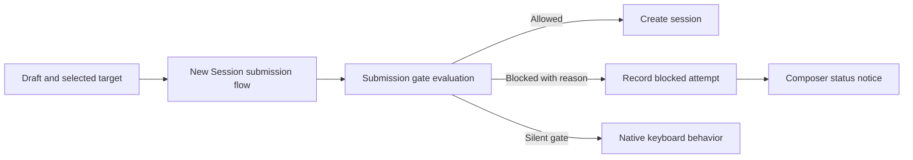

Codex review: needs maintainer review before merge. _Reviewed August 16, 2026, 10:02 AM ET / 14:02 UTC._

# ClawSweeper review

## What this changes

The PR centralizes New Session submission blockers and makes Enter show a temporary status reason when a reasoned blocker prevents session creation.

## Regression provenance

Possible regression — suspected (reviewed change). No predecessor PR is attributed.

## Merge readiness

⚠️ **Ready for maintainer review - 3 items remain**

The patch is a coherent owner-boundary repair for a source-proven silent New Session submission path. No blocking correctness finding was identified; it should remain open for normal maintainer review and exact-head CI after its base refresh.

**Priority:** P1
**Reviewed head:** `2e6ad2b319cd2b49a273a78d41b51169a75ca1c9`

## Review scores

| Measure | Result | What it means |
|---|---|---|
| **Overall readiness** | 🐚 platinum hermit **(4/6)** | A sound, source-backed repair with focused behavioral coverage; exact-head CI remains the remaining merge validation. |
| **Proof confidence** | 🌊 off-meta tidepool | Not applicable: This maintainer-authored, maintainer-labeled PR is outside the external-contributor proof gate; its body additionally supplies before/after rendered-UI captures. |
| **Patch quality** | 🐚 platinum hermit **(4/6)** | No actionable review findings were identified. |

## Verification

| Check | Result | Evidence |
|---|---|---|
| **Real behavior** | Not applicable | Not applicable: This maintainer-authored, maintainer-labeled PR is outside the external-contributor proof gate; its body additionally supplies before/after rendered-UI captures. |
| **Evidence reviewed** | 6 items | Current-main failure path: Current main returns from the composer keydown handler whenever canSubmit is false, while the submission flow's former disabled-reason method covers only route, model, and access cases; transient blockers therefore leave Enter native with no displayed reason. Canonical repaired owner: The proposed resolver returns the first typed blocker for both session and terminal actions; canSubmit and both disabled-reason methods delegate to it, removing the prior divergent decision lists. Caller and user-visible result: The page passes the flow's reason and blocked-attempt notice into the composer, whose keydown handler consumes only allowed submissions or blockers with a reason and renders that notice as a status message. |
| **Findings** | None | None. |
| **Security** | None | None. |

## How this fits together

The New Session Control UI turns a draft, selected target, and Gateway state into a session-creation request. Its submission flow supplies both the Start controls and composer keyboard handling, so a blocker must produce a visible reason instead of silently suppressing the action.

## Before merge

- [ ] **Resolve merge risk (P1)** - The branch is behind current main and its aggregate CI gate is currently failing; revalidate the merge result on the exact head before landing.
- [ ] **Resolve merge risk (P1)** - Production code is net +198 lines for a bug fix; the shared resolver is the justified canonical owner, but its gate list should remain the only submission-policy source.
- [ ] **Complete next step (P2)** - No mechanical repair is outstanding; this maintainer-owned PR needs normal exact-head CI and merge review.

<strong>Agent review details</strong>

### Security

None.

### PR surface

Source +198, Tests +294. Total +492 across 8 files.

View PR surface stats

| Area | Files | Added | Removed | Net |
|---|---:|---:|---:|---:|
| Source | 6 | 292 | 94 | +198 |
| Tests | 2 | 295 | 1 | +294 |
| Docs | 0 | 0 | 0 | 0 |
| Config | 0 | 0 | 0 | 0 |
| Generated | 0 | 0 | 0 | 0 |
| Other | 0 | 0 | 0 | 0 |
| **Total** | **8** | **587** | **95** | **+492** |

### Review metrics

| Metric | Value | Why it matters |
|---|---|---|
| **Production versus test LOC** | production +292/-94 (net +198); tests +295/-1 (net +294) | The repair replaces duplicated gate checks with one shared owner while adding regression coverage; the nontrivial production growth deserves explicit merge review. |

### Stored data model

Persistent data-model change detected: `serialized state: ui/src/pages/new-session/draft-submission-flow.test.ts`. Confirm migration or upgrade compatibility proof before merge.

### Merge-risk options

**Maintainer options:**
1. **Decide the mitigation before merge**  
   Keep one typed submission-block resolver feeding the boolean, tooltip, and blocked-Enter notice; the extra production surface is warranted because those three consumers otherwise require duplicated policy. Land only after an exact-head green validation confirms the merge result.
2. **Pause or close**  
   Do not merge this PR until maintainers decide whether the risk is worth taking.

### Technical review

Best possible solution:

Keep one typed submission-block resolver feeding the boolean, tooltip, and blocked-Enter notice; the extra production surface is warranted because those three consumers otherwise require duplicated policy. Land only after an exact-head green validation confirms the merge result.

Do we have a high-confidence way to reproduce the issue?

Yes—source inspection on current main shows Enter returns early whenever canSubmit is false, while several canSubmit blockers have no disabled reason; the precise live timing race was not executed in this read-only review.

Is this the best way to solve the issue?

Yes—the shared gate resolver is the narrowest maintainable fix because it makes the boolean decision, tooltip reason, and keyboard feedback derive from one owner rather than maintaining parallel lists.

AGENTS.md: found and applied where relevant.

Codex review notes: model internal, reasoning high; reviewed against [7f842da4bd45](https://github.com/openclaw/openclaw/commit/7f842da4bd45c1850562892a1003bc573e516d42).

### Labels

Label justifications:

- `P1`: The patch addresses a silent failure on the primary New Session submission path.
- `rating: 🐚 platinum hermit`: Overall readiness is 🐚 platinum hermit; proof is 🌊 off-meta tidepool and patch quality is 🐚 platinum hermit.
- `status: 👀 ready for maintainer look`: ClawSweeper has no concrete contributor-facing blocker left for this PR. Not applicable: This maintainer-authored, maintainer-labeled PR is outside the external-contributor proof gate; its body additionally supplies before/after rendered-UI captures.

### Evidence

What I checked:

- **Current-main failure path:** Current main returns from the composer keydown handler whenever canSubmit is false, while the submission flow's former disabled-reason method covers only route, model, and access cases; transient blockers therefore leave Enter native with no displayed reason. ([`ui/src/pages/new-session/composer.ts:181`](https://github.com/openclaw/openclaw/blob/7f842da4bd45/ui/src/pages/new-session/composer.ts#L181), [7f842da4bd45](https://github.com/openclaw/openclaw/commit/7f842da4bd45))
- **Canonical repaired owner:** The proposed resolver returns the first typed blocker for both session and terminal actions; canSubmit and both disabled-reason methods delegate to it, removing the prior divergent decision lists. ([`ui/src/pages/new-session/submit-gates.ts:66`](https://github.com/openclaw/openclaw/blob/2e6ad2b319cd/ui/src/pages/new-session/submit-gates.ts#L66), [2e6ad2b319cd](https://github.com/openclaw/openclaw/commit/2e6ad2b319cd))
- **Caller and user-visible result:** The page passes the flow's reason and blocked-attempt notice into the composer, whose keydown handler consumes only allowed submissions or blockers with a reason and renders that notice as a status message. ([`ui/src/pages/new-session/composer.ts:181`](https://github.com/openclaw/openclaw/blob/2e6ad2b319cd/ui/src/pages/new-session/composer.ts#L181), [2e6ad2b319cd](https://github.com/openclaw/openclaw/commit/2e6ad2b319cd))
- **Regression coverage:** The focused tests exercise representative blockers, verify the reason appears after a blocked submission attempt, and verify it clears once preference restoration finishes. ([`ui/src/pages/new-session/draft-submission-flow.test.ts:161`](https://github.com/openclaw/openclaw/blob/2e6ad2b319cd/ui/src/pages/new-session/draft-submission-flow.test.ts#L161), [2e6ad2b319cd](https://github.com/openclaw/openclaw/commit/2e6ad2b319cd))
- **History and ownership:** Blame attributes the original canSubmit and composer keydown path to d5f41f734b2476917d21b885595aa156eb672443; the PR author also owns the follow-up repair. ([`ui/src/pages/new-session/draft-submission-flow.ts:220`](https://github.com/openclaw/openclaw/blob/d5f41f734b24/ui/src/pages/new-session/draft-submission-flow.ts#L220), [d5f41f734b24](https://github.com/openclaw/openclaw/commit/d5f41f734b24))
- **Diff hygiene:** The PR diff has no whitespace errors in read-only inspection. ([2e6ad2b319cd](https://github.com/openclaw/openclaw/commit/2e6ad2b319cd))

Likely related people:

- **steipete:** Introduced the current New Session submission flow and composer path in d5f41f7, and authored the focused repair in this PR. (role: feature owner and recent area contributor; confidence: high; commits: [d5f41f734b24](https://github.com/openclaw/openclaw/commit/d5f41f734b2476917d21b885595aa156eb672443), [2e6ad2b319cd](https://github.com/openclaw/openclaw/commit/2e6ad2b319cd2b49a273a78d41b51169a75ca1c9); files: `ui/src/pages/new-session/draft-submission-flow.ts`, `ui/src/pages/new-session/composer.ts`)
- **Josh Lehman:** Recent history includes New Session startup-progress work that shares the same submission-flow surface. (role: adjacent area contributor; confidence: medium; commits: [a3207b574c6a](https://github.com/openclaw/openclaw/commit/a3207b574c6a913d93b6a58108f4470868093062); files: `ui/src/pages/new-session/draft-submission-flow.test.ts`)

### Rank-up moves

Optional improvements that raise the rating; they are not merge blockers.

- Refresh the branch as needed and obtain a green exact-head CI result before merge.

### Rating scale

| Score | Internal tier | Crab rank | Meaning |
|---:|:---:|---|---|
| **6/6** | S | 🦀 challenger crab | Exceptional readiness |
| **5/6** | A | 🦞 diamond lobster | Very strong readiness |
| **4/6** | B | 🐚 platinum hermit | Good normal PR; ordinary maintainer review |
| **3/6** | C | 🦐 gold shrimp | Useful, but confidence is limited |
| **2/6** | D | 🦪 silver shellfish | Proof or implementation needs work |
| **1/6** | F | 🧂 unranked krab | Not merge-ready |
| N/A | NA | 🌊 off-meta tidepool | Rating does not apply |

Overall follows the weaker of proof and patch quality.
Shiny media proof means a screenshot, video, or linked artifact directly shows the changed behavior. Runtime, network, CSP, and security claims still need visible diagnostics.

### Workflow

- ClawSweeper keeps one durable marker-backed review comment per issue or PR.
- Re-runs edit this comment so the latest verdict, findings, and automation markers stay together instead of adding duplicate bot comments.
- A fresh review can be triggered by eligible `@clawsweeper re-review` comments, exact-item GitHub events, scheduled/background review runs, or manual workflow dispatch.
- PR/issue authors and users with repository write access can comment `@clawsweeper re-review` or `@clawsweeper re-run` on an open PR or issue to request a fresh review only.
- Maintainers can also comment `@clawsweeper review` to request a fresh review only.
- Fresh-review commands do not start repair, autofix, rebase, CI repair, or automerge.
- Maintainer-only repair and merge flows require explicit commands such as `@clawsweeper autofix`, `@clawsweeper automerge`, `@clawsweeper fix ci`, or `@clawsweeper address review`.
- Maintainers can comment `@clawsweeper explain` to ask for more context, or `@clawsweeper stop` to stop active automation.

### History

Review history (1 earlier review cycle)

<!-- clawsweeper-review-history v=1 total=1 -->
- reviewed 2026-08-16T13:55:56.450Z sha 2e6ad2b319cd2b49a273a78d41b51169a75ca1c9 :: needs maintainer review before merge. :: none

<!-- clawsweeper-verdict:needs-human item=124613 sha=2e6ad2b319cd2b49a273a78d41b51169a75ca1c9 confidence=high updated_at=2026-08-16T13:59:50Z reviewed_at=2026-08-16T14:02:50.039Z lease_owner=github-run-31951342957-1 lease_comment_id=5307803584 source_revision=cdd0736d05232f0417d0f41b2b4218606d217f53728a4dcad8d02eca7213d0a7 -->

<!-- clawsweeper-review-version item=124613 reviewed_at=2026-08-16T14:02:50.039Z sha=2e6ad2b319cd2b49a273a78d41b51169a75ca1c9 source_revision=cdd0736d05232f0417d0f41b2b4218606d217f53728a4dcad8d02eca7213d0a7 lease_owner=github-run-31951342957-1 lease_comment_id=5307803584 v=1 -->

<!-- clawsweeper-review item=124613 -->