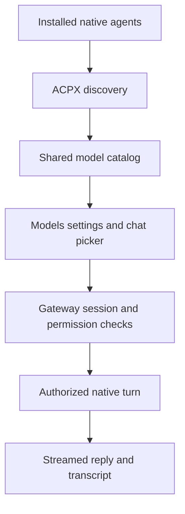

Codex review: blocked before merge. _Reviewed September 20, 2026, 8:12 AM ET / 12:12 UTC (Revision 39)._

# ClawSweeper review

## What this changes

Adds installed-agent controls and model selection to Models settings, setup, and chat, with streamed replies and administrator-confirmed per-chat permission recovery.

## Merge readiness

⛔ **Blocked before merge - 3 items remain**

Keep open for normal landing. This maintainer-sponsored integration remains distinct from current main, retained behavior proof is sufficient, and no blocking defect was found in the reviewed paths.

**Priority:** P2
**Reviewed head:** `2cd52365fb6e8640be5bacff934a1eea4e1a71ac`

## Review scores

| Measure | Result | What it means |
|---|---|---|
| **Overall readiness** | 🐚 platinum hermit **(4/6)** | Strong retained behavior evidence supports a sound integration with documented compatibility tradeoffs and no established blocking defect. |
| **Proof confidence** | 🦞 diamond lobster **(5/6)** | Sufficient (live_output): Retained Gateway/native-process observations cover consent-gated retry, streaming, cancellation, and stale-authority rejection; inspected screenshots corroborate the visible flow. Published-driver upgrade, managed-plugin restart, Telegram Test Server, and OpenCode observations cover the principal integration boundaries, with historical artifact identities and limits preserved. |
| **Patch quality** | 🐚 platinum hermit **(4/6)** | No actionable review findings were identified. |

## Verification

| Check | Result | Evidence |
|---|---|---|
| **Real behavior** | Verified | Sufficient (live_output): Retained Gateway/native-process observations cover consent-gated retry, streaming, cancellation, and stale-authority rejection; inspected screenshots corroborate the visible flow. Published-driver upgrade, managed-plugin restart, Telegram Test Server, and OpenCode observations cover the principal integration boundaries, with historical artifact identities and limits preserved. |
| **Evidence reviewed** | 11 items | Pinned introduction and clean checkout: Reviewed the local base-to-head delta using the supplied merge base. Raw head parentage matches the recorded original head. The stale test merge was not used to infer removals. git diff --check passed, and final git status remained clean. Still distinct from main: Fetched main registers the existing ACP service and reply hook but lacks this branch’s four native chat harness registrations and installed-agent listing method. The new harness and installed-agent controller paths are also absent from the supplied latest release tag. Native capability owner: The plugin registers the four supported native harnesses, reads current enablement flags, and exposes installation information through a read-scoped Gateway method. Vendor discovery stays in ACPX rather than a competing core implementation. |
| **Findings** | None | None. |
| **Security** | None | None. |

## How this fits together

The model catalog connects installed native agents to OpenClaw’s shared model picker. The Gateway owns session selection, consent, transcripts, and run authority; ACPX handles communication with the selected native application.

## Before merge

- [ ] **Resolve merge risk (P1)** - Existing explicit CLI selections now stop when the executable is unavailable instead of silently using an API route; affected users must restore the CLI or explicitly select an API model, and deployment prevalence is unmeasured.
- [ ] **Resolve merge risk (P1)** - The expanded SDK requires coordinated core/plugin delivery. Standard core-first upgrade evidence is present, but the disclosed custom bundled-Darwin route remains unqualified.
- [ ] **Review config compatibility** - Confirm compatibility and upgrade impact for the changed config or default surface before merge.

<strong>Agent review details</strong>

### Security

None.

### PR surface

PR surface statistics unavailable: the file list is incomplete.

### Review metrics

| Metric | Value | Why it matters |
|---|---|---|
| **Production versus test growth** | Production/tooling +3,137 net lines; tests/support −1,100 net lines | Excluding docs and manifests, production growth supports four native runtimes and their selection, consent, and lifecycle integration. |
| **New configuration** | 4 optional native-agent enable flags | Missing flags enable the supported agents; disabling a flag prevents new discovery and turns while preserving admitted work. |

### Stored data model

Persistent data-model change detected: `serialized state: ui/src/pages/new-session/rejected-initial-turn.ts`, `unknown-truncated-pull-files`. Migration or upgrade compatibility proof is recorded; maintainers should verify it before merge.

### Merge-risk options

**Maintainer options:**
1. **Retain the documented rollout contract (recommended)**  
   Accept explicit native-runtime ownership and coordinated core-first plugin delivery, keeping custom bundled-Darwin packaging outside the demonstrated installation path.

### Technical review

Best possible solution:

Preserve explicit runtime and billing choices, visible per-chat recovery, and the demonstrated core-first plugin upgrade path.

Do we have a high-confidence way to reproduce the issue?

Not applicable as a single bug reproduction: this is a feature integration, with retained observations covering selection, consent, streaming, cancellation, and persistence.

Is this the best way to solve the issue?

Yes. The implementation reuses ACPX for native transport and existing core owners for selection, session authority, and transcripts; the permission tradeoff is explicitly documented and maintainer-sponsored.

AGENTS.md: found and applied where relevant.

Codex review notes: model internal, reasoning medium; reviewed against [02c89f1b07ca](https://github.com/openclaw/openclaw/commit/02c89f1b07ca865e2c5964040a65db1b7b024fdd).

### Labels

Label justifications:

- `P2`: This is a bounded user-facing integration improvement without evidence of an urgent production outage.
- `merge-risk: 🚨 compatibility`: The branch changes explicit CLI fallback behavior and expands the SDK consumed by the separately installable ACPX plugin.
- `rating: 🐚 platinum hermit`: Overall readiness is 🐚 platinum hermit; proof is 🦞 diamond lobster and patch quality is 🐚 platinum hermit.
- `status: 👀 ready for maintainer look`: ClawSweeper has no concrete contributor-facing blocker left for this PR. Sufficient (live_output): Retained Gateway/native-process observations cover consent-gated retry, streaming, cancellation, and stale-authority rejection; inspected screenshots corroborate the visible flow. Published-driver upgrade, managed-plugin restart, Telegram Test Server, and OpenCode observations cover the principal integration boundaries, with historical artifact identities and limits preserved.
- `proof: sufficient`: Contributor real behavior proof is sufficient. Retained Gateway/native-process observations cover consent-gated retry, streaming, cancellation, and stale-authority rejection; inspected screenshots corroborate the visible flow. Published-driver upgrade, managed-plugin restart, Telegram Test Server, and OpenCode observations cover the principal integration boundaries, with historical artifact identities and limits preserved.
- `proof: telegram-e2e`: This PR needs Telegram Test Server proof with the repository E2E skill. Native model callbacks change visible Telegram confirmation text and persisted selection; the retained Test Server evidence addresses that surface.

### Evidence

What I checked:

- **Pinned introduction and clean checkout:** Reviewed the local base-to-head delta using the supplied merge base. Raw head parentage matches the recorded original head. The stale test merge was not used to infer removals. git diff --check passed, and final git status remained clean. ([2cd52365fb6e](https://github.com/openclaw/openclaw/commit/2cd52365fb6e8640be5bacff934a1eea4e1a71ac))
- **Still distinct from main:** Fetched main registers the existing ACP service and reply hook but lacks this branch’s four native chat harness registrations and installed-agent listing method. The new harness and installed-agent controller paths are also absent from the supplied latest release tag. ([`extensions/acpx/index.ts:14`](https://github.com/openclaw/openclaw/blob/02c89f1b07ca865e2c5964040a65db1b7b024fdd/extensions/acpx/index.ts#L14), [02c89f1b07ca](https://github.com/openclaw/openclaw/commit/02c89f1b07ca865e2c5964040a65db1b7b024fdd))
- **Native capability owner:** The plugin registers the four supported native harnesses, reads current enablement flags, and exposes installation information through a read-scoped Gateway method. Vendor discovery stays in ACPX rather than a competing core implementation. ([`extensions/acpx/index.ts:32`](https://github.com/openclaw/openclaw/blob/2cd52365fb6e8640be5bacff934a1eea4e1a71ac/extensions/acpx/index.ts#L32), [2cd52365fb6e](https://github.com/openclaw/openclaw/commit/2cd52365fb6e8640be5bacff934a1eea4e1a71ac))
- **Consent and final-effect safeguards:** Session mutations enforce administrator scope, exact incarnation/settings expectations, mandatory containment, and idle execution, with guards repeated at commit. The native attempt carries live authority into model controls, approval decisions, prompt dispatch, and transcript writes. Inspected tests assert rejection without mutation and absence of native file effects after denial or cancellation. ([`src/gateway/server-methods/sessions-patch-sandbox.runtime.ts`](https://github.com/openclaw/openclaw/blob/2cd52365fb6e8640be5bacff934a1eea4e1a71ac/src/gateway/server-methods/sessions-patch-sandbox.runtime.ts), [2cd52365fb6e](https://github.com/openclaw/openclaw/commit/2cd52365fb6e8640be5bacff934a1eea4e1a71ac))
- **Retained real behavior evidence:** The captured body and discussion report a real isolated Gateway/native subprocess flow, published-driver upgrade, managed-plugin installation, Telegram Test Server selection/persistence, and real OpenCode response. The later before/after images were fetched read-only and inspected: the consent dialog explains delegation, and the after image shows an assistant chunk with Stop available. Authority evidence additionally records cancellation and stale-grant rejection without peer effects. These remain observations of their stated historical artifacts, not reviewer reruns. ([99ecb40e5d0b](https://github.com/openclaw/openclaw/commit/99ecb40e5d0b79ebc50d6e525dfbb6b8aea57c72))
- **Review continuity:** The previous completed review contained no findings or published rank-up moves. The selected native attempt, consent validator, execution-policy module, UI recovery owner, and CLI selection owner are unchanged from that reviewed head. Its documented CLI fallback warning is retained as compatibility context, not converted into a new proof request. ([`src/auto-reply/reply/model-selection.ts`](https://github.com/openclaw/openclaw/blob/2cd52365fb6e8640be5bacff934a1eea4e1a71ac/src/auto-reply/reply/model-selection.ts), [2cd52365fb6e](https://github.com/openclaw/openclaw/commit/2cd52365fb6e8640be5bacff934a1eea4e1a71ac))

Likely related people:

- **unknown:** The claimed source-line change could not be verified from bounded local history. (role: source history unknown; confidence: low)
- **steipete:** Suggested for follow-up; no historical authorship or introduction is verified. (role: unverified routing candidate; confidence: low)

### Rating scale

| Score | Internal tier | Crab rank | Meaning |
|---:|:---:|---|---|
| **6/6** | S | 🦀 challenger crab | Exceptional readiness |
| **5/6** | A | 🦞 diamond lobster | Very strong readiness |
| **4/6** | B | 🐚 platinum hermit | Good normal PR; ordinary maintainer review |
| **3/6** | C | 🦐 gold shrimp | Useful, but confidence is limited |
| **2/6** | D | 🦪 silver shellfish | Proof or implementation needs work |
| **1/6** | F | 🧂 unranked krab | Not merge-ready |
| N/A | NA | 🌊 off-meta tidepool | Rating does not apply |

Overall follows the weaker of proof and patch quality.
Shiny media proof means a screenshot, video, or linked artifact directly shows the changed behavior. Runtime, network, CSP, and security claims still need visible diagnostics.

### Workflow

- ClawSweeper keeps one durable marker-backed review comment per issue or PR.
- Re-runs edit this comment so the latest verdict, findings, and automation markers stay together instead of adding duplicate bot comments.
- A fresh review can be triggered by eligible `@clawsweeper re-review` comments, exact-item GitHub events, scheduled/background review runs, or manual workflow dispatch.
- PR/issue authors and users with repository write access can comment `@clawsweeper re-review` or `@clawsweeper re-run` on an open PR or issue to request a fresh review only.
- Maintainers can also comment `@clawsweeper review` to request a fresh review only.
- Fresh-review commands do not start repair, autofix, rebase, CI repair, or automerge.
- Maintainer-only repair and merge flows require explicit commands such as `@clawsweeper autofix`, `@clawsweeper automerge`, `@clawsweeper fix ci`, or `@clawsweeper address review`.
- Maintainers can comment `@clawsweeper explain` to ask for more context, or `@clawsweeper stop` to stop active automation.

### History

Review history (38 earlier review cycles; latest 8 shown)

<!-- clawsweeper-review-history v=1 total=38 -->
- reviewed 2026-09-20T06:58:57.411Z sha 99ecb40e5d0b79ebc50d6e525dfbb6b8aea57c72 :: blocked before merge. :: none
- reviewed 2026-09-20T07:35:46.923Z sha 9f1be0a1d7a9181e044fed810f8c2fb631d8ea9c :: blocked before merge. :: none
- reviewed 2026-09-20T08:07:05.863Z sha d7ff4413ca5e0d894db1a403aaf21fd45f79e509 :: blocked before merge. :: none
- reviewed 2026-09-20T08:46:42.628Z sha 394c0bd366b4eff93a4c699a55dfe1ab8580a897 :: blocked before merge. :: none
- reviewed 2026-09-20T09:03:54.525Z sha 77215017ff0d4368d7b16f124b7f82da8d300e66 :: blocked before merge. :: none
- reviewed 2026-09-20T09:31:02.838Z sha da6208c061ce72114910b4217fbcc036f5c2daed :: blocked before merge. :: none
- reviewed 2026-09-20T09:46:31.272Z sha f4a0d26b8f05e91f305d2a6cc887cfd94524c2ce :: blocked before merge. :: none
- reviewed 2026-09-20T10:38:57.885Z sha e3c78e3a92aa2f927e74c166721926fb326d9708 :: blocked before merge. :: none

<!-- clawsweeper-verdict:needs-human item=150224 sha=2cd52365fb6e8640be5bacff934a1eea4e1a71ac confidence=high updated_at=2026-09-20T12:07:30Z reviewed_at=2026-09-20T12:12:58.250Z lease_owner=github-run-35509645785-1 lease_comment_id=5749694795 source_revision=6a7f054c21def6dc07721efe502c641d2c8566b404f9150a19a406d33f287abe live_verification=absent -->
<!-- clawsweeper-review-state:blocked item=150224 sha=2cd52365fb6e8640be5bacff934a1eea4e1a71ac v=1 -->

<!-- clawsweeper-review-version item=150224 reviewed_at=2026-09-20T12:12:58.250Z sha=2cd52365fb6e8640be5bacff934a1eea4e1a71ac source_revision=6a7f054c21def6dc07721efe502c641d2c8566b404f9150a19a406d33f287abe lease_owner=github-run-35509645785-1 lease_comment_id=5749694795 v=1 -->

<!-- clawsweeper-review item=150224 -->