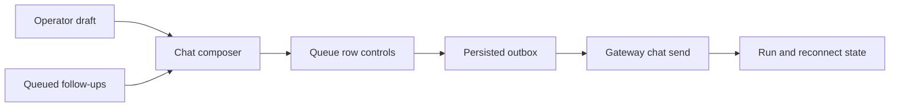

Codex review: needs maintainer review before merge. _Reviewed August 26, 2026, 8:34 AM ET / 12:34 UTC._

# ClawSweeper review

## What this changes

Attaches queued follow-up messages to the Control UI composer while updating queue editing, reorder/reconnect behavior, dictation, picker, and adjacent composer presentation.

## Merge readiness

⚠️ **Ready for maintainer review - 3 items remain**

Keep open for normal maintainer landing review. The reviewed head keeps queue edits row-owned and covers edit, cancellation, reorder, storage rejection, and reconnect draining; no discrete new defect was established. Exact-head CI is still incomplete, and this shallow checkout cannot materialize the PR base/current-main blobs for an independent three-way comparison.

**Priority:** P2
**Reviewed head:** `cb12cde341dfbfd1e373a0b110fa6a245f10b672`

## Review scores

| Measure | Result | What it means |
|---|---|---|
| **Overall readiness** | 🦐 gold shrimp **(3/6)** | Strong focused scenario coverage is reported, but final merge confidence is limited by incomplete exact-head CI and unavailable local base comparison. |
| **Proof confidence** | 🐚 platinum hermit **(4/6)** | Not applicable: This MEMBER-authored PR is exempt from the external-contributor proof gate; the supplied browser and isolated-Gateway evidence remains useful supplemental validation. |
| **Patch quality** | 🦐 gold shrimp **(3/6)** | No actionable review findings were identified. |

## Verification

| Check | Result | Evidence |
|---|---|---|
| **Real behavior** | Not applicable | Not applicable: This MEMBER-authored PR is exempt from the external-contributor proof gate; the supplied browser and isolated-Gateway evidence remains useful supplemental validation. |
| **Evidence reviewed** | 6 items | Composer-to-queue owner boundary: The composer view passes queue editing, retry, steering, movement, and removal callbacks into one queue renderer; queue row edits remain distinct from the main composer draft.<br>Row-local edit lifecycle: The edit owner records the original row, scoped outbox identity, attachments, and order, and rejects stale source replacement rather than retiring the original row.<br>End-to-end queue coverage: The browser flow exercises queued-row editing, cancellation, unrelated composer sends, reorder, failed removal, reconnect, and exact send ordering. |
| **Findings** | None | None. |
| **Security** | None | None. |


### Live Verification

**Command:** `node scripts/run-vitest.mjs run --config test/vitest/vitest.ui-e2e.config.ts --configLoader runner ui/src/e2e/chat-flow.queue-edit.e2e.test.ts`

**Result:** FAIL (failed) — step 1 `run` `node scripts/run-vitest.mjs run --config test/vitest/vitest.ui-e2e.config.ts --configLoader runner ui/src/e2e/chat-flow.queue-edit.e2e.test.ts`: `previous terminal command was still running after 30 seconds: "node scripts/run-vitest.mjs run --config test/vitest/vitest.ui-e2e.config.ts --configLoader runner ui/src/e2e/chat-flow.queue-edit.e2e.test.ts"`

```text
RUN  v4.1.10 /tmp/clawsweeper-live-proof-127823-toYaT0/target

[vitest] still running with no output for 30000ms.
```

**Assertions:**

- FAIL `expect_output`: 4 passed

## How this fits together

The Control UI composer accepts a draft while a chat run is active and displays queued follow-ups. Queue state is persisted for recovery, then drained through the Gateway chat-send path as runs complete or reconnect.



## Before merge

- [ ] **Resolve merge risk (P1)** - Queued messages and their saved edit state can be misordered or recovered incorrectly if the broad composer change conflicts with current main; complete required exact-head CI and the queue/reconnect browser lane before merge.
- [ ] **Resolve merge risk (P1)** - The local checkout cannot independently compare the full branch against current main because required promisor blobs are unavailable; use GitHub’s merge result and exact-head validation for the final landing pass.
- [ ] **Complete next step (P2)** - This protected maintainer PR has no discrete repair finding; it needs the normal exact-head landing pass after CI completes.


<details>
<summary><strong>Agent review details</strong></summary>

### Security

None.

### Review metrics

| Metric | Value | Why it matters |
|---|---|---|
| **Focused stack delta** | production +843/-406; tests +345/-64 | The PR body distinguishes substantial composer behavior growth from focused UI coverage; the local base blobs were unavailable to independently recalculate it. |

### Stored data model

Persistent data-model change detected: `serialized state: ui/src/components/session-progress-card.test.ts`, `serialized state: ui/src/components/session-progress-card.ts`, `serialized state: ui/src/lib/sessions/tool-overrides.ts`, `serialized state: ui/src/pages/chat/composer-persistence.test.ts`, `unknown-data-model-change: ui/src/e2e/session-progress-live-placement.e2e.test.ts`, `unknown-truncated-pull-files`, and 1 more. Confirm migration or upgrade compatibility proof before merge.

### Merge-risk options

**Maintainer options:**
1. **Complete exact-head queue validation (recommended)**  
   Wait for the final head’s required CI and queue/reconnect browser coverage before merging because the changed outbox controls affect delivery order and restored row state.

### Technical review

Best possible solution:

Retain the row-local edit and durable outbox design, then merge only after the final head has completed queue/reconnect browser proof and required CI against its actual merge result.

Do we have a high-confidence way to reproduce the issue?

Not applicable: this PR proposes a Control UI workflow change rather than reporting one standalone bug; its browser suite supplies concrete changed-behavior scenarios.

Is this the best way to solve the issue?

Unclear: the row-local edit and durable replacement design fit the owning queue boundary, but an independent current-main three-way comparison is blocked by unavailable base blobs in this checkout.

AGENTS.md: found and applied where relevant.

Codex review notes: model internal, reasoning high; reviewed against [1e6844b71aa2](https://github.com/openclaw/openclaw/commit/1e6844b71aa2299c082d23cf66dce38ff00b2211).

### Labels

Label justifications:

- `P2`: This is a substantial but bounded Control UI queue and composer change rather than an emergency regression.
- `merge-risk: 🚨 message-delivery`: The branch changes queued-message editing, reordering, retry, and reconnect drain behavior.
- `merge-risk: 🚨 session-state`: The branch changes persisted queue rows and keeps an edit draft scoped to its originating session and agent.
- `rating: 🦐 gold shrimp`: Overall readiness is 🦐 gold shrimp; proof is 🐚 platinum hermit and patch quality is 🦐 gold shrimp.
- `status: 👀 ready for maintainer look`: ClawSweeper has no concrete contributor-facing blocker left for this PR. Not applicable: This MEMBER-authored PR is exempt from the external-contributor proof gate; the supplied browser and isolated-Gateway evidence remains useful supplemental validation.

### Evidence

What I checked:

- **Composer-to-queue owner boundary:** The composer view passes queue editing, retry, steering, movement, and removal callbacks into one queue renderer; queue row edits remain distinct from the main composer draft. ([`ui/src/pages/chat/components/chat-composer-view.ts:264`](https://github.com/openclaw/openclaw/blob/cb12cde341df/ui/src/pages/chat/components/chat-composer-view.ts#L264), [cb12cde341df](https://github.com/openclaw/openclaw/commit/cb12cde341df))
- **Row-local edit lifecycle:** The edit owner records the original row, scoped outbox identity, attachments, and order, and rejects stale source replacement rather than retiring the original row. ([`ui/src/pages/chat/queued-message-edit.ts:19`](https://github.com/openclaw/openclaw/blob/cb12cde341df/ui/src/pages/chat/queued-message-edit.ts#L19), [cb12cde341df](https://github.com/openclaw/openclaw/commit/cb12cde341df))
- **End-to-end queue coverage:** The browser flow exercises queued-row editing, cancellation, unrelated composer sends, reorder, failed removal, reconnect, and exact send ordering. ([`ui/src/e2e/chat-flow.queue-edit.e2e.test.ts:17`](https://github.com/openclaw/openclaw/blob/cb12cde341df/ui/src/e2e/chat-flow.queue-edit.e2e.test.ts#L17), [cb12cde341df](https://github.com/openclaw/openclaw/commit/cb12cde341df))
- **Latest test alignment:** The final head replaces the macOS-specific Control+A assumption with ControlOrMeta+A; the maintainer discussion reports the focused suite passing three times on the Mac reproducer. ([`ui/src/e2e/chat-flow.queue-edit.e2e.test.ts:56`](https://github.com/openclaw/openclaw/blob/cb12cde341df/ui/src/e2e/chat-flow.queue-edit.e2e.test.ts#L56), [cb12cde341df](https://github.com/openclaw/openclaw/commit/cb12cde341df))
- **Review limitation:** The local clone has one reachable commit and its promisor remote cannot resolve, so historical/base source blobs and a local current-main diff could not be inspected. ([cb12cde341df](https://github.com/openclaw/openclaw/commit/cb12cde341df))
- **Security-sensitive guard:** The supplied PR discussion records that the current head cleared the security-sensitive-change guard. ([cb12cde341df](https://github.com/openclaw/openclaw/commit/cb12cde341df))

Likely related people:

- **vyctorbrzezowski:** Authored this branch and the merged composer-invocation work that forms its adjacent current-main surface. (role: recent composer-area contributor; confidence: medium; commits: [c08723064198](https://github.com/openclaw/openclaw/commit/c087230641987ed53f5842598f6e455fd8222fcd), [7b3fb4261719](https://github.com/openclaw/openclaw/commit/7b3fb426171924b4e69447e2a7a39e71752dcdbd); files: `ui/src/pages/chat/components/chat-composer-queue.ts`, `ui/src/pages/chat/queued-message-edit.ts`)
- **steipete:** Authored the current-head portable queue-edit test correction and the latest landing review notes. (role: recent reviewer and test-alignment contributor; confidence: high; commits: [cb12cde341df](https://github.com/openclaw/openclaw/commit/cb12cde341dfbfd1e373a0b110fa6a245f10b672); files: `ui/src/e2e/chat-flow.queue-edit.e2e.test.ts`)

### Rank-up moves

Optional improvements that raise the rating; they are not merge blockers.

- Complete the final head’s required CI and focused queue/reconnect browser lane against the actual merge result.

### Rating scale

| Score | Internal tier | Crab rank | Meaning |
|---:|:---:|---|---|
| **6/6** | S | 🦀 challenger crab | Exceptional readiness |
| **5/6** | A | 🦞 diamond lobster | Very strong readiness |
| **4/6** | B | 🐚 platinum hermit | Good normal PR; ordinary maintainer review |
| **3/6** | C | 🦐 gold shrimp | Useful, but confidence is limited |
| **2/6** | D | 🦪 silver shellfish | Proof or implementation needs work |
| **1/6** | F | 🧂 unranked krab | Not merge-ready |
| N/A | NA | 🌊 off-meta tidepool | Rating does not apply |

Overall follows the weaker of proof and patch quality.
Shiny media proof means a screenshot, video, or linked artifact directly shows the changed behavior. Runtime, network, CSP, and security claims still need visible diagnostics.

### Workflow

- ClawSweeper keeps one durable marker-backed review comment per issue or PR.
- Re-runs edit this comment so the latest verdict, findings, and automation markers stay together instead of adding duplicate bot comments.
- A fresh review can be triggered by eligible `@clawsweeper re-review` comments, exact-item GitHub events, scheduled/background review runs, or manual workflow dispatch.
- PR/issue authors and users with repository write access can comment `@clawsweeper re-review` or `@clawsweeper re-run` on an open PR or issue to request a fresh review only.
- Maintainers can also comment `@clawsweeper review` to request a fresh review only.
- Fresh-review commands do not start repair, autofix, rebase, CI repair, or automerge.
- Maintainer-only repair and merge flows require explicit commands such as `@clawsweeper autofix`, `@clawsweeper automerge`, `@clawsweeper fix ci`, or `@clawsweeper address review`.
- Maintainers can comment `@clawsweeper explain` to ask for more context, or `@clawsweeper stop` to stop active automation.

### History

<details>
<summary>Review history (28 earlier review cycles; latest 8 shown)</summary>

<!-- clawsweeper-review-history v=1 total=28 -->
- reviewed 2026-08-25T12:38:04.562Z sha d9b6ab8b9475e516ce5f5377d19ece095088af4a :: found issues before merge. :: [P2] Hide Steer while settings are pending | [P3] Document the current queue-edit controls
- reviewed 2026-08-26T00:52:51.924Z sha a9c3c27f3857a5b1af2ad0c78605dfbe02f1b111 :: found issues before merge. :: [P2] Hide Steer while settings are pending
- reviewed 2026-08-26T06:28:11.454Z sha a9c3c27f3857a5b1af2ad0c78605dfbe02f1b111 :: found issues before merge. :: [P2] Hide Steer while settings are pending
- reviewed 2026-08-26T07:36:05.528Z sha 14bcc456813a46348846e2b388dcaf7569f36b4b :: found issues before merge. :: [P2] Hide Steer while settings are pending
- reviewed 2026-08-26T08:37:07.862Z sha abf137cad50365223a78d032cdb81122ecb44869 :: found issues before merge. :: [P1] Preserve code-less encrypted-content recovery | [P1] Retry encrypted stream rejection before output | [P2] Hide Steer while settings are pending
- reviewed 2026-08-26T09:00:56.328Z sha a1be5d4a88135215ff747dfeabdf46d94d0e01ce :: found issues before merge. :: [P1] Preserve complete-stream encrypted-content recovery | [P2] Gate immediate Steer while settings are pending
- reviewed 2026-08-26T09:17:28.703Z sha 9b589c108e3a5380b6ddccd2431579fd24766015 :: needs changes before merge. :: [P1] Preserve complete-stream encrypted-content recovery
- reviewed 2026-08-26T09:49:06.175Z sha 0b001e72e9494e607fe4da4d230438b39f27f8ef :: needs maintainer review before merge. :: none

</details>

</details>

<!-- clawsweeper-verdict:needs-human item=127823 sha=cb12cde341dfbfd1e373a0b110fa6a245f10b672 confidence=medium updated_at=2026-08-26T12:31:16Z reviewed_at=2026-08-26T12:34:17.262Z lease_owner=github-run-32968843229-1 lease_comment_id=5425326932 source_revision=f7d4e24739571b8e9d07337564a332ff6fad4d815f38e41d9d5c2a4e4e6d027d -->

<!-- clawsweeper-review-version item=127823 reviewed_at=2026-08-26T12:34:17.262Z sha=cb12cde341dfbfd1e373a0b110fa6a245f10b672 source_revision=f7d4e24739571b8e9d07337564a332ff6fad4d815f38e41d9d5c2a4e4e6d027d lease_owner=github-run-32968843229-1 lease_comment_id=5425326932 v=1 -->

<!-- clawsweeper-review item=127823 -->