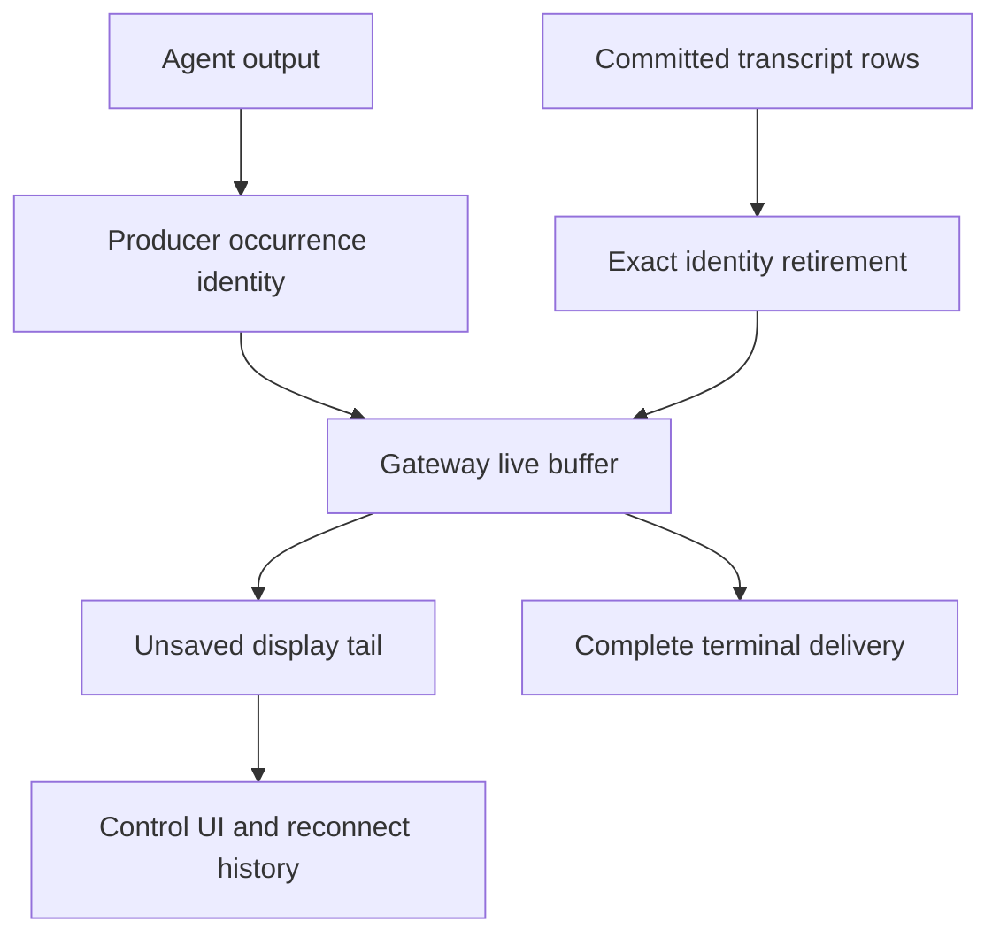

Codex review: blocked before merge. _Reviewed October 8, 2026, 6:13 AM ET / 10:13 UTC (Revision 4)._

# ClawSweeper review

## What this changes

The branch makes the Gateway retire saved assistant text by producer identity and places steering messages below their run’s output.

**Example:** The user reloads history during a 22-paragraph tool run.
- **Before:** The reported regression renders 44 commentary occurrences when only four saved commentary rows remain in the loaded page.
- **After:** The supplied regression renders each paragraph once and preserves the new text “Step 23: Still investigating.”

## Review scores

| Measure | Result | What it means |
|---|---|---|
| **Overall readiness** | 🦐 gold shrimp **(3/6)** | Useful owner-level repair with meaningful regression coverage, but current browser evidence and merged-base composition remain limited. |
| **Proof confidence** | 🦐 gold shrimp **(3/6)** | Not applicable: The supplied maintainer association exempts this PR from the external-contributor proof gate. Central commentary proof uses synthetic Gateway/UI inputs; reported real-Gateway SDK coverage supports canonical event ordering, while inspected historical screenshots do not demonstrate this head. Correlation metadata is stripped before storage, so no stored-data migration is required. |
| **Patch quality** | 🦐 gold shrimp **(3/6)** | No actionable review findings were identified. |

## Product

**Kind:** Bug fix · **Worth it:** Yes · **Fix scope:** Complete
**User problem:** Users see commentary paragraphs twice after loading history during a long tool run.
**Reason:** The paged-history failure is concrete and cannot be reliably repaired by client text matching. The author’s prior merged area work supports the explicitly chosen display-order direction.

## Merge readiness

⛔ **Blocked before merge - 4 items remain**

Keep open: this PR addresses a concrete gap that current main still has, with direction supplied by an established area contributor. No definite new code finding was established, but the available evidence does not settle current-base integration or the reported CLI timeout.

**Priority:** P2
**Reviewed head:** `3c144d208bdb23fad228216a46453ff719947e21`

## Before merge

- [ ] **Resolve merge risk (P1)** - Integration of the overlapping runtime-subscription and ACP transcript-persistence changes with fetched current main remains unverified because the available test-merge candidate has stale parents.
- [ ] **Complete next step (P2)** - Establish whether the exact-head local CLI timeout is caused by this branch or independently present on main before selecting the supported CI recovery path.
- [ ] **Resolve review confidence** - ClawSweeper must reach high confidence before merge readiness is known.
- [ ] **Review config compatibility** - Confirm compatibility and upgrade impact for the changed config or default surface before merge.

## Findings

None.

### Provenance

- `Codex provisional assistant replacement`: original intent not found (unknown: Available source documents phase-unknown replacement versus append-only final-answer delivery; git -S could not retrieve older blobs because the partial-clone request returned HTTP 403.)

### Tests

- Missing end-to-end proof: Current before/after browser evidence for the 22-paragraph history-recovery case and the revised steering order remains absent; prepared images belong to the earlier merged steering PR. Reported baseline failures and head passes were not independently executed in this read-only review.

<strong>Agent review details</strong>

### How this fits together

The Gateway combines agent output and committed transcript rows into updates consumed by the Control UI and other clients. This change makes the Gateway distinguish saved output from the live display tail while preserving complete terminal delivery content.

### Technical review

Best possible solution:

Keep exact-occurrence retirement in the Gateway, preserve complete delivery content, and validate the resulting client projection on a current-base candidate.

Do we have a high-confidence way to reproduce the issue?

Yes, there is a high-confidence source-backed path: cumulative commentary is replayed beside a partial history page, and the supplied 22-paragraph regression exercises that boundary. This read-only review did not execute a current-main reproduction.

Is this the best way to solve the issue?

Yes, retiring saved occurrences at their Gateway owner avoids guessing from incomplete client history. Confidence in landing remains limited by unverified current-base composition and missing current browser evidence.

AGENTS.md: found and applied where relevant.

Codex review notes: model internal, reasoning medium; reviewed against [e2f407d91780](https://github.com/openclaw/openclaw/commit/e2f407d91780d527ada810b0d2b24aa7c10c69a3).

### Merge-risk options

**Maintainer options:**
1. **Verify the overlapping current-base paths (recommended)**  
   Review a refreshed merge candidate containing pinned current main and this exact head, then validate runtime subscriptions and ACP transcript publication in that composition.

### Provenance checked

- `Gateway live assistant projection` keeps the original intent (https://github.com/openclaw/openclaw/pull/158489: Reduce repeated projection work while preserving normalization, suppression, recovery, and delivery ordering.)
- `Chat-delta itemId and itemStartOffset reconciliation` changes intended behavior with a stated reason (https://github.com/openclaw/openclaw/pull/158459: Retire the matching persisted commentary occurrence without claiming ownership through text equality.)
- `Control UI cumulative commentary handoff` changes intended behavior with a stated reason (https://github.com/openclaw/openclaw/pull/144498: Hide unfinished commentary when its completed item overtakes cumulative text while preserving later legitimate occurrences.)
- `Control UI replay-eviction history hydration` changes intended behavior with a stated reason (https://github.com/openclaw/openclaw/pull/147600: Use persisted commentary as cumulative-prefix evidence when matching replay items have been evicted.)
- `Control UI steering boundaries` changes intended behavior with a stated reason (https://github.com/openclaw/openclaw/pull/165535: Preserve already-visible output above a steer and subsequent output below it through refresh and recovery.)

### Testing

Proof path: in-process harness. Added test files: 44.

### Security

None.

### Evidence

What I checked:

- **Current main still uses cumulative projection:** Fetched main retains cumulative raw-buffer projection and itemStartOffset metadata; it does not contain this branch's occurrence-retirement owner. The earlier merged fix therefore does not establish that the paged-history problem is already solved. ([`src/gateway/server-chat-state.ts:261`](https://github.com/openclaw/openclaw/blob/e2f407d91780d527ada810b0d2b24aa7c10c69a3/src/gateway/server-chat-state.ts#L261), [e2f407d91780](https://github.com/openclaw/openclaw/commit/e2f407d91780d527ada810b0d2b24aa7c10c69a3))
- **Retirement and terminal-content separation:** The branch derives visible text from uncommitted occurrences, retains complete terminal content separately, and checks transcript session/run correspondence before retirement. ([`src/gateway/server-chat-state.ts:266`](https://github.com/openclaw/openclaw/blob/3c144d208bdb23fad228216a46453ff719947e21/src/gateway/server-chat-state.ts#L266), [3c144d208bdb](https://github.com/openclaw/openclaw/commit/3c144d208bdb23fad228216a46453ff719947e21))
- **Long-run regression boundary:** The synthetic regression drives the embedded subscription, Gateway handler, history loader, and UI projection with 22 paragraphs, a 40-row history page, and bounded replay; it checks single occurrences and continuation after reconnect. This review inspected the test but did not execute it. ([`src/gateway/server-chat.commentary-history.test.ts:54`](https://github.com/openclaw/openclaw/blob/3c144d208bdb23fad228216a46453ff719947e21/src/gateway/server-chat.commentary-history.test.ts#L54), [3c144d208bdb](https://github.com/openclaw/openclaw/commit/3c144d208bdb23fad228216a46453ff719947e21))
- **Accepted display direction:** The PR body expressly chooses live text below saved run output and steering below all output of the targeted run. Prior merged history connects its author to both Gateway projection and steering ownership; this is recorded direction rather than an unexplained reversal. Public docs: [`docs/web/control-ui.md`](https://docs.openclaw.ai/web/control-ui). ([`docs/web/control-ui.md:88`](https://docs.openclaw.ai/web/control-ui), [c108ae61b50f](https://github.com/openclaw/openclaw/commit/c108ae61b50f86f7d2d865fcbe048184ffb3c54d))
- **Prior fix and retained intent:** https://github.com/openclaw/openclaw/pull/158459 is merged and introduced optional live-delta identity metadata to prevent duplicate persisted commentary. This branch explicitly supersedes that approach because bounded replay and paged history cannot recover all ownership. ([`src/gateway/server-chat-state.ts`](https://github.com/openclaw/openclaw/blob/4893be630b53e5110f5aa3d4f7c0973ea45c6129/src/gateway/server-chat-state.ts), [4893be630b53](https://github.com/openclaw/openclaw/commit/4893be630b53e5110f5aa3d4f7c0973ea45c6129))
- **Stored-data compatibility:** Worker itemId correlation is removed before storage, Codex occurrence metadata is removed from transcript candidates, and assistantItemIds is excluded from public transcript events. The existing idempotency-key construction is preserved; these changes introduce no stored schema or migration. ([`src/gateway/worker-environments/transcript-commit.runtime.ts:269`](https://github.com/openclaw/openclaw/blob/3c144d208bdb23fad228216a46453ff719947e21/src/gateway/worker-environments/transcript-commit.runtime.ts#L269), [3c144d208bdb](https://github.com/openclaw/openclaw/commit/3c144d208bdb23fad228216a46453ff719947e21))

Likely related people:

- **steipete:** Suggested for follow-up; no historical authorship or introduction is verified. (role: unverified routing candidate; confidence: low)
- **RomneyDa:** Suggested for follow-up; no historical authorship or introduction is verified. (role: unverified routing candidate; confidence: low)

### PR surface

PR surface statistics unavailable: the file list is incomplete.

### Review metrics

| Metric | Value | Why it matters |
|---|---|---|
| **Protocol correlation fields** | 2 optional chat-delta fields removed; 1 optional worker transcript field added | The removed fields were explicitly unreleased, while the added worker field is stripped before storage and travels within exact-build admission. |

### Stored data model

Persistent data-model change detected: `serialized state: extensions/codex/src/app-server/event-projector-steering.ts`, `serialized state: ui/src/lib/chat/chat-types.ts`, `serialized state: ui/src/pages/chat/stream-segment-pruning.ts`, `serialized state: ui/src/pages/chat/tool-stream-preamble.ts`, `unknown-data-model-change: extensions/codex/src/app-server/event-projector-steering.ts`, `unknown-data-model-change: ui/src/pages/chat/stream-segment-pruning.ts`, and 2 more. Migration or upgrade compatibility proof is recorded; maintainers should verify it before merge.

### Labels

Label changes:

No label changes.

Label justifications:

- `P2`: Duplicate commentary during long active runs is a concrete display bug with limited blast radius.
- `merge-risk: 🚨 compatibility`: The branch changes shared live-text contracts and overlaps current-main runtime and transcript changes whose merged composition is not yet verified.
- `rating: 🦐 gold shrimp`: Overall readiness is 🦐 gold shrimp; proof is 🦐 gold shrimp and patch quality is 🦐 gold shrimp.
- `status: 👀 ready for maintainer look`: ClawSweeper has no concrete contributor-facing blocker left for this PR.

### Rank-up moves

Optional improvements that raise the rating; they are not merge blockers.

- Attach current before/after browser evidence for long-run commentary recovery and steering.
- Verify the overlapping paths on a refreshed current-base merge candidate.

### Rating scale

6/6 🦀 challenger crab · 5/6 🦞 diamond lobster · 4/6 🐚 platinum hermit · 3/6 🦐 gold shrimp · 2/6 🦪 silver shellfish · 1/6 🧂 unranked krab. Overall follows the weaker of proof and patch quality; ✨ marks media proof (a screenshot, video, or linked artifact) that directly shows the changed behavior.

### Workflow

ClawSweeper edits this one comment on every review. Comment `@clawsweeper re-review` for a fresh review only; repair and merge need explicit maintainer commands such as `@clawsweeper autofix` or `@clawsweeper automerge`.

### History

Review history (3 earlier review cycles)

<!-- clawsweeper-review-history v=1 total=3 -->
- reviewed 2026-10-08T08:36:26.869Z sha 05e22df4d003014b9bc11245a57d014195fada64 :: blocked before merge. :: none
- reviewed 2026-10-08T08:57:33.058Z sha cd1e8e98a3b9e2f05ce98467f3f2c75b32fa2673 :: blocked before merge. :: [P2] Update the compaction harness mock for the new source exports | [P2] Supply the unpersisted tail in the reconnect browser fixture | [P2] Migrate the refresh test to the new steering display contract
- reviewed 2026-10-08T09:33:58.384Z sha cc300922c8ea6497cc9823b7e07fabc33c303e70 :: blocked before merge. :: none

<!-- clawsweeper-verdict:needs-human item=167054 sha=3c144d208bdb23fad228216a46453ff719947e21 confidence=medium updated_at=2026-10-08T10:09:21Z reviewed_at=2026-10-08T10:13:25.560Z lease_owner=github-run-37761486273-1 lease_comment_id=6057560579 source_revision=47c8d9e124e579af35427360ff261603cf0aebf91f0f1001239d827d9f2cd713 live_verification=absent -->
<!-- clawsweeper-review-state:blocked item=167054 sha=3c144d208bdb23fad228216a46453ff719947e21 v=1 -->

<!-- clawsweeper-review-version item=167054 reviewed_at=2026-10-08T10:13:25.560Z sha=3c144d208bdb23fad228216a46453ff719947e21 source_revision=47c8d9e124e579af35427360ff261603cf0aebf91f0f1001239d827d9f2cd713 lease_owner=github-run-37761486273-1 lease_comment_id=6057560579 v=1 -->

<!-- clawsweeper-review item=167054 -->