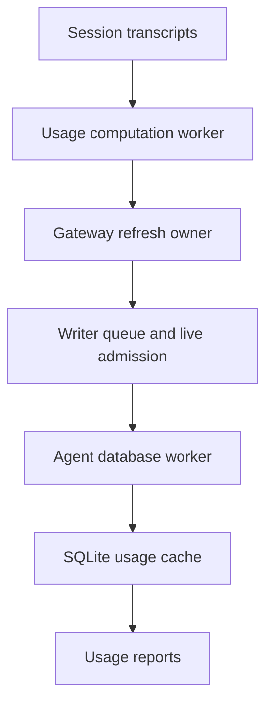

Codex review: needs maintainer review before merge. _Reviewed October 2, 2026, 1:52 AM ET / 05:52 UTC (Revision 2)._

# ClawSweeper review

## What this changes

Moves durable usage-cache writes, pruning, and refresh-lock transactions into the existing database worker while preserving incognito and maintenance behavior.

## Merge readiness

✅ **Ready for maintainer review**

This PR remains useful: current main still executes usage-cache transactions on the calling thread, and neither related PR supersedes it. No actionable correctness or security finding remains; the captured body records approval for the reviewed head, resolving the previous next step.

**Priority:** P2
**Reviewed head:** `496767dbf0ed3c734386635b9300e6c401df2bbf`

## Review scores

| Measure | Result | What it means |
|---|---|---|
| **Overall readiness** | 🐚 platinum hermit **(4/6)** | A coherent worker cutover with focused native boundary coverage and no actionable review finding. |
| **Proof confidence** | 🐚 platinum hermit **(4/6)** | Not applicable: Repository State identifies a MEMBER author, exempting ordinary contributor proof. The captured body reports native worker/SQLite execution through the production refresh owner, including queued revocation, lost replies, rollback, and cleanup; inspected source supports those boundaries, with no unresolved authority violation or stored-format change. |
| **Patch quality** | 🐚 platinum hermit **(4/6)** | No actionable review findings were identified. |

## Verification

| Check | Result | Evidence |
|---|---|---|
| **Real behavior** | Not applicable | Not applicable: Repository State identifies a MEMBER author, exempting ordinary contributor proof. The captured body reports native worker/SQLite execution through the production refresh owner, including queued revocation, lost replies, rollback, and cleanup; inspected source supports those boundaries, with no unresolved authority violation or stored-format change. |
| **Evidence reviewed** | 9 items | Pinned introduction and merge result: Inspected the merge-base-to-head introduced diff. The test merge's raw parents are the pinned base followed by the exact head, and its base-relative result contains only the eight introduced paths. Current main still needs this work: Current main retains runCacheWriteTransaction, which invokes synchronous native transactions and usage-cache kernels on the caller. The proposed worker dispatch is absent. Live admission and cleanup custody: Inputs are cloned before queueing; the existing execution binding validates source authority and physical identity at admission. Cleanup captures the admitted file identity and deletes only the exact lock value, without replaying a data write after an uncertain result. |
| **Findings** | None | None. |
| **Security** | None | None. |

## How this fits together

Usage reporting aggregates session transcripts into per-agent SQLite cache rows. The Gateway retains refresh authority and publishes results while database workers execute durable transactions.

## Before merge

None.

<strong>Agent review details</strong>

### Security

None.

### PR surface

Source +150, Tests +153. Total +303 across 8 files.

View PR surface stats

| Area | Files | Added | Removed | Net |
|---|---:|---:|---:|---:|
| Source | 4 | 234 | 84 | +150 |
| Tests | 4 | 176 | 23 | +153 |
| Docs | 0 | 0 | 0 | 0 |
| Config | 0 | 0 | 0 | 0 |
| Generated | 0 | 0 | 0 | 0 |
| Other | 0 | 0 | 0 | 0 |
| **Total** | **8** | **410** | **107** | **+303** |

### Review metrics

| Metric | Value | Why it matters |
|---|---|---|
| **Worker operation surface** | 4 internal operations added; 0 public API or configuration additions | The added dispatch extends the existing database owner without introducing another user-facing contract. |

### Technical review

Best possible solution:

Keep durable cache mutations under the canonical worker owner with exact-byte comparisons, live admission, and joined cleanup.

Do we have a high-confidence way to reproduce the issue?

Yes, current-main source establishes caller-thread cache transactions, and the production refresh regression has a reported baseline failure for that SQL. This review did not execute tests.

Is this the best way to solve the issue?

Yes, extending the existing database executor reuses the authoritative kernels and preserves the supported native exceptions.

AGENTS.md: found and applied where relevant.

Codex review notes: model internal, reasoning medium; reviewed against [a272cf0cd56e](https://github.com/openclaw/openclaw/commit/a272cf0cd56eb9d0a1245daaaf139902ac32da01).

### Labels

Label changes:

No label changes.

Label justifications:

- `P2`: This is a bounded runtime responsiveness improvement without evidence of an urgent user-facing outage.
- `rating: 🐚 platinum hermit`: Overall readiness is 🐚 platinum hermit; proof is 🐚 platinum hermit and patch quality is 🐚 platinum hermit.
- `status: 👀 ready for maintainer look`: ClawSweeper has no concrete contributor-facing blocker left for this PR. Not applicable: Repository State identifies a MEMBER author, exempting ordinary contributor proof. The captured body reports native worker/SQLite execution through the production refresh owner, including queued revocation, lost replies, rollback, and cleanup; inspected source supports those boundaries, with no unresolved authority violation or stored-format change.

### Evidence

What I checked:

- **Pinned introduction and merge result:** Inspected the merge-base-to-head introduced diff. The test merge's raw parents are the pinned base followed by the exact head, and its base-relative result contains only the eight introduced paths. ([8348d0350731](https://github.com/openclaw/openclaw/commit/8348d03507315d426cce5c577837fb3f2c7338e1))
- **Current main still needs this work:** Current main retains runCacheWriteTransaction, which invokes synchronous native transactions and usage-cache kernels on the caller. The proposed worker dispatch is absent. ([`src/infra/session-cost-usage-cache.sqlite.ts:43`](https://github.com/openclaw/openclaw/blob/a272cf0cd56eb9d0a1245daaaf139902ac32da01/src/infra/session-cost-usage-cache.sqlite.ts#L43), [a272cf0cd56e](https://github.com/openclaw/openclaw/commit/a272cf0cd56eb9d0a1245daaaf139902ac32da01))
- **Live admission and cleanup custody:** Inputs are cloned before queueing; the existing execution binding validates source authority and physical identity at admission. Cleanup captures the admitted file identity and deletes only the exact lock value, without replaying a data write after an uncertain result. ([`src/infra/session-cost-usage-cache.sqlite.ts:102`](https://github.com/openclaw/openclaw/blob/496767dbf0ed3c734386635b9300e6c401df2bbf/src/infra/session-cost-usage-cache.sqlite.ts#L102), [496767dbf0ed](https://github.com/openclaw/openclaw/commit/496767dbf0ed3c734386635b9300e6c401df2bbf))
- **Existing kernels and storage contracts retained:** Four internal worker operations reuse the unchanged SQL kernels and request commit admission inside the transaction. The introduced diff changes no schema, stored encoding, retention, configuration, or public SDK contract. ([`src/state/openclaw-agent-execution-operations.ts:275`](https://github.com/openclaw/openclaw/blob/496767dbf0ed3c734386635b9300e6c401df2bbf/src/state/openclaw-agent-execution-operations.ts#L275), [496767dbf0ed](https://github.com/openclaw/openclaw/commit/496767dbf0ed3c734386635b9300e6c401df2bbf))
- **Production-boundary coverage:** The refresh regression uses the production refresh entry point and observes zero caller-thread cache SQL. Native worker/database cases cover revoked queued authority with no persisted rollup, delayed and lost acquisition replies, foreign-file refusal, rollback, and exact-lock cleanup. The captured body reports 47 passing tests and the intended baseline failure; this read-only review did not rerun them. ([`src/infra/session-cost-usage-cache.worker.test.ts:215`](https://github.com/openclaw/openclaw/blob/496767dbf0ed3c734386635b9300e6c401df2bbf/src/infra/session-cost-usage-cache.worker.test.ts#L215), [496767dbf0ed](https://github.com/openclaw/openclaw/commit/496767dbf0ed3c734386635b9300e6c401df2bbf))
- **Previous approval item resolved:** The previous completed review had no findings and requested campaign coordinator approval. The captured body now explicitly records coordinator approval for this exact head. Internal scheduling and admission changes preserve existing contracts, so no additional product or storage-design approval is required by this review. ([496767dbf0ed](https://github.com/openclaw/openclaw/commit/496767dbf0ed3c734386635b9300e6c401df2bbf))

Likely related people:

- **steipete:** Suggested for follow-up; no historical authorship or introduction is verified. (role: unverified routing candidate; confidence: low)
- **obviyus:** Suggested for follow-up; no historical authorship or introduction is verified. (role: unverified routing candidate; confidence: low)

### Rating scale

| Score | Internal tier | Crab rank | Meaning |
|---:|:---:|---|---|
| **6/6** | S | 🦀 challenger crab | Exceptional readiness |
| **5/6** | A | 🦞 diamond lobster | Very strong readiness |
| **4/6** | B | 🐚 platinum hermit | Good normal PR; ordinary maintainer review |
| **3/6** | C | 🦐 gold shrimp | Useful, but confidence is limited |
| **2/6** | D | 🦪 silver shellfish | Proof or implementation needs work |
| **1/6** | F | 🧂 unranked krab | Not merge-ready |
| N/A | NA | 🌊 off-meta tidepool | Rating does not apply |

Overall follows the weaker of proof and patch quality.
Shiny media proof means a screenshot, video, or linked artifact directly shows the changed behavior. Runtime, network, CSP, and security claims still need visible diagnostics.

### Workflow

- ClawSweeper keeps one durable marker-backed review comment per issue or PR.
- Re-runs edit this comment so the latest verdict, findings, and automation markers stay together instead of adding duplicate bot comments.
- A fresh review can be triggered by eligible `@clawsweeper re-review` comments, exact-item GitHub events, scheduled/background review runs, or manual workflow dispatch.
- PR/issue authors and users with repository write access can comment `@clawsweeper re-review` or `@clawsweeper re-run` on an open PR or issue to request a fresh review only.
- Maintainers can also comment `@clawsweeper review` to request a fresh review only.
- Fresh-review commands do not start repair, autofix, rebase, CI repair, or automerge.
- Maintainer-only repair and merge flows require explicit commands such as `@clawsweeper autofix`, `@clawsweeper automerge`, `@clawsweeper fix ci`, or `@clawsweeper address review`.
- Maintainers can comment `@clawsweeper explain` to ask for more context, or `@clawsweeper stop` to stop active automation.

### History

Review history (1 earlier review cycle)

<!-- clawsweeper-review-history v=1 total=1 -->
- reviewed 2026-10-02T05:35:29.786Z sha 496767dbf0ed3c734386635b9300e6c401df2bbf :: needs changes before merge. :: none

<!-- clawsweeper-verdict:needs-human item=163287 sha=496767dbf0ed3c734386635b9300e6c401df2bbf confidence=high updated_at=2026-10-02T05:49:21Z reviewed_at=2026-10-02T05:52:26.581Z lease_owner=github-run-36970573049-1 lease_comment_id=5946337890 source_revision=a5c9ebddd65750efd0886f63a78719851d4e9184d5474cf2fe5f1699d0bbb643 live_verification=absent -->
<!-- clawsweeper-review-state:ready item=163287 sha=496767dbf0ed3c734386635b9300e6c401df2bbf v=1 -->

<!-- clawsweeper-review-version item=163287 reviewed_at=2026-10-02T05:52:26.581Z sha=496767dbf0ed3c734386635b9300e6c401df2bbf source_revision=a5c9ebddd65750efd0886f63a78719851d4e9184d5474cf2fe5f1699d0bbb643 lease_owner=github-run-36970573049-1 lease_comment_id=5946337890 v=1 -->

<!-- clawsweeper-review item=163287 -->