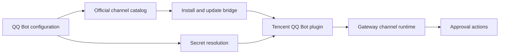

Codex review: found issues before merge. _Reviewed August 11, 2026, 6:00 PM ET / 22:00 UTC._

# ClawSweeper review

## What this changes

The PR removes bundled QQ Bot and moves catalog, installation, upgrade, setup, documentation, and secret compatibility support to Tencent’s external npm plugin.

## Merge readiness

⚠️ **Needs maintainer review before merge - 9 items remain**

This PR is still necessary, but it is not ready to merge: the public guide keeps the removed QQ Bot package command, the SecretRef guidance contradicts the added compatibility bridge, the fallback can activate secrets for an unavailable plugin, and a new SDK export widens approval authority.

**Priority:** P1
**Reviewed head:** `c3180f6c57ecf745e9bef2b39c14dc6b5a401752`
**Owner decision:** Required. See [Decision needed](#decision-needed).

## Review scores

| Measure | Result | What it means |
|---|---|---|
| **Overall readiness** | 🦐 gold shrimp **(3/6)** | The external-package load path has strong terminal proof, but merge-blocking compatibility and authority defects remain. |
| **Proof confidence** | 🦞 diamond lobster **(5/6)** | Sufficient (terminal): The maintainer comment includes an after-fix isolated-state install, channel setup, plugin listing, and Gateway startup transcript for Tencent’s package. |
| **Patch quality** | 🦐 gold shrimp **(3/6)** | Security review found an item that needs attention. |

## Verification

| Check | Result | Evidence |
|---|---|---|
| **Real behavior** | Verified | Sufficient (terminal): The maintainer comment includes an after-fix isolated-state install, channel setup, plugin listing, and Gateway startup transcript for Tencent’s package. |
| **Evidence reviewed** | 8 items | Current main still uses the bundled package: The current QQ Bot guide instructs operators to install @openclaw/qqbot, so the central externalization behavior is not already on main. Scoped package command bypasses catalog redirect: Only a bare plugin id is resolved through the official external catalog; a scoped npm package proceeds directly to npm, so the stale guide command will not redirect to Tencent’s package. Approval client is privileged: The current helper supplies a process-local approval token, requests operator.approvals, and omits device identity for loopback use. |
| **Findings** | 4 actionable findings | [P1] Install Tencent’s QQ Bot package in the guide [P1] Respect the active plugin-origin fence in the fallback [P1] Keep approval-runtime authority out of the public SDK |
| **Security** | Needs attention | Public SDK can mint approval-runtime authority: The exported helper sends the process-local approval token; the Gateway marks a local backend client with that token as approvalRuntime and permits approval resolution without reviewer-device identity. |

## How this fits together

QQ Bot settings select an official catalog entry, which installs and loads Tencent’s plugin before the Gateway runs the channel. Upgrade, setup, and secret-resolution paths must preserve existing operators’ configuration while moving the plugin owner.

## Decision needed

| Question | Recommendation |
|---|---|
| Should the public plugin SDK expose a helper that mints the host’s device-less operator-approval runtime for Tencent QQ Bot? | **Keep authority injected:** Remove the gateway-runtime export and provide Tencent’s channel only the host-injected, closure-bound approval runtime. |

Why: This is a public authority-boundary expansion; the thread records temporary acceptance, but repository policy requires explicit SDK and security-owner acceptance before widening that trust boundary.

## Before merge

- [ ] **Install Tencent’s QQ Bot package in the guide (P1)** - The branch removes the bundled QQ Bot owner and registers Tencent’s package, but this still directs fresh operators to `@openclaw/qqbot`. Scoped package specs bypass the catalog redirect, so update the command to Tencent’s package rather than leaving users to install the removed package or fail.
- [ ] **Respect the active plugin-origin fence in the fallback (P1)** - The fallback is returned after the record lookup filters against `loadablePluginOrigins`. Consequently, an absent or disabled QQ Bot plugin can still resolve a stale `clientSecret` SecretRef and block startup, contrary to the collector’s inactive-owner invariant. Return the catalog contract only when `openclaw-qqbot` is loadable, and cover the empty-origin case.
- [ ] **Keep approval-runtime authority out of the public SDK (P1)** - This re-export lets every installed plugin call a helper that supplies the process-local approval token, omits device identity, and is recognized by the Gateway as a trusted approval runtime. That client may resolve approvals despite reviewer-device binding; inject the existing closure-bound runtime instead, or obtain explicit SDK and security-owner approval for this public authority contract.
- [ ] **Describe the SecretRef bridge accurately (P2)** - The branch adds schema widening and a host fallback that resolves QQ Bot `clientSecret` SecretRefs, while these notes tell operators they must move them to env/file before upgrading. Document the supported host bridge or remove it; the current guide prescribes an unnecessary credential migration.
- [ ] **Resolve security concern: Public SDK can mint approval-runtime authority** - The exported helper sends the process-local approval token; the Gateway marks a local backend client with that token as approvalRuntime and permits approval resolution without reviewer-device identity.
- [ ] **Resolve merge risk (P1)** - Any installed plugin could use the new public helper to establish device-less approval authority, despite approval resolution being a remote-execution-grade permission.
- [ ] **Resolve merge risk (P2)** - A stale unavailable QQ Bot configuration can resolve a SecretRef and block startup if the catalog fallback ignores the active plugin-origin set.
- [ ] **Resolve merge risk (P1)** - The upgrade guide gives incompatible directions for package installation and structured credentials.

## Findings

- [P1] Install Tencent’s QQ Bot package in the guide — `docs/channels/qqbot.md:22`
- [P1] Respect the active plugin-origin fence in the fallback — `src/secrets/channel-contract-api.ts:230`
- [P1] Keep approval-runtime authority out of the public SDK — `src/plugin-sdk/gateway-runtime.ts:37`
- [high] Public SDK can mint approval-runtime authority — `src/plugin-sdk/gateway-runtime.ts:37`

<strong>Agent review details</strong>

### Security

Needs attention: The new public gateway-runtime export exposes a token-bearing approval client that can establish device-less approval authority from any installed plugin.

### Review metrics

| Metric | Value | Why it matters |
|---|---|---|
| **Production versus test delta** | production net-negative; tests net-positive | The bundled channel is removed, while new compatibility and migration coverage adds test code; the exact split could not be recomputed because the PR-head Git object is absent from this partial clone. |
| **Public SDK authority exports** | 1 added | The gateway-runtime entrypoint is a third-party plugin API, and the new export constructs a privileged approval client. |
| **QQ Bot secret compatibility paths** | 1 host fallback added; 1 contradictory migration instruction | Existing credential behavior must stay consistent between schema validation, runtime resolution, and upgrade documentation. |

### Stored data model

Persistent data-model change detected: `migration/backfill/repair: extensions/qqbot/doctor-contract-api.ts`, `migration/backfill/repair: src/plugins/manifest-registry-installed.test.ts`, `migration/backfill/repair: test/plugin-npm-runtime-build.test.ts`, `migration/backfill/repair: test/scripts/root-dependency-ownership-audit.test.ts`, `serialized state: src/plugins/manifest-registry-installed.test.ts`, `serialized state: test/scripts/plugin-gateway-gauntlet.test.ts`, and 6 more. Confirm migration or upgrade compatibility proof before merge.

### Merge-risk options

**Maintainer options:**
1. **Repair migration boundaries before merge (recommended)**  
   Fix the guide, preserve inactive-plugin secret behavior, and replace the public approval client with the injected runtime path.
2. **Accept the temporary SDK authority**  
   A security and SDK owner may explicitly approve the public authority contract with a documented removal condition.
3. **Pause the externalization**  
   Pause this PR if Tencent’s package cannot promptly migrate off the public approval authority contract.

### Technical review

Best possible solution:

Preserve the catalog-based QQ Bot migration, but correct the Tencent install and SecretRef documentation, gate fallback resolution on the active external owner, and use the existing injected closure-bound approval runtime instead of exporting token-bearing authority publicly.

Do we have a high-confidence way to reproduce the issue?

Yes. Source inspection reproduces the stale install command and the approval-authority path; the fallback’s missing active-origin guard follows directly from its unconditional catalog return in the supplied PR diff and current runtime collector contract.

Is this the best way to solve the issue?

No. Externalizing QQ Bot fits the plugin ownership direction, but public device-less approval authority and an ungated host fallback are broader than the existing injected-runtime and active-owner seams.

Full review comments:

- [P1] Install Tencent’s QQ Bot package in the guide — `docs/channels/qqbot.md:22`
  The branch removes the bundled QQ Bot owner and registers Tencent’s package, but this still directs fresh operators to `@openclaw/qqbot`. Scoped package specs bypass the catalog redirect, so update the command to Tencent’s package rather than leaving users to install the removed package or fail.
  Confidence: 0.99
- [P1] Respect the active plugin-origin fence in the fallback — `src/secrets/channel-contract-api.ts:230`
  The fallback is returned after the record lookup filters against `loadablePluginOrigins`. Consequently, an absent or disabled QQ Bot plugin can still resolve a stale `clientSecret` SecretRef and block startup, contrary to the collector’s inactive-owner invariant. Return the catalog contract only when `openclaw-qqbot` is loadable, and cover the empty-origin case.
  Confidence: 0.96
- [P1] Keep approval-runtime authority out of the public SDK — `src/plugin-sdk/gateway-runtime.ts:37`
  This re-export lets every installed plugin call a helper that supplies the process-local approval token, omits device identity, and is recognized by the Gateway as a trusted approval runtime. That client may resolve approvals despite reviewer-device binding; inject the existing closure-bound runtime instead, or obtain explicit SDK and security-owner approval for this public authority contract.
  Confidence: 0.98
- [P2] Describe the SecretRef bridge accurately — `docs/channels/qqbot.md:114-117`
  The branch adds schema widening and a host fallback that resolves QQ Bot `clientSecret` SecretRefs, while these notes tell operators they must move them to env/file before upgrading. Document the supported host bridge or remove it; the current guide prescribes an unnecessary credential migration.
  Confidence: 0.94

Overall correctness: patch is incorrect
Overall confidence: 0.98

AGENTS.md: found and applied where relevant.

Codex review notes: model internal, reasoning high; reviewed against [459c70e14a2c](https://github.com/openclaw/openclaw/commit/459c70e14a2c93bf355b31d46a285ffbc0c43438).

### Labels

Label justifications:

- `P1`: Fresh QQ Bot installation is directed to the removed package, while the new secret fallback can turn stale inactive config into a startup failure.
- `merge-risk: 🚨 compatibility`: The PR migrates a bundled channel to a renamed external plugin package and changes upgrade-time configuration handling.
- `merge-risk: 🚨 auth-provider`: The cutover changes how QQ Bot credentials and structured SecretRefs are validated and resolved.
- `merge-risk: 🚨 security-boundary`: The PR adds a public helper that establishes the host’s device-less operator-approval runtime.
- `rating: 🦐 gold shrimp`: Overall readiness is 🦐 gold shrimp; proof is 🦞 diamond lobster and patch quality is 🦐 gold shrimp.
- `status: ⏳ waiting on author`: ClawSweeper has contributor-facing work open and is waiting for author action. Sufficient (terminal): The maintainer comment includes an after-fix isolated-state install, channel setup, plugin listing, and Gateway startup transcript for Tencent’s package.
- `proof: sufficient`: Contributor real behavior proof is sufficient. The maintainer comment includes an after-fix isolated-state install, channel setup, plugin listing, and Gateway startup transcript for Tencent’s package.

### Evidence

Security concerns:

- [high] Public SDK can mint approval-runtime authority — `src/plugin-sdk/gateway-runtime.ts:37`
  The exported helper sends the process-local approval token; the Gateway marks a local backend client with that token as approvalRuntime and permits approval resolution without reviewer-device identity.
  Confidence: 0.98

What I checked:

- **Current main still uses the bundled package:** The current QQ Bot guide instructs operators to install @openclaw/qqbot, so the central externalization behavior is not already on main. Public docs: [`docs/channels/qqbot.md`](https://docs.openclaw.ai/channels/qqbot). ([`docs/channels/qqbot.md:22`](https://docs.openclaw.ai/channels/qqbot), [459c70e14a2c](https://github.com/openclaw/openclaw/commit/459c70e14a2c))
- **Scoped package command bypasses catalog redirect:** Only a bare plugin id is resolved through the official external catalog; a scoped npm package proceeds directly to npm, so the stale guide command will not redirect to Tencent’s package. ([`src/cli/plugin-install-plan.ts:143`](https://github.com/openclaw/openclaw/blob/459c70e14a2c/src/cli/plugin-install-plan.ts#L143), [459c70e14a2c](https://github.com/openclaw/openclaw/commit/459c70e14a2c))
- **Approval client is privileged:** The current helper supplies a process-local approval token, requests operator.approvals, and omits device identity for loopback use. ([`src/gateway/operator-approvals-client.ts:48`](https://github.com/openclaw/openclaw/blob/459c70e14a2c/src/gateway/operator-approvals-client.ts#L48), [459c70e14a2c](https://github.com/openclaw/openclaw/commit/459c70e14a2c))
- **Gateway attests and accepts the device-less runtime:** A local backend client carrying that token becomes approvalRuntime, which can resolve approvals and bypass reviewer-device binding. ([`src/gateway/server/ws-connection/connect-session.ts:270`](https://github.com/openclaw/openclaw/blob/459c70e14a2c/src/gateway/server/ws-connection/connect-session.ts#L270), [459c70e14a2c](https://github.com/openclaw/openclaw/commit/459c70e14a2c))
- **Existing injected approval runtime is narrower:** Channel startup already injects a closure-bound approval runtime limited to approval.resolve, avoiding a public token-minting SDK helper. ([`src/gateway/server-channels.ts:771`](https://github.com/openclaw/openclaw/blob/459c70e14a2c/src/gateway/server-channels.ts#L771), [459c70e14a2c](https://github.com/openclaw/openclaw/commit/459c70e14a2c))
- **Unavailable plugin owners must remain inactive:** Channel secret collection receives loadablePluginOrigins, and the adjacent plugin collector documents that absent owners must not resolve secrets or block startup; the PR fallback returns QQ Bot’s catalog contract without honoring that fence. ([`src/secrets/runtime-config-collectors-channels.ts:21`](https://github.com/openclaw/openclaw/blob/459c70e14a2c/src/secrets/runtime-config-collectors-channels.ts#L21), [459c70e14a2c](https://github.com/openclaw/openclaw/commit/459c70e14a2c))

Likely related people:

- **Kevin Lin:** Current-main blame covers the QQ Bot guide and approval-runtime SDK vicinity; the retained commit also contains the Gateway trust-path code. (role: recent approval-runtime and documentation contributor; confidence: medium; commits: [2d0c30fd654e](https://github.com/openclaw/openclaw/commit/2d0c30fd654e2a96907c7cce316ea48a82e4a06a); files: `docs/channels/qqbot.md`, `src/gateway/server/ws-connection/connect-session.ts`, `src/plugin-sdk/gateway-runtime.ts`)
- **steipete:** All current PR commits and maintainer comments cover the externalization, catalog, update bridge, and compatibility decisions. (role: recent QQ Bot externalization contributor; confidence: high; commits: [22308b10516f](https://github.com/openclaw/openclaw/commit/22308b10516fcd6ee09d97094770dc9f05160b85), [459224ea8d5f](https://github.com/openclaw/openclaw/commit/459224ea8d5f2de3a2e7c79e8f0a218cbc7d1d76); files: `docs/channels/qqbot.md`, `src/plugins/update-channel.ts`, `src/plugins/official-external-plugin-catalog.ts`)

### Rank-up moves

Optional improvements that raise the rating; they are not merge blockers.

- Replace the obsolete package command and reconcile the SecretRef guide with runtime behavior.
- Gate the fallback on the active external plugin owner and add the unavailable-owner regression.
- Remove the public approval-runtime export or secure explicit SDK and security-owner approval.

### Rating scale

| Score | Internal tier | Crab rank | Meaning |
|---:|:---:|---|---|
| **6/6** | S | 🦀 challenger crab | Exceptional readiness |
| **5/6** | A | 🦞 diamond lobster | Very strong readiness |
| **4/6** | B | 🐚 platinum hermit | Good normal PR; ordinary maintainer review |
| **3/6** | C | 🦐 gold shrimp | Useful, but confidence is limited |
| **2/6** | D | 🦪 silver shellfish | Proof or implementation needs work |
| **1/6** | F | 🧂 unranked krab | Not merge-ready |
| N/A | NA | 🌊 off-meta tidepool | Rating does not apply |

Overall follows the weaker of proof and patch quality.
Shiny media proof means a screenshot, video, or linked artifact directly shows the changed behavior. Runtime, network, CSP, and security claims still need visible diagnostics.

### Workflow

- ClawSweeper keeps one durable marker-backed review comment per issue or PR.
- Re-runs edit this comment so the latest verdict, findings, and automation markers stay together instead of adding duplicate bot comments.
- A fresh review can be triggered by eligible `@clawsweeper re-review` comments, exact-item GitHub events, scheduled/background review runs, or manual workflow dispatch.
- PR/issue authors and users with repository write access can comment `@clawsweeper re-review` or `@clawsweeper re-run` on an open PR or issue to request a fresh review only.
- Maintainers can also comment `@clawsweeper review` to request a fresh review only.
- Fresh-review commands do not start repair, autofix, rebase, CI repair, or automerge.
- Maintainer-only repair and merge flows require explicit commands such as `@clawsweeper autofix`, `@clawsweeper automerge`, `@clawsweeper fix ci`, or `@clawsweeper address review`.
- Maintainers can comment `@clawsweeper explain` to ask for more context, or `@clawsweeper stop` to stop active automation.

### History

Review history (25 earlier review cycles; latest 8 shown)

<!-- clawsweeper-review-history v=1 total=25 -->
- reviewed 2026-08-11T10:54:11.260Z sha 5080bd5bd655b1eb935fccc5628dc69bb1ea9e4d :: needs maintainer review before merge. :: none
- reviewed 2026-08-11T11:09:44.773Z sha ca55c1b8189d740b9cca90feda02cfea1c36befa :: found issues before merge. :: [P1] Keep approval runtime authority out of the public SDK
- reviewed 2026-08-11T11:58:30.214Z sha 25668f07b66b79b00196632e20005aac82221163 :: found issues before merge. :: [P1] Keep approval authority out of the public SDK
- reviewed 2026-08-11T12:21:05.860Z sha b1a56455858c9147cb2e2b8ca22ea5bb46bdf513 :: found issues before merge. :: [P1] Keep approval runtime authority out of the public SDK | [P1] Point the install command at Tencent’s package
- reviewed 2026-08-11T12:59:06.706Z sha 9cd16ae9feaf964ec26d8439ceddb8548479bcc8 :: found issues before merge. :: [P1] Keep approval-runtime authority out of the public SDK | [P1] Point the QQBot guide at Tencent’s package | [P2] Align SecretRef migration guidance with the host fallback
- reviewed 2026-08-11T14:01:56.984Z sha 16398b6c42ea4f95415f448523efa5ebfc652c77 :: found issues before merge. :: [P1] Do not publish device-less approval authority | [P1] Update the QQBot installation command | [P2] Describe the SecretRef compatibility behavior accurately
- reviewed 2026-08-11T15:59:33.715Z sha e27b67fec9cb563f4ab467d08e008521e9d0f3a5 :: found issues before merge. :: [P1] Keep approval runtime authority out of the public SDK | [P2] Describe the SecretRef compatibility bridge accurately
- reviewed 2026-08-11T18:56:05.944Z sha 5690413b7da51eb2d1776b4932f80d71cbb6da88 :: found issues before merge. :: [P1] Keep approval runtime authority out of the public SDK | [P1] Point the QQ Bot guide at Tencent’s package | [P2] Describe the SecretRef bridge accurately

<!-- clawsweeper-security:security-sensitive item=107295 sha=c3180f6c57ecf745e9bef2b39c14dc6b5a401752 confidence=high updated_at=2026-08-11T21:56:53Z reviewed_at=2026-08-11T22:00:46.116Z lease_owner=github-run-31540142748-1 lease_comment_id=5259312154 source_revision=68a7dc23d6446d1fc58bc14f5488d3f8d48b28b90c85988a83c2984d80e756f9 -->
<!-- clawsweeper-verdict:needs-human item=107295 sha=c3180f6c57ecf745e9bef2b39c14dc6b5a401752 confidence=high updated_at=2026-08-11T21:56:53Z reviewed_at=2026-08-11T22:00:46.116Z lease_owner=github-run-31540142748-1 lease_comment_id=5259312154 source_revision=68a7dc23d6446d1fc58bc14f5488d3f8d48b28b90c85988a83c2984d80e756f9 -->

<!-- clawsweeper-review-version item=107295 reviewed_at=2026-08-11T22:00:46.116Z sha=c3180f6c57ecf745e9bef2b39c14dc6b5a401752 source_revision=68a7dc23d6446d1fc58bc14f5488d3f8d48b28b90c85988a83c2984d80e756f9 lease_owner=github-run-31540142748-1 lease_comment_id=5259312154 v=1 -->

<!-- clawsweeper-review item=107295 -->