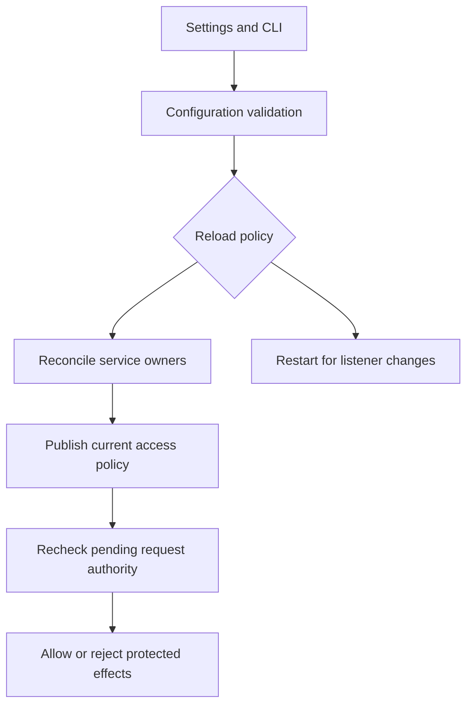

Codex review: needs real behavior proof before merge. _Reviewed September 21, 2026, 2:05 PM ET / 18:05 UTC (Revision 5)._

# ClawSweeper review

## What this changes

Applies more Gateway settings live, preserves service and capture lifetimes, rechecks request authority before protected effects, and updates Settings guidance.

## Merge readiness

⛔ **Blocked before merge - 5 items remain**

Keep open as useful, maintainer-owned work: current main’s Labs support covers only part of the requested behavior. The earlier code findings are repaired.

**Priority:** P2
**Reviewed head:** `c54ef83dc51bde7047a6d47a158c1b196323b7c9`

## Review scores

| Measure | Result | What it means |
|---|---|---|
| **Overall readiness** | 🦐 gold shrimp **(3/6)** | Useful owner-level repairs and substantial validation remain limited by the unresolved authority composition proof. |
| **Proof confidence** | 🦐 gold shrimp **(3/6)** | Needs stronger real behavior proof before merge: Authority-chain proof required: the hash-matched body preserves useful real-Gateway policy and relay observations, and production bytes match the recorded 2dd4d650 run. The added media cases use mocked authorization/response boundaries, while HTTP cancellation mocks the effect owner and separate owner tests use synthetic run handles; allowed and revoked final effects remain unobserved through the composed production path. After adding proof, update the PR body; ClawSweeper should re-review automatically. If it does not, the PR author or someone with repository write access can comment `@clawsweeper re-review`. |
| **Patch quality** | 🦐 gold shrimp **(3/6)** | No actionable review findings were identified. |

## Verification

| Check | Result | Evidence |
|---|---|---|
| **Real behavior** | Needs proof | Needs stronger real behavior proof before merge: Authority-chain proof required: the hash-matched body preserves useful real-Gateway policy and relay observations, and production bytes match the recorded 2dd4d650 run. The added media cases use mocked authorization/response boundaries, while HTTP cancellation mocks the effect owner and separate owner tests use synthetic run handles; allowed and revoked final effects remain unobserved through the composed production path. After adding proof, update the PR body; ClawSweeper should re-review automatically. If it does not, the PR author or someone with repository write access can comment `@clawsweeper re-review`. |
| **Evidence reviewed** | 11 items | Pinned introduction and proof continuity: Inspected the merge-base-to-head production changes. The final commit changes only the plugin-approval test fixture, confirming that production evidence recorded for 2dd4d6503689bfab31bf4417dd8f838bb5970a77 remains applicable to unchanged production bytes. Complete captured body inspected: Fetched and read the complete 26,011 UTF-16-unit body; its SHA-256 matches captured source 27291665ff64a9205f627aa3d3b0573c74d5b8535b46046eb9dc4d4eb75fa218. It reports real Gateway policy and Browser relay replays, a published-updater test, and explicitly describes media/cancellation proof as separate compositional boundary tests. Central work remains absent from main: Fetched main still limits desktop hot reload to desktop.host.enabled and cloudWorkers.desktop, and lacks this branch’s broader access-policy and transcript reload rules. The verified merged Labs change is partial overlap, not a replacement. The supplied latest-release object was unavailable locally, so no shipped-fix claim is made. |
| **Findings** | None | None. |
| **Security** | None | None. |

## How this fits together

The Gateway accepts configuration changes from Settings and CLI clients, then reconciles running services. Its request-authority checks determine whether authenticated clients may still receive protected data or perform actions after policy changes.

## Before merge

- [ ] **Add real behavior proof** - Needs stronger real behavior proof before merge: Authority-chain proof required: the hash-matched body preserves useful real-Gateway policy and relay observations, and production bytes match the recorded 2dd4d650 run. The added media cases use mocked authorization/response boundaries, while HTTP cancellation mocks the effect owner and separate owner tests use synthetic run handles; allowed and revoked final effects remain unobserved through the composed production path. After adding proof, update the PR body; ClawSweeper should re-review automatically. If it does not, the PR author or someone with repository write access can comment `@clawsweeper re-review`.
- [ ] **Resolve merge risk (P1)** - The composed HTTP authority handoff remains unproven for media disclosure and run cancellation when policy is revoked during preparation; separate mocked boundary tests do not establish rejection before those final effects.
- [ ] **Complete next step (P2)** - Complete the existing media/cancellation authority proof with redacted terminal output, logs, or an artifact showing allowed effects and revocation before final I/O. Update the PR body to trigger review; if needed, ask a maintainer to comment @clawsweeper re-review.
- [ ] **Review config compatibility** - Confirm compatibility and upgrade impact for the changed config or default surface before merge.
- [ ] **Add data-model compatibility proof** - Confirm migration or upgrade compatibility proof before merge.

<strong>Agent review details</strong>

### Security

None.

### PR surface

PR surface statistics unavailable: the file list is incomplete.

### Review metrics

None.

### Stored data model

Persistent data-model change detected: `unknown-truncated-pull-files`. Confirm migration or upgrade compatibility proof before merge.

### Merge-risk options

**Maintainer options:**
1. **Complete the final-effect evidence (recommended)**  
   Provide source-bound observations through production HTTP admission and the real media/cancellation owners, showing allowed effects and rejection after revocation during preparation.

### Technical review

Best possible solution:

Keep service-owned live reconciliation and request-bound revocation, with final-effect evidence covering both authorized requests and requests whose authority expires during preparation.

Do we have a high-confidence way to reproduce the issue?

Yes, from source: current main’s reload rules still restart for several affected settings, and the prior authority gaps are visible in the introduced repairs. This read-only review did not execute a reproduction.

Is this the best way to solve the issue?

Yes, the existing reload and service owners are the appropriate repair boundary; the remaining concern is final-effect proof rather than a competing implementation or new configuration surface.

AGENTS.md: found and applied where relevant.

Codex review notes: model internal, reasoning medium; reviewed against [b25f3d82963c](https://github.com/openclaw/openclaw/commit/b25f3d82963cbf42f35914136e1ce6f203e2d39a).

### Labels

Label justifications:

- `P2`: This improves ordinary configuration changes and service continuity without evidence of a current emergency.
- `merge-risk: 🚨 security-boundary`: Replacing restart-based policy retirement with live authority checks requires confidence that revoked requests cannot disclose media or cancel runs.
- `rating: 🦐 gold shrimp`: Overall readiness is 🦐 gold shrimp; proof is 🦐 gold shrimp and patch quality is 🦐 gold shrimp.
- `status: 📣 needs proof`: The PR needs real behavior proof before ClawSweeper can clear the contributor ask. Needs stronger real behavior proof before merge: Authority-chain proof required: the hash-matched body preserves useful real-Gateway policy and relay observations, and production bytes match the recorded 2dd4d650 run. The added media cases use mocked authorization/response boundaries, while HTTP cancellation mocks the effect owner and separate owner tests use synthetic run handles; allowed and revoked final effects remain unobserved through the composed production path. After adding proof, update the PR body; ClawSweeper should re-review automatically. If it does not, the PR author or someone with repository write access can comment `@clawsweeper re-review`.

### Evidence

What I checked:

- **Pinned introduction and proof continuity:** Inspected the merge-base-to-head production changes. The final commit changes only the plugin-approval test fixture, confirming that production evidence recorded for 2dd4d6503689bfab31bf4417dd8f838bb5970a77 remains applicable to unchanged production bytes. ([`src/gateway/server-methods/plugin-approval.test.ts:153`](https://github.com/openclaw/openclaw/blob/c54ef83dc51bde7047a6d47a158c1b196323b7c9/src/gateway/server-methods/plugin-approval.test.ts#L153), [c54ef83dc51b](https://github.com/openclaw/openclaw/commit/c54ef83dc51bde7047a6d47a158c1b196323b7c9))
- **Complete captured body inspected:** Fetched and read the complete 26,011 UTF-16-unit body; its SHA-256 matches captured source 27291665ff64a9205f627aa3d3b0573c74d5b8535b46046eb9dc4d4eb75fa218. It reports real Gateway policy and Browser relay replays, a published-updater test, and explicitly describes media/cancellation proof as separate compositional boundary tests. ([c54ef83dc51b](https://github.com/openclaw/openclaw/commit/c54ef83dc51bde7047a6d47a158c1b196323b7c9))
- **Central work remains absent from main:** Fetched main still limits desktop hot reload to desktop.host.enabled and cloudWorkers.desktop, and lacks this branch’s broader access-policy and transcript reload rules. The verified merged Labs change is partial overlap, not a replacement. The supplied latest-release object was unavailable locally, so no shipped-fix claim is made. ([`src/gateway/config-reload-plan.ts:182`](https://github.com/openclaw/openclaw/blob/b25f3d82963cbf42f35914136e1ce6f203e2d39a/src/gateway/config-reload-plan.ts#L182), [b25f3d82963c](https://github.com/openclaw/openclaw/commit/b25f3d82963cbf42f35914136e1ce6f203e2d39a))
- **Earlier outgoing-media finding repaired:** Managed outgoing media now checks captured request authority immediately before writing headers and streaming the verified descriptor; thumbnail and preparation responses also recheck authority after awaited work. ([`src/gateway/managed-image-attachments.ts:1803`](https://github.com/openclaw/openclaw/blob/c54ef83dc51bde7047a6d47a158c1b196323b7c9/src/gateway/managed-image-attachments.ts#L1803), [c54ef83dc51b](https://github.com/openclaw/openclaw/commit/c54ef83dc51bde7047a6d47a158c1b196323b7c9))
- **Earlier cancellation finding repaired:** The HTTP kill handler passes requestAuth.assertCurrent into the production cancellation owner. That owner composes the guard with cancellation control and checks it before aborting the active run and clearing queues. ([`src/gateway/session-kill-http.ts:108`](https://github.com/openclaw/openclaw/blob/c54ef83dc51bde7047a6d47a158c1b196323b7c9/src/gateway/session-kill-http.ts#L108), [c54ef83dc51b](https://github.com/openclaw/openclaw/commit/c54ef83dc51bde7047a6d47a158c1b196323b7c9))
- **Media proof has a remaining composition gap:** The six revocation cases exercise the actual media handler, response guard, and filesystem descriptors, but replace HTTP authorization and transcript lookup. Their response is a PassThrough-based double from test-http-response.ts, rather than an authenticated client observing the production HTTP response. ([`src/gateway/managed-image-attachments.authority.test.ts:40`](https://github.com/openclaw/openclaw/blob/c54ef83dc51bde7047a6d47a158c1b196323b7c9/src/gateway/managed-image-attachments.authority.test.ts#L40), [c54ef83dc51b](https://github.com/openclaw/openclaw/commit/c54ef83dc51bde7047a6d47a158c1b196323b7c9))

Likely related people:

- **steipete:** Suggested for follow-up; no historical authorship or introduction is verified. (role: unverified routing candidate; confidence: low)
- **shakkernerd:** Suggested for follow-up; no historical authorship or introduction is verified. (role: unverified routing candidate; confidence: low)

### Rank-up moves

Optional improvements that raise the rating; they are not merge blockers.

- Add source-bound production observations showing authorized media delivery and cancellation, then rejection before those effects when authority is revoked during preparation; a bounded production-path harness is sufficient.

### Rating scale

| Score | Internal tier | Crab rank | Meaning |
|---:|:---:|---|---|
| **6/6** | S | 🦀 challenger crab | Exceptional readiness |
| **5/6** | A | 🦞 diamond lobster | Very strong readiness |
| **4/6** | B | 🐚 platinum hermit | Good normal PR; ordinary maintainer review |
| **3/6** | C | 🦐 gold shrimp | Useful, but confidence is limited |
| **2/6** | D | 🦪 silver shellfish | Proof or implementation needs work |
| **1/6** | F | 🧂 unranked krab | Not merge-ready |
| N/A | NA | 🌊 off-meta tidepool | Rating does not apply |

Overall follows the weaker of proof and patch quality.
Shiny media proof means a screenshot, video, or linked artifact directly shows the changed behavior. Runtime, network, CSP, and security claims still need visible diagnostics.

### Workflow

- ClawSweeper keeps one durable marker-backed review comment per issue or PR.
- Re-runs edit this comment so the latest verdict, findings, and automation markers stay together instead of adding duplicate bot comments.
- A fresh review can be triggered by eligible `@clawsweeper re-review` comments, exact-item GitHub events, scheduled/background review runs, or manual workflow dispatch.
- PR/issue authors and users with repository write access can comment `@clawsweeper re-review` or `@clawsweeper re-run` on an open PR or issue to request a fresh review only.
- Maintainers can also comment `@clawsweeper review` to request a fresh review only.
- Fresh-review commands do not start repair, autofix, rebase, CI repair, or automerge.
- Maintainer-only repair and merge flows require explicit commands such as `@clawsweeper autofix`, `@clawsweeper automerge`, `@clawsweeper fix ci`, or `@clawsweeper address review`.
- Maintainers can comment `@clawsweeper explain` to ask for more context, or `@clawsweeper stop` to stop active automation.

### History

Review history (4 earlier review cycles)

<!-- clawsweeper-review-history v=1 total=4 -->
- reviewed 2026-09-21T12:07:10.363Z sha 06b203337e502767109e3d317c6bd4db1903f449 :: needs real behavior proof before merge. :: [P1] [P1] Revalidate outgoing-media authority before serving bytes | [P1] [P1] Carry HTTP authority into subagent cancellation
- reviewed 2026-09-21T14:34:27.948Z sha 16da3bf6d3a0ec150493fe94c18bf49aeea61bcc :: needs real behavior proof before merge. :: none
- reviewed 2026-09-21T16:11:23.288Z sha b91188fba9a6fc414a7f3e54c443a56a8a8836fa :: needs real behavior proof before merge. :: none
- reviewed 2026-09-21T16:46:50.627Z sha 62433684098f8be17562d1f5a2f44423b51b4afa :: needs real behavior proof before merge. :: none

<!-- clawsweeper-verdict:needs-human item=154792 sha=c54ef83dc51bde7047a6d47a158c1b196323b7c9 confidence=high updated_at=2026-09-21T18:00:47Z reviewed_at=2026-09-21T18:05:23.182Z lease_owner=github-run-35635373712-1 lease_comment_id=5765125894 source_revision=d2ed8bec2912faef9a785b668cd6bcc0f82123c7572ee348da83a8e57ce875b3 live_verification=absent -->
<!-- clawsweeper-review-state:blocked item=154792 sha=c54ef83dc51bde7047a6d47a158c1b196323b7c9 v=1 -->

<!-- clawsweeper-review-version item=154792 reviewed_at=2026-09-21T18:05:23.182Z sha=c54ef83dc51bde7047a6d47a158c1b196323b7c9 source_revision=d2ed8bec2912faef9a785b668cd6bcc0f82123c7572ee348da83a8e57ce875b3 lease_owner=github-run-35635373712-1 lease_comment_id=5765125894 v=1 -->

<!-- clawsweeper-review item=154792 -->