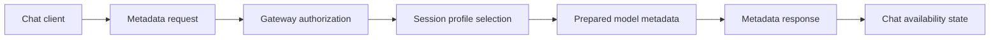

Codex review: needs real behavior proof before merge. _Reviewed August 29, 2026, 2:09 AM ET / 06:09 UTC._

# ClawSweeper review

## What this changes

This PR makes chat metadata session-aware and refreshes Control UI and Android model availability when credentials recover.

## Regression provenance

Possible regression — suspected (reviewed change). No predecessor PR is attributed.

## Merge readiness

⛔ **Blocked until stronger real behavior proof is added - 7 items remain**

Keep open: the introduced session-aware metadata branch can use a foreign draft session’s auth-profile selection without applying the session visibility policy, exposing profile-dependent model availability to a read-only operator.

**Priority:** P1
**Reviewed head:** `0cea7a1211ecff6da4d3c89200717839999322fe`
**Owner decision:** Required. See [Decision needed](#decision-needed).

## Review scores

| Measure | Result | What it means |
|---|---|---|
| **Overall readiness** | 🦪 silver shellfish **(2/6)** | The recovery design has substantial focused coverage, but the introduced session authorization gap and missing final-effect proof block merge readiness. |
| **Proof confidence** | 🦪 silver shellfish **(2/6)** | Needs stronger real behavior proof before merge: Authority-chain proof required: the supplied tests call the handler or authorization helper separately, so they do not prove that a foreign draft is rejected before metadata selection or that a visibility change during asynchronous projection suppresses the final response. After adding proof, update the PR body; ClawSweeper should re-review automatically. If it does not, the PR author or someone with repository write access can comment `@clawsweeper re-review`. |
| **Patch quality** | 🦐 gold shrimp **(3/6)** | Security review found an item that needs attention. |

## Verification

| Check | Result | Evidence |
|---|---|---|
| **Real behavior** | Needs proof | Needs stronger real behavior proof before merge: Authority-chain proof required: the supplied tests call the handler or authorization helper separately, so they do not prove that a foreign draft is rejected before metadata selection or that a visibility change during asynchronous projection suppresses the final response. After adding proof, update the PR body; ClawSweeper should re-review automatically. If it does not, the PR author or someone with repository write access can comment `@clawsweeper re-review`. |
| **Evidence reviewed** | 8 items | Introduced session selector: The PR adds `sessionKey` to `chat.metadata` and states that it reads the authorized session’s persisted auth-profile selection; the handler then loads that session entry and passes it into metadata computation. Missing visibility authorization: Pre-dispatch invokes session authorization, but `chat.metadata` is absent from the method-to-session-target map; unmapped methods return no authorization error after only the generic direct/incognito checks. Existing draft visibility contract: The canonical list filter hides an identified operator’s foreign draft session, while the new metadata branch directly reads that entry before awaiting and responding. |
| **Findings** | 1 actionable finding | [P1] Authorize session visibility before loading metadata |
| **Security** | Needs attention | Foreign drafts can disclose profile-derived availability: The introduced session selector loads another operator’s persisted auth-profile override and returns metadata after only generic request authorization; it does not apply the draft visibility owner used by session listings. |

## How this fits together

Chat clients request Gateway metadata to determine model availability and sending state. The Gateway combines prepared provider facts with the active session’s persisted model and auth-profile selection, then returns that projection to the client.

## Decision needed

| Question | Recommendation |
|---|---|
| Should a direct `chat.metadata` request with a known session key follow the draft visibility policy used by session lists, or intentionally retain the broader direct-read behavior of `chat.history`? | **Honor draft visibility:** Deny foreign draft metadata before session loading and again before response publication, matching the existing list/read visibility model. |

Why: The new method turns that selector into profile-dependent availability output, while current direct-read behavior and the schema’s “authorized session” wording do not establish the intended boundary for foreign drafts.

## Before merge

- [ ] **Add real behavior proof** - Needs stronger real behavior proof before merge: Authority-chain proof required: the supplied tests call the handler or authorization helper separately, so they do not prove that a foreign draft is rejected before metadata selection or that a visibility change during asynchronous projection suppresses the final response. After adding proof, update the PR body; ClawSweeper should re-review automatically. If it does not, the PR author or someone with repository write access can comment `@clawsweeper re-review`.
- [ ] **Authorize session visibility before loading metadata (P1)** - `sessionKey` now selects an auth-profile-dependent projection, but `chat.metadata` is not a session target for `resolveSessionMutationAuthorization`. A view/suggest client can therefore supply a known foreign draft key, have this branch load its persisted entry, and receive its profile-derived model availability even though `createSessionListEntryFilter` hides that draft. Use the canonical read-visibility fence before the load and recheck it after `readChatMetadata` resolves; add a full request-path foreign-draft regression test.
- [ ] **Resolve security concern: Foreign drafts can disclose profile-derived availability** - The introduced session selector loads another operator’s persisted auth-profile override and returns metadata after only generic request authorization; it does not apply the draft visibility owner used by session listings.
- [ ] **Resolve merge risk (P1)** - A read-only identified operator who knows a foreign draft session key can receive model availability projected from that session’s selected auth profile.
- [ ] **Resolve merge risk (P1)** - The 60-file change is runtime/protocol/docs net +143 lines after test/support separation; the final repair should absorb authorization at the session-read owner rather than add another client-side guard.
- [ ] **Complete next step (P2)** - A focused code repair is clear, but the maintained direct-read policy must be explicitly resolved because the PR discussion asserts broader access is intentional.

## Findings

- [P1] Authorize session visibility before loading metadata — `src/gateway/server-methods/chat-history-handler.ts:119-143`
- [medium] Foreign drafts can disclose profile-derived availability — `src/gateway/server-methods/chat-history-handler.ts:119`

<strong>Agent review details</strong>

### Security

Needs attention: The new profile-scoped metadata read crosses an identified-session visibility boundary without enforcing the existing draft policy.

### PR surface

Source +267, Tests +932, Docs +8, Other +323. Total +1530 across 60 files.

View PR surface stats

| Area | Files | Added | Removed | Net |
|---|---:|---:|---:|---:|
| Source | 27 | 684 | 417 | +267 |
| Tests | 25 | 1377 | 445 | +932 |
| Docs | 2 | 8 | 0 | +8 |
| Config | 0 | 0 | 0 | 0 |
| Generated | 0 | 0 | 0 | 0 |
| Other | 6 | 363 | 40 | +323 |
| **Total** | **60** | **2432** | **902** | **+1530** |

### Review metrics

| Metric | Value | Why it matters |
|---|---|---|
| **Runtime versus test delta** | runtime/protocol/docs +598/-455; tests/support +1834/-447 | The classified 60-file delta is production net +143, so the authorization repair should avoid further duplicated ownership logic. |

### Stored data model

Persistent data-model change detected: `persistent cache schema: ui/src/lib/model-catalog-store.ts`, `serialized state: packages/gateway-protocol/src/schema/logs-chat.ts`, `serialized state: ui/src/lib/chat/chat-metadata-store.ts`, `unknown-data-model-change: src/gateway/server-methods/chat-metadata-runtime.test-support.ts`, `unknown-data-model-change: src/gateway/server-methods/chat-metadata-runtime.ts`, `unknown-data-model-change: ui/src/lib/chat/chat-metadata-store.ts`, and 16 more. Confirm migration or upgrade compatibility proof before merge.

### Merge-risk options

**Maintainer options:**
1. **Fence session-scoped metadata reads (recommended)**  
   Apply canonical session visibility before reading the entry and recheck it after metadata projection, with full request-path foreign-draft coverage.
2. **Pause pending an explicit access-policy decision**  
   Do not merge the new selector until maintainers choose and document whether direct known-key metadata may bypass draft visibility.

### Technical review

Best possible solution:

Make session-scoped metadata use the canonical draft/read visibility policy before loading profile state, revalidate it after asynchronous projection, and cover both denial and mid-read visibility change through the real Gateway request path.

Do we have a high-confidence way to reproduce the issue?

Yes, from source: a view or suggest client can request `chat.metadata` for a known foreign draft key because that method is not mapped to session-target authorization, and the introduced handler consumes that entry’s profile override.

Is this the best way to solve the issue?

No: session-specific projection is the right recovery mechanism, but its read boundary must use and revalidate the canonical session visibility policy rather than rely on generic selector handling.

Full review comments:

- [P1] Authorize session visibility before loading metadata — `src/gateway/server-methods/chat-history-handler.ts:119-143`
  `sessionKey` now selects an auth-profile-dependent projection, but `chat.metadata` is not a session target for `resolveSessionMutationAuthorization`. A view/suggest client can therefore supply a known foreign draft key, have this branch load its persisted entry, and receive its profile-derived model availability even though `createSessionListEntryFilter` hides that draft. Use the canonical read-visibility fence before the load and recheck it after `readChatMetadata` resolves; add a full request-path foreign-draft regression test.
  Confidence: 0.97

Overall correctness: patch is incorrect
Overall confidence: 0.97

AGENTS.md: found and applied where relevant.

Codex review notes: model internal, reasoning high; reviewed against [bbe4f3a7f7dc](https://github.com/openclaw/openclaw/commit/bbe4f3a7f7dce27452ccd5457a558c2d5ccbfd76).

### Labels

Label changes:

- add `rating: 🦪 silver shellfish`: Overall readiness is 🦪 silver shellfish; proof is 🦪 silver shellfish and patch quality is 🦐 gold shrimp.
- add `status: 📣 needs proof`: The PR needs real behavior proof before ClawSweeper can clear the contributor ask. Needs stronger real behavior proof before merge: Authority-chain proof required: the supplied tests call the handler or authorization helper separately, so they do not prove that a foreign draft is rejected before metadata selection or that a visibility change during asynchronous projection suppresses the final response. After adding proof, update the PR body; ClawSweeper should re-review automatically. If it does not, the PR author or someone with repository write access can comment `@clawsweeper re-review`.
- remove `rating: 🧂 unranked krab`: Current PR rating is `rating: 🦪 silver shellfish`, so this older rating label is no longer current.
- remove `status: ⏳ waiting on author`: Current PR status label is `status: 📣 needs proof`.

Label justifications:

- `P1`: The PR changes an active chat recovery path and introduces a reachable profile-derived disclosure across identified operator boundaries.
- `merge-risk: 🚨 security-boundary`: A newly accepted session selector can bypass draft visibility before profile-dependent metadata is returned.
- `rating: 🦪 silver shellfish`: Overall readiness is 🦪 silver shellfish; proof is 🦪 silver shellfish and patch quality is 🦐 gold shrimp.
- `status: 📣 needs proof`: The PR needs real behavior proof before ClawSweeper can clear the contributor ask. Needs stronger real behavior proof before merge: Authority-chain proof required: the supplied tests call the handler or authorization helper separately, so they do not prove that a foreign draft is rejected before metadata selection or that a visibility change during asynchronous projection suppresses the final response. After adding proof, update the PR body; ClawSweeper should re-review automatically. If it does not, the PR author or someone with repository write access can comment `@clawsweeper re-review`.

### Evidence

Security concerns:

- [medium] Foreign drafts can disclose profile-derived availability — `src/gateway/server-methods/chat-history-handler.ts:119`
  The introduced session selector loads another operator’s persisted auth-profile override and returns metadata after only generic request authorization; it does not apply the draft visibility owner used by session listings.
  Confidence: 0.97

Acceptance criteria:

- [P1] pnpm test src/gateway/server-methods/chat-history-handler.test.ts.
- [P1] pnpm test src/gateway/session-sharing.test.ts.
- [P1] pnpm test src/gateway/server-methods.profile-authorization.test.ts.

What I checked:

- **Introduced session selector:** The PR adds `sessionKey` to `chat.metadata` and states that it reads the authorized session’s persisted auth-profile selection; the handler then loads that session entry and passes it into metadata computation. ([`packages/gateway-protocol/src/schema/logs-chat.ts:63`](https://github.com/openclaw/openclaw/blob/0cea7a1211ec/packages/gateway-protocol/src/schema/logs-chat.ts#L63), [0cea7a1211ec](https://github.com/openclaw/openclaw/commit/0cea7a1211ec))
- **Missing visibility authorization:** Pre-dispatch invokes session authorization, but `chat.metadata` is absent from the method-to-session-target map; unmapped methods return no authorization error after only the generic direct/incognito checks. ([`src/gateway/session-sharing-target-input.ts:39`](https://github.com/openclaw/openclaw/blob/0cea7a1211ec/src/gateway/session-sharing-target-input.ts#L39), [0cea7a1211ec](https://github.com/openclaw/openclaw/commit/0cea7a1211ec))
- **Existing draft visibility contract:** The canonical list filter hides an identified operator’s foreign draft session, while the new metadata branch directly reads that entry before awaiting and responding. ([`src/gateway/session-sharing.ts:723`](https://github.com/openclaw/openclaw/blob/0cea7a1211ec/src/gateway/session-sharing.ts#L723), [0cea7a1211ec](https://github.com/openclaw/openclaw/commit/0cea7a1211ec))
- **Profile-derived output:** Metadata converts a session auth-profile override into preferred or locked profile IDs and uses those values to project the returned model catalog and availability. ([`src/gateway/server-methods/chat-metadata-runtime.ts:196`](https://github.com/openclaw/openclaw/blob/0cea7a1211ec/src/gateway/server-methods/chat-metadata-runtime.ts#L196), [0cea7a1211ec](https://github.com/openclaw/openclaw/commit/0cea7a1211ec))
- **Coverage gap:** The new handler test calls the handler with `client: null`; the sharing tests cover shared, none, and incognito paths but do not prove that a foreign identified draft is denied through the full metadata request path. ([`src/gateway/server-methods/chat-history-handler.test.ts:10`](https://github.com/openclaw/openclaw/blob/0cea7a1211ec/src/gateway/server-methods/chat-history-handler.test.ts#L10), [0cea7a1211ec](https://github.com/openclaw/openclaw/commit/0cea7a1211ec))
- **Current-main status:** Current local main still uses agent-only `chat.metadata` handling and has no session selector, so the PR’s central behavior is neither already implemented on main nor shown to be in the supplied stable release. ([`src/gateway/server-methods/chat-history-handler.ts:119`](https://github.com/openclaw/openclaw/blob/bbe4f3a7f7dc/src/gateway/server-methods/chat-history-handler.ts#L119), [bbe4f3a7f7dc](https://github.com/openclaw/openclaw/commit/bbe4f3a7f7dc))

Likely related people:

- **steipete:** Authored the introduced session-scoped metadata branch and the preceding handler implementation shown by blame and file history. (role: feature owner and recent Gateway metadata contributor; confidence: high; commits: [e0edcf9c3d02](https://github.com/openclaw/openclaw/commit/e0edcf9c3d02a5250dfd1a0562e4877f32d83027), [c7116d35ec](https://github.com/openclaw/openclaw/commit/c7116d35ec); files: `src/gateway/server-methods/chat-history-handler.ts`, `src/gateway/server-methods/chat-metadata-runtime.ts`)

### Rank-up moves

Optional improvements that raise the rating; they are not merge blockers.

- Add a full request-path test that a non-owner cannot fetch foreign-draft metadata before profile selection.
- Add deferred-read coverage showing a visibility change prevents a successful metadata response after the await.

### Rating scale

| Score | Internal tier | Crab rank | Meaning |
|---:|:---:|---|---|
| **6/6** | S | 🦀 challenger crab | Exceptional readiness |
| **5/6** | A | 🦞 diamond lobster | Very strong readiness |
| **4/6** | B | 🐚 platinum hermit | Good normal PR; ordinary maintainer review |
| **3/6** | C | 🦐 gold shrimp | Useful, but confidence is limited |
| **2/6** | D | 🦪 silver shellfish | Proof or implementation needs work |
| **1/6** | F | 🧂 unranked krab | Not merge-ready |
| N/A | NA | 🌊 off-meta tidepool | Rating does not apply |

Overall follows the weaker of proof and patch quality.
Shiny media proof means a screenshot, video, or linked artifact directly shows the changed behavior. Runtime, network, CSP, and security claims still need visible diagnostics.

### Workflow

- ClawSweeper keeps one durable marker-backed review comment per issue or PR.
- Re-runs edit this comment so the latest verdict, findings, and automation markers stay together instead of adding duplicate bot comments.
- A fresh review can be triggered by eligible `@clawsweeper re-review` comments, exact-item GitHub events, scheduled/background review runs, or manual workflow dispatch.
- PR/issue authors and users with repository write access can comment `@clawsweeper re-review` or `@clawsweeper re-run` on an open PR or issue to request a fresh review only.
- Maintainers can also comment `@clawsweeper review` to request a fresh review only.
- Fresh-review commands do not start repair, autofix, rebase, CI repair, or automerge.
- Maintainer-only repair and merge flows require explicit commands such as `@clawsweeper autofix`, `@clawsweeper automerge`, `@clawsweeper fix ci`, or `@clawsweeper address review`.
- Maintainers can comment `@clawsweeper explain` to ask for more context, or `@clawsweeper stop` to stop active automation.

### History

Review history (14 earlier review cycles; latest 8 shown)

<!-- clawsweeper-review-history v=1 total=14 -->
- reviewed 2026-08-29T02:07:59.457Z sha 7208170305cfd678682fc3f94c0dc5d2299536f5 :: found issues before merge. :: [P1] Send the active session key from Android metadata refresh
- reviewed 2026-08-29T02:26:08.973Z sha cd077f72997b62f38d1a2be8384eb433328377d6 :: needs maintainer review before merge. :: none
- reviewed 2026-08-29T02:50:46.679Z sha 2da9e79e812cdefd4ab81bf89eb44bb77980cac1 :: needs maintainer review before merge. :: none
- reviewed 2026-08-29T04:10:11.001Z sha ad6ba5d3dcc76f7d8111970e8db7eac4c5f06d73 :: needs maintainer review before merge. :: none
- reviewed 2026-08-29T04:20:42.260Z sha ad6ba5d3dcc76f7d8111970e8db7eac4c5f06d73 :: needs maintainer review before merge. :: none
- reviewed 2026-08-29T04:52:04.335Z sha 0cea7a1211ecff6da4d3c89200717839999322fe :: needs maintainer review before merge. :: none
- reviewed 2026-08-29T05:14:47.022Z sha 0cea7a1211ecff6da4d3c89200717839999322fe :: needs maintainer review before merge. :: none
- reviewed 2026-08-29T05:46:19.734Z sha 0cea7a1211ecff6da4d3c89200717839999322fe :: found issues before merge. :: [P1] Enforce session visibility for scoped metadata reads

<!-- clawsweeper-security:security-sensitive item=132179 sha=0cea7a1211ecff6da4d3c89200717839999322fe confidence=high updated_at=2026-08-29T06:04:02Z reviewed_at=2026-08-29T06:09:42.777Z lease_owner=github-run-33237461516-1 lease_comment_id=5460717730 source_revision=89f0b9ff06299afe2b4b4024b9d54e93ec5914a68642a9c91736851708656b91 live_verification=absent -->
<!-- clawsweeper-verdict:needs-human item=132179 sha=0cea7a1211ecff6da4d3c89200717839999322fe confidence=high updated_at=2026-08-29T06:04:02Z reviewed_at=2026-08-29T06:09:42.777Z lease_owner=github-run-33237461516-1 lease_comment_id=5460717730 source_revision=89f0b9ff06299afe2b4b4024b9d54e93ec5914a68642a9c91736851708656b91 live_verification=absent -->

<!-- clawsweeper-review-version item=132179 reviewed_at=2026-08-29T06:09:42.777Z sha=0cea7a1211ecff6da4d3c89200717839999322fe source_revision=89f0b9ff06299afe2b4b4024b9d54e93ec5914a68642a9c91736851708656b91 lease_owner=github-run-33237461516-1 lease_comment_id=5460717730 v=1 -->

<!-- clawsweeper-review item=132179 -->