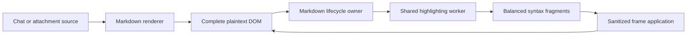

Codex review: needs changes before merge.

## What this changes

This PR moves highlighting of long interactive code fences into a shared worker and applies syntax decoration incrementally.

**Example:** A chat reply contains 5,000 TypeScript lines of `let x;`.
- **Before:** Highlighting builds thousands of hidden spans on the main thread, with a reported 226 ms task.
- **After:** Complete plaintext appears immediately, seven lines receive syntax decoration while collapsed, and expansion decorates the remaining source across frames.

## Review scores

| Measure | Result | What it means |
|---|---|---|
| **Overall readiness** | 🦪 silver shellfish **(2/6)** | Useful and substantially exercised, but the source-preservation finding blocks merge. |
| **Proof confidence** | 🐚 platinum hermit **(4/6)** | Sufficient (live_output): The supplied production-bundle Chromium results exercise the changed renderer and real worker through chat and attachment UI, including arrival, expansion, selection, copying, and retirement; inspected screenshots confirm settled appearance, and reported browser observations cover worker completion without errors. |
| **Patch quality** | 🦪 silver shellfish **(2/6)** | 1 actionable review finding remain. |

## Product

**Kind:** Performance · **Worth it:** Yes · **Fix scope:** Complete
**User problem:** Large completed code and diff blocks can stall chat even while most lines are collapsed.
**Reason:** Repeated production-browser measurements demonstrate substantial CPU and responsiveness gains, and the maintainer-authored body accepts the measured size and layout tradeoffs.

## Merge readiness

⛔ **Needs changes before merge - 1 item remains**

Keep open: this maintainer-authored performance improvement has clear value, but an introduced source-preservation defect needs repair before merge.

**Priority:** P2
**Reviewed head:** `08ec882cfcdaa7a06b5e3e6b64302a1dd023fe00`

## Before merge

- [ ] **Detect generated syntax spans instead of literal hljs text (P2)** - An interactive `sql` fence containing 400 repetitions of `-- 'hljs-keyword'\n` takes the unsupported-language plaintext fallback, but `html.includes("hljs-")` incorrectly sends it through the syntax splitter. That fallback emits apostrophes as `&#39;`, whereas the splitter recognizes only `&#x27;`, so the first seven lines produce offset 182 for 126 actual source characters. Applying that chunk deletes 56 extra characters from the remaining plaintext tail, violating full-source selection and search while collapsed. Detect actual generated span markup rather than source text, and cover this fallback through the real worker and DOM application path.

## Findings

- [P2] Detect generated syntax spans instead of literal hljs text — `ui/src/components/markdown-code-highlight.worker.ts:13-16`

<strong>Agent review details</strong>

### How this fits together

Control UI Markdown rendering consumes chat and attachment source, creates sanitized DOM, and attaches reader controls; the existing Markdown lifecycle now also manages asynchronous syntax decoration.

### Technical review

Best possible solution:

Keep the worker design, but admit only genuine generated syntax markup to the splitter and preserve exact fallback source throughout decoration.

Do we have a high-confidence way to reproduce the issue?

Current-main source shows synchronous completed-fence highlighting, supported by the supplied production-browser measurements; the introduced fallback corruption is independently traceable through escaping, splitting, and plaintext deletion without executing target code.

Is this the best way to solve the issue?

The measured worker approach appropriately retains the existing grammar and Markdown lifecycle, but its highlighted-output classification must preserve the existing plaintext fallback contract.

Full review comments:

- [P2] Detect generated syntax spans instead of literal hljs text — `ui/src/components/markdown-code-highlight.worker.ts:13-16`
  An interactive `sql` fence containing 400 repetitions of `-- 'hljs-keyword'\n` takes the unsupported-language plaintext fallback, but `html.includes("hljs-")` incorrectly sends it through the syntax splitter. That fallback emits apostrophes as `&#39;`, whereas the splitter recognizes only `&#x27;`, so the first seven lines produce offset 182 for 126 actual source characters. Applying that chunk deletes 56 extra characters from the remaining plaintext tail, violating full-source selection and search while collapsed. Detect actual generated span markup rather than source text, and cover this fallback through the real worker and DOM application path.
  Confidence: 0.99
  Late finding: first raised on code an earlier review cycle already covered.

Overall correctness: patch is incorrect
Overall confidence: 0.97

AGENTS.md: found and applied where relevant.

Codex review notes: model internal, reasoning medium; reviewed against [189ed6f72718](https://github.com/openclaw/openclaw/commit/189ed6f72718b568beea88bd8bb78db37f6165bd).

### Provenance checked

- `Code disclosure and lazy highlighting` keeps the original intent (https://github.com/openclaw/openclaw/pull/125229: Provide a common seven-line preview, reversible wrapping, and complete raw copying; later lazy-highlighter work preserved escaped readable text while optional highlighting loads.)
- `Streaming token rendering` keeps the original intent (b688518a2f9a38afa850d6394df7722fa2d84d23: Construct supported mutable streaming tails directly as allowlisted DOM while preserving bulk sanitization and specialized-renderer fallbacks.)
- `Retained Markdown DOM ownership` keeps the original intent (bd4852e946818899e1334aa6fbf137f7279241b7: Keep MarkdownDomReconciler as the sole sanitized-island owner and retain reader state across streaming updates.)
- `Benchmark HTTP delivery` keeps the original intent (5949f2d53be766f91a2bfa43d844108f421e96f1: Measure immutable production bundles through the existing Gateway HTTP handler with its actual document policy and asset delivery.)
- `Startup budget baseline` changes intended behavior with a stated reason (f1c5e2069a3b2eb364c723dfaf1f2815e38a633a: Record measured startup bytes and an accepted small size tradeoff for demonstrated CPU savings; this PR records its own measured and accepted tradeoff.)

### Testing

Proof path: shipped entry point.

### Security

None.

### Evidence

Acceptance criteria:

- OPENCLAW_VITEST_RUNTIME=node pnpm --dir ui test src/components/markdown-code-highlighting.browser.test.tsx --maxWorkers=1
- pnpm --dir ui test src/components/markdown-code-blocks.test.ts src/components/markdown-dom-ref.test.ts --maxWorkers=1
- pnpm tsgo:ui
- git diff --check
- Verify the fallback regression fails on the reviewed head and preserves exact source after the repair.

What I checked:

- **Pinned introduction and current main:** Reviewed the introduced merge-base-to-head changes at 08ec882cfcdaa7a06b5e3e6b64302a1dd023fe00. Fetched main still performs synchronous highlighting for completed long fences; the worker improvement is not implemented there. ([`ui/src/components/markdown-code-blocks.ts:205`](https://github.com/openclaw/openclaw/blob/08ec882cfcdaa7a06b5e3e6b64302a1dd023fe00/ui/src/components/markdown-code-blocks.ts#L205), [08ec882cfcda](https://github.com/openclaw/openclaw/commit/08ec882cfcdaa7a06b5e3e6b64302a1dd023fe00))
- **Fallback incorrectly enters syntax splitting:** The worker classifies any output containing literal `hljs-` as highlighted, including escaped plaintext returned for unsupported languages. ([`ui/src/components/markdown-code-highlight.worker.ts:13`](https://github.com/openclaw/openclaw/blob/08ec882cfcdaa7a06b5e3e6b64302a1dd023fe00/ui/src/components/markdown-code-highlight.worker.ts#L13), [08ec882cfcda](https://github.com/openclaw/openclaw/commit/08ec882cfcdaa7a06b5e3e6b64302a1dd023fe00))
- **Incorrect fallback offsets:** The fallback escapes apostrophes as `&#39;`, but the splitter recognizes only `&#x27;`; inflated offsets then reach Text.deleteData and remove extra plaintext. ([`ui/src/components/markdown-code-highlight-chunks.ts:34`](https://github.com/openclaw/openclaw/blob/08ec882cfcdaa7a06b5e3e6b64302a1dd023fe00/ui/src/components/markdown-code-highlight-chunks.ts#L34), [08ec882cfcda](https://github.com/openclaw/openclaw/commit/08ec882cfcdaa7a06b5e3e6b64302a1dd023fe00))
- **Production-browser evidence and accepted tradeoffs:** Read the complete PR body, including the previously omitted suffix, and inspected both screenshot pairs through in-memory reads. Production-bundle measurements cover arrival, streaming, expansion, selection, copying, scrolling, and worker retirement. The maintainer-authored body explicitly accepts the small bundle increase and extra aggregate layout work; dense attachments remain a disclosed performance limitation. ([08ec882cfcda](https://github.com/openclaw/openclaw/commit/08ec882cfcdaa7a06b5e3e6b64302a1dd023fe00))
- **Earlier contracts remain relevant:** https://github.com/openclaw/openclaw/pull/125229 established the shared seven-line disclosure; https://github.com/openclaw/openclaw/pull/175105 established lazy highlighting with readable plaintext fallback; https://github.com/openclaw/openclaw/pull/127754 suppressed highlighting of unfinished fences. ([`ui/src/components/markdown-code-blocks.ts:22`](https://github.com/openclaw/openclaw/blob/4a2c8498afcbf4cded82348c9cb0c8c89f2e8f61/ui/src/components/markdown-code-blocks.ts#L22), [4a2c8498afcb](https://github.com/openclaw/openclaw/commit/4a2c8498afcbf4cded82348c9cb0c8c89f2e8f61))
- **Related discussion distinguishes the remaining work:** In https://github.com/openclaw/openclaw/issues/112136#issuecomment-5457551183, m13v cautioned that moving every growing streaming block to a worker retains copying costs. This PR preserves unfinished-fence suppression and measures total renderer CPU, addressing completed-fence work instead. https://github.com/openclaw/openclaw/pull/183766 explicitly identified heavy Markdown highlighting as a separate follow-up.

Likely related people:

- **Peter Steinberger:** Raw commit 4a2c8498afcbf4cded82348c9cb0c8c89f2e8f61 adds ui/src/components/markdown-code-blocks.ts:21 relative to its recorded parents. This identifies author metadata, not feature responsibility or a PR merger. (role: source-line author; confidence: high; commits: [4a2c8498afcb](https://github.com/openclaw/openclaw/commit/4a2c8498afcbf4cded82348c9cb0c8c89f2e8f61); files: `ui/src/components/markdown-code-blocks.ts`)
- **Vyctor H. Brzezowski:** Raw commit 0e17e0823174263bbb5dc547b09d38c80ca6fbb6 adds ui/src/components/markdown-code-blocks.ts:20 relative to its recorded parents. This identifies author metadata, not feature responsibility or a PR merger. (role: source-line author; confidence: high; commits: [0e17e0823174](https://github.com/openclaw/openclaw/commit/0e17e0823174263bbb5dc547b09d38c80ca6fbb6); files: `ui/src/components/markdown-code-blocks.ts`)

### PR surface

Source +402, Tests +262, Docs +37, Other +886. Total +1587 across 18 files. Added test files: 1.

View PR surface stats

| Area | Files | Added | Removed | Net |
|---|---:|---:|---:|---:|
| Source | 8 | 414 | 12 | +402 |
| Tests | 3 | 262 | 0 | +262 |
| Docs | 1 | 39 | 2 | +37 |
| Config | 0 | 0 | 0 | 0 |
| Generated | 0 | 0 | 0 | 0 |
| Other | 6 | 949 | 63 | +886 |
| **Total** | **18** | **1664** | **77** | **+1587** |

### Review metrics

| Metric | Value | Why it matters |
|---|---|---|
| **UI production versus tests** | Production +414/-12 LOC; tests +262/-0 LOC | The production growth implements worker lifetime, balanced fragments, cancellation, and bounded DOM application; benchmark tooling is excluded. |
| **Benchmark options** | 3 new flags | Adds --renderer-process-metrics, --counterbalance, and --asset-latency-ms to the existing benchmark without adding persisted product settings. |

### Labels

Label changes:

- add `P2`: The improvement addresses measured chat stalls, while the introduced defect affects displayed source in a specific unsupported-language fallback.
- add `proof: sufficient`: Contributor real behavior proof is sufficient.
- add `rating: 🦪 silver shellfish`: Overall readiness is 🦪 silver shellfish; proof is 🐚 platinum hermit and patch quality is 🦪 silver shellfish.
- add `status: ⏳ waiting on author`: ClawSweeper has contributor-facing work open and is waiting for author action.

Label justifications:

- `P2`: The improvement addresses measured chat stalls, while the introduced defect affects displayed source in a specific unsupported-language fallback.
- `rating: 🦪 silver shellfish`: Overall readiness is 🦪 silver shellfish; proof is 🐚 platinum hermit and patch quality is 🦪 silver shellfish.
- `status: ⏳ waiting on author`: ClawSweeper has contributor-facing work open and is waiting for author action.
- `proof: sufficient`: Contributor real behavior proof is sufficient.

### Rating scale

6/6 🦀 challenger crab · 5/6 🦞 diamond lobster · 4/6 🐚 platinum hermit · 3/6 🦐 gold shrimp · 2/6 🦪 silver shellfish · 1/6 🧂 unranked krab. Overall follows the weaker of proof and patch quality; ✨ marks media proof (a screenshot, video, or linked artifact) that directly shows the changed behavior.

### Workflow

ClawSweeper edits this one comment on every review. Comment `@clawsweeper re-review` for a fresh review only. Repair and merge execution lanes are retired.

_Reviewed October 25, 2026, 4:42 PM ET / 20:42 UTC._

<!-- clawsweeper-verdict:needs-changes item=183816 sha=08ec882cfcdaa7a06b5e3e6b64302a1dd023fe00 confidence=high updated_at=2026-10-25T20:37:52Z reviewed_at=2026-10-25T20:42:40.324Z lease_owner=github-run-40231584712-1 lease_comment_id=6402926319 source_revision=9c1de68322c4821f365eb247ab9741562da0aa5a9b896767f6caf9ad0c0632f7 -->
<!-- clawsweeper-review-state:needs-changes item=183816 sha=08ec882cfcdaa7a06b5e3e6b64302a1dd023fe00 v=1 -->

<!-- clawsweeper-review-version item=183816 reviewed_at=2026-10-25T20:42:40.324Z sha=08ec882cfcdaa7a06b5e3e6b64302a1dd023fe00 source_revision=9c1de68322c4821f365eb247ab9741562da0aa5a9b896767f6caf9ad0c0632f7 lease_owner=github-run-40231584712-1 lease_comment_id=6402926319 v=1 -->

<!-- clawsweeper-review item=183816 -->