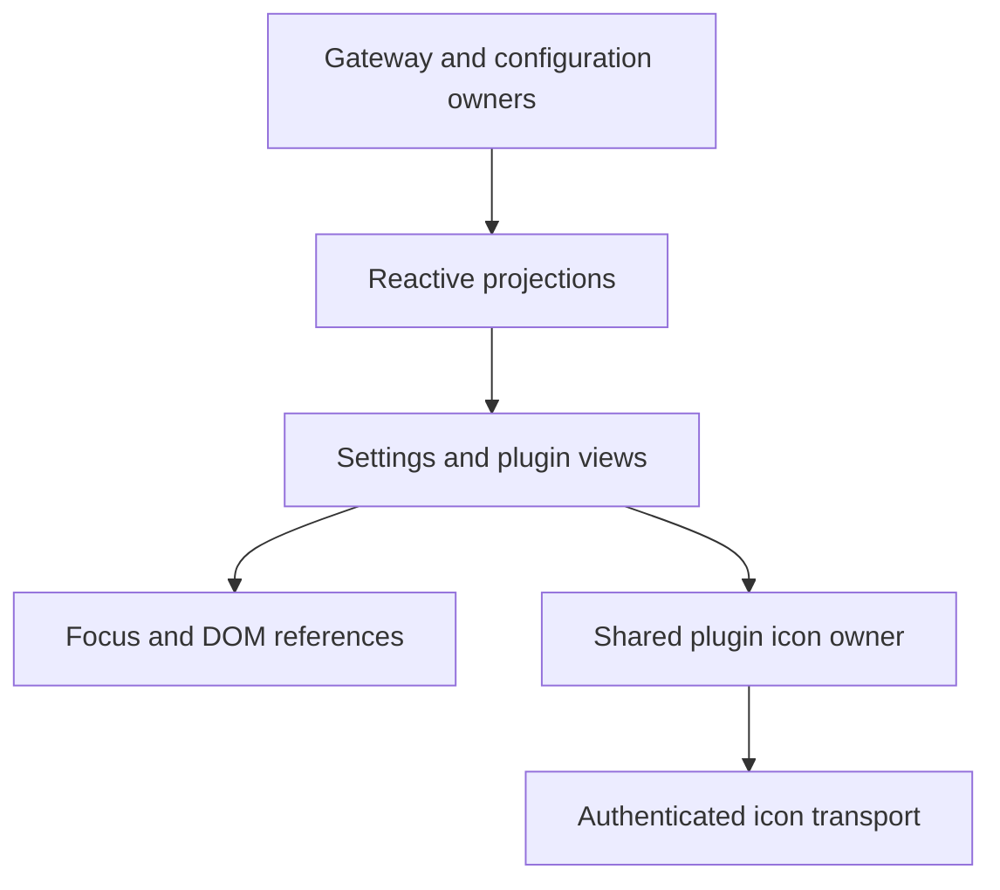

Codex review: needs changes before merge.

## What this changes

This PR simplifies Control UI subscriptions, focus references, and post-render work while renaming the shared plugin icon owner.

**Example:** Model setup advances from consent to device-code sign-in.
- **Before:** The wizard finds its primary focus target with a DOM query.
- **After:** The wizard focuses the registered Open sign-in element.

## Review scores

| Measure | Result | What it means |
|---|---|---|
| **Overall readiness** | 🦐 gold shrimp **(3/6)** | Useful lifecycle cleanup with supporting CI coverage, a stale generated capture, and unresolved attribution of failing checks. |
| **Proof confidence** | 🦐 gold shrimp **(3/6)** | This maintainer-authored refactor is outside the ordinary contributor proof gate; the body reports a production startup comparison, while CI supplies supporting harness coverage rather than direct evidence of the changed interactions. |
| **Patch quality** | 🦐 gold shrimp **(3/6)** | 1 actionable review finding remain. |

## Product

**Kind:** Refactor · **Worth it:** Yes · **Fix scope:** Complete
**User problem:** Settings and plugin interactions must retain focus, cancellation, and view state as their Solid lifecycles are simplified.
**Reason:** The supplied maintainer-authored direction authorizes this focused lifecycle cleanup, and the diff reuses existing owners without adding configuration or public APIs.

## Merge readiness

⛔ **Needs changes before merge - 2 items remain**

Keep this maintainer-directed refactor open; the icon-owner rename leaves a stale generated boot manifest that needs repair.

**Priority:** P2
**Reviewed head:** `bdab362ac59c75e1571a669fa0dced170a6ec4b1`

## Before merge

- [ ] **Regenerate the boot manifest for the renamed icon module (P2)** - The renamed import resolves to plugin-icon-owner.ts, but ui/config/control-ui-boot-modules.json:1931 still records the deleted plugin-icon-controller.ts and contains no replacement entry. control-ui-chunking.ts selects recorded boot membership by exact module path, so the generated capture no longer describes this dependency. Regenerate the manifest with pnpm ui:boot-manifest:gen and verify grouped output with pnpm ui:build, as ui/AGENTS.md requires; do not hand-edit the generated file. The existing review at https://github.com/openclaw/openclaw/pull/176460#discussion_r4308674925 flags the same omission.
- [ ] **Complete next step** - Attribute the remaining core-lint and real-Gateway media failures against main before landing; repair only failures caused by this diff.

## Findings

- [P2] Regenerate the boot manifest for the renamed icon module — `ui/src/pages/chat/chat-tool-icon-controller.ts:6`

### Tests

- Missing end-to-end proof: The supplied startup comparison does not demonstrate settings focus, background-preview retirement, or retained plugin-view interactions.

<strong>Agent review details</strong>

### How this fits together

Control UI views consume synchronous Gateway and configuration owners, then manage rendering, focus, subscriptions, and icon resources within their view lifetimes.

### Technical review

Best possible solution:

Keep the existing lifecycle owners and regenerate the boot capture to include the renamed icon module.

Do we have a high-confidence way to reproduce the issue?

Source inspection establishes the stale manifest entry and failed exact-path membership for the renamed module; no runtime regression was reproduced.

Is this the best way to solve the issue?

The owner-scoped refactor is coherent, preserves synchronous domain authority, and needs the generated boot capture updated with its renamed dependency.

Full review comments:

- [P2] Regenerate the boot manifest for the renamed icon module — `ui/src/pages/chat/chat-tool-icon-controller.ts:6`
  The renamed import resolves to plugin-icon-owner.ts, but ui/config/control-ui-boot-modules.json:1931 still records the deleted plugin-icon-controller.ts and contains no replacement entry. control-ui-chunking.ts selects recorded boot membership by exact module path, so the generated capture no longer describes this dependency. Regenerate the manifest with pnpm ui:boot-manifest:gen and verify grouped output with pnpm ui:build, as ui/AGENTS.md requires; do not hand-edit the generated file. The existing review at https://github.com/openclaw/openclaw/pull/176460#discussion_r4308674925 flags the same omission.
  Confidence: 0.96

Overall correctness: patch is incorrect
Overall confidence: 0.88

AGENTS.md: found and applied where relevant.

Codex review notes: model internal, reasoning medium; reviewed against [993ec298df4e](https://github.com/openclaw/openclaw/commit/993ec298df4ee9e5a761553500c623f3c38feab6).

### Provenance checked

- `Shared plugin icon lifecycle` keeps the original intent (https://github.com/openclaw/openclaw/pull/145644: Consolidate catalog requests while preserving consumer-specific timeout, retry, cancellation, and publication behavior.)
- `Settings and model setup lifetime ownership` keeps the original intent (https://github.com/openclaw/openclaw/pull/173811: Move presentation lifetimes into Solid while keeping request and mutation decisions synchronous.)
- `Profile drag references and page projections` keeps the original intent (https://github.com/openclaw/openclaw/pull/174771: Simplify view lifetimes while retaining imperative drag integration and domain authority.)

### Testing

Proof path: in-process harness.

### Security

None.

### Evidence

Acceptance criteria:

- pnpm ui:boot-manifest:gen
- pnpm ui:build
- pnpm --dir ui test src/pages/plugins/catalog-icon-controller.test.ts
- git diff --check

What I checked:

- **Pinned introduction:** Reviewed the introduced hunks from the verified merge base to the original PR head; unrelated base movement was excluded. ([bdab362ac59c](https://github.com/openclaw/openclaw/commit/bdab362ac59c75e1571a669fa0dced170a6ec4b1))
- **Stale boot capture:** The generated manifest still contains plugin-icon-controller.ts, while the changed imports resolve plugin-icon-owner.ts; boot-group membership uses exact normalized module paths. ([`ui/config/control-ui-boot-modules.json:1931`](https://github.com/openclaw/openclaw/blob/bdab362ac59c75e1571a669fa0dced170a6ec4b1/ui/config/control-ui-boot-modules.json#L1931), [bdab362ac59c](https://github.com/openclaw/openclaw/commit/bdab362ac59c75e1571a669fa0dced170a6ec4b1))
- **Applicable build contract:** The UI guide requires regenerating the boot manifest for material boot-path changes and verifying grouped build output; the existing review at https://github.com/openclaw/openclaw/pull/176460#discussion_r4308674925 identified the same omission. ([`ui/AGENTS.md:77`](https://github.com/openclaw/openclaw/blob/bdab362ac59c75e1571a669fa0dced170a6ec4b1/ui/AGENTS.md#L77), [bdab362ac59c](https://github.com/openclaw/openclaw/commit/bdab362ac59c75e1571a669fa0dced170a6ec4b1))
- **Existing lifecycle intent:** https://github.com/openclaw/openclaw/pull/145644 established shared icon ownership while preserving catalog cancellation, miss retention, and notification ordering; the renamed implementation retains those policies. ([`ui/src/pages/plugins/plugin-icon-owner.ts:35`](https://github.com/openclaw/openclaw/blob/d5936a7bdcb85c4518648857a2211b023f6d2978/ui/src/pages/plugins/plugin-icon-owner.ts#L35), [d5936a7bdcb8](https://github.com/openclaw/openclaw/commit/d5936a7bdcb85c4518648857a2211b023f6d2978))
- **Exact-head validation:** UI unit and browser shards and control-ui-performance passed, but core lint, both real-Gateway UI shards, and the aggregate gate failed. Annotations identify line-limit and media assertions; matching base failures were not established. Full job logs redirected to a blocked artifact host, so these failures remain unattributed rather than contributor defects. ([bdab362ac59c](https://github.com/openclaw/openclaw/commit/bdab362ac59c75e1571a669fa0dced170a6ec4b1))
- **Review limits and clean checkout:** Root and UI AGENTS.md were read completely; no scoped maintainer-notes directory exists. The installed Solid cheatsheet was unavailable, and one historical commit lookup encountered an unavailable promisor object. Repository Solid guidance and available history were inspected; no target code was executed and the checkout remains clean. ([`AGENTS.md`](https://github.com/openclaw/openclaw/blob/bdab362ac59c75e1571a669fa0dced170a6ec4b1/AGENTS.md), [bdab362ac59c](https://github.com/openclaw/openclaw/commit/bdab362ac59c75e1571a669fa0dced170a6ec4b1))

### PR surface

Source +32, Tests 0. Total +32 across 35 files. Added test files: 0.

View PR surface stats

| Area | Files | Added | Removed | Net |
|---|---:|---:|---:|---:|
| Source | 34 | 319 | 287 | +32 |
| Tests | 1 | 2 | 2 | 0 |
| Docs | 0 | 0 | 0 | 0 |
| Config | 0 | 0 | 0 | 0 |
| Generated | 0 | 0 | 0 | 0 |
| Other | 0 | 0 | 0 | 0 |
| **Total** | **35** | **321** | **289** | **+32** |

### Labels

Label changes:

- add `P2`: The generated boot capture needs a focused repair; no urgent user-facing outage was established.
- add `rating: 🦐 gold shrimp`: Overall readiness is 🦐 gold shrimp; proof is 🦐 gold shrimp and patch quality is 🦐 gold shrimp.
- add `status: ⏳ waiting on author`: ClawSweeper has contributor-facing work open and is waiting for author action.

Label justifications:

- `P2`: The generated boot capture needs a focused repair; no urgent user-facing outage was established.
- `rating: 🦐 gold shrimp`: Overall readiness is 🦐 gold shrimp; proof is 🦐 gold shrimp and patch quality is 🦐 gold shrimp.
- `status: ⏳ waiting on author`: ClawSweeper has contributor-facing work open and is waiting for author action.

### Rating scale

6/6 🦀 challenger crab · 5/6 🦞 diamond lobster · 4/6 🐚 platinum hermit · 3/6 🦐 gold shrimp · 2/6 🦪 silver shellfish · 1/6 🧂 unranked krab. Overall follows the weaker of proof and patch quality; ✨ marks media proof (a screenshot, video, or linked artifact) that directly shows the changed behavior.

### Workflow

ClawSweeper edits this one comment on every review. Comment `@clawsweeper re-review` for a fresh review only. Repair and merge execution lanes are retired.

_Reviewed October 18, 2026, 5:06 PM ET / 21:06 UTC._

<!-- clawsweeper-verdict:needs-changes item=176460 sha=bdab362ac59c75e1571a669fa0dced170a6ec4b1 confidence=high updated_at=2026-10-18T21:02:44Z reviewed_at=2026-10-18T21:06:51.503Z lease_owner=github-run-39165983517-1 lease_comment_id=6255104219 source_revision=d2a9e02f904640550809ea11f13801984c834aa98d072bcd09ec811d45e1b5e5 -->
<!-- clawsweeper-review-state:needs-changes item=176460 sha=bdab362ac59c75e1571a669fa0dced170a6ec4b1 v=1 -->

<!-- clawsweeper-review-version item=176460 reviewed_at=2026-10-18T21:06:51.503Z sha=bdab362ac59c75e1571a669fa0dced170a6ec4b1 source_revision=d2a9e02f904640550809ea11f13801984c834aa98d072bcd09ec811d45e1b5e5 lease_owner=github-run-39165983517-1 lease_comment_id=6255104219 v=1 -->

<!-- clawsweeper-review item=176460 -->