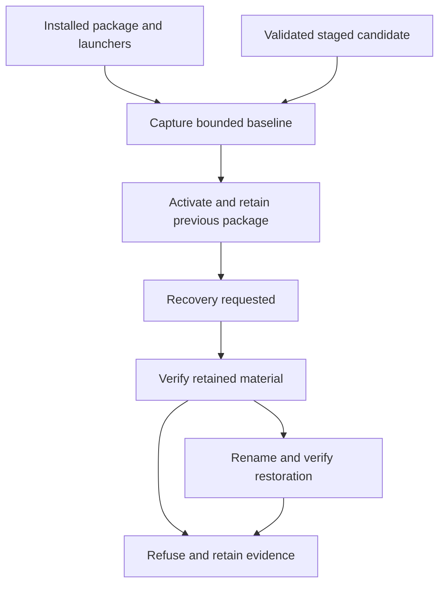

Codex review: blocked before merge. _Reviewed September 7, 2026, 3:26 AM ET / 07:26 UTC._

# ClawSweeper review

## What this changes

The PR verifies npm package contents, filesystem identity, and launchers before and after rollback, restores packages by rename, and adds bounded-reader diagnostics and regression coverage.

## Merge readiness

⛔ **Blocked before merge - 2 items remain**

This PR remains useful: current main still permits same-version backup corruption to escape rollback verification. No blocking introduced defect was identified, and the maintainer discussion explicitly accepts the narrower package-integrity scope and admission tradeoff.

**Priority:** P2
**Reviewed head:** `7697f3a3a86dd1d07f9755b34a56489085d79e9e`

## Review scores

| Measure | Result | What it means |
|---|---|---|
| **Overall readiness** | 🐚 platinum hermit **(4/6)** | A coherent owner-level repair with meaningful failure coverage and an explicitly accepted compatibility tradeoff; no blocking defect was identified. |
| **Proof confidence** | 🌊 off-meta tidepool | Not applicable: The author is a MEMBER, so the external-contributor proof gate does not apply. Supplied historical receipts exercise package restoration and corruption refusal; the captured body explicitly leaves current-head reader-timing observation pending, and those older receipts are not treated as validation of the new executable. |
| **Patch quality** | 🐚 platinum hermit **(4/6)** | No actionable review findings were identified. |

## Verification

| Check | Result | Evidence |
|---|---|---|
| **Real behavior** | Not applicable | Not applicable: The author is a MEMBER, so the external-contributor proof gate does not apply. Supplied historical receipts exercise package restoration and corruption refusal; the captured body explicitly leaves current-head reader-timing observation pending, and those older receipts are not treated as validation of the new executable. |
| **Evidence reviewed** | 10 items | Current main still needs the repair: Current main restores the retained package before comparing its version and launcher backups; it does not capture and compare an immutable package-tree fingerprint. Same-version content changes therefore remain outside that verification. Introduced recovery boundary: The pinned introduced delta checks retained package and launcher fingerprints before restoration, preserves the candidate on refusal, compensates a denied restoration rename, and verifies the restored result before allowing recovery cleanup. Reader bounds and truthful settlement: The reader uses the existing absolute-deadline helper, limits tree inventory and streamed bytes, bounds buffered manifests and launchers separately, and records timeout and outstanding-I/O facts without claiming that uncancelable I/O has completed. |
| **Findings** | None | None. |
| **Security** | None | None. |

## How this fits together

The package updater stages a candidate installation and retains the previous package and launchers for recovery. Its transaction reports restoration results to the update orchestrator, which separately owns state compatibility and service restart decisions.

## Before merge

- [ ] **Resolve merge risk (P1)** - The accepted admission policy can stop updates for existing linked, unreadable, unsupported, oversized, or sufficiently slow npm installations before service preparation; affected operators may need a supported package layout or the documented manual update path.
- [ ] **Resolve merge risk (P1)** - Fingerprinting observes package integrity but cannot exclude later writes through held descriptors; it must retain its documented diagnostic scope.

<strong>Agent review details</strong>

### Security

None.

### PR surface

Source +456, Tests +674. Total +1130 across 10 files.

View PR surface stats

| Area | Files | Added | Removed | Net |
|---|---:|---:|---:|---:|
| Source | 4 | 491 | 35 | +456 |
| Tests | 6 | 760 | 86 | +674 |
| Docs | 0 | 0 | 0 | 0 |
| Config | 0 | 0 | 0 | 0 |
| Generated | 0 | 0 | 0 | 0 |
| Other | 0 | 0 | 0 | 0 |
| **Total** | **10** | **1251** | **121** | **+1130** |

### Review metrics

| Metric | Value | Why it matters |
|---|---|---|
| **Production versus regression growth** | Production net +456 lines; tests/support net +674 lines | The growth implements the bounded integrity model and reader observations with explicit justification in the PR body. |
| **Admission limits** | 50,000 entries; 1 GiB tree data; 1 MiB manifest/launcher; 30-second reader deadline | These accepted limits can refuse an existing installation before activation. |

### Merge-risk options

**Maintainer options:**
1. **Retain the accepted admission policy (recommended)**  
   Carry forward the recorded decision to refuse unverifiable npm trees before service preparation, with manual update guidance for affected operators.

### Technical review

Best possible solution:

Keep the owner-approved bounded verification in the existing swap transaction, with explicit refusal guidance and the documented manual update path for unsupported installations.

Do we have a high-confidence way to reproduce the issue?

Yes, from source: modify a retained npm package file without changing its manifest version, then request rollback; current main restores it without comparing captured package contents. No runtime reproduction was executed in this read-only review.

Is this the best way to solve the issue?

Yes. Capturing facts before activation and checking them at the existing restoration owner addresses the defect without duplicating transaction or service lifecycle ownership.

AGENTS.md: found and applied where relevant.

Codex review notes: model internal, reasoning medium; reviewed against [1ebb4c09323d](https://github.com/openclaw/openclaw/commit/1ebb4c09323dc1735cd172c9af1b7f350c8885df).

### Labels

Label changes:

- remove `proof: sufficient`: Current real behavior proof status is not_applicable, not sufficient.

Label justifications:

- `P2`: This is a focused recovery-integrity improvement with a concrete same-version corruption failure mode.
- `merge-risk: 🚨 compatibility`: Pre-activation verification intentionally refuses installation layouts and sizes that the previous updater could attempt to update.
- `rating: 🐚 platinum hermit`: Overall readiness is 🐚 platinum hermit; proof is 🌊 off-meta tidepool and patch quality is 🐚 platinum hermit.
- `status: 👀 ready for maintainer look`: ClawSweeper has no concrete contributor-facing blocker left for this PR. Not applicable: The author is a MEMBER, so the external-contributor proof gate does not apply. Supplied historical receipts exercise package restoration and corruption refusal; the captured body explicitly leaves current-head reader-timing observation pending, and those older receipts are not treated as validation of the new executable.

### Evidence

What I checked:

- **Current main still needs the repair:** Current main restores the retained package before comparing its version and launcher backups; it does not capture and compare an immutable package-tree fingerprint. Same-version content changes therefore remain outside that verification. ([`src/infra/package-update-swap.ts:256`](https://github.com/openclaw/openclaw/blob/1ebb4c09323dc1735cd172c9af1b7f350c8885df/src/infra/package-update-swap.ts#L256), [1ebb4c09323d](https://github.com/openclaw/openclaw/commit/1ebb4c09323dc1735cd172c9af1b7f350c8885df))
- **Introduced recovery boundary:** The pinned introduced delta checks retained package and launcher fingerprints before restoration, preserves the candidate on refusal, compensates a denied restoration rename, and verifies the restored result before allowing recovery cleanup. ([`src/infra/package-update-swap.ts:267`](https://github.com/openclaw/openclaw/blob/7697f3a3a86dd1d07f9755b34a56489085d79e9e/src/infra/package-update-swap.ts#L267), [7697f3a3a86d](https://github.com/openclaw/openclaw/commit/7697f3a3a86dd1d07f9755b34a56489085d79e9e))
- **Reader bounds and truthful settlement:** The reader uses the existing absolute-deadline helper, limits tree inventory and streamed bytes, bounds buffered manifests and launchers separately, and records timeout and outstanding-I/O facts without claiming that uncancelable I/O has completed. ([`src/infra/package-update-integrity.ts:38`](https://github.com/openclaw/openclaw/blob/7697f3a3a86dd1d07f9755b34a56489085d79e9e/src/infra/package-update-integrity.ts#L38), [7697f3a3a86d](https://github.com/openclaw/openclaw/commit/7697f3a3a86dd1d07f9755b34a56489085d79e9e))
- **Meaningful recovery regressions:** The tests exercise changed contents, manifest, inventory, identity, metadata, links and launchers; unchanged restoration; absent previous packages; rename failure compensation; and the held-writable-descriptor counterexample. These were inspected, not executed during this review. ([`src/infra/package-update-swap.integrity.test.ts:97`](https://github.com/openclaw/openclaw/blob/7697f3a3a86dd1d07f9755b34a56489085d79e9e/src/infra/package-update-swap.integrity.test.ts#L97), [7697f3a3a86d](https://github.com/openclaw/openclaw/commit/7697f3a3a86dd1d07f9755b34a56489085d79e9e))
- **Timing follow-up coverage:** Bounds tests cover stalled opens and reads, initial presence/enumeration probes, aggregate inventory limits, diagnostic-sink failure, and cleanup-only timeout reporting. The cleanup-only case deliberately preserves best-effort close behavior while reporting pending I/O. ([`src/infra/package-update-swap.bounds.test.ts:264`](https://github.com/openclaw/openclaw/blob/7697f3a3a86dd1d07f9755b34a56489085d79e9e/src/infra/package-update-swap.bounds.test.ts#L264), [7697f3a3a86d](https://github.com/openclaw/openclaw/commit/7697f3a3a86dd1d07f9755b34a56489085d79e9e))
- **Accepted compatibility and scope decisions:** The MEMBER comment at https://github.com/openclaw/openclaw/pull/136329#issuecomment-5514790918 accepts pre-activation scanning and fail-closed limits. The updated scope decision at https://github.com/openclaw/openclaw/pull/136329#issuecomment-5547191903 withdraws whole-journey custody and per-PR remote-proof prerequisites while retaining package defects as actionable.

Likely related people:

- **steipete:** Suggested for follow-up; no historical authorship or introduction is verified. (role: unverified routing candidate; confidence: low)
- **fuller-stack-dev:** Suggested for follow-up; no historical authorship or introduction is verified. (role: unverified routing candidate; confidence: low)

### Rating scale

| Score | Internal tier | Crab rank | Meaning |
|---:|:---:|---|---|
| **6/6** | S | 🦀 challenger crab | Exceptional readiness |
| **5/6** | A | 🦞 diamond lobster | Very strong readiness |
| **4/6** | B | 🐚 platinum hermit | Good normal PR; ordinary maintainer review |
| **3/6** | C | 🦐 gold shrimp | Useful, but confidence is limited |
| **2/6** | D | 🦪 silver shellfish | Proof or implementation needs work |
| **1/6** | F | 🧂 unranked krab | Not merge-ready |
| N/A | NA | 🌊 off-meta tidepool | Rating does not apply |

Overall follows the weaker of proof and patch quality.
Shiny media proof means a screenshot, video, or linked artifact directly shows the changed behavior. Runtime, network, CSP, and security claims still need visible diagnostics.

### Workflow

- ClawSweeper keeps one durable marker-backed review comment per issue or PR.
- Re-runs edit this comment so the latest verdict, findings, and automation markers stay together instead of adding duplicate bot comments.
- A fresh review can be triggered by eligible `@clawsweeper re-review` comments, exact-item GitHub events, scheduled/background review runs, or manual workflow dispatch.
- PR/issue authors and users with repository write access can comment `@clawsweeper re-review` or `@clawsweeper re-run` on an open PR or issue to request a fresh review only.
- Maintainers can also comment `@clawsweeper review` to request a fresh review only.
- Fresh-review commands do not start repair, autofix, rebase, CI repair, or automerge.
- Maintainer-only repair and merge flows require explicit commands such as `@clawsweeper autofix`, `@clawsweeper automerge`, `@clawsweeper fix ci`, or `@clawsweeper address review`.
- Maintainers can comment `@clawsweeper explain` to ask for more context, or `@clawsweeper stop` to stop active automation.

### History

Review history (16 earlier review cycles; latest 8 shown)

<!-- clawsweeper-review-history v=1 total=16 -->
- reviewed 2026-09-03T08:03:15.042Z sha 76dc98911d9a9baa65a67134dcd36ccac9597bc5 :: blocked before merge. :: none
- reviewed 2026-09-03T09:35:45.663Z sha b143d0f06e07557be7fee69067e81b466246ea67 :: blocked before merge. :: [P2] Enforce the update deadline during rollback fingerprinting
- reviewed 2026-09-06T16:11:52.080Z sha b143d0f06e07557be7fee69067e81b466246ea67 :: blocked before merge. :: [P2] Enforce an elapsed-time bound on rollback fingerprinting
- reviewed 2026-09-06T18:17:13.932Z sha 8e9f257a4721251cab4b9fdadbb3827ab4d08b9e :: blocked before merge. :: none
- reviewed 2026-09-06T18:29:24.094Z sha 8e9f257a4721251cab4b9fdadbb3827ab4d08b9e :: blocked before merge. :: none
- reviewed 2026-09-07T06:12:34.684Z sha 8e9f257a4721251cab4b9fdadbb3827ab4d08b9e :: blocked before merge. :: none
- reviewed 2026-09-07T06:22:21.356Z sha 8e9f257a4721251cab4b9fdadbb3827ab4d08b9e :: blocked before merge. :: none
- reviewed 2026-09-07T06:51:56.023Z sha 8e9f257a4721251cab4b9fdadbb3827ab4d08b9e :: blocked before merge. :: none

<!-- clawsweeper-verdict:needs-human item=136329 sha=7697f3a3a86dd1d07f9755b34a56489085d79e9e confidence=high updated_at=2026-09-07T07:23:56Z reviewed_at=2026-09-07T07:26:30.706Z lease_owner=github-run-34095075447-1 lease_comment_id=5566738664 source_revision=7cf1a3bccd194decfca4c115e244edea9e795196909c573313c782cf1d36d64d live_verification=absent -->
<!-- clawsweeper-review-state:blocked item=136329 sha=7697f3a3a86dd1d07f9755b34a56489085d79e9e v=1 -->

<!-- clawsweeper-review-version item=136329 reviewed_at=2026-09-07T07:26:30.706Z sha=7697f3a3a86dd1d07f9755b34a56489085d79e9e source_revision=7cf1a3bccd194decfca4c115e244edea9e795196909c573313c782cf1d36d64d lease_owner=github-run-34095075447-1 lease_comment_id=5566738664 v=1 -->

<!-- clawsweeper-review item=136329 -->