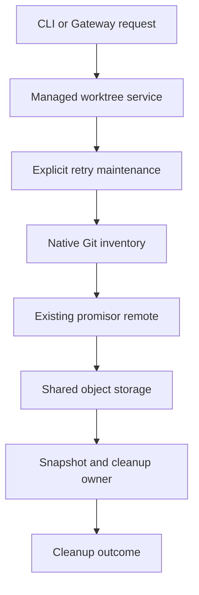

Codex review: needs maintainer review before merge.

## What this changes

This PR restores missing partial-clone objects before explicit GC retries while preserving staged content and working files.

**Example:** Two eligible session worktrees require a missing promised blob, and origin becomes reachable again.
- **Before:** Explicit GC retry attempts snapshotting first and defers both worktrees without repairing the blob.
- **After:** Explicit retry fetches the missing blob before classification, then snapshots and removes both worktrees.

## Review scores

| Measure | Result | What it means |
|---|---|---|
| **Overall readiness** | 🦐 gold shrimp **(3/6)** | A useful, focused recovery patch with no actionable findings and meaningful service/native-Git validation; shipped-entry-point evidence is absent, and the failed CI shard has not been attributed. |
| **Proof confidence** | 🦐 gold shrimp **(3/6)** | The maintainer-authored exemption applies; supplied Ubuntu service/native-Git results cover missing live and index-only objects, unchanged staged and working bytes, bounded resumption, and the corrected public service GC path. |
| **Patch quality** | 🐚 platinum hermit **(4/6)** | No actionable review findings were identified. |

## Product

**Kind:** Bug fix · **Worth it:** Yes · **Fix scope:** Complete
**User problem:** Managed worktrees with missing promised objects remain preserved but cannot be snapshotted and cleaned up after remote access returns.
**Reason:** The maintainer-authored direction adds useful bounded recovery through an existing explicit command and preserves the existing ordinary-cleanup policy.

## Merge readiness

✅ **Ready for maintainer review**

Keep this PR open: current main lacks bounded live-object recovery, and the previous GC-ordering finding is fixed; no new introduced defect was found.

**Priority:** P2
**Reviewed head:** `72e14cbc8a641c03d3e839e2edd711ddc3487c6c`

## Before merge

None.

## Findings

None.

### Tests

- Missing end-to-end proof: Supplied recovery evidence exercises the service and native Git; no installed CLI or Gateway recovery run is shown.

<strong>Agent review details</strong>

### How this fits together

The managed-worktree service receives CLI and Gateway cleanup requests, uses the existing Git maintenance owner to repair shared object storage, and returns cleanup outcomes with restorable snapshots.

### Technical review

Best possible solution:

Land bounded explicit recovery in the existing maintenance owner while retaining network-free ordinary cleanup.

Do we have a high-confidence way to reproduce the issue?

Source and the supplied original-source controls establish the missing-object cleanup failure and the previous explicit-retry ordering defect; this read-only review ran no target code.

Is this the best way to solve the issue?

Bounded recovery through the existing maintenance owner is appropriate for remotely recoverable content, and the PR correctly separates that repair from diagnosing the unidentified historical deletion cause.

AGENTS.md: found and applied where relevant.

Codex review notes: model internal, reasoning medium; reviewed against [27f0857bf3c7](https://github.com/openclaw/openclaw/commit/27f0857bf3c7362c8fb2d72e2d2e482e6dc3d628).

### Provenance checked

- `Network-free ordinary Git maintenance` keeps the original intent (e376a19e50387fa03872fbaee4d16a68e05233c5: Move repository-wide maintenance off individual removals and preserve checkouts when required objects are missing.)
- `Repository-corruption backoff` keeps the original intent (1c112774983c5266f627518b5f9d51c7ade51199: Avoid repeated failed snapshots across sibling worktrees and later sweeps while allowing explicit retry after repair.)
- `Explicit GC maintenance ordering` changes intended behavior with a stated reason (e1dbb59b46bdbc3498b2b68c2a5b27dedd0c4205: The service retained serial cleanup and post-cleanup maintenance during runtime consolidation; this PR explains why explicit object recovery must precede classification.)
- `Worker-owned removal guards and retirement` keeps the original intent (623d8e02a5d87997b9378b7b4b2980fff8bc11cf: Keep authoritative row guards, retirement, and final-effect validation with the existing worker and lifecycle owners.)

### Testing

Proof path: in-process harness.

### Security

None.

### Evidence

What I checked:

- **Previous finding resolved:** Explicit retry now awaits maintenance before reading cleanup state; the existing GC regression no longer manually hydrates the missing object and verifies removal followed by restoration of retained edits. ([`src/agents/worktrees/service.ts:1082`](https://github.com/openclaw/openclaw/blob/72e14cbc8a641c03d3e839e2edd711ddc3487c6c/src/agents/worktrees/service.ts#L1082), [72e14cbc8a64](https://github.com/openclaw/openclaw/commit/72e14cbc8a641c03d3e839e2edd711ddc3487c6c))
- **Bounded recovery in the existing owner:** Recovery inventories linked indexes and current HEAD trees, fetches object IDs in batches of 256, limits each repository pass to 4,096 requested objects and five minutes, and checks cancellation and current authority before Git execution. ([`src/agents/worktrees/git-maintenance.ts:33`](https://github.com/openclaw/openclaw/blob/72e14cbc8a641c03d3e839e2edd711ddc3487c6c/src/agents/worktrees/git-maintenance.ts#L33), [72e14cbc8a64](https://github.com/openclaw/openclaw/commit/72e14cbc8a641c03d3e839e2edd711ddc3487c6c))
- **Current main still needs recovery:** Fetched main performs pack maintenance and network-free commit-graph/loose-object maintenance but has no live-object recovery operation. ([`src/agents/worktrees/git-maintenance.ts:239`](https://github.com/openclaw/openclaw/blob/27f0857bf3c7362c8fb2d72e2d2e482e6dc3d628/src/agents/worktrees/git-maintenance.ts#L239), [27f0857bf3c7](https://github.com/openclaw/openclaw/commit/27f0857bf3c7362c8fb2d72e2d2e482e6dc3d628))
- **Native inventory contract:** The patch executes native Git and depends on its inventory contract: Git 2.53 documentation confirms that --indexed-objects examines all worktrees by default, --no-walk excludes ancestors, and --missing=print reports missing object IDs. (`Documentation/rev-list-options.adoc:222`)
- **Recovery scope and supplied validation:** The full PR body and steipete's follow-up describe synthetic Ubuntu recovery results, preservation of staged and working bytes, original-source failing controls, and passing final GC integration tests; they explicitly leave the historical object-loss writer unidentified. ([72e14cbc8a64](https://github.com/openclaw/openclaw/commit/72e14cbc8a641c03d3e839e2edd711ddc3487c6c))
- **Exact-head CI failure requires attribution:** The completed run https://github.com/openclaw/openclaw/actions/runs/38112480618 fails in checks-node-changed-compact-large-2; annotations report ERR_INVALID_URL_SCHEME at an unchanged publication fixture's fileURLToPath call. The aggregate gate fails and other jobs were canceled. No matching baseline failure or revert run was verified, so inherited-failure attribution remains unconfirmed; full job logs were blocked by the host's storage-domain allowlist. ([`src/gateway/github-publication-requester.test-support.ts:311`](https://github.com/openclaw/openclaw/blob/72e14cbc8a641c03d3e839e2edd711ddc3487c6c/src/gateway/github-publication-requester.test-support.ts#L311), [72e14cbc8a64](https://github.com/openclaw/openclaw/commit/72e14cbc8a641c03d3e839e2edd711ddc3487c6c))

Likely related people:

- **Peter Steinberger:** Raw commit e376a19e50387fa03872fbaee4d16a68e05233c5 adds src/agents/worktrees/git-maintenance.ts:241 relative to its recorded parents. This identifies author metadata, not feature responsibility or a PR merger. (role: source-line author; confidence: high; commits: [e376a19e5038](https://github.com/openclaw/openclaw/commit/e376a19e50387fa03872fbaee4d16a68e05233c5); files: `src/agents/worktrees/git-maintenance.ts`)

### PR surface

Source +151, Tests +118, Docs +11. Total +280 across 6 files. Added test files: 0.

View PR surface stats

| Area | Files | Added | Removed | Net |
|---|---:|---:|---:|---:|
| Source | 3 | 232 | 81 | +151 |
| Tests | 2 | 126 | 8 | +118 |
| Docs | 1 | 11 | 0 | +11 |
| Config | 0 | 0 | 0 | 0 |
| Generated | 0 | 0 | 0 | 0 |
| Other | 0 | 0 | 0 | 0 |
| **Total** | **6** | **369** | **89** | **+280** |

### Review metrics

| Metric | Value | Why it matters |
|---|---|---|
| **Production versus test LOC** | Production +232/-81; tests +126/-8. | The net production growth supplies bounded recovery; the removal-loop relocation replaces its previous service implementation, and the tests protect recovery, staged-byte preservation, and resumable limits. |

### Labels

Label changes:

- add `rating: 🦐 gold shrimp`: Overall readiness is 🦐 gold shrimp; proof is 🦐 gold shrimp and patch quality is 🐚 platinum hermit.
- add `status: 👀 ready for maintainer look`: ClawSweeper has no concrete contributor-facing blocker left for this PR.
- remove `rating: 🦪 silver shellfish`: Current PR rating is `rating: 🦐 gold shrimp`, so this older rating label is no longer current.
- remove `status: ⏳ waiting on author`: Current PR status label is `status: 👀 ready for maintainer look`.

Label justifications:

- `P2`: Missing objects prevent cleanup of affected managed partial clones while ordinary removal preserves the checkout.
- `rating: 🦐 gold shrimp`: Overall readiness is 🦐 gold shrimp; proof is 🦐 gold shrimp and patch quality is 🐚 platinum hermit.
- `status: 👀 ready for maintainer look`: ClawSweeper has no concrete contributor-facing blocker left for this PR.

### Rating scale

6/6 🦀 challenger crab · 5/6 🦞 diamond lobster · 4/6 🐚 platinum hermit · 3/6 🦐 gold shrimp · 2/6 🦪 silver shellfish · 1/6 🧂 unranked krab. Overall follows the weaker of proof and patch quality; ✨ marks media proof (a screenshot, video, or linked artifact) that directly shows the changed behavior.

### Workflow

ClawSweeper edits this one comment on every review. Comment `@clawsweeper re-review` for a fresh review only; repair and merge need explicit maintainer commands such as `@clawsweeper autofix` or `@clawsweeper automerge`.

### History

Review history (2 earlier review cycles)

<!-- clawsweeper-review-history v=1 total=2 -->
- reviewed 2026-10-11T03:54:06.995Z sha ab1dc2843fc211e775d4b8786822bf6f9b72353b :: needs changes before merge. :: [P2] Allow explicit recovery after GC defers the repository
- reviewed 2026-10-11T04:00:13.049Z sha ab1dc2843fc211e775d4b8786822bf6f9b72353b :: needs changes before merge. :: [P2] Allow explicit recovery after GC defers the repository

_Reviewed October 11, 2026, 12:50 AM ET / 04:50 UTC (Revision 3)._

<!-- clawsweeper-verdict:needs-human item=168864 sha=72e14cbc8a641c03d3e839e2edd711ddc3487c6c confidence=high updated_at=2026-10-11T04:45:54Z reviewed_at=2026-10-11T04:50:24.901Z lease_owner=github-run-38112561474-1 lease_comment_id=6105550692 source_revision=798edec9c9c3b449244209ad5185809c49af83bda5dcb8232e101eb96b9b0181 live_verification=absent hold=not_opted_in findings=0 -->
<!-- clawsweeper-review-state:ready item=168864 sha=72e14cbc8a641c03d3e839e2edd711ddc3487c6c v=1 -->

<!-- clawsweeper-review-version item=168864 reviewed_at=2026-10-11T04:50:24.901Z sha=72e14cbc8a641c03d3e839e2edd711ddc3487c6c source_revision=798edec9c9c3b449244209ad5185809c49af83bda5dcb8232e101eb96b9b0181 lease_owner=github-run-38112561474-1 lease_comment_id=6105550692 v=1 -->

<!-- clawsweeper-review item=168864 -->