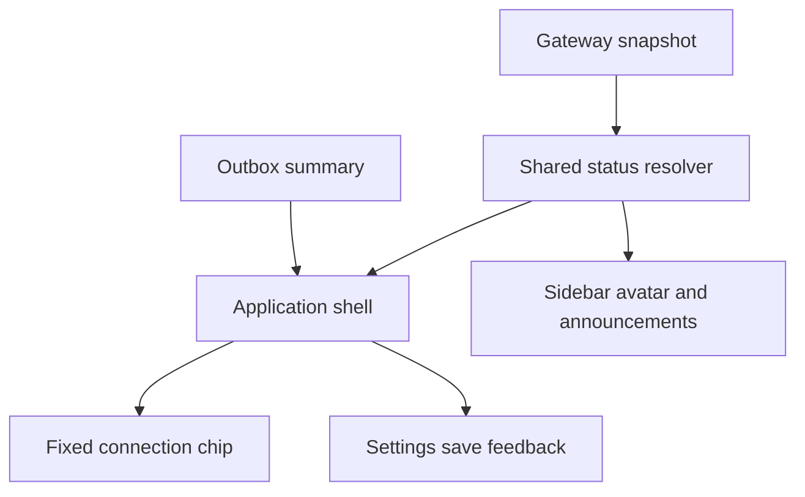

Codex review: needs changes before merge.

## What this changes

This PR replaces layout-dependent connection labels with an avatar dot and a fixed bottom-left status chip while preserving Settings save feedback.

**Example:** The desktop Gateway disconnects with two chat messages queued.
- **Before:** Connection text is clipped inside the navigation rail.
- **After:** A visible chip reads “Reconnecting… · 2 queued” and offers Retry now.

## Review scores

| Measure | Result | What it means |
|---|---|---|
| **Overall readiness** | 🧂 unranked krab **(1/6)** | Useful and focused direction, with two concrete repairable defects and the required visual evidence still absent; no persistent format changes require migration. |
| **Proof confidence** | 🧂 unranked krab **(1/6)** | Real behavior proof is not required for maintainer- or bot-authored pull requests. |
| **Patch quality** | 🦪 silver shellfish **(2/6)** | 2 actionable review findings remain. |

## Product

**Kind:** Bug fix · **Worth it:** Yes · **Fix scope:** Complete
**User problem:** Users cannot readily see connection loss in the desktop rail, and alternative status rows move the page while Settings loses save feedback.
**Reason:** The source verifies the visibility problem, and this maintainer-authored PR supplies the direction for relocating its presentation.

## Merge readiness

⛔ **Needs changes before merge - 2 items remain**

Keep this PR open: it addresses a current visibility defect with approved maintainer direction, but introduces duplicate accessibility announcements and a deterministic browser-test failure.

**Priority:** P2
**Reviewed head:** `18464294955a565c2f318835953e3b3bbd05eaf5`

## Before merge

- [ ] **Keep a single live region for connection transitions (P2)** - With the regular desktop sidebar mounted, the shell now renders this unconditional polite live region alongside the existing sidebar region at app-sidebar-render.tsx:282. Reconnecting, suspension, and other unhealthy transitions therefore publish the same status twice to assistive technology. This independently confirms the existing review comment. Consolidate announcements at one owner while preserving recovery announcements when the sidebar is hidden or replaced by Settings.
- [ ] **Scope the readiness test to one connection control (P2)** - The offline readiness case uses getByRole('button', { name: /Reconnecting…/ }). Showing the shell Retry button alongside the identity button makes that locator match two elements. The exact-head checks-ui-e2e (8/9) annotation reports this strict-mode failure at this line. Scope the locator to the intended identity control or shell chip so the readiness scenario can continue without weakening its assertions.

## Findings

- [P2] Keep a single live region for connection transitions — `ui/src/components/solid/gateway-status.tsx:41`
- [P2] Scope the readiness test to one connection control — `ui/src/test-helpers/control-ui-e2e-readiness.e2e.test.ts:126`

### Tests

- Missing end-to-end proof: Supply inspected before/after browser captures of the chip across desktop, mobile composer, and Settings recovery states; a base-fail/head-pass run for the added regression coverage is not shown.

<strong>Agent review details</strong>

### How this fits together

The Control UI shell consumes the Gateway snapshot and outbox summary, derives connection presentation, and renders recovery controls alongside navigation and Settings.

### Technical review

Best possible solution:

Retain the shared resolver and shell chip, give connection announcements one owner across layouts, and repair the readiness selector.

Do we have a high-confidence way to reproduce the issue?

Current-main CSS clips the connection label inside the persistent rail, and the shell suppresses its alternative surface when that sidebar is available; no target code was executed during this review.

Is this the best way to solve the issue?

A fixed shell-owned chip directly addresses visibility and layout movement without changing connection state ownership, but its accessibility cutover must include the retained sidebar announcement.

Full review comments:

- [P2] Keep a single live region for connection transitions — `ui/src/components/solid/gateway-status.tsx:41`
  With the regular desktop sidebar mounted, the shell now renders this unconditional polite live region alongside the existing sidebar region at app-sidebar-render.tsx:282. Reconnecting, suspension, and other unhealthy transitions therefore publish the same status twice to assistive technology. This independently confirms the existing review comment. Consolidate announcements at one owner while preserving recovery announcements when the sidebar is hidden or replaced by Settings.
  Confidence: 0.99
- [P2] Scope the readiness test to one connection control — `ui/src/test-helpers/control-ui-e2e-readiness.e2e.test.ts:126`
  The offline readiness case uses getByRole('button', { name: /Reconnecting…/ }). Showing the shell Retry button alongside the identity button makes that locator match two elements. The exact-head checks-ui-e2e (8/9) annotation reports this strict-mode failure at this line. Scope the locator to the intended identity control or shell chip so the readiness scenario can continue without weakening its assertions.
  Confidence: 1

Overall correctness: patch is incorrect
Overall confidence: 0.98

AGENTS.md: found and applied where relevant.

Codex review notes: model internal, reasoning medium; reviewed against [35b769240bb1](https://github.com/openclaw/openclaw/commit/35b769240bb14a7f400292936fbaf1c3e32196ef).

### Provenance checked

- `Shared lifecycle presentation and shell fallback` changes intended behavior with a stated reason (017eb0db64cce5f2d395166656070a5c94e5f98c: Consolidate duplicate lifecycle labels, preserve initial recovery stability, and keep recovery controls clear of the composer.)
- `Compact navigation rail status` changes intended behavior with a stated reason (fd018170c94387e843076b259ee54d8998ba935f: Retain compact persistent navigation and account controls; the PR explains why the resulting clipped text and amber outline need a visible replacement.)
- `Solid sidebar and Settings rendering` keeps the original intent (e80558a4da0f3577bc750c5994fdc9f66d35a773: Port rendering while preserving the single sidebar, host tags, lifecycle behavior, and existing domain owners; Settings subsequently followed in 7f007e0ab75386cea289f4faa7bf8d65f3d6b8a8.)

### Testing

Proof path: in-process harness.

### Security

None.

### Evidence

Acceptance criteria:

- pnpm test:ui -- src/app/app-shell-view.test.ts src/components/app-sidebar-rail.test.ts src/components/settings-sidebar.test.tsx
- pnpm test:ui:e2e ui/src/test-helpers/control-ui-e2e-readiness.e2e.test.ts ui/src/e2e/gateway-status.e2e.test.ts ui/src/e2e/sidebar-account-footer.e2e.test.ts
- pnpm tsgo:ui
- git diff --check

What I checked:

- **Pinned introduction reviewed:** Reviewed the merge-base-to-head hunks and original status-rendering blobs; the relevant current-main production files retain the pre-PR behavior. ([`ui/src/app/app-shell-view-state.ts:257`](https://github.com/openclaw/openclaw/blob/18464294955a565c2f318835953e3b3bbd05eaf5/ui/src/app/app-shell-view-state.ts#L257), [18464294955a](https://github.com/openclaw/openclaw/commit/18464294955a565c2f318835953e3b3bbd05eaf5))
- **Current-main visibility defect:** The rail clips identity-card text to one pixel, while the shell only supplies its alternative status surface when navigation or its renderer is unavailable. ([`ui/src/styles/sidebar-rail.css:141`](https://github.com/openclaw/openclaw/blob/35b769240bb14a7f400292936fbaf1c3e32196ef/ui/src/styles/sidebar-rail.css#L141), [35b769240bb1](https://github.com/openclaw/openclaw/commit/35b769240bb14a7f400292936fbaf1c3e32196ef))
- **Duplicate announcement independently confirmed:** The unconditional chip live region coexists with the sidebar's retained polite status region; this confirms the existing discussion at https://github.com/openclaw/openclaw/pull/174022#discussion_r4292673236. ([`ui/src/components/solid/gateway-status.tsx:41`](https://github.com/openclaw/openclaw/blob/18464294955a565c2f318835953e3b3bbd05eaf5/ui/src/components/solid/gateway-status.tsx#L41), [18464294955a](https://github.com/openclaw/openclaw/commit/18464294955a565c2f318835953e3b3bbd05eaf5))
- **Diff-caused CI failure:** The failed checks-ui-e2e (8/9) annotation records the readiness locator matching both the identity button and new Retry button: https://github.com/openclaw/openclaw/actions/runs/38875991216/job/116891618195. ([`ui/src/test-helpers/control-ui-e2e-readiness.e2e.test.ts:126`](https://github.com/openclaw/openclaw/blob/18464294955a565c2f318835953e3b3bbd05eaf5/ui/src/test-helpers/control-ui-e2e-readiness.e2e.test.ts#L126), [18464294955a](https://github.com/openclaw/openclaw/commit/18464294955a565c2f318835953e3b3bbd05eaf5))
- **Original lifecycle contract:** https://github.com/openclaw/openclaw/pull/153321 established one calm lifecycle label, initial-recovery suppression, reachable retry, and composer clearance; the current PR explains relocating that presentation. ([`ui/src/components/gateway-status.ts`](https://github.com/openclaw/openclaw/blob/017eb0db64cce5f2d395166656070a5c94e5f98c/ui/src/components/gateway-status.ts), [017eb0db64cc](https://github.com/openclaw/openclaw/commit/017eb0db64cce5f2d395166656070a5c94e5f98c))
- **Visual evidence inspected:** The complete live body and discussion contain a promise to add before/after screenshots, but no attached captures of this change. ([18464294955a](https://github.com/openclaw/openclaw/commit/18464294955a565c2f318835953e3b3bbd05eaf5))

### PR surface

Source -1, Tests +174, Docs +5. Total +178 across 24 files. Added test files: 0.

View PR surface stats

| Area | Files | Added | Removed | Net |
|---|---:|---:|---:|---:|
| Source | 11 | 87 | 88 | -1 |
| Tests | 12 | 250 | 76 | +174 |
| Docs | 1 | 10 | 5 | +5 |
| Config | 0 | 0 | 0 | 0 |
| Generated | 0 | 0 | 0 | 0 |
| Other | 0 | 0 | 0 | 0 |
| **Total** | **24** | **347** | **169** | **+178** |

### Labels

Label changes:

- add `P2`: Connection visibility and accessibility need a focused UI repair; the underlying connection and message-delivery owners remain unchanged.
- add `rating: 🧂 unranked krab`: Overall readiness is 🧂 unranked krab; proof is 🧂 unranked krab and patch quality is 🦪 silver shellfish.
- add `status: ⏳ waiting on author`: ClawSweeper has contributor-facing work open and is waiting for author action.

Label justifications:

- `P2`: Connection visibility and accessibility need a focused UI repair; the underlying connection and message-delivery owners remain unchanged.
- `rating: 🧂 unranked krab`: Overall readiness is 🧂 unranked krab; proof is 🧂 unranked krab and patch quality is 🦪 silver shellfish.
- `status: ⏳ waiting on author`: ClawSweeper has contributor-facing work open and is waiting for author action.

### Rating scale

6/6 🦀 challenger crab · 5/6 🦞 diamond lobster · 4/6 🐚 platinum hermit · 3/6 🦐 gold shrimp · 2/6 🦪 silver shellfish · 1/6 🧂 unranked krab. Overall follows the weaker of proof and patch quality; ✨ marks media proof (a screenshot, video, or linked artifact) that directly shows the changed behavior.

### Workflow

ClawSweeper edits this one comment on every review. Comment `@clawsweeper re-review` for a fresh review only. Repair and merge execution lanes are retired.

_Reviewed October 16, 2026, 5:04 AM ET / 09:04 UTC._

<!-- clawsweeper-verdict:needs-changes item=174022 sha=18464294955a565c2f318835953e3b3bbd05eaf5 confidence=high updated_at=2026-10-16T08:59:55Z reviewed_at=2026-10-16T09:04:04.299Z lease_owner=github-run-38877287499-1 lease_comment_id=6211929302 source_revision=349a32dd69f38362ec41e0e60ae71a5f23385aeeb38571d2b1c90d975b19d189 -->
<!-- clawsweeper-review-state:needs-changes item=174022 sha=18464294955a565c2f318835953e3b3bbd05eaf5 v=1 -->

<!-- clawsweeper-review-version item=174022 reviewed_at=2026-10-16T09:04:04.299Z sha=18464294955a565c2f318835953e3b3bbd05eaf5 source_revision=349a32dd69f38362ec41e0e60ae71a5f23385aeeb38571d2b1c90d975b19d189 lease_owner=github-run-38877287499-1 lease_comment_id=6211929302 v=1 -->

<!-- clawsweeper-review item=174022 -->