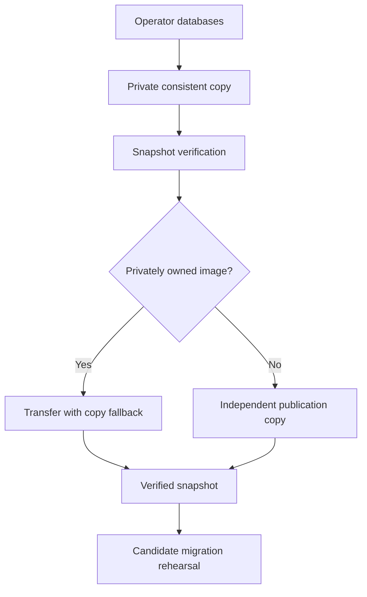

Codex review: blocked before merge. _Reviewed October 1, 2026, 5:26 AM ET / 09:26 UTC (Revision 7)._

# ClawSweeper review

## What this changes

The PR avoids copying privately owned SQLite images again during snapshot publication, preserves row IDs in update rehearsals, and adjusts regression coverage and updating documentation.

## Merge readiness

⛔ **Blocked before merge - 2 items remain**

The PR remains useful and has no identified blocking code defect. Earlier findings are resolved, but the repository-required published-updater compatibility check remains explicitly unperformed.

**Priority:** P2
**Reviewed head:** `9c5a3906982184d8bfd4e647b42bcd582da5136a`

## Review scores

| Measure | Result | What it means |
|---|---|---|
| **Overall readiness** | 🐚 platinum hermit **(4/6)** | The focused implementation and snapshot evidence are strong, with one material updater compatibility requirement still outstanding. |
| **Proof confidence** | 🦞 diamond lobster **(5/6)** | Sufficient (live_output): Recorded production API proof exercises snapshotUpdateCandidateState on a real SQLite fixture and shows reduced checkpoint allocation, preserved sparse row IDs, and unchanged source bytes; prior API evidence also covers independence and failures. The stronger repository-required published-updater handoff remains outstanding in risks. No stored schema or serialized-format contract changes. |
| **Patch quality** | 🐚 platinum hermit **(4/6)** | No actionable review findings were identified. |

## Verification

| Check | Result | Evidence |
|---|---|---|
| **Real behavior** | Verified | Sufficient (live_output): Recorded production API proof exercises snapshotUpdateCandidateState on a real SQLite fixture and shows reduced checkpoint allocation, preserved sparse row IDs, and unchanged source bytes; prior API evidence also covers independence and failures. The stronger repository-required published-updater handoff remains outstanding in risks. No stored schema or serialized-format contract changes. |
| **Evidence reviewed** | 8 items | Pinned introduced changes: Reviewed the merge-base-to-head delta. Private transfer is enabled only inside snapshot creation; the exported publisher retains independent-copy behavior. Current main still needs the change: Fetched main still copies the prepared image through copyFileExclusive, and its rehearsal caller omits preserveRowIds. The provided merged prerequisites address worker selection and verified receipts, rather than implementing this optimization. Re-review continuity: All seven introduced source/test files are unchanged from the preceding reviewed head; only the updating guide differs. Repository race hooks now select final repository entries, and the guide accurately describes row-ID preservation. |
| **Findings** | None | None. |
| **Security** | None | None. |

## How this fits together

Update rehearsals prepare private copies of operator databases before candidate migrations and validation. The SQLite snapshot owner verifies and publishes those copies while preserving the live source databases.

## Before merge

- [ ] **Resolve merge risk (P1)** - The published-updater-to-exact-candidate flow using existing operator state has not been demonstrated; snapshot API proof does not establish that rehearsal, activation, migration, and recovery remain compatible.
- [ ] **Complete next step (P2)** - Record the repository-required published-updater-to-exact-candidate compatibility result using existing operator state before merge.

<strong>Agent review details</strong>

### Security

None.

### PR surface

Source +53, Tests +343, Docs 0. Total +396 across 8 files.

View PR surface stats

| Area | Files | Added | Removed | Net |
|---|---:|---:|---:|---:|
| Source | 2 | 80 | 27 | +53 |
| Tests | 5 | 353 | 10 | +343 |
| Docs | 1 | 2 | 2 | 0 |
| Config | 0 | 0 | 0 | 0 |
| Generated | 0 | 0 | 0 | 0 |
| Other | 0 | 0 | 0 | 0 |
| **Total** | **8** | **435** | **39** | **+396** |

### Review metrics

| Metric | Value | Why it matters |
|---|---|---|
| **Production and regression growth** | production +53 net lines; tests +343 net lines | Production growth implements private transfer and ownership checks; regression growth covers isolation, fallback, cleanup, and rehearsal row IDs. |
| **Observed allocation checkpoint** | 33,611,776 → 16,809,984 allocated bytes | The recorded same-fixture result supports reduced duplicate allocation, without claiming a whole-update peak reduction. |

### Merge-risk options

**Maintainer options:**
1. **Complete the updater compatibility cell (recommended)**  
   Record a published updater running against this exact candidate with existing operator state and verify successful completion and state preservation.

### Technical review

Best possible solution:

Keep private-image transfer within the existing snapshot owner, preserve public-copy isolation and fallback, and establish compatibility through the published updater before landing.

Do we have a high-confidence way to reproduce the issue?

Yes, source provides a high-confidence path: current main recopies the private image and leaves rehearsal compaction enabled, which can renumber sparse implicit row IDs. This read-only review did not execute that path.

Is this the best way to solve the issue?

Yes, the patch extends the existing publication owner and reuses its supported fallback while preserving the public publisher contract. Full updater compatibility remains a separate validation requirement.

AGENTS.md: found and applied where relevant.

Codex review notes: model internal, reasoning medium; reviewed against [3862ade452e3](https://github.com/openclaw/openclaw/commit/3862ade452e312333e4771c78b3dc81fc079cdd5).

### Labels

Label changes:

No label changes.

Label justifications:

- `P2`: This is a bounded updater storage and rehearsal-correctness repair without evidence of an urgent introduced outage.
- `merge-risk: 🚨 compatibility`: The changed snapshot lifecycle participates in installed updates, whose published-driver handoff remains unverified for this candidate.
- `rating: 🐚 platinum hermit`: Overall readiness is 🐚 platinum hermit; proof is 🦞 diamond lobster and patch quality is 🐚 platinum hermit.
- `status: 👀 ready for maintainer look`: ClawSweeper has no concrete contributor-facing blocker left for this PR. Sufficient (live_output): Recorded production API proof exercises snapshotUpdateCandidateState on a real SQLite fixture and shows reduced checkpoint allocation, preserved sparse row IDs, and unchanged source bytes; prior API evidence also covers independence and failures. The stronger repository-required published-updater handoff remains outstanding in risks. No stored schema or serialized-format contract changes.
- `proof: sufficient`: Contributor real behavior proof is sufficient. Recorded production API proof exercises snapshotUpdateCandidateState on a real SQLite fixture and shows reduced checkpoint allocation, preserved sparse row IDs, and unchanged source bytes; prior API evidence also covers independence and failures. The stronger repository-required published-updater handoff remains outstanding in risks. No stored schema or serialized-format contract changes.

### Evidence

What I checked:

- **Pinned introduced changes:** Reviewed the merge-base-to-head delta. Private transfer is enabled only inside snapshot creation; the exported publisher retains independent-copy behavior. ([`src/infra/sqlite-snapshot.ts:344`](https://github.com/openclaw/openclaw/blob/9c5a3906982184d8bfd4e647b42bcd582da5136a/src/infra/sqlite-snapshot.ts#L344), [9c5a39069821](https://github.com/openclaw/openclaw/commit/9c5a3906982184d8bfd4e647b42bcd582da5136a))
- **Current main still needs the change:** Fetched main still copies the prepared image through copyFileExclusive, and its rehearsal caller omits preserveRowIds. The provided merged prerequisites address worker selection and verified receipts, rather than implementing this optimization. ([`src/infra/sqlite-snapshot.ts:374`](https://github.com/openclaw/openclaw/blob/3862ade452e312333e4771c78b3dc81fc079cdd5/src/infra/sqlite-snapshot.ts#L374), [3862ade452e3](https://github.com/openclaw/openclaw/commit/3862ade452e312333e4771c78b3dc81fc079cdd5))
- **Re-review continuity:** All seven introduced source/test files are unchanged from the preceding reviewed head; only the updating guide differs. Repository race hooks now select final repository entries, and the guide accurately describes row-ID preservation. Public docs: [`docs/install/updating.md`](https://docs.openclaw.ai/install/updating). ([`docs/install/updating.md:394`](https://docs.openclaw.ai/install/updating), [9c5a39069821](https://github.com/openclaw/openclaw/commit/9c5a3906982184d8bfd4e647b42bcd582da5136a))
- **Recorded production-boundary proof:** The captured PR body records a 16 MiB fixture exercised through snapshotUpdateCandidateState: allocated bytes at the observed checkpoint fell from 33,611,776 to 16,809,984, source bytes stayed unchanged, and rowid 71 remained 71. Earlier API proof retains its original commit identities; current-head focused validation reports 49 passing tests. These observations do not establish whole-update peak allocation or an installed-updater handoff. ([`src/infra/update-candidate-state.ts:669`](https://github.com/openclaw/openclaw/blob/9c5a3906982184d8bfd4e647b42bcd582da5136a/src/infra/update-candidate-state.ts#L669), [9c5a39069821](https://github.com/openclaw/openclaw/commit/9c5a3906982184d8bfd4e647b42bcd582da5136a))
- **Required upgrade evidence remains outstanding:** The full root policy requires a published-driver × candidate cell for update changes. The captured body explicitly says this cell has not run. Compatibility proof for https://github.com/openclaw/openclaw/pull/162383 exercised a different candidate and cannot satisfy this PR's handoff requirement. The body also correctly states that published older drivers retain their original first-hop snapshot workers. ([`AGENTS.md`](https://github.com/openclaw/openclaw/blob/9c5a3906982184d8bfd4e647b42bcd582da5136a/AGENTS.md), [9c5a39069821](https://github.com/openclaw/openclaw/commit/9c5a3906982184d8bfd4e647b42bcd582da5136a))
- **Publication dependency contract inspected:** The introduced transfer calls publishFileExclusive through OpenClaw's directory-durability adapter, establishing a direct dependency signal. npm metadata verifies openclaw/fs-safe ownership; the published 0.21.3 implementation was read in memory. It pins source and parent identities, publishes exclusively, permits copy fallback, verifies copied content, and returns a durability receipt. No dependency code was executed or installed.

Likely related people:

- **unknown:** The claimed source-line change could not be verified from bounded local history. (role: source history unknown; confidence: low)

### Rank-up moves

Optional improvements that raise the rating; they are not merge blockers.

- Add the published-updater-to-exact-candidate result using existing operator state.

### Rating scale

| Score | Internal tier | Crab rank | Meaning |
|---:|:---:|---|---|
| **6/6** | S | 🦀 challenger crab | Exceptional readiness |
| **5/6** | A | 🦞 diamond lobster | Very strong readiness |
| **4/6** | B | 🐚 platinum hermit | Good normal PR; ordinary maintainer review |
| **3/6** | C | 🦐 gold shrimp | Useful, but confidence is limited |
| **2/6** | D | 🦪 silver shellfish | Proof or implementation needs work |
| **1/6** | F | 🧂 unranked krab | Not merge-ready |
| N/A | NA | 🌊 off-meta tidepool | Rating does not apply |

Overall follows the weaker of proof and patch quality.
Shiny media proof means a screenshot, video, or linked artifact directly shows the changed behavior. Runtime, network, CSP, and security claims still need visible diagnostics.

### Workflow

- ClawSweeper keeps one durable marker-backed review comment per issue or PR.
- Re-runs edit this comment so the latest verdict, findings, and automation markers stay together instead of adding duplicate bot comments.
- A fresh review can be triggered by eligible `@clawsweeper re-review` comments, exact-item GitHub events, scheduled/background review runs, or manual workflow dispatch.
- PR/issue authors and users with repository write access can comment `@clawsweeper re-review` or `@clawsweeper re-run` on an open PR or issue to request a fresh review only.
- Maintainers can also comment `@clawsweeper review` to request a fresh review only.
- Fresh-review commands do not start repair, autofix, rebase, CI repair, or automerge.
- Maintainer-only repair and merge flows require explicit commands such as `@clawsweeper autofix`, `@clawsweeper automerge`, `@clawsweeper fix ci`, or `@clawsweeper address review`.
- Maintainers can comment `@clawsweeper explain` to ask for more context, or `@clawsweeper stop` to stop active automation.

### History

Review history (6 earlier review cycles)

<!-- clawsweeper-review-history v=1 total=6 -->
- reviewed 2026-10-01T05:00:51.047Z sha 35811f761ce72ea9212d1311a2a6e7913b5396be :: needs changes before merge. :: [P2] Restrict repository race hooks to final entry publication
- reviewed 2026-10-01T05:10:15.489Z sha bfd9f33a42d7cd60b9a0c0b21ee4e9a6905dd949 :: needs maintainer review before merge. :: none
- reviewed 2026-10-01T05:23:05.325Z sha af8c565aa135f118f1e59a2b4b1ddd1a1b91ca04 :: needs changes before merge. :: [P3] Update the rehearsal guide to remove the compaction claim
- reviewed 2026-10-01T05:34:56.932Z sha ff91f52321441e407f6cb04293bd87815b102478 :: needs maintainer review before merge. :: none
- reviewed 2026-10-01T05:47:45.770Z sha ff91f52321441e407f6cb04293bd87815b102478 :: needs maintainer review before merge. :: none
- reviewed 2026-10-01T08:05:28.908Z sha 077342a9329da98ea23a82f1df7e599b57664708 :: blocked before merge. :: none

<!-- clawsweeper-verdict:needs-human item=162403 sha=9c5a3906982184d8bfd4e647b42bcd582da5136a confidence=high updated_at=2026-10-01T09:23:40Z reviewed_at=2026-10-01T09:26:44.706Z lease_owner=github-run-36842334746-1 lease_comment_id=5928557294 source_revision=5c12b15fe88107672dd812744ad066949a37301279d109b998fbdf882a8e617a live_verification=absent -->
<!-- clawsweeper-review-state:blocked item=162403 sha=9c5a3906982184d8bfd4e647b42bcd582da5136a v=1 -->

<!-- clawsweeper-review-version item=162403 reviewed_at=2026-10-01T09:26:44.706Z sha=9c5a3906982184d8bfd4e647b42bcd582da5136a source_revision=5c12b15fe88107672dd812744ad066949a37301279d109b998fbdf882a8e617a lease_owner=github-run-36842334746-1 lease_comment_id=5928557294 v=1 -->

<!-- clawsweeper-review item=162403 -->