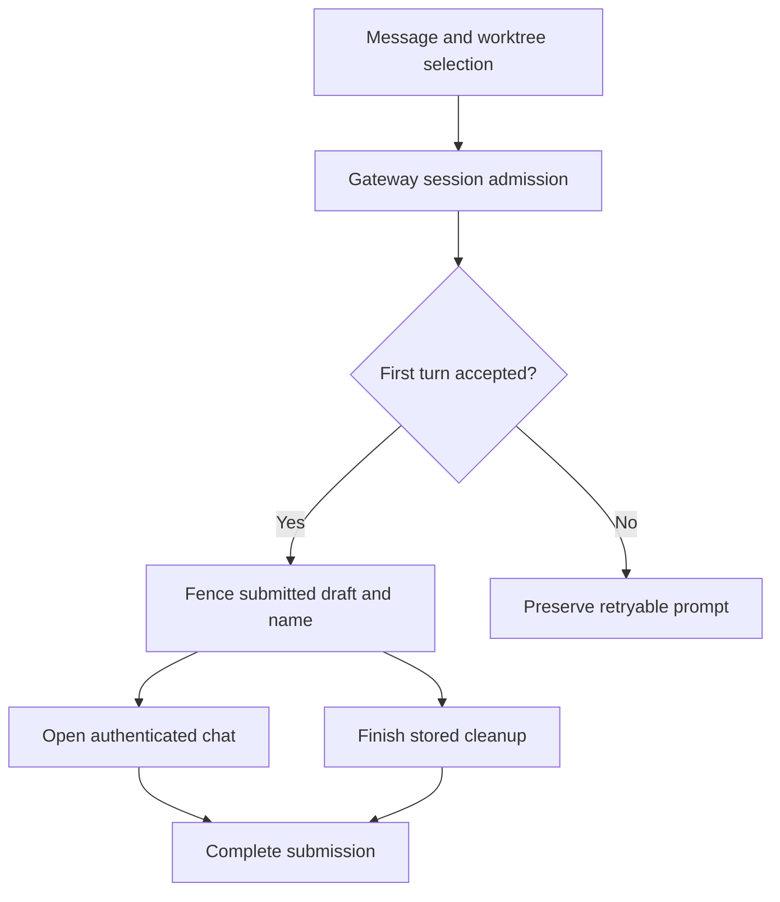

Codex review: needs maintainer review before merge. _Reviewed October 8, 2026, 2:36 PM ET / 18:36 UTC (Revision 2)._

# ClawSweeper review

## What this changes

The PR opens accepted new-session conversations while submitted-draft and saved worktree-name cleanup finish through their existing owners.

**Example:** Submit “Inspect the synthetic project and summarize the files.” while preference cleanup is held
- **Before:** The browser remains on New session showing “Starting… 45s” without assistant output.
- **After:** The accepted conversation displays “The worktree is ready. I am inspecting the project files now.” while cleanup remains pending.

## Review scores

| Measure | Result | What it means |
|---|---|---|
| **Overall readiness** | 🦞 diamond lobster **(5/6)** | A narrow, worthwhile repair with inspected browser before/after proof, meaningful reported negative controls, and no open findings. |
| **Proof confidence** | 🦞 diamond lobster **(5/6)** ✨ media proof bonus | Sufficient (screenshot): The source-served Control UI ran in Chromium with a synthetic Gateway and held preference cleanup: inspected baseline and candidate captures show Starting… replaced by the accepted chat and assistant output, supported by reported chat.startup assertions. This completes the prior proof request. Existing draft and preference formats, conditional writes, and migrations are unchanged, so no data-model migration is required. |
| **Patch quality** | 🦞 diamond lobster **(5/6)** | No actionable review findings were identified. |

## Product

**Kind:** Bug fix · **Worth it:** Yes · **Fix scope:** Complete
**User problem:** An accepted conversation remains hidden behind Starting… when saved-name or draft cleanup is slow.
**Reason:** This restores the established immediate accepted-conversation handoff with a small scheduling repair and no new product surface. Area history connects the author to the existing owner, and the original retirement contracts remain intact.

## Merge readiness

✅ **Ready for maintainer review**

This PR remains useful: current main still delays accepted chat behind cleanup. The inspected browser proof satisfies the prior rank-up request, and no actionable correctness or security finding remains.

**Priority:** P2
**Reviewed head:** `c044572a4588956be60b65ff713b0c4e8257ca79`

## Before merge

None.

## Findings

None.

<strong>Agent review details</strong>

### How this fits together

The Control UI sends a new conversation’s first turn to the Gateway, then transfers the accepted session into chat. Separate draft and preference owners retire submitted content and consumed worktree names while preserving newer edits.

### Technical review

Best possible solution:

Keep synchronous retirement and authenticated admission in their existing owners, with storage settlement outside the conversation-opening path.

Do we have a high-confidence way to reproduce the issue?

Yes: current-main source places both cleanup awaits before accepted chat navigation, so held cleanup reproduces the delay. Supplied browser captures and original-source negative controls support that mechanism; this review did not execute it.

Is this the best way to solve the issue?

Yes: the change removes the two blocking awaits while retaining synchronous mutation fencing, existing cleanup owners, and authenticated navigation.

AGENTS.md: found and applied where relevant.

Codex review notes: model internal, reasoning medium; reviewed against [b3b40e1615d5](https://github.com/openclaw/openclaw/commit/b3b40e1615d5820434c6d2dbdfd4eecff0dac7d8).

### Provenance checked

- `ui/src/pages/new-session/draft-submission-flow.ts and draft-submission-worktree-preferences.test.ts: accepted-name cleanup ordering` changes intended behavior with a stated reason (https://github.com/openclaw/openclaw/pull/150426: Retire consumed custom names through the existing preference owner, preserve newer selections, and continue accepted creation when cleanup cannot be confirmed.)
- `ui/src/pages/new-session/initial-session-turn-handoff.ts: accepted conversation handoff` keeps the original intent (https://github.com/openclaw/openclaw/pull/114032: Keep provisional chat read-only until admission and preserve authenticated handoff, rollback, and navigation-only retries.)
- `ui/src/pages/new-session/draft-submission-flow.test.ts: accepted draft retirement` keeps the original intent (https://github.com/openclaw/openclaw/pull/147413: Consume accepted content synchronously so cleanup, reconnects, or navigation interruptions cannot leave a duplicate submitted draft.)

### Testing

Proof path: shipped entry point. Added test files: 2.

### Security

None.

### Evidence

What I checked:

- **Pinned introduced change:** The introduced diff retains the preference-cleanup promise, starts draft retirement before navigation, and joins cleanup before submission completes; it adds no configuration, protocol, or storage format. ([`ui/src/pages/new-session/draft-submission-flow.ts:546`](https://github.com/openclaw/openclaw/blob/c044572a4588956be60b65ff713b0c4e8257ca79/ui/src/pages/new-session/draft-submission-flow.ts#L546), [c044572a4588](https://github.com/openclaw/openclaw/commit/c044572a4588956be60b65ff713b0c4e8257ca79))
- **Current main still contains the delay:** Current main still awaits durable draft cleanup before authenticated navigation. Comparison against the merge base found no intervening changes to either production file containing the two blocking awaits. ([`ui/src/pages/new-session/initial-session-turn-handoff.ts:100`](https://github.com/openclaw/openclaw/blob/b3b40e1615d5820434c6d2dbdfd4eecff0dac7d8/ui/src/pages/new-session/initial-session-turn-handoff.ts#L100), [b3b40e1615d5](https://github.com/openclaw/openclaw/commit/b3b40e1615d5820434c6d2dbdfd4eecff0dac7d8))
- **Inspected browser before and after:** Inspected both prepared images linked from the captured PR body, sourceRevision 1033fe58fdd2f746587d03094bfc263288817184877d8000d1fee299c2c1ec7b. The baseline shows Starting… 45s; the candidate shows the accepted conversation and synthetic assistant response. The body reports source-served Chromium runs with a synthetic Gateway, held preference cleanup, and assertions that chat.startup occurs only after the repair. This satisfies the previous review’s browser-demonstration request. ([c044572a4588](https://github.com/openclaw/openclaw/commit/c044572a4588956be60b65ff713b0c4e8257ca79))
- **Captured draft retirement preserves newer edits:** The existing persistence owner synchronously retires the submitted mutation and consumes matching in-memory content before awaiting writes; durable clearing matches captured write identities. Navigating earlier does not change the stored representation or migration contract. ([`ui/src/pages/new-session/draft-persistence.ts:339`](https://github.com/openclaw/openclaw/blob/c044572a4588956be60b65ff713b0c4e8257ca79/ui/src/pages/new-session/draft-persistence.ts#L339), [c044572a4588](https://github.com/openclaw/openclaw/commit/c044572a4588956be60b65ff713b0c4e8257ca79))
- **Preference cleanup survives route disposal safely:** Accepted cleanup uses captured connection and selection ownership, rechecks ownership after awaited reads, and uses conditional writes. Its queue explicitly survives submitting-route disposal without overwriting newer checkout choices. ([`ui/src/pages/new-session/draft-preference-state.ts:329`](https://github.com/openclaw/openclaw/blob/c044572a4588956be60b65ff713b0c4e8257ca79/ui/src/pages/new-session/draft-preference-state.ts#L329), [c044572a4588](https://github.com/openclaw/openclaw/commit/c044572a4588956be60b65ff713b0c4e8257ca79))
- **Original cleanup and handoff intent:** The merged https://github.com/openclaw/openclaw/pull/150426 requires accepted-name retirement without reversing creation or overwriting newer preferences. The merged https://github.com/openclaw/openclaw/pull/147413 requires synchronous accepted-draft consumption, and https://github.com/openclaw/openclaw/pull/114032 preserves authenticated admission and navigation-only retries. This PR keeps those contracts. ([`ui/src/pages/new-session/draft-submission-flow.ts:545`](https://github.com/openclaw/openclaw/blob/bcafd72f610e6ceb3e97edac7a183abd9808ac41/ui/src/pages/new-session/draft-submission-flow.ts#L545), [bcafd72f610e](https://github.com/openclaw/openclaw/commit/bcafd72f610e6ceb3e97edac7a183abd9808ac41))

Likely related people:

- **steipete:** Suggested for follow-up; no historical authorship or introduction is verified. (role: unverified routing candidate; confidence: low)
- **RomneyDa:** Suggested for follow-up; no historical authorship or introduction is verified. (role: unverified routing candidate; confidence: low)

### PR surface

Source +5, Tests +28, Docs +5. Total +38 across 5 files.

View PR surface stats

| Area | Files | Added | Removed | Net |
|---|---:|---:|---:|---:|
| Source | 2 | 9 | 4 | +5 |
| Tests | 2 | 49 | 21 | +28 |
| Docs | 1 | 5 | 0 | +5 |
| Config | 0 | 0 | 0 | 0 |
| Generated | 0 | 0 | 0 | 0 |
| Other | 0 | 0 | 0 | 0 |
| **Total** | **5** | **63** | **25** | **+38** |

### Labels

Label changes:

- add `proof: sufficient`: Contributor real behavior proof is sufficient.
- add `proof: 📸 screenshot`: Contributor real behavior proof includes screenshot evidence.
- add `rating: 🦞 diamond lobster`: Overall readiness is 🦞 diamond lobster; proof is 🦞 diamond lobster and patch quality is 🦞 diamond lobster. Replaced prior `rating: 🦐 gold shrimp`.
- remove `rating: 🦐 gold shrimp`: Current PR rating is `rating: 🦞 diamond lobster`, so this older rating label is no longer current.

Label justifications:

- `P2`: This repairs a bounded Control UI delay after successful session admission without changing settings or permissions.
- `rating: 🦞 diamond lobster`: Overall readiness is 🦞 diamond lobster; proof is 🦞 diamond lobster and patch quality is 🦞 diamond lobster. Replaced prior `rating: 🦐 gold shrimp`.
- `status: 👀 ready for maintainer look`: ClawSweeper has no concrete contributor-facing blocker left for this PR.
- `proof: sufficient`: Contributor real behavior proof is sufficient.
- `proof: 📸 screenshot`: Contributor real behavior proof includes screenshot evidence.

### Rating scale

6/6 🦀 challenger crab · 5/6 🦞 diamond lobster · 4/6 🐚 platinum hermit · 3/6 🦐 gold shrimp · 2/6 🦪 silver shellfish · 1/6 🧂 unranked krab. Overall follows the weaker of proof and patch quality; ✨ marks media proof (a screenshot, video, or linked artifact) that directly shows the changed behavior.

### Workflow

ClawSweeper edits this one comment on every review. Comment `@clawsweeper re-review` for a fresh review only; repair and merge need explicit maintainer commands such as `@clawsweeper autofix` or `@clawsweeper automerge`.

### History

Review history (1 earlier review cycle)

<!-- clawsweeper-review-history v=1 total=1 -->
- reviewed 2026-10-08T18:21:00.517Z sha c044572a4588956be60b65ff713b0c4e8257ca79 :: needs maintainer review before merge. :: none

<!-- clawsweeper-verdict:needs-human item=167384 sha=c044572a4588956be60b65ff713b0c4e8257ca79 confidence=high updated_at=2026-10-08T18:34:00Z reviewed_at=2026-10-08T18:36:55.291Z lease_owner=github-run-37825135911-1 lease_comment_id=6066531543 source_revision=1033fe58fdd2f746587d03094bfc263288817184877d8000d1fee299c2c1ec7b live_verification=absent -->
<!-- clawsweeper-review-state:ready item=167384 sha=c044572a4588956be60b65ff713b0c4e8257ca79 v=1 -->

<!-- clawsweeper-review-version item=167384 reviewed_at=2026-10-08T18:36:55.291Z sha=c044572a4588956be60b65ff713b0c4e8257ca79 source_revision=1033fe58fdd2f746587d03094bfc263288817184877d8000d1fee299c2c1ec7b lease_owner=github-run-37825135911-1 lease_comment_id=6066531543 v=1 -->

<!-- clawsweeper-review item=167384 -->