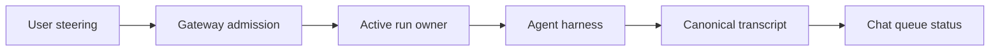

Codex review: found issues before merge. _Reviewed August 5, 2026, 11:16 AM ET / 15:16 UTC._

# ClawSweeper review

## What this changes

The PR changes Gateway admission, shared active-run delivery, Copilot steering receipt handling, and Control UI queue wording so active runs receive steering instructions.

## Merge readiness

⛔ **Blocked by patch quality or review findings - 8 items remain**

Keep open: the exact head still admits a stale steering turn when the active owner disappears between Gateway admission and harness injection, so the prior P1 remains unresolved.

**Priority:** P1
**Reviewed head:** `7ccfc94370d3e9c9e3fa5d298cfa968cdc436f87`
**Owner decision:** Required. See [Decision needed](#decision-needed).

## Review scores

| Measure | Result | What it means |
|---|---|---|
| **Overall readiness** | 🦪 silver shellfish **(2/6)** | The PR has useful runtime evidence and broad regression intent, but the unchanged P1 owner-handoff defect makes the patch not ready to merge. |
| **Proof confidence** | 🦐 gold shrimp **(3/6)** | Not applicable: This MEMBER-authored PR is exempt from the external-contributor proof gate; its body nevertheless records an installed after-fix runtime trace and negative control. |
| **Patch quality** | 🦪 silver shellfish **(2/6)** | 1 actionable review finding remain. |

## Verification

| Check | Result | Evidence |
|---|---|---|
| **Real behavior** | Not applicable | Not applicable: This MEMBER-authored PR is exempt from the external-contributor proof gate; its body nevertheless records an installed after-fix runtime trace and negative control. |
| **Evidence reviewed** | 5 items | Unchanged active-owner bypass: The proposed head bypasses expected-leaf validation solely from an instantaneous streaming-registry check. An owner can clear after this check, leaving a stale steering turn eligible for ordinary follow-up dispatch on the advanced branch. Fallback path does not restore the fence: The reply runner only applies the new rejection-to-follow-up handling after it attempts steering; once the owner has cleared, queue policy falls through before that path runs. Regression coverage misses the interleaving: The new Gateway case retains the owner until completion, while the reply-runner table fixes the owner as active and streaming; neither clears ownership after admission and before injection. |
| **Findings** | 1 actionable finding | [P1] Preserve stale-leaf fencing through owner handoff |
| **Security** | None | None. |

## How this fits together

A steering message travels from the chat composer through Gateway admission to the active agent harness, then becomes durable in the canonical transcript. The queue UI must remain pending until that durable receipt, while branch-leaf fencing prevents a stale composer from creating a new turn on a newer branch.

## Decision needed

| Question | Recommendation |
|---|---|
| Should this PR be corrected to retain or revalidate stale-leaf fencing through active-owner handoff before it is merged? | **Repair the handoff fence:** Preserve the expected leaf through steering delivery or revalidate it immediately before the no-owner fallback, with an owner-clear interleaving regression. |

Why: The protected maintainer PR has a concrete session-safety defect, but the canonical ownership mechanism—receipt versus pre-fallback revalidation—needs an owner-level choice.

## Before merge

- [ ] **Preserve stale-leaf fencing through owner handoff (P1)** - This remains from the previous review on unchanged code. `isStreaming()` only snapshots ownership at admission; if that owner advances the leaf and clears before injection, the steer bypasses the leaf guard and the no-owner path can run it as a new turn on the newer branch. Retain the precondition until receipt, or revalidate before fallback dispatch, and add the owner-clear interleaving regression.
- [ ] **Resolve merge risk (P1)** - Merging as-is can route a stale steering instruction as a fresh follow-up after the active owner advances the transcript and exits.
- [ ] **Resolve merge risk (P1)** - The Copilot receipt path assumes the SDK `send()` return value equals the later `user.message` event identifier; local fakes enforce that equality, but the installed SDK source/types were unavailable for direct contract verification.
- [ ] **Resolve merge risk (P1)** - The PR asserts preserved native Codex behavior, but the required sibling Codex source was absent from this review environment, so that assertion was not independently verified.
- [ ] **Complete next step (P2)** - The protected maintainer PR needs an owner-level correction of the exact-head P1 before another merge review.
- [ ] **Improve patch quality** - Retain or revalidate the expected leaf through owner disappearance and add the focused interleaving regression.
- [ ] **Improve patch quality** - Provide direct SDK type/source evidence or a runtime trace establishing that Copilot `send()` returns the identifier used by the transcript event.

## Findings

- [P1] Preserve stale-leaf fencing through owner handoff — `src/gateway/server-methods/chat-send-admission.ts:203-205`

<strong>Agent review details</strong>

### Security

None.

### PR surface

Source +147, Tests +353. Total +500 across 14 files.

View PR surface stats

| Area | Files | Added | Removed | Net |
|---|---:|---:|---:|---:|
| Source | 7 | 162 | 15 | +147 |
| Tests | 7 | 358 | 5 | +353 |
| Docs | 0 | 0 | 0 | 0 |
| Config | 0 | 0 | 0 | 0 |
| Generated | 0 | 0 | 0 | 0 |
| Other | 0 | 0 | 0 | 0 |
| **Total** | **14** | **520** | **20** | **+500** |

### Review metrics

| Metric | Value | Why it matters |
|---|---|---|
| **Production versus test delta** | production +162/-15, tests +358/-5 | The production growth implements a cross-harness ownership and transcript-receipt boundary; the added tests must also cover owner disappearance between admission and injection. |

### Merge-risk options

**Maintainer options:**
1. **Restore handoff-safe fencing (recommended)**  
   Make fallback dispatch retain or revalidate the caller’s expected leaf after the active owner clears, and cover that ordering in a focused regression.
2. **Pause this approach**  
   Do not merge the shared admission bypass if the owner boundary cannot supply a durable receipt or an equivalent revalidation point.

### Technical review

Best possible solution:

Carry an owner-bound receipt or the expected-leaf precondition through the owner handoff, and revalidate the leaf before admitting any no-owner fallback turn.

Do we have a high-confidence way to reproduce the issue?

Yes, by a focused owner-clear interleaving: admit a stale steer while the owner streams, advance the leaf, clear the owner before injection, and observe fallback dispatch on the newer branch; this read-only review did not execute it.

Is this the best way to solve the issue?

No: the shared owner boundary is the right repair layer, but the proposed instantaneous streaming check is not sufficient because it loses the stale-leaf precondition before fallback dispatch.

Full review comments:

- [P1] Preserve stale-leaf fencing through owner handoff — `src/gateway/server-methods/chat-send-admission.ts:203-205`
  This remains from the previous review on unchanged code. `isStreaming()` only snapshots ownership at admission; if that owner advances the leaf and clears before injection, the steer bypasses the leaf guard and the no-owner path can run it as a new turn on the newer branch. Retain the precondition until receipt, or revalidate before fallback dispatch, and add the owner-clear interleaving regression.
  Confidence: 0.96

Overall correctness: patch is incorrect
Overall confidence: 0.96

AGENTS.md: found and applied where relevant.

Codex review notes: model internal, reasoning high; reviewed against [ce06e7924e88](https://github.com/openclaw/openclaw/commit/ce06e7924e880032a0ca58dd52c61a6e1d409769).

### Labels

Label justifications:

- `P1`: A user steering an active run can have their instruction silently attached to the wrong transcript branch.
- `merge-risk: 🚨 compatibility`: The PR changes shared Gateway admission semantics for existing chat-send clients.
- `merge-risk: 🚨 session-state`: It conditionally removes transcript-leaf fencing during active-run ownership.
- `rating: 🦪 silver shellfish`: Overall readiness is 🦪 silver shellfish; proof is 🦐 gold shrimp and patch quality is 🦪 silver shellfish.
- `status: ⏳ waiting on author`: ClawSweeper has contributor-facing work open and is waiting for author action. Not applicable: This MEMBER-authored PR is exempt from the external-contributor proof gate; its body nevertheless records an installed after-fix runtime trace and negative control.

### Evidence

What I checked:

- **Unchanged active-owner bypass:** The proposed head bypasses expected-leaf validation solely from an instantaneous streaming-registry check. An owner can clear after this check, leaving a stale steering turn eligible for ordinary follow-up dispatch on the advanced branch. ([`src/gateway/server-methods/chat-send-admission.ts:203`](https://github.com/openclaw/openclaw/blob/7ccfc94370d3/src/gateway/server-methods/chat-send-admission.ts#L203), [7ccfc94370d3](https://github.com/openclaw/openclaw/commit/7ccfc94370d3))
- **Fallback path does not restore the fence:** The reply runner only applies the new rejection-to-follow-up handling after it attempts steering; once the owner has cleared, queue policy falls through before that path runs. ([`src/auto-reply/reply/agent-runner-run.ts:359`](https://github.com/openclaw/openclaw/blob/7ccfc94370d3/src/auto-reply/reply/agent-runner-run.ts#L359), [7ccfc94370d3](https://github.com/openclaw/openclaw/commit/7ccfc94370d3))
- **Regression coverage misses the interleaving:** The new Gateway case retains the owner until completion, while the reply-runner table fixes the owner as active and streaming; neither clears ownership after admission and before injection. ([`src/gateway/server-methods/chat.directive-tags.test.ts:1353`](https://github.com/openclaw/openclaw/blob/7ccfc94370d3/src/gateway/server-methods/chat.directive-tags.test.ts#L1353), [7ccfc94370d3](https://github.com/openclaw/openclaw/commit/7ccfc94370d3))
- **History and review continuity:** Blame assigns the bypass to the PR’s hardening commit; the current head equals the previously reviewed SHA, so the prior P1 remains applicable rather than being a late finding. ([`src/gateway/server-methods/chat-send-admission.ts:203`](https://github.com/openclaw/openclaw/blob/d585181c52ef/src/gateway/server-methods/chat-send-admission.ts#L203), [d585181c52ef](https://github.com/openclaw/openclaw/commit/d585181c52ef))
- **Current-main check:** The PR head is not contained in current main, so its central steering change is neither implemented nor superseded. ([`src/gateway/server-methods/chat-send-admission.ts:203`](https://github.com/openclaw/openclaw/blob/ce06e7924e88/src/gateway/server-methods/chat-send-admission.ts#L203), [ce06e7924e88](https://github.com/openclaw/openclaw/commit/ce06e7924e88))

Likely related people:

- **fuller-stack-dev:** Current-main blame ties the original leaf-fence area to this contributor, and the exact-head bypass is from their steering-hardening commit. (role: recent area contributor; confidence: high; commits: [47ce26985d40](https://github.com/openclaw/openclaw/commit/47ce26985d407fdb238a91531cee2a7587ed6487), [d585181c52ef](https://github.com/openclaw/openclaw/commit/d585181c52efaa3e6a6fffaf6ff53451cfdd2c3c); files: `src/gateway/server-methods/chat-send-admission.ts`, `src/auto-reply/reply/agent-runner-run.ts`)
- **steipete:** Local history shows extensive work around the active-run registry and admission area, and the supplied PR timeline records an explicit mention/subscription. (role: adjacent owner; confidence: low; files: `src/auto-reply/reply/reply-run-registry.ts`, `src/gateway/server-methods/chat-send-admission.ts`)

### Rating scale

| Score | Internal tier | Crab rank | Meaning |
|---:|:---:|---|---|
| **6/6** | S | 🦀 challenger crab | Exceptional readiness |
| **5/6** | A | 🦞 diamond lobster | Very strong readiness |
| **4/6** | B | 🐚 platinum hermit | Good normal PR; ordinary maintainer review |
| **3/6** | C | 🦐 gold shrimp | Useful, but confidence is limited |
| **2/6** | D | 🦪 silver shellfish | Proof or implementation needs work |
| **1/6** | F | 🧂 unranked krab | Not merge-ready |
| N/A | NA | 🌊 off-meta tidepool | Rating does not apply |

Overall follows the weaker of proof and patch quality.
Shiny media proof means a screenshot, video, or linked artifact directly shows the changed behavior. Runtime, network, CSP, and security claims still need visible diagnostics.

### Workflow

- ClawSweeper keeps one durable marker-backed review comment per issue or PR.
- Re-runs edit this comment so the latest verdict, findings, and automation markers stay together instead of adding duplicate bot comments.
- A fresh review can be triggered by eligible `@clawsweeper re-review` comments, exact-item GitHub events, scheduled/background review runs, or manual workflow dispatch.
- PR/issue authors and users with repository write access can comment `@clawsweeper re-review` or `@clawsweeper re-run` on an open PR or issue to request a fresh review only.
- Maintainers can also comment `@clawsweeper review` to request a fresh review only.
- Fresh-review commands do not start repair, autofix, rebase, CI repair, or automerge.
- Maintainer-only repair and merge flows require explicit commands such as `@clawsweeper autofix`, `@clawsweeper automerge`, `@clawsweeper fix ci`, or `@clawsweeper address review`.
- Maintainers can comment `@clawsweeper explain` to ask for more context, or `@clawsweeper stop` to stop active automation.

### History

Review history (3 earlier review cycles)

<!-- clawsweeper-review-history v=1 total=3 -->
- reviewed 2026-08-05T12:12:45.716Z sha f3724f062e45a05966758d096826fd75385dc83e :: needs changes before merge. :: [P1] Preserve stale-leaf fencing without an active owner | [P1] Gate steering until the initial SDK user event is observed | [P1] Reject receipts for suppressed steering writes
- reviewed 2026-08-05T13:19:01.493Z sha 7ccfc94370d3e9c9e3fa5d298cfa968cdc436f87 :: found issues before merge. :: [P1] Keep stale-leaf fencing through owner handoff
- reviewed 2026-08-05T13:26:28.382Z sha 7ccfc94370d3e9c9e3fa5d298cfa968cdc436f87 :: found issues before merge. :: [P1] Preserve stale-leaf fencing through owner handoff

<!-- clawsweeper-verdict:needs-human item=119594 sha=7ccfc94370d3e9c9e3fa5d298cfa968cdc436f87 confidence=high updated_at=2026-08-05T15:12:40Z reviewed_at=2026-08-05T15:16:47.391Z lease_owner=github-run-31019031025-1 lease_comment_id=5193595283 source_revision=7b83b48a253726abe05be697844bd29a9df67e2fa112291207ff19c75822ce02 -->

<!-- clawsweeper-review-version item=119594 reviewed_at=2026-08-05T15:16:47.391Z sha=7ccfc94370d3e9c9e3fa5d298cfa968cdc436f87 source_revision=7b83b48a253726abe05be697844bd29a9df67e2fa112291207ff19c75822ce02 lease_owner=github-run-31019031025-1 lease_comment_id=5193595283 v=1 -->

<!-- clawsweeper-review item=119594 -->