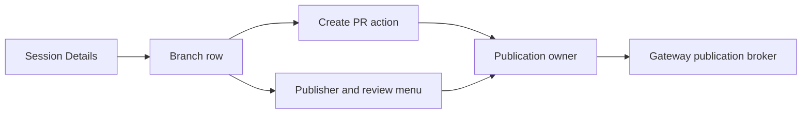

Codex review: needs changes before merge.

## What this changes

This PR exposes Create PR in desktop Details and moves eligible publisher choices into the branch’s ellipsis menu.

**Example:** A desktop session has an unpublished branch and publishers @system-bot and @alice-tools.
- **Before:** Publishing requires opening the branch menu, and selecting @alice-tools requires another nested menu.
- **After:** Create PR appears beside the branch, and @alice-tools can be selected directly from the ellipsis menu.

## Review scores

| Measure | Result | What it means |
|---|---|---|
| **Overall readiness** | 🐚 platinum hermit **(4/6)** | Clear visual proof and focused owner reuse support the change; the remaining defect is outdated user navigation documentation. |
| **Proof confidence** | 🦞 diamond lobster **(5/6)** ✨ media proof bonus | Sufficient (screenshot): Inspected before/after screenshots exercise the actual desktop Details renderer with a mock Gateway and synthetic publishers, directly showing inline Create PR and flattened account choices; the supplied integration coverage supports identity, consent, and recovery behavior without claiming a real GitHub publication. |
| **Patch quality** | 🐚 platinum hermit **(4/6)** | 1 actionable review finding remain. |

## Product

**Kind:** Preference · **Worth it:** Yes · **Fix scope:** Complete
**User problem:** Desktop users must navigate nested menus to find PR creation and choose a publisher.
**Reason:** The maintainer author also contributed the current Details presentation, establishing direction for this focused usability improvement.

## Merge readiness

⛔ **Needs changes before merge - 1 item remains**

Keep this PR open: the maintainer-authored presentation improvement is useful, preserves the existing publication owner, and needs one low-priority documentation correction.

**Priority:** P2
**Reviewed head:** `2c6220752be68495e8ef3c317a347545c50625d5`

## Before merge

- [ ] **Update the documented desktop publisher controls (P3)** - With both publishers available, this change removes the desktop account arrow and places its choices directly in the ellipsis menu, but docs/web/control-ui/chat.md:591 still tells users to use the arrow beside Publish PR and describes recovery actions as inline. Users following https://docs.openclaw.ai/web/control-ui/chat will look for controls that no longer exist in that desktop layout. Update that paragraph for Create PR, the publisher menu, and Review while retaining the mobile distinction; root AGENTS.md requires documentation to follow behavior changes.

## Findings

- [P3] Update the documented desktop publisher controls — `ui/src/pages/chat/components/chat-pull-requests-content.tsx:433-434`

<strong>Agent review details</strong>

### How this fits together

The Control UI renders session branch and publication information from the existing GitHub publication owner; user actions invoke its scoped selection, publication, confirmation, and recovery callbacks.

### Technical review

Best possible solution:

Keep the shared publication controls and update the chat guide to describe the new desktop navigation.

Do we have a high-confidence way to reproduce the issue?

Current-main markup and the inspected before screenshots establish the nested-menu behavior; no target code or tests were executed during this read-only review.

Is this the best way to solve the issue?

The implementation reuses the existing eligibility projection, account-menu rendering, publication callbacks, and native menu owner; its added branching handles the distinct inline, personal-consent, and recovery presentations without creating another state owner.

Full review comments:

- [P3] Update the documented desktop publisher controls — `ui/src/pages/chat/components/chat-pull-requests-content.tsx:433-434`
  With both publishers available, this change removes the desktop account arrow and places its choices directly in the ellipsis menu, but docs/web/control-ui/chat.md:591 still tells users to use the arrow beside Publish PR and describes recovery actions as inline. Users following https://docs.openclaw.ai/web/control-ui/chat will look for controls that no longer exist in that desktop layout. Update that paragraph for Create PR, the publisher menu, and Review while retaining the mobile distinction; root AGENTS.md requires documentation to follow behavior changes.
  Confidence: 0.98

Overall correctness: patch is correct
Overall confidence: 0.94

AGENTS.md: found and applied where relevant.

Codex review notes: model internal, reasoning medium; reviewed against [e8d8145cd62f](https://github.com/openclaw/openclaw/commit/e8d8145cd62feac71d6c65636c948a74b7f799d6).

### Provenance checked

- `Desktop branch actions and publication placement` changes intended behavior with a stated reason (33b16c7ef875e94b387f61a78fdb4942333e45ac: Compact Details grouped publication and review controls in an actions menu while retaining mounted content and keyboard access.)
- `Eligible publisher choices and explicit personal consent` keeps the original intent (https://github.com/openclaw/openclaw/pull/160967: Hide redundant account controls while retaining explicit personal selection, exact account binding, and recovery; the Solid and mobile implementations carried that contract forward.)
- `Native menu lifecycle and retained content` keeps the original intent (84617eabd35800aa329663bc1e5ae2ea8de8b8fd: Replace legacy menus with the shared native primitives while preserving dismissal, focus, and retained-panel behavior.)

### Testing

Proof path: shipped entry point.

### Security

None.

### Evidence

Acceptance criteria:

- git diff --check
- pnpm format:docs:check
- pnpm docs:check-mdx
- pnpm docs:check-links

What I checked:

- **Pinned change and current-main behavior:** The introduced diff exposes the primary action and flattens publisher choices; current main retains the original nested presentation in these production modules. ([`ui/src/pages/chat/components/chat-pull-requests-content.tsx:433`](https://github.com/openclaw/openclaw/blob/2c6220752be68495e8ef3c317a347545c50625d5/ui/src/pages/chat/components/chat-pull-requests-content.tsx#L433), [2c6220752be6](https://github.com/openclaw/openclaw/commit/2c6220752be68495e8ef3c317a347545c50625d5))
- **Existing publication authority remains authoritative:** The extracted eligibility projection preserves its existing conditions, and the renderer continues invoking the publication owner’s callbacks rather than constructing publication requests or selecting replacement credentials. ([`ui/src/pages/chat/components/chat-github-publication.tsx:36`](https://github.com/openclaw/openclaw/blob/2c6220752be68495e8ef3c317a347545c50625d5/ui/src/pages/chat/components/chat-github-publication.tsx#L36), [2c6220752be6](https://github.com/openclaw/openclaw/commit/2c6220752be68495e8ef3c317a347545c50625d5))
- **Direct visual evidence:** Inspected all four prepared images: the actual Control UI with synthetic accounts and a mock Gateway shows the previous nested controls and the new inline Create PR action with publisher choices in one menu. ([2c6220752be6](https://github.com/openclaw/openclaw/commit/2c6220752be68495e8ef3c317a347545c50625d5))
- **Documented navigation becomes inaccurate:** The published chat guide still describes an account arrow beside Publish PR and inline recovery actions; desktop now uses Create PR, the ellipsis menu, and Review. See https://docs.openclaw.ai/web/control-ui/chat. ([`docs/web/control-ui/chat.md:591`](https://docs.openclaw.ai/web/control-ui/chat), [2c6220752be6](https://github.com/openclaw/openclaw/commit/2c6220752be68495e8ef3c317a347545c50625d5))
- **Feature direction and prior intent:** The same feature contributor authored the compact Details layout in https://github.com/openclaw/openclaw/pull/176424; the current PR deliberately changes its discoverability while retaining the explicit personal-consent contract documented by https://github.com/openclaw/openclaw/pull/160967. ([`ui/src/pages/chat/components/chat-pull-requests-content.tsx:258`](https://github.com/openclaw/openclaw/blob/33b16c7ef875e94b387f61a78fdb4942333e45ac/ui/src/pages/chat/components/chat-pull-requests-content.tsx#L258), [33b16c7ef875](https://github.com/openclaw/openclaw/commit/33b16c7ef875e94b387f61a78fdb4942333e45ac))
- **Exact-head CI:** The reviewed head has successful openclaw/ci-gate, dependency-review, and security-sensitive-review statuses; the cancelled dispatch is not evidence of a patch-caused failure. ([2c6220752be6](https://github.com/openclaw/openclaw/commit/2c6220752be68495e8ef3c317a347545c50625d5))

Likely related people:

- **Vyctor H. Brzezowski:** Raw commit 33b16c7ef875e94b387f61a78fdb4942333e45ac adds ui/src/pages/chat/components/chat-pull-requests-content.tsx:245 relative to its recorded parents. This identifies author metadata, not feature responsibility or a PR merger. (role: source-line author; confidence: high; commits: [33b16c7ef875](https://github.com/openclaw/openclaw/commit/33b16c7ef875e94b387f61a78fdb4942333e45ac); files: `ui/src/pages/chat/components/chat-pull-requests-content.tsx`)

### PR surface

Source +131, Tests +152. Total +283 across 10 files. Added test files: 0.

View PR surface stats

| Area | Files | Added | Removed | Net |
|---|---:|---:|---:|---:|
| Source | 4 | 252 | 121 | +131 |
| Tests | 6 | 203 | 51 | +152 |
| Docs | 0 | 0 | 0 | 0 |
| Config | 0 | 0 | 0 | 0 |
| Generated | 0 | 0 | 0 | 0 |
| Other | 0 | 0 | 0 | 0 |
| **Total** | **10** | **455** | **172** | **+283** |

### Labels

Label changes:

- add `P2`: The existing publication workflow remains usable; this improves desktop discoverability with limited blast radius.
- add `proof: sufficient`: Contributor real behavior proof is sufficient.
- add `proof: 📸 screenshot`: Contributor real behavior proof includes screenshot evidence.
- add `rating: 🐚 platinum hermit`: Overall readiness is 🐚 platinum hermit; proof is 🦞 diamond lobster and patch quality is 🐚 platinum hermit.
- add `status: ⏳ waiting on author`: ClawSweeper has contributor-facing work open and is waiting for author action.

Label justifications:

- `P2`: The existing publication workflow remains usable; this improves desktop discoverability with limited blast radius.
- `rating: 🐚 platinum hermit`: Overall readiness is 🐚 platinum hermit; proof is 🦞 diamond lobster and patch quality is 🐚 platinum hermit.
- `status: ⏳ waiting on author`: ClawSweeper has contributor-facing work open and is waiting for author action.
- `proof: sufficient`: Contributor real behavior proof is sufficient.
- `proof: 📸 screenshot`: Contributor real behavior proof includes screenshot evidence.

### Rating scale

6/6 🦀 challenger crab · 5/6 🦞 diamond lobster · 4/6 🐚 platinum hermit · 3/6 🦐 gold shrimp · 2/6 🦪 silver shellfish · 1/6 🧂 unranked krab. Overall follows the weaker of proof and patch quality; ✨ marks media proof (a screenshot, video, or linked artifact) that directly shows the changed behavior.

### Workflow

ClawSweeper edits this one comment on every review. Comment `@clawsweeper re-review` for a fresh review only. Repair and merge execution lanes are retired.

_Reviewed October 21, 2026, 1:14 AM ET / 05:14 UTC._

<!-- clawsweeper-verdict:needs-changes item=179029 sha=2c6220752be68495e8ef3c317a347545c50625d5 confidence=high updated_at=2026-10-21T05:09:18Z reviewed_at=2026-10-21T05:14:06.580Z lease_owner=github-run-39547863191-1 lease_comment_id=6308547224 source_revision=7760d76e7d4dc98521ecd762fcb77d6cc7703967bd0529c476ae81e259137e2b -->
<!-- clawsweeper-review-state:needs-changes item=179029 sha=2c6220752be68495e8ef3c317a347545c50625d5 v=1 -->

<!-- clawsweeper-review-version item=179029 reviewed_at=2026-10-21T05:14:06.580Z sha=2c6220752be68495e8ef3c317a347545c50625d5 source_revision=7760d76e7d4dc98521ecd762fcb77d6cc7703967bd0529c476ae81e259137e2b lease_owner=github-run-39547863191-1 lease_comment_id=6308547224 v=1 -->

<!-- clawsweeper-review item=179029 -->