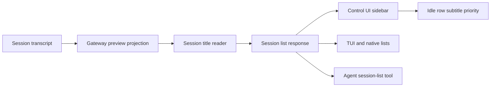

Codex review: needs maintainer review before merge. _Reviewed August 17, 2026, 3:24 AM ET / 07:24 UTC._

# ClawSweeper review

## What this changes

The branch converts shared session-list previews from Markdown to one-line prose and lets unread terminal observer digests take precedence over final replies in idle sidebar rows.

## Regression provenance

Possible regression — suspected (reviewed change). No predecessor PR is attributed.

## Merge readiness

⚠️ **Ready for maintainer review - 2 items remain**

Keep open for normal maintainer merge handling. The final head fixes the prior truncation-order finding and now applies the shared transformation at the Gateway producer used by both single and batched session-title reads.

**Priority:** P2
**Reviewed head:** `64e0766623a889987fb938da471ab8857b77bb01`

## Review scores

| Measure | Result | What it means |
|---|---|---|
| **Overall readiness** | 🐚 platinum hermit **(4/6)** | The corrected owner-boundary patch has focused regression coverage and no remaining discrete correctness finding. |
| **Proof confidence** | 🌊 off-meta tidepool | Not applicable: This is a maintainer-authored PR, so external-contributor proof gating does not apply; the PR body nevertheless provides before/after Gateway and sidebar evidence. |
| **Patch quality** | 🐚 platinum hermit **(4/6)** | No actionable review findings were identified. |

## Verification

| Check | Result | Evidence |
|---|---|---|
| **Real behavior** | Not applicable | Not applicable: This is a maintainer-authored PR, so external-contributor proof gating does not apply; the PR body nevertheless provides before/after Gateway and sidebar evidence. |
| **Evidence reviewed** | 6 items | Owner-boundary repair: The final head flattens Markdown before the 240-character bound in the common projection, and the transcript title reader opts into that behavior only for the last-message preview. Shared consumers: The Gateway sessions-list path copies the derived preview into response rows, while the sessions-list tool independently reads the same title fields; this is a producer-level fix rather than a Control UI-only workaround. Prior blocker resolved: The diff from the prior reviewed head replaces truncation-before-flattening with flattening-before-truncation and adds a cap-crossing link regression test. |
| **Findings** | None | None. |
| **Security** | None | None. |

## How this fits together

Gateway transcript readers derive `lastMessagePreview` for session-list responses, which feed the Control UI, TUI, native clients, and the agent session-list tool. The Control UI then selects the highest-priority status, digest, or preview for an idle session row.

## Before merge

- [ ] **Resolve merge risk (P1)** - `lastMessagePreview` changes from raw Markdown to display prose for all session-list consumers; this is the intended contract, but integrations that treated it as raw transcript text will observe a content change.
- [ ] **Complete next step (P2)** - The patch is technically ready for ordinary maintainer review, but the maintainer-authored/protected item must not enter automated cleanup.

<strong>Agent review details</strong>

### Security

None.

### PR surface

Source +23, Tests +154, Config +8. Total +185 across 14 files.

View PR surface stats

| Area | Files | Added | Removed | Net |
|---|---:|---:|---:|---:|
| Source | 7 | 42 | 19 | +23 |
| Tests | 5 | 171 | 17 | +154 |
| Docs | 0 | 0 | 0 | 0 |
| Config | 2 | 9 | 1 | +8 |
| Generated | 0 | 0 | 0 | 0 |
| Other | 0 | 0 | 0 | 0 |
| **Total** | **14** | **222** | **37** | **+185** |

### Review metrics

| Metric | Value | Why it matters |
|---|---|---|
| **Production versus test LOC** | production +51/-20; tests +171/-17 | This bug fix adds a shared helper and package/export wiring while replacing the prior private UI implementation; the positive production delta should remain limited to that shared owner boundary. |

### Stored data model

Persistent data-model change detected: `migration/backfill/repair: ui/src/e2e/chat-flow.sidebar-presentation.e2e.test.ts`, `serialized state: src/gateway/session-display-projection.test.ts`, `serialized state: src/gateway/session-display-projection.ts`, `serialized state: src/gateway/session-transcript-title-reader.markdown.test.ts`, `serialized state: src/gateway/session-transcript-title-reader.ts`, `serialized state: ui/src/components/session-row-subtitle.test.ts`, and 2 more. Confirm migration or upgrade compatibility proof before merge.

### Merge-risk options

**Maintainer options:**
1. **Validate the display-preview contract (recommended)**  
   Run the exact-head Gateway, normalization-core export, and Control UI checks to confirm consumers accept the intentional raw-Markdown-to-prose response change.
2. **Accept the display-only conversion**  
   Land with the stated compatibility change if maintainers confirm `lastMessagePreview` is a display field rather than a raw-transcript contract.

### Technical review

Best possible solution:

Keep raw transcript content in transcript readers and make `lastMessagePreview` the canonical bounded prose display field at the Gateway producer, with exact-head validation of its package export and session-list consumers.

Do we have a high-confidence way to reproduce the issue?

Yes—source reproducible: current main passes the final transcript message through the shared projection without Markdown flattening, then exposes it through session-list fields consumed as display text. No local execution was run because this review is read-only.

Is this the best way to solve the issue?

Yes—the Gateway producer is the narrowest shared owner, and the final head covers both cached single and batched paths. The existing general Markdown projector is unsuitable because it preserves code-block content that these previews must omit.

AGENTS.md: found and applied where relevant.

Codex review notes: model internal, reasoning high; reviewed against [ab143955aa43](https://github.com/openclaw/openclaw/commit/ab143955aa43f2f3a29dd7a28cf93854b23cb163).

### Labels

Label changes:

- add `rating: 🐚 platinum hermit`: Overall readiness is 🐚 platinum hermit; proof is 🌊 off-meta tidepool and patch quality is 🐚 platinum hermit.
- add `status: 👀 ready for maintainer look`: ClawSweeper has no concrete contributor-facing blocker left for this PR. Not applicable: This is a maintainer-authored PR, so external-contributor proof gating does not apply; the PR body nevertheless provides before/after Gateway and sidebar evidence.
- remove `rating: 🦐 gold shrimp`: Current PR rating is `rating: 🐚 platinum hermit`, so this older rating label is no longer current.
- remove `status: ⏳ waiting on author`: Current PR status label is `status: 👀 ready for maintainer look`.

Label justifications:

- `P2`: The PR fixes a bounded, user-visible session-list presentation defect without evidence of urgent runtime, data, or security impact.
- `merge-risk: 🚨 compatibility`: The Gateway changes the content representation of an existing session-list response field used by multiple clients.
- `rating: 🐚 platinum hermit`: Overall readiness is 🐚 platinum hermit; proof is 🌊 off-meta tidepool and patch quality is 🐚 platinum hermit.
- `status: 👀 ready for maintainer look`: ClawSweeper has no concrete contributor-facing blocker left for this PR. Not applicable: This is a maintainer-authored PR, so external-contributor proof gating does not apply; the PR body nevertheless provides before/after Gateway and sidebar evidence.

### Evidence

What I checked:

- **Owner-boundary repair:** The final head flattens Markdown before the 240-character bound in the common projection, and the transcript title reader opts into that behavior only for the last-message preview. ([`src/gateway/session-display-projection.ts:64`](https://github.com/openclaw/openclaw/blob/64e0766623a8/src/gateway/session-display-projection.ts#L64), [64e0766623a8](https://github.com/openclaw/openclaw/commit/64e0766623a8))
- **Shared consumers:** The Gateway sessions-list path copies the derived preview into response rows, while the sessions-list tool independently reads the same title fields; this is a producer-level fix rather than a Control UI-only workaround. ([`src/gateway/session-utils-list.ts:605`](https://github.com/openclaw/openclaw/blob/ab143955aa43/src/gateway/session-utils-list.ts#L605), [ab143955aa43](https://github.com/openclaw/openclaw/commit/ab143955aa43))
- **Prior blocker resolved:** The diff from the prior reviewed head replaces truncation-before-flattening with flattening-before-truncation and adds a cap-crossing link regression test. ([`src/gateway/session-display-projection.test.ts:47`](https://github.com/openclaw/openclaw/blob/799a66d7f417/src/gateway/session-display-projection.test.ts#L47), [799a66d7f417](https://github.com/openclaw/openclaw/commit/799a66d7f417))
- **Single and batch coverage:** The new reader test checks Markdown flattening and fenced-code fallback through both single and batched title-reader paths while retaining Markdown in first-user titles. ([`src/gateway/session-transcript-title-reader.markdown.test.ts:48`](https://github.com/openclaw/openclaw/blob/64e0766623a8/src/gateway/session-transcript-title-reader.markdown.test.ts#L48), [64e0766623a8](https://github.com/openclaw/openclaw/commit/64e0766623a8))
- **Feature provenance:** Current main introduced the shared bounded display projection in the session refactor; the history identifies the same area as the likely ownership route. ([`src/gateway/session-display-projection.ts:42`](https://github.com/openclaw/openclaw/blob/4e1f26dc1892/src/gateway/session-display-projection.ts#L42), [4e1f26dc1892](https://github.com/openclaw/openclaw/commit/4e1f26dc1892))
- **Existing-helper check:** The existing shared Markdown projector retains fenced-code contents, whereas this preview contract intentionally drops fenced content so a code-only last message falls through to the prior displayable message. ([`src/shared/text/strip-markdown.ts:110`](https://github.com/openclaw/openclaw/blob/ab143955aa43/src/shared/text/strip-markdown.ts#L110), [ab143955aa43](https://github.com/openclaw/openclaw/commit/ab143955aa43))

Likely related people:

- **steipete:** Peter Steinberger authored the current-main refactor that introduced the bounded session display projection, and this PR continues that same ownership area. (role: introduced the shared display-projection area; confidence: high; commits: [4e1f26dc1892](https://github.com/openclaw/openclaw/commit/4e1f26dc18920d8ce9cd01cf000e7908fb5d1209), [799a66d7f417](https://github.com/openclaw/openclaw/commit/799a66d7f417599c0277efe2f2c6c57fdffc61e5); files: `src/gateway/session-display-projection.ts`, `src/gateway/session-transcript-title-reader.ts`, `ui/src/components/session-row-subtitle.ts`)

### Rank-up moves

Optional improvements that raise the rating; they are not merge blockers.

- Complete the exact-head Gateway, normalization-core export, and Control UI checks before merge.

### Rating scale

| Score | Internal tier | Crab rank | Meaning |
|---:|:---:|---|---|
| **6/6** | S | 🦀 challenger crab | Exceptional readiness |
| **5/6** | A | 🦞 diamond lobster | Very strong readiness |
| **4/6** | B | 🐚 platinum hermit | Good normal PR; ordinary maintainer review |
| **3/6** | C | 🦐 gold shrimp | Useful, but confidence is limited |
| **2/6** | D | 🦪 silver shellfish | Proof or implementation needs work |
| **1/6** | F | 🧂 unranked krab | Not merge-ready |
| N/A | NA | 🌊 off-meta tidepool | Rating does not apply |

Overall follows the weaker of proof and patch quality.
Shiny media proof means a screenshot, video, or linked artifact directly shows the changed behavior. Runtime, network, CSP, and security claims still need visible diagnostics.

### Workflow

- ClawSweeper keeps one durable marker-backed review comment per issue or PR.
- Re-runs edit this comment so the latest verdict, findings, and automation markers stay together instead of adding duplicate bot comments.
- A fresh review can be triggered by eligible `@clawsweeper re-review` comments, exact-item GitHub events, scheduled/background review runs, or manual workflow dispatch.
- PR/issue authors and users with repository write access can comment `@clawsweeper re-review` or `@clawsweeper re-run` on an open PR or issue to request a fresh review only.
- Maintainers can also comment `@clawsweeper review` to request a fresh review only.
- Fresh-review commands do not start repair, autofix, rebase, CI repair, or automerge.
- Maintainer-only repair and merge flows require explicit commands such as `@clawsweeper autofix`, `@clawsweeper automerge`, `@clawsweeper fix ci`, or `@clawsweeper address review`.
- Maintainers can comment `@clawsweeper explain` to ask for more context, or `@clawsweeper stop` to stop active automation.

### History

Review history (3 earlier review cycles)

<!-- clawsweeper-review-history v=1 total=3 -->
- reviewed 2026-08-17T06:35:57.371Z sha 72ee199f9880b5ef9139029166f504515fa43ffc :: found issues before merge. :: [P2] Preserve literal punctuation in session previews
- reviewed 2026-08-17T06:52:57.249Z sha c7f6cee31c7a50e60d4e18f6141358750285d5bb :: found issues before merge. :: [P2] Preserve literal punctuation in session previews
- reviewed 2026-08-17T07:03:15.906Z sha b94c4dd1666a041554180a51b33bca838023aaa7 :: found issues before merge. :: [P2] Flatten previews before applying the character cap

<!-- clawsweeper-verdict:needs-human item=125113 sha=64e0766623a889987fb938da471ab8857b77bb01 confidence=high updated_at=2026-08-17T07:21:04Z reviewed_at=2026-08-17T07:24:18.026Z lease_owner=github-run-32005288883-1 lease_comment_id=5313044004 source_revision=d89682d38c661aa450f481ba2c6c9afcc5443a247606ba5e7141eee2bd0e3e71 -->

<!-- clawsweeper-review-version item=125113 reviewed_at=2026-08-17T07:24:18.026Z sha=64e0766623a889987fb938da471ab8857b77bb01 source_revision=d89682d38c661aa450f481ba2c6c9afcc5443a247606ba5e7141eee2bd0e3e71 lease_owner=github-run-32005288883-1 lease_comment_id=5313044004 v=1 -->

<!-- clawsweeper-review item=125113 -->