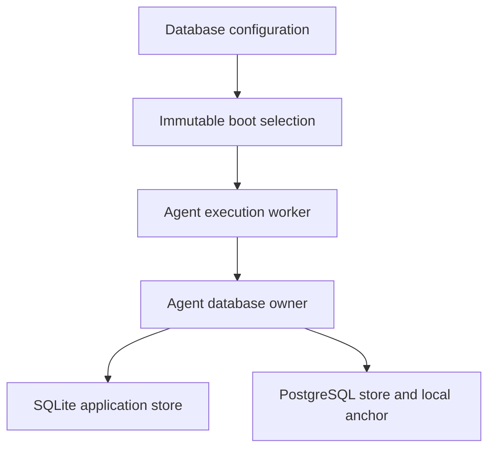

Codex review: blocked before merge.

## What this changes

This PR routes agent databases, transcripts, and agent auth storage through the database engine selected at boot.

**Example:** Create agent main in a fresh state directory with database.engine set to postgres.
- **Before:** The agent database still stores application rows in native SQLite.
- **After:** Application rows use PostgreSQL while a local SQLite anchor retains physical identity.

## Review scores

| Measure | Result | What it means |
|---|---|---|
| **Overall readiness** | 🦪 silver shellfish **(2/6)** | Useful production-owner conformance coverage supports the design, but concrete PostgreSQL failures and incomplete existing-state compatibility prevent merge readiness. |
| **Proof confidence** | 🦐 gold shrimp **(3/6)** | This maintainer-authored PR is outside the ordinary contributor proof gate; its PostgreSQL 17 conformance evidence exercises real agent owners, auth reads, persistence, and worker FIFO, but existing-state compatibility still needs a v2026.10.3 SQLite upgrade preserving auth and transcripts. |
| **Patch quality** | 🦪 silver shellfish **(2/6)** | 4 actionable review findings remain. |

## Product

**Kind:** Feature · **Worth it:** Yes · **Fix scope:** Complete
**User problem:** Selecting PostgreSQL still leaves agent transcripts and agent auth data in SQLite.
**Reason:** The maintainer-authored direction completes an existing engine contract and explicitly documents its experimental limits.

## Merge readiness

⛔ **Blocked before merge - 5 items remain**

Keep this PR open: the approved engine cutover is useful, but four reachable PostgreSQL failures block merging.

**Priority:** P2
**Reviewed head:** `b5e9fe28a2938e197fd09b45f4d54aefb115c048`

## Before merge

- [ ] **Route Doctor ownership revalidation through the agent worker (P1)** - With PostgreSQL selected, any main-thread call requesting revalidateSchema bypasses the cached-metadata return and throws outside the existing inspection error handler. Doctor's stale-auth-order scanner makes exactly this request for existing agent auth databases, so reaching that inspection aborts the scan instead of returning ownership facts. Migrate those callers to asynchronous worker inspection before rejecting synchronous revalidation.
- [ ] **Prepare local capability auth ownership in a worker (P2)** - prepareLocalCapabilityAccountSecrets calls this function on the main thread for local model, image, and audio execution. The new PostgreSQL branch calls openOpenClawAgentDatabaseReadOnly, which immediately asserts worker execution before even checking for a missing database. Consequently these commands throw before preparing credentials whenever PostgreSQL is selected. Use the existing asynchronous agent owner or prepared ownership facts.
- [ ] **Port run-input visibility SQL to the selected engine (P2)** - This helper now accepts PostgreSQL connections, and the production history reader invokes it when resolving run-message visibility, but its projection still calls SQLite json_object and json_extract. The retained-position expansion also uses SQLite-shaped json_each. Such history requests fail with PostgreSQL function/type errors instead of returning messages. Build these expressions through the existing engine JSON and set-expansion helpers.
- [ ] **Allow schema-seal refresh during existing-only admission (P2)** - For a cold existing-only agent open, the empty PostgreSQL migration list sets admitExistingOnly and starts a read-only outer transaction. After a PostgreSQL major upgrade, or with unsealed metadata, admit(false) reaches verifyAndRecordPostgresSchema, which creates a scratch schema and updates openclaw_schema_meta. Those writes are forbidden by the outer transaction, so a valid store cannot be admitted through this read path. Preserve writable seal-refresh custody or make this verification path non-mutating.
- [ ] **Add data-model compatibility proof** - The review found that existing stored data may not work after upgrade. Show that existing data still loads and works with this change.

## Findings

- [P1] Route Doctor ownership revalidation through the agent worker — `src/state/openclaw-agent-db-lifecycle.ts:569-574`
- [P2] Prepare local capability auth ownership in a worker — `src/agents/auth-profiles/sqlite.ts:201-202`
- [P2] Port run-input visibility SQL to the selected engine — `src/config/sessions/session-accessor.sqlite-history-input-visibility.ts:22-24`

### Tests

- Missing end-to-end proof: No latest-stable upgrade run or base-fail/head-pass regression for the four failing PostgreSQL paths is supplied.

<strong>Agent review details</strong>

### How this fits together

The agent database owner receives boot engine selection and worker admission, opens the selected store, and serves transcript, auth, and session operations through existing execution workers.

### Technical review

Best possible solution:

Complete the cutover through existing worker owners and engine SQL helpers while preserving SQLite upgrades and PostgreSQL seal refresh.

Do we have a high-confidence way to reproduce the issue?

The introduced source establishes the four failure paths; no target code was executed during this read-only review.

Is this the best way to solve the issue?

Reusing the existing agent owner and engine boundary is appropriate, but widening connection types must include every affected caller and SQL dialect.

Full review comments:

- [P1] Route Doctor ownership revalidation through the agent worker — `src/state/openclaw-agent-db-lifecycle.ts:569-574`
  With PostgreSQL selected, any main-thread call requesting revalidateSchema bypasses the cached-metadata return and throws outside the existing inspection error handler. Doctor's stale-auth-order scanner makes exactly this request for existing agent auth databases, so reaching that inspection aborts the scan instead of returning ownership facts. Migrate those callers to asynchronous worker inspection before rejecting synchronous revalidation.
  Confidence: 0.97
- [P2] Prepare local capability auth ownership in a worker — `src/agents/auth-profiles/sqlite.ts:201-202`
  prepareLocalCapabilityAccountSecrets calls this function on the main thread for local model, image, and audio execution. The new PostgreSQL branch calls openOpenClawAgentDatabaseReadOnly, which immediately asserts worker execution before even checking for a missing database. Consequently these commands throw before preparing credentials whenever PostgreSQL is selected. Use the existing asynchronous agent owner or prepared ownership facts.
  Confidence: 0.99
- [P2] Port run-input visibility SQL to the selected engine — `src/config/sessions/session-accessor.sqlite-history-input-visibility.ts:22-24`
  This helper now accepts PostgreSQL connections, and the production history reader invokes it when resolving run-message visibility, but its projection still calls SQLite json_object and json_extract. The retained-position expansion also uses SQLite-shaped json_each. Such history requests fail with PostgreSQL function/type errors instead of returning messages. Build these expressions through the existing engine JSON and set-expansion helpers.
  Confidence: 0.99
- [P2] Allow schema-seal refresh during existing-only admission — `src/infra/database-engine/open.ts:184-186`
  For a cold existing-only agent open, the empty PostgreSQL migration list sets admitExistingOnly and starts a read-only outer transaction. After a PostgreSQL major upgrade, or with unsealed metadata, admit(false) reaches verifyAndRecordPostgresSchema, which creates a scratch schema and updates openclaw_schema_meta. Those writes are forbidden by the outer transaction, so a valid store cannot be admitted through this read path. Preserve writable seal-refresh custody or make this verification path non-mutating.
  Confidence: 0.99

Overall correctness: patch is incorrect
Overall confidence: 0.97

AGENTS.md: found and applied where relevant.

Codex review notes: model internal, reasoning medium; reviewed against [26da73bf2aa8](https://github.com/openclaw/openclaw/commit/26da73bf2aa83c89f2f806bb84ff9134b033549c).

### Provenance checked

- `Agent admission and lifecycle` keeps the original intent (b8b094b57a113f676ce8f76e77a93e5638d2701a: The earlier worker cutover admitted agent databases off the main thread while preserving physical identity, leases, revocation, and cleanup.)
- `PostgreSQL schema verification` changes intended behavior with a stated reason (e3b8a282764d3eebcb331f1eabccf13e459a2232: Exact catalog admission deliberately refreshes seals through temporary DDL after server-major changes or for unsealed stores.)
- `Transcript query portability` keeps the original intent (93e8fe353765072d576d2379f6c8b0a57fce343b: Shared engine helpers were introduced to preserve SQLite behavior while making transcript readers executable on PostgreSQL.)
- `Run-input history visibility` keeps the original intent (b9948b13604a4921d33f31daf94dc26941a61920: The existing reader resolves originating inputs before expensive marker projection while preserving hidden-input and steering behavior.)

### Testing

Proof path: in-process harness.

### Security

None.

### Evidence

What I checked:

- **Pinned introduction and current-main behavior:** The introduced diff is 656a3fa8d4c67ac0b4983e8b92ffbfb7a54edac3..b5e9fe28a2938e197fd09b45f4d54aefb115c048. Fetched main still opens native agent storage; this PR supplies the runtime cutover. ([`src/state/openclaw-agent-db.ts:355`](https://github.com/openclaw/openclaw/blob/26da73bf2aa83c89f2f806bb84ff9134b033549c/src/state/openclaw-agent-db.ts#L355), [26da73bf2aa8](https://github.com/openclaw/openclaw/commit/26da73bf2aa83c89f2f806bb84ff9134b033549c))
- **Doctor ownership revalidation:** The new PostgreSQL main-thread branch throws whenever revalidateSchema is requested; Doctor's stale-auth-order scanner requests that option for existing agent databases. ([`src/state/openclaw-agent-db-lifecycle.ts:569`](https://github.com/openclaw/openclaw/blob/b5e9fe28a2938e197fd09b45f4d54aefb115c048/src/state/openclaw-agent-db-lifecycle.ts#L569), [b5e9fe28a293](https://github.com/openclaw/openclaw/commit/b5e9fe28a2938e197fd09b45f4d54aefb115c048))
- **Local capability ownership probe:** prepareLocalCapabilityAccountSecrets calls the synchronous ownership probe, whose new PostgreSQL branch invokes a reader that rejects main-thread execution before checking whether the database exists. ([`src/agents/auth-profiles/sqlite.ts:202`](https://github.com/openclaw/openclaw/blob/b5e9fe28a2938e197fd09b45f4d54aefb115c048/src/agents/auth-profiles/sqlite.ts#L202), [b5e9fe28a293](https://github.com/openclaw/openclaw/commit/b5e9fe28a2938e197fd09b45f4d54aefb115c048))
- **History dialect gap:** The newly widened run-input visibility helper retains SQLite json_object, json_extract, and json_each expressions and is called by the production session-history reader. ([`src/config/sessions/session-accessor.sqlite-history-input-visibility.ts:22`](https://github.com/openclaw/openclaw/blob/b5e9fe28a2938e197fd09b45f4d54aefb115c048/src/config/sessions/session-accessor.sqlite-history-input-visibility.ts#L22), [b5e9fe28a293](https://github.com/openclaw/openclaw/commit/b5e9fe28a2938e197fd09b45f4d54aefb115c048))
- **Read-only admission conflicts with seal refresh:** Existing-only bootstrap admission now starts a read-only transaction, while unsealed or server-major-changed metadata reaches verifyAndRecordPostgresSchema, which creates a scratch schema and updates metadata. ([`src/infra/database-engine/open.ts:184`](https://github.com/openclaw/openclaw/blob/b5e9fe28a2938e197fd09b45f4d54aefb115c048/src/infra/database-engine/open.ts#L184), [b5e9fe28a293](https://github.com/openclaw/openclaw/commit/b5e9fe28a2938e197fd09b45f4d54aefb115c048))
- **Existing discussion independently checked:** The four source-confirmed concerns were also raised in the existing Codex connector review: https://github.com/openclaw/openclaw/pull/173462#discussion_r4288236576, https://github.com/openclaw/openclaw/pull/173462#discussion_r4288236592, https://github.com/openclaw/openclaw/pull/173462#discussion_r4288236600, and https://github.com/openclaw/openclaw/pull/173462#discussion_r4288236607. ([b5e9fe28a293](https://github.com/openclaw/openclaw/commit/b5e9fe28a2938e197fd09b45f4d54aefb115c048))

### PR surface

PR surface statistics unavailable: the file list is incomplete.

### Labels

Label changes:

- add `P2`: This extends an experimental backend with meaningful storage value and limited current exposure.
- add `merge-risk: 🚨 compatibility`: The changed admission paths can reject valid existing PostgreSQL stores and break Doctor ownership inspection.
- add `merge-risk: 🚨 auth-provider`: Local capability commands reach a PostgreSQL ownership probe that throws before credential preparation.
- add `rating: 🦪 silver shellfish`: Overall readiness is 🦪 silver shellfish; proof is 🦐 gold shrimp and patch quality is 🦪 silver shellfish.
- add `status: ⏳ waiting on author`: ClawSweeper has contributor-facing work open and is waiting for author action.

Label justifications:

- `P2`: This extends an experimental backend with meaningful storage value and limited current exposure.
- `merge-risk: 🚨 compatibility`: The changed admission paths can reject valid existing PostgreSQL stores and break Doctor ownership inspection.
- `merge-risk: 🚨 auth-provider`: Local capability commands reach a PostgreSQL ownership probe that throws before credential preparation.
- `rating: 🦪 silver shellfish`: Overall readiness is 🦪 silver shellfish; proof is 🦐 gold shrimp and patch quality is 🦪 silver shellfish.
- `status: ⏳ waiting on author`: ClawSweeper has contributor-facing work open and is waiting for author action.

### Rating scale

6/6 🦀 challenger crab · 5/6 🦞 diamond lobster · 4/6 🐚 platinum hermit · 3/6 🦐 gold shrimp · 2/6 🦪 silver shellfish · 1/6 🧂 unranked krab. Overall follows the weaker of proof and patch quality; ✨ marks media proof (a screenshot, video, or linked artifact) that directly shows the changed behavior.

### Workflow

ClawSweeper edits this one comment on every review. Comment `@clawsweeper re-review` for a fresh review only. Repair and merge execution lanes are retired.

_Reviewed October 15, 2026, 5:13 PM ET / 21:13 UTC._

<!-- clawsweeper-verdict:needs-human item=173462 sha=b5e9fe28a2938e197fd09b45f4d54aefb115c048 confidence=high updated_at=2026-10-15T21:06:43Z reviewed_at=2026-10-15T21:13:41.581Z lease_owner=github-run-38807171337-1 lease_comment_id=6202282100 source_revision=2dd24bfe1f8482385e4cae8d56a7379c5b46bce0a8d9dbf450c2c4975eb672a0 hold=blocked findings=4 -->
<!-- clawsweeper-review-state:blocked item=173462 sha=b5e9fe28a2938e197fd09b45f4d54aefb115c048 v=1 -->

<!-- clawsweeper-review-version item=173462 reviewed_at=2026-10-15T21:13:41.581Z sha=b5e9fe28a2938e197fd09b45f4d54aefb115c048 source_revision=2dd24bfe1f8482385e4cae8d56a7379c5b46bce0a8d9dbf450c2c4975eb672a0 lease_owner=github-run-38807171337-1 lease_comment_id=6202282100 v=1 -->

<!-- clawsweeper-review item=173462 -->