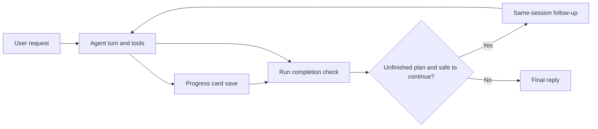

Codex review: needs changes before merge. _Reviewed September 28, 2026, 12:15 PM ET / 16:15 UTC (Revision 12)._

# ClawSweeper review

## What this changes

The built-in agent now checks a newly saved unfinished progress-card plan once before ending, with session lifecycle tests, a Doctor test-fixture adjustment, and documentation.

## Merge readiness

⛔ **Needs changes before merge - 1 item remains**

Current main still lacks a completion check for an unfinished plan saved during the active run. The branch addresses a distinct agent behavior, and this review found no actionable patch defect.

**Priority:** P2
**Reviewed head:** `565329e3000f0c0b78b729f6638c781a743c1e68`

## Review scores

| Measure | Result | What it means |
|---|---|---|
| **Overall readiness** | 🦐 gold shrimp **(3/6)** | Cross-component tests support a coherent patch, while the visible continuation has not been observed in a real chat. |
| **Proof confidence** | 🦐 gold shrimp **(3/6)** | Not applicable: The bot-authored PR is exempt from the external contributor proof gate. The changed built-in terminal path has reported registered-tool and session tests with provider and Gateway stand-ins, but no live chat observation; no stored-data format changes. |
| **Patch quality** | 🐚 platinum hermit **(4/6)** | No actionable review findings were identified. |

## Verification

| Check | Result | Evidence |
|---|---|---|
| **Real behavior** | Not applicable | Not applicable: The bot-authored PR is exempt from the external contributor proof gate. The changed built-in terminal path has reported registered-tool and session tests with provider and Gateway stand-ins, but no live chat observation; no stored-data format changes. |
| **Evidence reviewed** | 9 items | Current-main behavior: The fetched main revision has terminal retry state but no run-local plan completion state; its terminal hook is selected only for an existing finalize hook. A normal final answer does not consult a newly saved plan.<br>Committed-plan observation: The progress-card tool reports whether the Gateway's successful replacement result still contains unfinished steps; a rejected write cannot update this run-local fact.<br>Bounded terminal decision: The check requires a normal stop, an unfinished plan and a live registration; it excludes cancellation, queued input, pending handoffs and an already consumed check before queuing the follow-up. |
| **Findings** | None | None. |
| **Security** | None | None. |

## How this fits together

The built-in agent runs model turns and tools inside a session, while the Gateway stores progress cards for that session. Before delivering a normal final reply, the agent can queue one follow-up turn using the same session and completed tool results.



## Before merge

- [ ] **Complete next step (P2)** - Reconcile the exact-head Control UI E2E failure through the native landing gate; use the inherited-red exception only if a matching current-main failure is verified.


<details>
<summary><strong>Agent review details</strong></summary>

### Security

None.

### PR surface

Source +122, Tests +483, Docs +20. Total +625 across 24 files.

<details>
<summary>View PR surface stats</summary>

| Area | Files | Added | Removed | Net |
|---|---:|---:|---:|---:|
| Source | 15 | 247 | 125 | +122 |
| Tests | 8 | 496 | 13 | +483 |
| Docs | 1 | 20 | 0 | +20 |
| Config | 0 | 0 | 0 | 0 |
| Generated | 0 | 0 | 0 | 0 |
| Other | 0 | 0 | 0 | 0 |
| **Total** | **24** | **763** | **138** | **+625** |

</details>

### Review metrics

| Metric | Value | Why it matters |
|---|---|---|
| **Production versus test code** | production +247/-125, tests +496/-13 | The net runtime growth implements one bounded continuation through existing owners; the larger test addition covers session and tool boundaries. |
| **Completion regression cost** | 20 cases; 59.02 s local one-worker wall | The PR reports that cold compilation contributes to the cost of its cross-component session coverage. |

### Mantis proof suggestion

A redacted web UI chat transcript could show whether the checkpoint remains visible and the continued turn delivers one final reply. A maintainer can ask Mantis to capture proof by posting this exact PR comment:

```text
@openclaw-mantis verify in web UI chat that a run saving an unfinished progress card shows its checkpoint, continues once, and delivers one final reply; return a redacted transcript and screenshots.
```

### Technical review

Best possible solution:

The built-in agent should reconcile a plan it saved during the current run before its final reply, while retaining completed effects, current authority and the one-check limit.

Do we have a high-confidence way to reproduce the issue?

Yes, at source level: a run can save an unfinished progress-card plan and then produce a normal final answer, which current main delivers without a plan check. I did not execute the scenario in this read-only review.

Is this the best way to solve the issue?

Yes. Observing successful saves and continuing once at the existing terminal boundary is a narrow way to address the stop while preserving the session and completed effects.

AGENTS.md: found and applied where relevant.

Codex review notes: model internal, reasoning high; reviewed against [f3556310d29d](https://github.com/openclaw/openclaw/commit/f3556310d29dfb545fe07c6f304ad4cae5450dac).

### Labels

Label changes:

- add `rating: 🦐 gold shrimp`: Overall readiness is 🦐 gold shrimp; proof is 🦐 gold shrimp and patch quality is 🐚 platinum hermit.
- remove `rating: 🐚 platinum hermit`: Current PR rating is `rating: 🦐 gold shrimp`, so this older rating label is no longer current.

Label justifications:

- `P2`: Prematurely ending an agent task is a meaningful workflow defect, but the report does not establish a broad or urgent current-user outage.
- `rating: 🦐 gold shrimp`: Overall readiness is 🦐 gold shrimp; proof is 🦐 gold shrimp and patch quality is 🐚 platinum hermit.
- `status: 👀 ready for maintainer look`: ClawSweeper has no concrete contributor-facing blocker left for this PR. Not applicable: The bot-authored PR is exempt from the external contributor proof gate. The changed built-in terminal path has reported registered-tool and session tests with provider and Gateway stand-ins, but no live chat observation; no stored-data format changes.
- `proof: telegram-e2e`: This PR needs Telegram Test Server proof with the repository E2E skill. An eligible Telegram run can show a checkpoint followed by another agent reply after saving an unfinished plan, which the Test Server can observe.

### Evidence

What I checked:

- **Current-main behavior:** The fetched main revision has terminal retry state but no run-local plan completion state; its terminal hook is selected only for an existing finalize hook. A normal final answer does not consult a newly saved plan. ([`src/agents/embedded-agent-runner/run/terminal-retry-state.ts:3`](https://github.com/openclaw/openclaw/blob/f3556310d29dfb545fe07c6f304ad4cae5450dac/src/agents/embedded-agent-runner/run/terminal-retry-state.ts#L3), [f3556310d29d](https://github.com/openclaw/openclaw/commit/f3556310d29dfb545fe07c6f304ad4cae5450dac))
- **Committed-plan observation:** The progress-card tool reports whether the Gateway's successful replacement result still contains unfinished steps; a rejected write cannot update this run-local fact. ([`src/agents/tools/progress-card-tool.ts:64`](https://github.com/openclaw/openclaw/blob/565329e3000f0c0b78b729f6638c781a743c1e68/src/agents/tools/progress-card-tool.ts#L64), [565329e3000f](https://github.com/openclaw/openclaw/commit/565329e3000f0c0b78b729f6638c781a743c1e68))
- **Bounded terminal decision:** The check requires a normal stop, an unfinished plan and a live registration; it excludes cancellation, queued input, pending handoffs and an already consumed check before queuing the follow-up. ([`src/agents/embedded-agent-runner/run/attempt-stream-prepare.ts:269`](https://github.com/openclaw/openclaw/blob/565329e3000f0c0b78b729f6638c781a743c1e68/src/agents/embedded-agent-runner/run/attempt-stream-prepare.ts#L269), [565329e3000f](https://github.com/openclaw/openclaw/commit/565329e3000f0c0b78b729f6638c781a743c1e68))
- **Reply lifecycle:** The continuation branch flushes the checkpoint without emitting terminal lifecycle delivery, leaving final delivery to the follow-up turn. ([`src/agents/embedded-agent-subscribe.handlers.lifecycle.ts:357`](https://github.com/openclaw/openclaw/blob/565329e3000f0c0b78b729f6638c781a743c1e68/src/agents/embedded-agent-subscribe.handlers.lifecycle.ts#L357), [565329e3000f](https://github.com/openclaw/openclaw/commit/565329e3000f0c0b78b729f6638c781a743c1e68))
- **Scoped regression coverage:** The added session cases exercise direct and nested progress-card calls, a non-streamed attachment, same-prompt continuation and exactly-once execution. They use provider and Gateway stand-ins rather than a live chat transport. ([`src/agents/embedded-agent-runner/run/attempt-plan-completion.test.ts:32`](https://github.com/openclaw/openclaw/blob/565329e3000f0c0b78b729f6638c781a743c1e68/src/agents/embedded-agent-runner/run/attempt-plan-completion.test.ts#L32), [565329e3000f](https://github.com/openclaw/openclaw/commit/565329e3000f0c0b78b729f6638c781a743c1e68))
- **Prior concern addressed:** The discussion identifies the earlier attachment-loss concern and the added non-streamed session case. The previous completed review of this same head retained no findings.

Likely related people:

- **Peter Steinberger:** Suggested for follow-up; no historical authorship or introduction is verified. (role: unverified routing candidate; confidence: low)
- **Ayaan Zaidi:** Suggested for follow-up; no historical authorship or introduction is verified. (role: unverified routing candidate; confidence: low)

### Rank-up moves

Optional improvements that raise the rating; they are not merge blockers.

- Capture a redacted Telegram Test Server or web UI chat transcript showing one continuation and one final reply after an unfinished plan save.

### Rating scale

| Score | Internal tier | Crab rank | Meaning |
|---:|:---:|---|---|
| **6/6** | S | 🦀 challenger crab | Exceptional readiness |
| **5/6** | A | 🦞 diamond lobster | Very strong readiness |
| **4/6** | B | 🐚 platinum hermit | Good normal PR; ordinary maintainer review |
| **3/6** | C | 🦐 gold shrimp | Useful, but confidence is limited |
| **2/6** | D | 🦪 silver shellfish | Proof or implementation needs work |
| **1/6** | F | 🧂 unranked krab | Not merge-ready |
| N/A | NA | 🌊 off-meta tidepool | Rating does not apply |

Overall follows the weaker of proof and patch quality.
Shiny media proof means a screenshot, video, or linked artifact directly shows the changed behavior. Runtime, network, CSP, and security claims still need visible diagnostics.

### Workflow

- ClawSweeper keeps one durable marker-backed review comment per issue or PR.
- Re-runs edit this comment so the latest verdict, findings, and automation markers stay together instead of adding duplicate bot comments.
- A fresh review can be triggered by eligible `@clawsweeper re-review` comments, exact-item GitHub events, scheduled/background review runs, or manual workflow dispatch.
- PR/issue authors and users with repository write access can comment `@clawsweeper re-review` or `@clawsweeper re-run` on an open PR or issue to request a fresh review only.
- Maintainers can also comment `@clawsweeper review` to request a fresh review only.
- Fresh-review commands do not start repair, autofix, rebase, CI repair, or automerge.
- Maintainer-only repair and merge flows require explicit commands such as `@clawsweeper autofix`, `@clawsweeper automerge`, `@clawsweeper fix ci`, or `@clawsweeper address review`.
- Maintainers can comment `@clawsweeper explain` to ask for more context, or `@clawsweeper stop` to stop active automation.

### History

<details>
<summary>Review history (11 earlier review cycles; latest 8 shown)</summary>

<!-- clawsweeper-review-history v=1 total=11 -->
- reviewed 2026-09-28T09:39:59.164Z sha 0d6a2dfcb76867e06c69be17ab8555bddb0919be :: needs maintainer review before merge. :: none
- reviewed 2026-09-28T11:00:16.012Z sha f6cefeca3a3d7b283efd8bd7d5e35f824919c345 :: blocked before merge. :: none
- reviewed 2026-09-28T11:15:31.172Z sha 056529ed65769bfdfe6d1f6adac7dcf6f3c25644 :: blocked before merge. :: none
- reviewed 2026-09-28T12:16:35.117Z sha 08fb91ee62350ddfd722309890b02d74dd1bd7c0 :: blocked before merge. :: none
- reviewed 2026-09-28T12:38:52.720Z sha 1d655af5090c19152bc79b4aa2150e0a1ea8b518 :: needs maintainer review before merge. :: none
- reviewed 2026-09-28T13:31:50.604Z sha 56bd7a06b0860d49ba1d13ff1981b5771f69e32f :: needs maintainer review before merge. :: none
- reviewed 2026-09-28T14:47:59.427Z sha 56bd7a06b0860d49ba1d13ff1981b5771f69e32f :: needs maintainer review before merge. :: none
- reviewed 2026-09-28T15:56:56.921Z sha 565329e3000f0c0b78b729f6638c781a743c1e68 :: needs maintainer review before merge. :: none

</details>

</details>

<!-- clawsweeper-verdict:needs-human item=160297 sha=565329e3000f0c0b78b729f6638c781a743c1e68 confidence=high updated_at=2026-09-28T16:09:50Z reviewed_at=2026-09-28T16:15:05.375Z lease_owner=github-run-36448714738-1 lease_comment_id=5873920850 source_revision=db10d06aeb47a1184b7f2080c6ed9661e23e5a4b57716be014339cb60f891e89 live_verification=absent -->
<!-- clawsweeper-review-state:needs-changes item=160297 sha=565329e3000f0c0b78b729f6638c781a743c1e68 v=1 -->

<!-- clawsweeper-review-version item=160297 reviewed_at=2026-09-28T16:15:05.375Z sha=565329e3000f0c0b78b729f6638c781a743c1e68 source_revision=db10d06aeb47a1184b7f2080c6ed9661e23e5a4b57716be014339cb60f891e89 lease_owner=github-run-36448714738-1 lease_comment_id=5873920850 v=1 -->

<!-- clawsweeper-review item=160297 -->