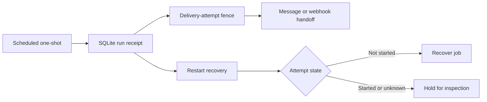

Codex review: blocked before merge. _Reviewed September 30, 2026, 9:15 PM ET / October 1, 2026, 01:15 UTC (Revision 27)._

# ClawSweeper review

## What this changes

The branch records delivery attempts in Cron's SQLite run receipts and carries that fence through message and webhook delivery so restart recovery replays only one-shot runs proven not to have started delivery.

> [!WARNING]
> **SQLite table change**
>
> This PR modifies persisted SQLite tables in `src/state/openclaw-state-schema.sql`. Prefer a design that avoids changing persisted SQLite tables. Migration or upgrade compatibility proof is recorded, but maintainers should still confirm that the schema change is necessary.

## Merge readiness

⛔ **Blocked before merge - 1 item remains**

Keep open. Current main still permits startup replay of an interrupted one-shot without a delivery-attempt check, so this PR remains useful. The previously missing schema-19 upgrade witness is now recorded for the reviewed head, and this review found no definite introduced defect. The exact-head CI gate remains failed after an Android test failure outside the changed paths.

**Priority:** P2
**Reviewed head:** `65862a058521a48eb2195e341e0a7cf89e434b68`

## Review scores

| Measure | Result | What it means |
|---|---|---|
| **Overall readiness** | 🐚 platinum hermit **(4/6)** | The receipt-owned implementation and upgrade/restart evidence are solid, with final recipient acceptance still simulated and exact-head CI incomplete. |
| **Proof confidence** | 🐚 platinum hermit **(4/6)** | Not applicable: The collaborator proof gate does not apply. For the reviewed head, the matching PR body records a published-updater schema-19→20 run, Doctor, and two Gateway starts with four ambiguous jobs held and one never-started control recovered; recipient transports were synthetic. The migrated receipt observations and focused downgrade/rollback tests support existing-state compatibility, although this review did not independently open the linked archive. |
| **Patch quality** | 🐚 platinum hermit **(4/6)** | No actionable review findings were identified. |

## Verification

| Check | Result | Evidence |
|---|---|---|
| **Real behavior** | Not applicable | Not applicable: The collaborator proof gate does not apply. For the reviewed head, the matching PR body records a published-updater schema-19→20 run, Doctor, and two Gateway starts with four ambiguous jobs held and one never-started control recovered; recipient transports were synthetic. The migrated receipt observations and focused downgrade/rollback tests support existing-state compatibility, although this review did not independently open the linked archive. |
| **Evidence reviewed** | 10 items | Current main still needs the fix: The fetched main revision passes startup mode directly as recoverInterruptedOneShot, without consulting a delivery-attempt state. Durable recovery rule: The introduced recovery code requires the exact receipt to read not-started; missing and legacy evidence resolves to unknown. New receipt claims explicitly start as not-started. Stored-state migration: Schema 20 adds one checked receipt column defaulting to unknown, while the worker commits started before delivery. This is a stored-data change, independently assessed for upgrade compatibility. |
| **Findings** | None | None. |
| **Security** | None | None. |

## How this fits together

Cron schedules jobs and stores run receipts in OpenClaw's shared SQLite state. On restart, those receipts guide whether the Gateway may retry a one-shot job; during execution, the Gateway and outbound dispatch use them before handing off messages or webhooks.

## Before merge

- [ ] **Review config compatibility** - Confirm compatibility and upgrade impact for the changed config or default surface before merge.

<strong>Agent review details</strong>

### Security

None.

### PR surface

PR surface statistics unavailable: the file list is incomplete.

### Review metrics

| Metric | Value | Why it matters |
|---|---|---|
| **Production versus test growth** | production +626 net lines; tests and test support +976 net lines | The production growth spans receipt migration, run authority, and final delivery handoff; the PR explains those boundaries as necessary for durable fencing. |
| **Stored-state contract** | schema 19→20; 1 receipt column added | Existing databases and older readers are affected, making the recorded published-updater witness material to review. |

### Stored data model

Persistent data-model change detected: `database schema: src/state/openclaw-state-schema.sql`, `migration/backfill/repair: scripts/pr-lib/wrapper-components.txt`, `migration/backfill/repair: src/state/openclaw-state-db-cron-delivery-migration.ts`, `migration/backfill/repair: src/state/openclaw-state-db-maintenance.ts`, `unknown-truncated-pull-files`. Migration or upgrade compatibility proof is recorded; maintainers should verify it before merge.

### Technical review

Best possible solution:

Keep the run receipt as the single durable attempt owner, replay only exact never-started one-shots, and present ambiguous interrupted jobs for recipient inspection before any manual retry.

Do we have a high-confidence way to reproduce the issue?

Yes at the source boundary: current main still replays interrupted one-shots without checking delivery attempts, and the PR records a frozen-main negative control that duplicated delivery. This review did not execute a current-main live-recipient reproduction.

Is this the best way to solve the issue?

Yes. Recording a monotonic attempt fact in the existing receipt and checking it at recovery and handoff is a coherent single-owner repair; the conservative Unknown outcome matches the accepted storage decision.

AGENTS.md: found and applied where relevant.

Codex review notes: model internal, reasoning high; reviewed against [b1b1f19f7d3a](https://github.com/openclaw/openclaw/commit/b1b1f19f7d3a82d62aa9fc4aad8f60c8cb154d0e).

### Labels

Label changes:

No label changes.

Label justifications:

- `P2`: Duplicate one-shot delivery is a concrete user-facing Cron defect with a bounded but meaningful delivery impact.
- `merge-risk: 🚨 compatibility`: Schema 20 changes older-reader admission and conservatively holds ambiguous legacy one-shots; the accepted tradeoff and upgrade witness bound that impact.
- `merge-risk: 🚨 message-delivery`: The new receipt state controls whether Cron announcements and webhooks can be sent or replayed after interruption.
- `rating: 🐚 platinum hermit`: Overall readiness is 🐚 platinum hermit; proof is 🐚 platinum hermit and patch quality is 🐚 platinum hermit.
- `status: 👀 ready for maintainer look`: ClawSweeper has no concrete contributor-facing blocker left for this PR. Not applicable: The collaborator proof gate does not apply. For the reviewed head, the matching PR body records a published-updater schema-19→20 run, Doctor, and two Gateway starts with four ambiguous jobs held and one never-started control recovered; recipient transports were synthetic. The migrated receipt observations and focused downgrade/rollback tests support existing-state compatibility, although this review did not independently open the linked archive.

### Evidence

What I checked:

- **Current main still needs the fix:** The fetched main revision passes startup mode directly as recoverInterruptedOneShot, without consulting a delivery-attempt state. ([`src/cron/store/run-recovery.kernel.ts:150`](https://github.com/openclaw/openclaw/blob/b1b1f19f7d3a82d62aa9fc4aad8f60c8cb154d0e/src/cron/store/run-recovery.kernel.ts#L150), [b1b1f19f7d3a](https://github.com/openclaw/openclaw/commit/b1b1f19f7d3a82d62aa9fc4aad8f60c8cb154d0e))
- **Durable recovery rule:** The introduced recovery code requires the exact receipt to read not-started; missing and legacy evidence resolves to unknown. New receipt claims explicitly start as not-started. ([`src/cron/store/run-recovery.kernel.ts:151`](https://github.com/openclaw/openclaw/blob/65862a058521a48eb2195e341e0a7cf89e434b68/src/cron/store/run-recovery.kernel.ts#L151), [65862a058521](https://github.com/openclaw/openclaw/commit/65862a058521a48eb2195e341e0a7cf89e434b68))
- **Stored-state migration:** Schema 20 adds one checked receipt column defaulting to unknown, while the worker commits started before delivery. This is a stored-data change, independently assessed for upgrade compatibility. ([`src/state/openclaw-state-schema.sql:1501`](https://github.com/openclaw/openclaw/blob/65862a058521a48eb2195e341e0a7cf89e434b68/src/state/openclaw-state-schema.sql#L1501), [65862a058521](https://github.com/openclaw/openclaw/commit/65862a058521a48eb2195e341e0a7cf89e434b68))
- **Final-effect authority:** The new run capability carries a delivery-attempt callback and current-run assertion into message actions; the Cron fence checks admission, reservation, cancellation, agent availability, and lifecycle before its worker mutation. ([`src/cron/run-admission.ts:100`](https://github.com/openclaw/openclaw/blob/65862a058521a48eb2195e341e0a7cf89e434b68/src/cron/run-admission.ts#L100), [65862a058521](https://github.com/openclaw/openclaw/commit/65862a058521a48eb2195e341e0a7cf89e434b68))
- **Restart and authority controls:** Focused tests cover accepted-then-lost acknowledgment, never-started recovery, repeated startup, and refusal before mocked platform sends after fence failure or revocation. The final recipients are simulated. ([`src/cron/service.restart-delivery.test.ts:39`](https://github.com/openclaw/openclaw/blob/65862a058521a48eb2195e341e0a7cf89e434b68/src/cron/service.restart-delivery.test.ts#L39), [65862a058521](https://github.com/openclaw/openclaw/commit/65862a058521a48eb2195e341e0a7cf89e434b68))
- **Accepted conservative recovery tradeoff:** A collaborator with repository admin access recorded acceptance of schema 19→20 and of holding legacy ambiguous or post-admission interrupted one-shots as Unknown, while explicitly retaining migration, rollback, and proof requirements. See https://github.com/openclaw/openclaw/pull/159873#issuecomment-5860085060.

Likely related people:

- **Peter Steinberger:** Suggested for follow-up; no historical authorship or introduction is verified. (role: unverified routing candidate; confidence: low)
- **Josh Avant:** Suggested for follow-up; no historical authorship or introduction is verified. (role: unverified routing candidate; confidence: low)

### Rating scale

| Score | Internal tier | Crab rank | Meaning |
|---:|:---:|---|---|
| **6/6** | S | 🦀 challenger crab | Exceptional readiness |
| **5/6** | A | 🦞 diamond lobster | Very strong readiness |
| **4/6** | B | 🐚 platinum hermit | Good normal PR; ordinary maintainer review |
| **3/6** | C | 🦐 gold shrimp | Useful, but confidence is limited |
| **2/6** | D | 🦪 silver shellfish | Proof or implementation needs work |
| **1/6** | F | 🧂 unranked krab | Not merge-ready |
| N/A | NA | 🌊 off-meta tidepool | Rating does not apply |

Overall follows the weaker of proof and patch quality.
Shiny media proof means a screenshot, video, or linked artifact directly shows the changed behavior. Runtime, network, CSP, and security claims still need visible diagnostics.

### Workflow

- ClawSweeper keeps one durable marker-backed review comment per issue or PR.
- Re-runs edit this comment so the latest verdict, findings, and automation markers stay together instead of adding duplicate bot comments.
- A fresh review can be triggered by eligible `@clawsweeper re-review` comments, exact-item GitHub events, scheduled/background review runs, or manual workflow dispatch.
- PR/issue authors and users with repository write access can comment `@clawsweeper re-review` or `@clawsweeper re-run` on an open PR or issue to request a fresh review only.
- Maintainers can also comment `@clawsweeper review` to request a fresh review only.
- Fresh-review commands do not start repair, autofix, rebase, CI repair, or automerge.
- Maintainer-only repair and merge flows require explicit commands such as `@clawsweeper autofix`, `@clawsweeper automerge`, `@clawsweeper fix ci`, or `@clawsweeper address review`.
- Maintainers can comment `@clawsweeper explain` to ask for more context, or `@clawsweeper stop` to stop active automation.

### History

Review history (26 earlier review cycles; latest 8 shown)

<!-- clawsweeper-review-history v=1 total=26 -->
- reviewed 2026-09-30T09:13:30.362Z sha 875c597535f5acb47ffdc4370fbe358e85ed04a5 :: blocked before merge. :: none
- reviewed 2026-09-30T09:37:05.337Z sha 875c597535f5acb47ffdc4370fbe358e85ed04a5 :: blocked before merge. :: none
- reviewed 2026-09-30T23:15:40.486Z sha 65862a058521a48eb2195e341e0a7cf89e434b68 :: blocked before merge. :: none
- reviewed 2026-09-30T23:33:35.474Z sha 65862a058521a48eb2195e341e0a7cf89e434b68 :: blocked before merge. :: none
- reviewed 2026-09-30T23:42:11.289Z sha 65862a058521a48eb2195e341e0a7cf89e434b68 :: blocked before merge. :: none
- reviewed 2026-10-01T00:12:09.118Z sha 65862a058521a48eb2195e341e0a7cf89e434b68 :: blocked before merge. :: none
- reviewed 2026-10-01T00:37:02.306Z sha 65862a058521a48eb2195e341e0a7cf89e434b68 :: blocked before merge. :: none
- reviewed 2026-10-01T00:54:06.446Z sha 65862a058521a48eb2195e341e0a7cf89e434b68 :: blocked before merge. :: none

<!-- clawsweeper-verdict:needs-human item=159873 sha=65862a058521a48eb2195e341e0a7cf89e434b68 confidence=high updated_at=2026-10-01T01:10:16Z reviewed_at=2026-10-01T01:15:04.588Z lease_owner=github-run-36799709631-1 lease_comment_id=5922680470 source_revision=13633e0b634792bd8b6c3340b9b38e2d7e879018b357e8dc2d752ccd6af5e6f3 live_verification=absent -->
<!-- clawsweeper-review-state:blocked item=159873 sha=65862a058521a48eb2195e341e0a7cf89e434b68 v=1 -->

<!-- clawsweeper-review-version item=159873 reviewed_at=2026-10-01T01:15:04.588Z sha=65862a058521a48eb2195e341e0a7cf89e434b68 source_revision=13633e0b634792bd8b6c3340b9b38e2d7e879018b357e8dc2d752ccd6af5e6f3 lease_owner=github-run-36799709631-1 lease_comment_id=5922680470 v=1 -->

<!-- clawsweeper-review item=159873 -->