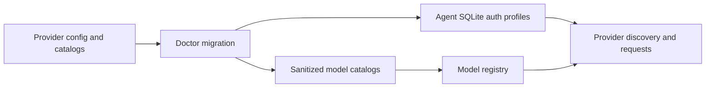

Codex review: found issues before merge. _Reviewed August 10, 2026, 4:06 AM ET / 08:06 UTC._

# ClawSweeper review

## What this changes

Migrates plaintext root and plugin model-catalog credentials into per-agent SQLite profiles, rewrites catalogs to profile references, and removes catalog keys from model request configuration.

## Merge readiness

⛔ **Blocked by patch quality or review findings - 10 items remain**

Keep open. Current main still permits catalog credentials, and this maintainer-owned rewrite addresses the earlier writer and outbound-auth gaps, but three concrete migration regressions block merge.

**Priority:** P1
**Reviewed head:** `c1eb078786a8aaacd80f58475e4e2324f4431623`

## Review scores

| Measure | Result | What it means |
|---|---|---|
| **Overall readiness** | 🧂 unranked krab **(1/6)** | The branch has a coherent goal but three P1 migration regressions make it unready to merge. |
| **Proof confidence** | 🌊 off-meta tidepool | Not applicable: Repository metadata identifies the author as a member, so the external-contributor proof gate does not apply; exact-head CI and focused migration regressions remain required. |
| **Patch quality** | 🧂 unranked krab **(1/6)** | Security review found an item that needs attention. |

## Verification

| Check | Result | Evidence |
|---|---|---|
| **Real behavior** | Not applicable | Not applicable: Repository metadata identifies the author as a member, so the external-contributor proof gate does not apply; exact-head CI and focused migration regressions remain required. |
| **Evidence reviewed** | 6 items | Current main still has the reported behavior: The planner serializes final root and plugin provider configurations directly, and the model registry stores catalog provider configuration for request auth. Existing test and docs define the legacy contract: Current tests expect a catalog-only key to be returned for request auth, while model documentation says a nonempty models.json apiKey wins in merge mode. Migrated config references are passed to discovery as literals: The branch rewrites configured apiKey values to profile IDs, but the provider discovery resolver checks configured strings before profile credentials and returns the string as its discovery key. |
| **Findings** | 3 actionable findings | [P1] Resolve migrated config profile IDs during discovery [P1] Preserve inherited profile references in worker catalogs [P1] Parse root catalogs with the runtime's JSON-comment rules |
| **Security** | Needs attention | Commented root catalogs evade credential migration: The migration parses root models.json with raw JSON.parse even though the runtime accepts comments and trailing commas, leaving plaintext credentials in a supported catalog format. |

## How this fits together

Model catalog generation combines configured and discovered provider metadata into root and plugin catalogs. Doctor migrates persisted catalog state, while model execution should obtain credentials only from the canonical auth-profile store.

## Before merge

- [ ] **Resolve migrated config profile IDs during discovery (P1)** - `rewriteConfigCredentials` writes a profile ID such as `provider:config`, but the discovery resolver checks the configured string before profiles and sends that ID as the discovery key. A migrated configured provider can therefore fail catalog discovery immediately after Doctor persists the config; resolve a valid profile reference before the literal-config path and add a Doctor-to-discovery regression.
- [ ] **Preserve inherited profile references in worker catalogs (P1)** - This reads only the worker's local store, although runtime auth merges inherited main profiles and gives local entries precedence. A worker catalog reference backed only by main is treated as plaintext, then written locally as the literal profile ID, overriding the inherited real credential; scan effective inherited references or leave them untouched.
- [ ] **Parse root catalogs with the runtime's JSON-comment rules (P1)** - ModelRegistry accepts comments and trailing commas in root `models.json`, but this raw `JSON.parse` only records a warning on the same valid file. Doctor then leaves its plaintext key in place, defeating the migration for a supported catalog format; share the runtime parser contract and cover a commented catalog.
- [ ] **Resolve security concern: Commented root catalogs evade credential migration** - The migration parses root models.json with raw JSON.parse even though the runtime accepts comments and trailing commas, leaving plaintext credentials in a supported catalog format.
- [ ] **Resolve merge risk (P1)** - Exact-head CI is still incomplete.
- [ ] **Resolve merge risk (P1)** - The migration adds 493 net production lines on a compatibility-sensitive credential path; the repaired upgrade cases need focused proof before merge.
- [ ] **Complete next step (P2)** - This protected, maintainer-owned PR needs its author or a maintainer to resolve the security-sensitive migration findings.
- [ ] **Improve patch quality** - Repair the three migration paths in the review findings.
- [ ] **Improve patch quality** - Add focused Doctor-to-discovery, inherited-worker, and commented-catalog regressions.
- [ ] **Improve patch quality** - Wait for exact-head CI to complete.

## Findings

- [P1] Resolve migrated config profile IDs during discovery — `src/commands/doctor-model-catalog-credentials.ts:249`
- [P1] Preserve inherited profile references in worker catalogs — `src/commands/doctor-model-catalog-credentials.ts:260`
- [P1] Parse root catalogs with the runtime's JSON-comment rules — `src/commands/doctor-model-catalog-credentials.ts:89`
- [high] Commented root catalogs evade credential migration — `src/commands/doctor-model-catalog-credentials.ts:89`

<strong>Agent review details</strong>

### Security

Needs attention: A supported commented root catalog can bypass migration and retain plaintext credentials.

### PR surface

Source +493, Tests +277. Total +770 across 10 files.

View PR surface stats

| Area | Files | Added | Removed | Net |
|---|---:|---:|---:|---:|
| Source | 5 | 566 | 73 | +493 |
| Tests | 5 | 290 | 13 | +277 |
| Docs | 0 | 0 | 0 | 0 |
| Config | 0 | 0 | 0 | 0 |
| Generated | 0 | 0 | 0 | 0 |
| Other | 0 | 0 | 0 | 0 |
| **Total** | **10** | **856** | **86** | **+770** |

### Review metrics

| Metric | Value | Why it matters |
|---|---|---|
| **Production vs test LOC** | production +493, tests +277 | The new migration owner and persistence flow need proportionate compatibility and upgrade validation. |

### Stored data model

Persistent data-model change detected: `migration/backfill/repair: src/commands/doctor-model-catalog-credentials.test.ts`, `migration/backfill/repair: src/commands/doctor-model-catalog-credentials.ts`, `migration/backfill/repair: src/flows/doctor-health-contributions.test.ts`, `migration/backfill/repair: src/flows/doctor-health-contributions.ts`, `serialized state: src/agents/models-config.plan.ts`, `serialized state: src/agents/models-config.skips-writing-models-json-no-env-token.test.ts`, and 8 more. Confirm migration or upgrade compatibility proof before merge.

### Root-cause cluster

Relationship: `canonical`
Canonical: https://github.com/openclaw/openclaw/pull/87166
Summary: This is the active maintainer-owned migration after several closed one-sided catalog-redaction proposals.

Members:
- `superseded`: https://github.com/openclaw/openclaw/pull/83294 - That closed earlier approach did not provide the current migration-first boundary.

Proposal only: this assessment does not dispatch repair, suppress jobs, mutate sibling items, close, or merge anything.

### Merge-risk options

**Maintainer options:**
1. **Repair migration compatibility before merge (recommended)**  
   Resolve profile IDs during discovery, retain inherited worker profile references, and cover comment-tolerant root catalog migration.
2. **Pause the migration rewrite**  
   Keep the PR open until the persisted credential reference format can preserve all current provider-discovery and worker-profile behavior.

### Technical review

Best possible solution:

Keep Doctor as the sole migration owner, but resolve profile references during discovery, preserve inherited worker references, and parse root catalogs with the runtime’s established JSON-comment contract.

Do we have a high-confidence way to reproduce the issue?

Yes. Source establishes focused reproductions for migrated config discovery, inherited worker profile references, and comment-tolerant root catalogs.

Is this the best way to solve the issue?

No. The Doctor-owned migration boundary is appropriate, but it must retain the established profile-resolution and catalog-parsing contracts.

Full review comments:

- [P1] Resolve migrated config profile IDs during discovery — `src/commands/doctor-model-catalog-credentials.ts:249`
  `rewriteConfigCredentials` writes a profile ID such as `provider:config`, but the discovery resolver checks the configured string before profiles and sends that ID as the discovery key. A migrated configured provider can therefore fail catalog discovery immediately after Doctor persists the config; resolve a valid profile reference before the literal-config path and add a Doctor-to-discovery regression.
  Confidence: 0.99
- [P1] Preserve inherited profile references in worker catalogs — `src/commands/doctor-model-catalog-credentials.ts:260`
  This reads only the worker's local store, although runtime auth merges inherited main profiles and gives local entries precedence. A worker catalog reference backed only by main is treated as plaintext, then written locally as the literal profile ID, overriding the inherited real credential; scan effective inherited references or leave them untouched.
  Confidence: 0.99
- [P1] Parse root catalogs with the runtime's JSON-comment rules — `src/commands/doctor-model-catalog-credentials.ts:89`
  ModelRegistry accepts comments and trailing commas in root `models.json`, but this raw `JSON.parse` only records a warning on the same valid file. Doctor then leaves its plaintext key in place, defeating the migration for a supported catalog format; share the runtime parser contract and cover a commented catalog.
  Confidence: 0.99

Overall correctness: patch is incorrect
Overall confidence: 0.98

AGENTS.md: found and applied where relevant.

Codex review notes: model internal, reasoning high; reviewed against [bcf342903fe7](https://github.com/openclaw/openclaw/commit/bcf342903fe75c7a07090ac875f3a52a032f6262).

### Labels

Label changes:

- add `rating: 🧂 unranked krab`: Overall readiness is 🧂 unranked krab; proof is 🌊 off-meta tidepool and patch quality is 🧂 unranked krab.
- add `status: ⏳ waiting on author`: ClawSweeper has contributor-facing work open and is waiting for author action. Not applicable: Repository metadata identifies the author as a member, so the external-contributor proof gate does not apply; exact-head CI and focused migration regressions remain required.
- remove `rating: 🦪 silver shellfish`: Current PR rating is `rating: 🧂 unranked krab`, so this older rating label is no longer current.
- remove `status: 📣 needs proof`: Current PR status label is `status: ⏳ waiting on author`.

Label justifications:

- `P1`: The migration can immediately break provider discovery or worker-agent authentication for existing setups.
- `merge-risk: 🚨 compatibility`: Doctor rewrites persisted catalogs and configured provider credentials into a new reference form.
- `merge-risk: 🚨 auth-provider`: The patch changes how provider discovery and runtime request authentication select credentials.
- `merge-risk: 🚨 security-boundary`: A skipped root-catalog migration can leave plaintext credentials in model-visible catalog state.
- `rating: 🧂 unranked krab`: Overall readiness is 🧂 unranked krab; proof is 🌊 off-meta tidepool and patch quality is 🧂 unranked krab.
- `status: ⏳ waiting on author`: ClawSweeper has contributor-facing work open and is waiting for author action. Not applicable: Repository metadata identifies the author as a member, so the external-contributor proof gate does not apply; exact-head CI and focused migration regressions remain required.

### Evidence

Security concerns:

- [high] Commented root catalogs evade credential migration — `src/commands/doctor-model-catalog-credentials.ts:89`
  The migration parses root models.json with raw JSON.parse even though the runtime accepts comments and trailing commas, leaving plaintext credentials in a supported catalog format.
  Confidence: 0.99

What I checked:

- **Current main still has the reported behavior:** The planner serializes final root and plugin provider configurations directly, and the model registry stores catalog provider configuration for request auth. ([`src/agents/models-config.plan.ts:314`](https://github.com/openclaw/openclaw/blob/bcf342903fe7/src/agents/models-config.plan.ts#L314), [bcf342903fe7](https://github.com/openclaw/openclaw/commit/bcf342903fe7))
- **Existing test and docs define the legacy contract:** Current tests expect a catalog-only key to be returned for request auth, while model documentation says a nonempty models.json apiKey wins in merge mode. ([`src/agents/sessions/model-registry.test.ts:234`](https://github.com/openclaw/openclaw/blob/bcf342903fe7/src/agents/sessions/model-registry.test.ts#L234), [bcf342903fe7](https://github.com/openclaw/openclaw/commit/bcf342903fe7))
- **Migrated config references are passed to discovery as literals:** The branch rewrites configured apiKey values to profile IDs, but the provider discovery resolver checks configured strings before profile credentials and returns the string as its discovery key. ([`src/commands/doctor-model-catalog-credentials.ts:249`](https://github.com/openclaw/openclaw/blob/c1eb078786a8/src/commands/doctor-model-catalog-credentials.ts#L249), [c1eb078786a8](https://github.com/openclaw/openclaw/commit/c1eb078786a8))
- **Worker migration misses inherited profiles:** The migration loads only the local persisted store, whereas runtime auth merges the main store with the worker store using worker override precedence. ([`src/commands/doctor-model-catalog-credentials.ts:260`](https://github.com/openclaw/openclaw/blob/c1eb078786a8/src/commands/doctor-model-catalog-credentials.ts#L260), [c1eb078786a8](https://github.com/openclaw/openclaw/commit/c1eb078786a8))
- **Root-catalog parser is inconsistent with runtime:** The new migration uses JSON.parse on raw root catalog bytes, while ModelRegistry accepts comments and trailing commas before parsing. ([`src/commands/doctor-model-catalog-credentials.ts:89`](https://github.com/openclaw/openclaw/blob/c1eb078786a8/src/commands/doctor-model-catalog-credentials.ts#L89), [c1eb078786a8](https://github.com/openclaw/openclaw/commit/c1eb078786a8))
- **Area provenance:** Current main attributes the catalog-request boundary and comment-tolerant parser to Peter Steinberger; recent catalog lifecycle work is also shared with Jason (Json). ([`src/agents/sessions/model-registry.ts:576`](https://github.com/openclaw/openclaw/blob/d6ee4c357015/src/agents/sessions/model-registry.ts#L576), [d6ee4c357015](https://github.com/openclaw/openclaw/commit/d6ee4c357015))

Likely related people:

- **steipete:** Current-main blame and recent model-catalog lifecycle commits connect this author to the planner, registry, and auth-profile boundaries. (role: recent area contributor; confidence: high; commits: [d6ee4c357015](https://github.com/openclaw/openclaw/commit/d6ee4c357015adb3364db1505e72cf7a8ea83d7d), [498a2caaf2e1](https://github.com/openclaw/openclaw/commit/498a2caaf2e185796a18f289dc6fd2bf50034256), [cc57514e680d](https://github.com/openclaw/openclaw/commit/cc57514e680d42443d1cf28e8fa7dc8f64f1074b); files: `src/agents/models-config.plan.ts`, `src/agents/sessions/model-registry.ts`, `src/agents/plugin-model-catalog.ts`)
- **Jason (Json):** Recent generated-catalog repair and prepared-runtime work covers the SQLite catalog lifecycle affected by this migration. (role: adjacent catalog lifecycle contributor; confidence: medium; commits: [c0c55a82fa83](https://github.com/openclaw/openclaw/commit/c0c55a82fa8340e6eee05327b6124903ef605966), [a67ad03eea4b](https://github.com/openclaw/openclaw/commit/a67ad03eea4b9953af9ccac89173a67d396413b1); files: `src/agents/plugin-model-catalog.ts`, `src/agents/sessions/model-registry.ts`)

### Rating scale

| Score | Internal tier | Crab rank | Meaning |
|---:|:---:|---|---|
| **6/6** | S | 🦀 challenger crab | Exceptional readiness |
| **5/6** | A | 🦞 diamond lobster | Very strong readiness |
| **4/6** | B | 🐚 platinum hermit | Good normal PR; ordinary maintainer review |
| **3/6** | C | 🦐 gold shrimp | Useful, but confidence is limited |
| **2/6** | D | 🦪 silver shellfish | Proof or implementation needs work |
| **1/6** | F | 🧂 unranked krab | Not merge-ready |
| N/A | NA | 🌊 off-meta tidepool | Rating does not apply |

Overall follows the weaker of proof and patch quality.
Shiny media proof means a screenshot, video, or linked artifact directly shows the changed behavior. Runtime, network, CSP, and security claims still need visible diagnostics.

### Workflow

- ClawSweeper keeps one durable marker-backed review comment per issue or PR.
- Re-runs edit this comment so the latest verdict, findings, and automation markers stay together instead of adding duplicate bot comments.
- A fresh review can be triggered by eligible `@clawsweeper re-review` comments, exact-item GitHub events, scheduled/background review runs, or manual workflow dispatch.
- PR/issue authors and users with repository write access can comment `@clawsweeper re-review` or `@clawsweeper re-run` on an open PR or issue to request a fresh review only.
- Maintainers can also comment `@clawsweeper review` to request a fresh review only.
- Fresh-review commands do not start repair, autofix, rebase, CI repair, or automerge.
- Maintainer-only repair and merge flows require explicit commands such as `@clawsweeper autofix`, `@clawsweeper automerge`, `@clawsweeper fix ci`, or `@clawsweeper address review`.
- Maintainers can comment `@clawsweeper explain` to ask for more context, or `@clawsweeper stop` to stop active automation.

### History

Review history (3 earlier review cycles)

<!-- clawsweeper-review-history v=1 total=3 -->
- reviewed 2026-06-24T18:57:48.794Z sha a088aa693d762d5d108fa174d050ec3af34835fe :: needs real behavior proof before merge. :: [P1] Sanitize plugin catalog writes too | [P1] Keep the config marker out of request auth
- reviewed 2026-06-29T15:30:04.357Z sha a088aa693d762d5d108fa174d050ec3af34835fe :: needs real behavior proof before merge. :: [P1] Sanitize plugin catalog writes too | [P1] Keep the config marker out of request auth
- reviewed 2026-07-31T11:15:21.297Z sha a088aa693d762d5d108fa174d050ec3af34835fe :: needs real behavior proof before merge. :: [P1] Sanitize every generated catalog writer | [P1] Keep the config marker out of request authentication

<!-- clawsweeper-security:security-sensitive item=87166 sha=c1eb078786a8aaacd80f58475e4e2324f4431623 confidence=high updated_at=2026-08-10T08:01:46Z reviewed_at=2026-08-10T08:06:47.878Z lease_owner=github-run-31368135865-1 lease_comment_id=5237500104 source_revision=ae7321526b1082151dc77f96ea84a1e0198732ece7f4bf582f9cf95a390ebc44 -->
<!-- clawsweeper-verdict:needs-human item=87166 sha=c1eb078786a8aaacd80f58475e4e2324f4431623 confidence=high updated_at=2026-08-10T08:01:46Z reviewed_at=2026-08-10T08:06:47.878Z lease_owner=github-run-31368135865-1 lease_comment_id=5237500104 source_revision=ae7321526b1082151dc77f96ea84a1e0198732ece7f4bf582f9cf95a390ebc44 -->

<!-- clawsweeper-review-version item=87166 reviewed_at=2026-08-10T08:06:47.878Z sha=c1eb078786a8aaacd80f58475e4e2324f4431623 source_revision=ae7321526b1082151dc77f96ea84a1e0198732ece7f4bf582f9cf95a390ebc44 lease_owner=github-run-31368135865-1 lease_comment_id=5237500104 v=1 -->

<!-- clawsweeper-review item=87166 -->