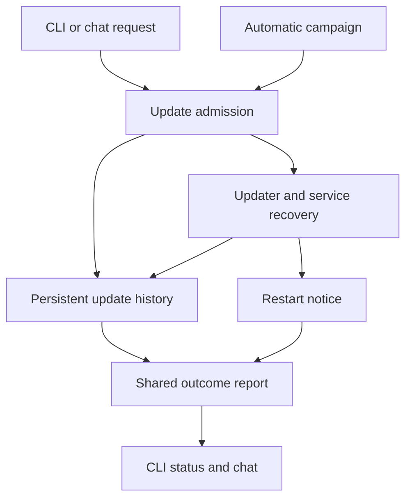

Codex review: blocked before merge. _Reviewed September 4, 2026, 10:57 PM ET / September 5, 2026, 02:57 UTC._

# ClawSweeper review

## What this changes

Adds persistent update history and shared outcome reports across the CLI, chat, Gateway restarts, and administrator APIs.

> [!WARNING]
> **SQLite table change**
>
> This PR modifies persisted SQLite tables in `src/state/openclaw-state-schema.sql`. Prefer a design that avoids changing persisted SQLite tables. If the change is necessary, verify migration and upgrade compatibility against an existing database before merge.

## Regression provenance

Possible regression — suspected (reviewed change). No predecessor PR is attributed.

## Merge readiness

⛔ **Blocked before merge - 10 items remain**

Keep open: current main lacks this history foundation, both prior findings remain, and interrupted-run reconciliation is still unresolved.

**Priority:** P2
**Reviewed head:** `f8e8fd385d75ddabb7c20233caadc330b2992275`
**Owner decision:** Required. See [Decision needed](#decision-needed).

## Review scores

| Measure | Result | What it means |
|---|---|---|
| **Overall readiness** | 🦐 gold shrimp **(3/6)** | Useful architecture and substantial validation, with three concrete admission and lifecycle defects still blocking readiness. |
| **Proof confidence** | 🐚 platinum hermit **(4/6)** | Not applicable: The maintainer-authored PR is exempt from the ordinary contributor-proof gate. Its reported CLI smoke exercises ledger admission and status; broader AWS campaign results do not establish this head’s restart-delivery behavior. |
| **Patch quality** | 🦐 gold shrimp **(3/6)** | 3 actionable review findings remain. |

## Verification

| Check | Result | Evidence |
|---|---|---|
| **Real behavior** | Not applicable | Not applicable: The maintainer-authored PR is exempt from the ordinary contributor-proof gate. Its reported CLI smoke exercises ledger admission and status; broader AWS campaign results do not establish this head’s restart-delivery behavior. |
| **Evidence reviewed** | 11 items | Introduced change and merge identity: Inspected the complete local merge-base-to-head file inventory. The verified test merge records the pinned base first and PR head second; its result retains the problematic CLI metadata assignment. Prior notice-ownership finding remains: CLI admission spreads nullable control-plane metadata into an object containing runId. A package-target refusal subsequently passes the sentinel writer’s non-null guard; the singleton store replaces session, delivery, and continuation columns. Prior cross-process discovery finding remains: An empty watcher poll returns without scheduling another read. Wake calls exist in Gateway admission and campaigns, while standalone CLI admission only writes SQLite. The watcher test explicitly invokes the process-local wake function. |
| **Findings** | 3 actionable findings | [P2] Preserve absent control-plane metadata for standalone CLI runs [P2] Discover standalone CLI admissions after the watcher becomes idle [P2] Reconcile interrupted executions before reporting them as active |
| **Security** | None | None. |

## How this fits together

OpenClaw’s updater accepts requests from the CLI, chat, and automatic campaigns, then coordinates installation and Gateway recovery. The new ledger records that work so status commands and completion notices can report the same outcome.

## Decision needed

| Question | Recommendation |
|---|---|
| Which execution-ownership and reconciliation contract should govern interrupted update runs before the stack treats persisted running rows as live? | **Complete run-owned reconciliation:** Accept and implement durable ownership transfer across Gateway, helper, and updater so abandoned runs can settle safely before landing the stack. |

Why: The dependent PR explicitly leaves this blocked on acceptance of a material persistence design, and helper death alone cannot safely distinguish abandoned work from a surviving updater.

## Before merge

- [ ] **Preserve absent control-plane metadata for standalone CLI runs (P2)** - The prior finding remains: this spread turns `null` into `{ runId }` for a CLI invocation that owns no handoff. On a package install, `openclaw update --tag main --yes --json` reaches `reportPreMutationUpdateFailure`, passes the sentinel writer’s non-null guard, and replaces any unrelated pending notice, including its session and continuation. Attach the run ID only to existing owned metadata and cover refusal with a pre-existing pending notice.
- [ ] **Discover standalone CLI admissions after the watcher becomes idle (P2)** - The prior finding remains: when startup finds no active row, polling ends here. Later CLI admission writes SQLite in another process without waking the Gateway; the only wake calls are process-local Gateway admission and campaign callbacks. Subscribers therefore receive no progress events for that standalone update until another wake or restart. Add cross-process admission discovery and exercise it after an idle Gateway startup.
- [ ] **Reconcile interrupted executions before reporting them as active (P2)** - A CLI updater killed after admission but before writing a restart sentinel leaves `status: running` permanently. This query keeps returning that row, and `update status` prefers it over even a newer completed run; sentinel-based boot recovery cannot settle a run without its sentinel. Add reconciliation at the execution-ownership boundary, including helper-to-updater transfer, rather than treating age or helper PID alone as proof of abandonment. The dependent PR already identifies this lifecycle gap.
- [ ] **Resolve merge risk (P1)** - An unrelated CLI refusal can replace another update’s pending completion notice and continuation.
- [ ] **Resolve merge risk (P1)** - Safe interrupted-run reconciliation needs an accepted ownership-transfer contract; elapsed time or a dead helper alone cannot establish that the updater has stopped.
- [ ] **Resolve merge risk (P1)** - Dry-run now requires writable shared state, and the supplied schema test does not exercise reopening with an older OpenClaw runtime.
- [ ] **Complete next step (P2)** - Resolve the three findings, confirm the interrupted-run ownership contract, and document fresh-install and upgrade validation for the ledger.
- [ ] **Resolve maintainer decision** - Resolve the maintainer decision shown above before merge.
- [ ] **Review config compatibility** - Confirm compatibility and upgrade impact for the changed config or default surface before merge.
- [ ] **Add data-model compatibility proof** - Confirm migration or upgrade compatibility proof before merge.

## Findings

- [P2] Preserve absent control-plane metadata for standalone CLI runs — `src/cli/update-cli/update-command.ts:96-99`
- [P2] Discover standalone CLI admissions after the watcher becomes idle — `src/gateway/update-run-watcher.ts:30-33`
- [P2] Reconcile interrupted executions before reporting them as active — `src/infra/update-run-ledger.ts:467-469`

<strong>Agent review details</strong>

### Security

None.

### PR surface

PR surface statistics unavailable: the file list is incomplete.

### Review metrics

| Metric | Value | Why it matters |
|---|---|---|
| **Interpreted LOC delta** | Production +1,816; tests/support +1,259 net; generated, docs, and tooling excluded | Feature growth supplies persistence, cross-process identity, history APIs, and shared reporting while removing duplicate formatters. |
| **Persistent and protocol surface** | 1 table, 2 indexes, 2 administrator RPCs, and 1 event added; schema version unchanged | These additions create a durable compatibility contract across updater and Gateway versions. |
| **Preview behavior** | 1 existing mode changed: dry-run now writes history | Previously read-only previews now require permission to write shared state. |

### Stored data model

Persistent data-model change detected: `database schema: packages/gateway-protocol/src/schema/update-runs.ts`, `database schema: src/state/openclaw-state-schema.sql`, `migration/backfill/repair: apps/shared/OpenClawKit/Sources/OpenClawProtocol/GatewayModels.swift`, `migration/backfill/repair: src/cli/update-cli/progress.ts`, `migration/backfill/repair: src/cli/update-cli/update-command-service-recovery.ts`, `migration/backfill/repair: src/infra/update-run-ledger.ts`, and 4 more. Confirm migration or upgrade compatibility proof before merge.

### Merge-risk options

**Maintainer options:**
1. **Complete ownership and upgrade safeguards (recommended)**  
   Repair notice custody and discovery, settle the interrupted-run design, and verify writable-state previews plus older-runtime reopen behavior.
2. **Hold the dependent stack**  
   Keep the reporting stack unlanded until its durable execution lifecycle and compatibility expectations are agreed.

### Technical review

Best possible solution:

Keep one ledger and renderer, with preserved notice ownership, cross-process discovery, safe interrupted-run reconciliation, and verified fresh-install and upgrade behavior.

Do we have a high-confidence way to reproduce the issue?

Yes, from the pinned PR source: a package-target refusal overwrites absent notice metadata, an idle watcher misses separate-process admission, and a killed updater leaves an active row. These paths were not executed during this read-only review.

Is this the best way to solve the issue?

The shared ledger and renderer are the appropriate owners, but the implementation is incomplete at admission and lifecycle boundaries; extending the singleton sentinel would not provide retained history.

Full review comments:

- [P2] Preserve absent control-plane metadata for standalone CLI runs — `src/cli/update-cli/update-command.ts:96-99`
  The prior finding remains: this spread turns `null` into `{ runId }` for a CLI invocation that owns no handoff. On a package install, `openclaw update --tag main --yes --json` reaches `reportPreMutationUpdateFailure`, passes the sentinel writer’s non-null guard, and replaces any unrelated pending notice, including its session and continuation. Attach the run ID only to existing owned metadata and cover refusal with a pre-existing pending notice.
  Confidence: 0.99
- [P2] Discover standalone CLI admissions after the watcher becomes idle — `src/gateway/update-run-watcher.ts:30-33`
  The prior finding remains: when startup finds no active row, polling ends here. Later CLI admission writes SQLite in another process without waking the Gateway; the only wake calls are process-local Gateway admission and campaign callbacks. Subscribers therefore receive no progress events for that standalone update until another wake or restart. Add cross-process admission discovery and exercise it after an idle Gateway startup.
  Confidence: 0.99
- [P2] Reconcile interrupted executions before reporting them as active — `src/infra/update-run-ledger.ts:467-469`
  A CLI updater killed after admission but before writing a restart sentinel leaves `status: running` permanently. This query keeps returning that row, and `update status` prefers it over even a newer completed run; sentinel-based boot recovery cannot settle a run without its sentinel. Add reconciliation at the execution-ownership boundary, including helper-to-updater transfer, rather than treating age or helper PID alone as proof of abandonment. The dependent PR already identifies this lifecycle gap.
  Confidence: 0.97

Overall correctness: patch is incorrect
Overall confidence: 0.97

AGENTS.md: found and applied where relevant.

Codex review notes: model internal, reasoning high; reviewed against [bb147376f771](https://github.com/openclaw/openclaw/commit/bb147376f7719cc4ba7d35999435b7d158703234).

### Labels

Label justifications:

- `P2`: This is a useful update-observability improvement with bounded correctness and lifecycle blockers.
- `merge-risk: 🚨 message-delivery`: Standalone CLI admission can overwrite an unrelated pending restart notice and its continuation route.
- `merge-risk: 🚨 compatibility`: The same-version persistent table and newly writable dry-run path require explicit upgrade and operator-behavior validation.
- `rating: 🦐 gold shrimp`: Overall readiness is 🦐 gold shrimp; proof is 🐚 platinum hermit and patch quality is 🦐 gold shrimp.
- `status: ⏳ waiting on author`: ClawSweeper has contributor-facing work open and is waiting for author action. Not applicable: The maintainer-authored PR is exempt from the ordinary contributor-proof gate. Its reported CLI smoke exercises ledger admission and status; broader AWS campaign results do not establish this head’s restart-delivery behavior.
- `proof: telegram-e2e`: This PR needs Telegram Test Server proof with the repository E2E skill. The shared renderer changes Telegram /update replies and post-restart completion reports, which Telegram Test Server can observe.

### Evidence

What I checked:

- **Introduced change and merge identity:** Inspected the complete local merge-base-to-head file inventory. The verified test merge records the pinned base first and PR head second; its result retains the problematic CLI metadata assignment. ([`src/cli/update-cli/update-command.ts:96`](https://github.com/openclaw/openclaw/blob/587c13fb4075d0d0ca1660038749529d6bffaf4a/src/cli/update-cli/update-command.ts#L96), [587c13fb4075](https://github.com/openclaw/openclaw/commit/587c13fb4075d0d0ca1660038749529d6bffaf4a))
- **Prior notice-ownership finding remains:** CLI admission spreads nullable control-plane metadata into an object containing runId. A package-target refusal subsequently passes the sentinel writer’s non-null guard; the singleton store replaces session, delivery, and continuation columns. ([`src/cli/update-cli/update-command.ts:96`](https://github.com/openclaw/openclaw/blob/f8e8fd385d75ddabb7c20233caadc330b2992275/src/cli/update-cli/update-command.ts#L96), [f8e8fd385d75](https://github.com/openclaw/openclaw/commit/f8e8fd385d75ddabb7c20233caadc330b2992275))
- **Prior cross-process discovery finding remains:** An empty watcher poll returns without scheduling another read. Wake calls exist in Gateway admission and campaigns, while standalone CLI admission only writes SQLite. The watcher test explicitly invokes the process-local wake function. ([`src/gateway/update-run-watcher.ts:30`](https://github.com/openclaw/openclaw/blob/f8e8fd385d75ddabb7c20233caadc330b2992275/src/gateway/update-run-watcher.ts#L30), [f8e8fd385d75](https://github.com/openclaw/openclaw/commit/f8e8fd385d75ddabb7c20233caadc330b2992275))
- **Interrupted-run lifecycle:** Active discovery selects persisted status=running without execution-liveness reconciliation. A CLI process killed after admission but before creating its sentinel leaves such a row indefinitely; CLI status prefers it over newer terminal history. The dependent presentation PR explicitly acknowledges the same pre-landing lifecycle problem. ([`src/infra/update-run-ledger.ts:467`](https://github.com/openclaw/openclaw/blob/f8e8fd385d75ddabb7c20233caadc330b2992275/src/infra/update-run-ledger.ts#L467), [f8e8fd385d75](https://github.com/openclaw/openclaw/commit/f8e8fd385d75ddabb7c20233caadc330b2992275))
- **Storage contract and validation:** The ledger uses the shared transaction owner, lazy additive schema creation, bounded diagnostic fields, and first-terminal-wins updates. Tests cover rollback of failed first use, preserved schema metadata, reopening, and concurrent process writes. The older-reader case uses DatabaseSync with the captured prior schema rather than an older OpenClaw runtime. ([`src/infra/update-run-ledger.test.ts:67`](https://github.com/openclaw/openclaw/blob/f8e8fd385d75ddabb7c20233caadc330b2992275/src/infra/update-run-ledger.test.ts#L67), [f8e8fd385d75](https://github.com/openclaw/openclaw/commit/f8e8fd385d75ddabb7c20233caadc330b2992275))
- **Current-main and release necessity:** Current main’s update status reports installation, channel, and availability without retained run records. Tree inspection found neither the ledger nor watcher on current main or v2026.9.1. No merged replacement is established by the supplied related context. ([`src/cli/update-cli/status.ts:54`](https://github.com/openclaw/openclaw/blob/bb147376f7719cc4ba7d35999435b7d158703234/src/cli/update-cli/status.ts#L54), [bb147376f771](https://github.com/openclaw/openclaw/commit/bb147376f7719cc4ba7d35999435b7d158703234))

Likely related people:

- **steipete:** Suggested for follow-up; no historical authorship or introduction is verified. (role: unverified routing candidate; confidence: low)

### Rank-up moves

Optional improvements that raise the rating; they are not merge blockers.

- Preserve absent notice metadata and add the competing-notice regression.
- Verify standalone CLI admission reaches an already-idle Gateway watcher across processes.
- Complete the accepted interrupted-run ownership design and demonstrate fresh, upgrade, and older-runtime reopen behavior.

### Rating scale

| Score | Internal tier | Crab rank | Meaning |
|---:|:---:|---|---|
| **6/6** | S | 🦀 challenger crab | Exceptional readiness |
| **5/6** | A | 🦞 diamond lobster | Very strong readiness |
| **4/6** | B | 🐚 platinum hermit | Good normal PR; ordinary maintainer review |
| **3/6** | C | 🦐 gold shrimp | Useful, but confidence is limited |
| **2/6** | D | 🦪 silver shellfish | Proof or implementation needs work |
| **1/6** | F | 🧂 unranked krab | Not merge-ready |
| N/A | NA | 🌊 off-meta tidepool | Rating does not apply |

Overall follows the weaker of proof and patch quality.
Shiny media proof means a screenshot, video, or linked artifact directly shows the changed behavior. Runtime, network, CSP, and security claims still need visible diagnostics.

### Workflow

- ClawSweeper keeps one durable marker-backed review comment per issue or PR.
- Re-runs edit this comment so the latest verdict, findings, and automation markers stay together instead of adding duplicate bot comments.
- A fresh review can be triggered by eligible `@clawsweeper re-review` comments, exact-item GitHub events, scheduled/background review runs, or manual workflow dispatch.
- PR/issue authors and users with repository write access can comment `@clawsweeper re-review` or `@clawsweeper re-run` on an open PR or issue to request a fresh review only.
- Maintainers can also comment `@clawsweeper review` to request a fresh review only.
- Fresh-review commands do not start repair, autofix, rebase, CI repair, or automerge.
- Maintainer-only repair and merge flows require explicit commands such as `@clawsweeper autofix`, `@clawsweeper automerge`, `@clawsweeper fix ci`, or `@clawsweeper address review`.
- Maintainers can comment `@clawsweeper explain` to ask for more context, or `@clawsweeper stop` to stop active automation.

### History

Review history (2 earlier review cycles)

<!-- clawsweeper-review-history v=1 total=2 -->
- reviewed 2026-09-04T23:56:44.557Z sha 11e6797160449331a283b35f2639dcba53068940 :: blocked before merge. :: [P2] [P2] Preserve absent control-plane metadata for ordinary CLI runs | [P2] [P2] Wake the Gateway watcher for standalone CLI admissions
- reviewed 2026-09-05T00:56:36.204Z sha 5afa01447675b104079a44bd4dc176c675068605 :: blocked before merge. :: [P2] [P2] Preserve absent control-plane metadata for ordinary CLI runs | [P2] [P2] Wake the Gateway watcher for standalone CLI admissions

<!-- clawsweeper-verdict:needs-human item=138690 sha=f8e8fd385d75ddabb7c20233caadc330b2992275 confidence=high updated_at=2026-09-05T02:51:32Z reviewed_at=2026-09-05T02:57:14.484Z lease_owner=github-run-33940134205-1 lease_comment_id=5548862029 source_revision=aa1a41e7b8206e6c4ce70e46960156e2d0aaaf794798988d12297008f1eed311 live_verification=absent -->
<!-- clawsweeper-review-state:blocked item=138690 sha=f8e8fd385d75ddabb7c20233caadc330b2992275 v=1 -->

<!-- clawsweeper-review-version item=138690 reviewed_at=2026-09-05T02:57:14.484Z sha=f8e8fd385d75ddabb7c20233caadc330b2992275 source_revision=aa1a41e7b8206e6c4ce70e46960156e2d0aaaf794798988d12297008f1eed311 lease_owner=github-run-33940134205-1 lease_comment_id=5548862029 v=1 -->

<!-- clawsweeper-review item=138690 -->