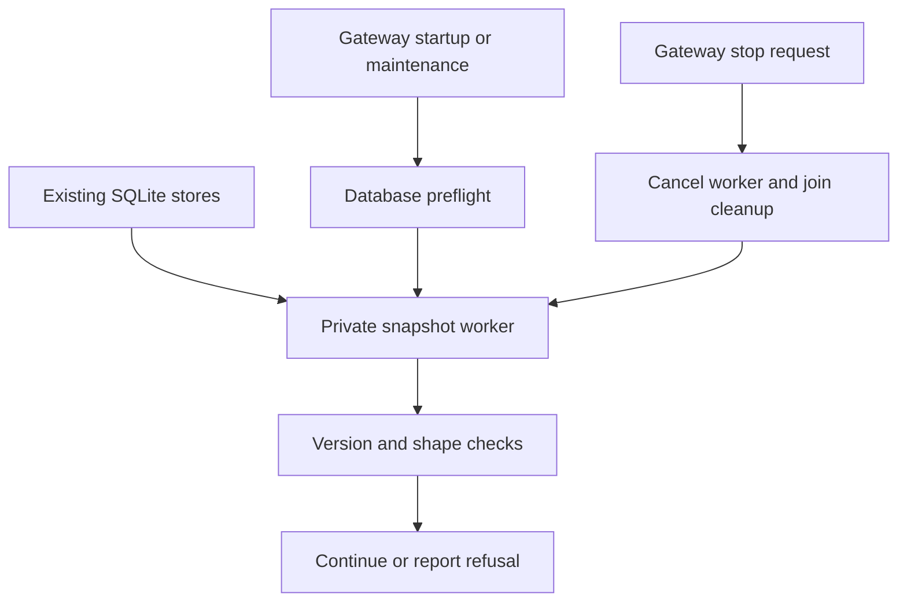

Codex review: blocked before merge. _Reviewed September 5, 2026, 7:02 AM ET / 11:02 UTC._

# ClawSweeper review

## What this changes

Makes database compatibility checks asynchronous and ties startup snapshot workers to Gateway cancellation and cleanup, while preserving Update and Doctor sequencing.

> [!WARNING]
> **SQLite table change**
>
> This PR modifies persisted SQLite tables in `src/infra/sqlite-readonly-location.ts`, `src/infra/sqlite-readonly-worker.ts`. Prefer a design that avoids changing persisted SQLite tables. If the change is necessary, verify migration and upgrade compatibility against an existing database before merge.

## Merge readiness

⛔ **Blocked before merge - 3 items remain**

Still useful: current main retains blocking schema snapshots. No concrete introduced correctness defect found; the declared final Linux lifecycle verification remains outstanding.

**Priority:** P2
**Reviewed head:** `1ce6848dbbe3fbb83f91dadded8704ee517a5162`

## Review scores

| Measure | Result | What it means |
|---|---|---|
| **Overall readiness** | 🐚 platinum hermit **(4/6)** | Coherent ownership repair with meaningful regression coverage and no identified correctness defect; final compiled lifecycle verification remains a material risk reducer. |
| **Proof confidence** | 🌊 off-meta tidepool | Not applicable: The maintainer-authored PR is exempt from the ordinary contributor-proof gate; reported live-WAL and child-close results support the snapshot owner, while final compiled Linux Gateway startup-stage cancellation remains explicitly pending. |
| **Patch quality** | 🐚 platinum hermit **(4/6)** | No actionable review findings were identified. |

## Verification

| Check | Result | Evidence |
|---|---|---|
| **Real behavior** | Not applicable | Not applicable: The maintainer-authored PR is exempt from the ordinary contributor-proof gate; reported live-WAL and child-close results support the snapshot owner, while final compiled Linux Gateway startup-stage cancellation remains explicitly pending. |
| **Evidence reviewed** | 10 items | Current main still needs the fix: Fetched main imports and calls prepareSqliteReadOnlyLocationSync for both state and agent schema inspection. The proposed asynchronous behavior is therefore still distinct. Startup ownership boundary: Both ownership inspection and schema preflight receive the per-start operation callback. Accepted stops close admission and drain that scope before server close; cancellation is joined through the retained stop completion. Snapshot transport and dependency boundary: The worker runs the existing OpenClaw SQLite entrypoint with process.execPath, waits for child close, and lets the snapshot owner remove parent-owned staging. Schema inspection retains the byte-preserving copy strategy. This path depends on Node child-process behavior, with no affirmative Codex dependency signal. |
| **Findings** | None | None. |
| **Security** | None | None. |

## How this fits together

Before Gateway startup, updates, and Doctor maintenance, OpenClaw inspects existing SQLite databases for compatibility. Private snapshot workers feed those checks; the Gateway host now owns their cancellation and cleanup during startup.

## Before merge

- [ ] **Resolve merge risk (P1)** - Final compiled Linux verification remains pending for stopping during ownership inspection and schema preflight; composed process exit, worker teardown, and staging cleanup are not yet demonstrated for the final revision.
- [ ] **Complete next step (P2)** - Attach final compiled Linux readiness and cancellation results for both startup database stages, plus the declared POSIX-lock verification.
- [ ] **Add data-model compatibility proof** - Confirm migration or upgrade compatibility proof before merge.

<strong>Agent review details</strong>

### Security

None.

### PR surface

Source +186, Tests +466. Total +652 across 26 files.

View PR surface stats

| Area | Files | Added | Removed | Net |
|---|---:|---:|---:|---:|
| Source | 16 | 333 | 147 | +186 |
| Tests | 10 | 592 | 126 | +466 |
| Docs | 0 | 0 | 0 | 0 |
| Config | 0 | 0 | 0 | 0 |
| Generated | 0 | 0 | 0 | 0 |
| Other | 0 | 0 | 0 | 0 |
| **Total** | **26** | **925** | **273** | **+652** |

### Review metrics

| Metric | Value | Why it matters |
|---|---|---|
| **Production versus test growth** | Production net +186; tests net +466 | Transport moves cancel in the net; production growth supplies startup lifetime ownership and parent-owned staging, justified by the recorded orphan-worker failure. |

### Stored data model

Persistent data-model change detected: `serialized state: src/infra/sqlite-readonly-worker.ts`, `unknown-data-model-change: src/infra/sqlite-readonly-location.ts`, `unknown-data-model-change: src/infra/sqlite-readonly-worker.ts`. Confirm migration or upgrade compatibility proof before merge.

### Merge-risk options

**Maintainer options:**
1. **Complete the declared Linux verification (recommended)**  
   Attach the final compiled startup and stop results, including worker disappearance, staging cleanup, and POSIX-lock preservation.

### Technical review

Best possible solution:

Keep the existing isolated snapshot strategy under one host-owned cancellation and cleanup boundary, with compiled startup and shutdown behavior verified.

Do we have a high-confidence way to reproduce the issue?

Yes, from source: current main synchronously waits for snapshot workers during schema inspection, and the existing live-WAL fixture supplies a focused event-loop regression path. This review did not execute it.

Is this the best way to solve the issue?

Yes, architecturally: reusing the snapshot owner and AsyncWorkScope addresses both blocking and worker lifetime; changing transport alone would leave the recorded orphan-worker failure unresolved.

AGENTS.md: found and applied where relevant.

Codex review notes: model internal, reasoning high; reviewed against [1a13b42b6b75](https://github.com/openclaw/openclaw/commit/1a13b42b6b75d5d15b47eb966b1c3f5ce5456136).

### Labels

Label changes:

- add `rating: 🐚 platinum hermit`: Overall readiness is 🐚 platinum hermit; proof is 🌊 off-meta tidepool and patch quality is 🐚 platinum hermit.
- remove `rating: 🦐 gold shrimp`: Current PR rating is `rating: 🐚 platinum hermit`, so this older rating label is no longer current.

Label justifications:

- `P2`: Repairs database-preflight responsiveness without evidence of a widespread current outage.
- `merge-risk: 🚨 availability`: The newly asynchronous startup path relies on child-close and cleanup joins whose final compiled Linux composition remains unverified.
- `rating: 🐚 platinum hermit`: Overall readiness is 🐚 platinum hermit; proof is 🌊 off-meta tidepool and patch quality is 🐚 platinum hermit.
- `status: 👀 ready for maintainer look`: ClawSweeper has no concrete contributor-facing blocker left for this PR. Not applicable: The maintainer-authored PR is exempt from the ordinary contributor-proof gate; reported live-WAL and child-close results support the snapshot owner, while final compiled Linux Gateway startup-stage cancellation remains explicitly pending.

### Evidence

What I checked:

- **Current main still needs the fix:** Fetched main imports and calls prepareSqliteReadOnlyLocationSync for both state and agent schema inspection. The proposed asynchronous behavior is therefore still distinct. ([`src/state/openclaw-database-preflight.ts:347`](https://github.com/openclaw/openclaw/blob/1a13b42b6b75d5d15b47eb966b1c3f5ce5456136/src/state/openclaw-database-preflight.ts#L347), [1a13b42b6b75](https://github.com/openclaw/openclaw/commit/1a13b42b6b75d5d15b47eb966b1c3f5ce5456136))
- **Startup ownership boundary:** Both ownership inspection and schema preflight receive the per-start operation callback. Accepted stops close admission and drain that scope before server close; cancellation is joined through the retained stop completion. ([`src/cli/gateway-cli/run-loop.ts:881`](https://github.com/openclaw/openclaw/blob/1ce6848dbbe3fbb83f91dadded8704ee517a5162/src/cli/gateway-cli/run-loop.ts#L881), [1ce6848dbbe3](https://github.com/openclaw/openclaw/commit/1ce6848dbbe3fbb83f91dadded8704ee517a5162))
- **Snapshot transport and dependency boundary:** The worker runs the existing OpenClaw SQLite entrypoint with process.execPath, waits for child close, and lets the snapshot owner remove parent-owned staging. Schema inspection retains the byte-preserving copy strategy. This path depends on Node child-process behavior, with no affirmative Codex dependency signal. ([`src/infra/sqlite-readonly-worker.ts:83`](https://github.com/openclaw/openclaw/blob/1ce6848dbbe3fbb83f91dadded8704ee517a5162/src/infra/sqlite-readonly-worker.ts#L83), [1ce6848dbbe3](https://github.com/openclaw/openclaw/commit/1ce6848dbbe3fbb83f91dadded8704ee517a5162))
- **Direct child-process contract inspection:** Inspected the installed official Node v24.20.0 builtin source: abort can invoke the error callback before process close, while execFile registers its close callback before returning the child. The distribution README identifies nodejs/node; no dependency commit SHA was established. (`lib/child_process.js:521`)
- **Sibling sequencing and stale recovery:** Package and Git mutation paths await preflight before beginMutation; interrupted or completed Windows recovery rejects there. Doctor awaits compatibility and final readiness checks, and managed reload already returns the readiness promise. ([`src/cli/update-cli/update-command-execution.ts:255`](https://github.com/openclaw/openclaw/blob/1ce6848dbbe3fbb83f91dadded8704ee517a5162/src/cli/update-cli/update-command-execution.ts#L255), [1ce6848dbbe3](https://github.com/openclaw/openclaw/commit/1ce6848dbbe3fbb83f91dadded8704ee517a5162))
- **Regression coverage inspected:** The live-WAL test checks event-loop progress alongside committed versions and unchanged source artifacts. Cancellation coverage holds a real child after SIGTERM and requires close plus staging removal before settlement; run-loop tests cover queued restart followed by stop, duplicate signals, cleanup failure, and retained callbacks. ([`src/state/openclaw-database-preflight.artifacts.test.ts:107`](https://github.com/openclaw/openclaw/blob/1ce6848dbbe3fbb83f91dadded8704ee517a5162/src/state/openclaw-database-preflight.artifacts.test.ts#L107), [1ce6848dbbe3](https://github.com/openclaw/openclaw/commit/1ce6848dbbe3fbb83f91dadded8704ee517a5162))

Likely related people:

- **Peter Steinberger:** Raw commit 0d830e9e74488c1ee5a3af461b147cb683f0581f adds src/shared/async-work-scope.ts:32 relative to its recorded parents. This identifies author metadata, not feature responsibility or a PR merger. (role: source-line author; confidence: high; commits: [0d830e9e7448](https://github.com/openclaw/openclaw/commit/0d830e9e74488c1ee5a3af461b147cb683f0581f); files: `src/shared/async-work-scope.ts`)
- **Jason (Json):** Suggested for follow-up; no historical authorship or introduction is verified. (role: unverified routing candidate; confidence: low)

### Rank-up moves

Optional improvements that raise the rating; they are not merge blockers.

- Attach the declared final compiled Linux readiness, both startup-stage stop, and POSIX-lock results, completing the prior review's remaining validation request.

### Rating scale

| Score | Internal tier | Crab rank | Meaning |
|---:|:---:|---|---|
| **6/6** | S | 🦀 challenger crab | Exceptional readiness |
| **5/6** | A | 🦞 diamond lobster | Very strong readiness |
| **4/6** | B | 🐚 platinum hermit | Good normal PR; ordinary maintainer review |
| **3/6** | C | 🦐 gold shrimp | Useful, but confidence is limited |
| **2/6** | D | 🦪 silver shellfish | Proof or implementation needs work |
| **1/6** | F | 🧂 unranked krab | Not merge-ready |
| N/A | NA | 🌊 off-meta tidepool | Rating does not apply |

Overall follows the weaker of proof and patch quality.
Shiny media proof means a screenshot, video, or linked artifact directly shows the changed behavior. Runtime, network, CSP, and security claims still need visible diagnostics.

### Workflow

- ClawSweeper keeps one durable marker-backed review comment per issue or PR.
- Re-runs edit this comment so the latest verdict, findings, and automation markers stay together instead of adding duplicate bot comments.
- A fresh review can be triggered by eligible `@clawsweeper re-review` comments, exact-item GitHub events, scheduled/background review runs, or manual workflow dispatch.
- PR/issue authors and users with repository write access can comment `@clawsweeper re-review` or `@clawsweeper re-run` on an open PR or issue to request a fresh review only.
- Maintainers can also comment `@clawsweeper review` to request a fresh review only.
- Fresh-review commands do not start repair, autofix, rebase, CI repair, or automerge.
- Maintainer-only repair and merge flows require explicit commands such as `@clawsweeper autofix`, `@clawsweeper automerge`, `@clawsweeper fix ci`, or `@clawsweeper address review`.
- Maintainers can comment `@clawsweeper explain` to ask for more context, or `@clawsweeper stop` to stop active automation.

### History

Review history (1 earlier review cycle)

<!-- clawsweeper-review-history v=1 total=1 -->
- reviewed 2026-09-05T09:47:13.293Z sha 5fcb70015613439b4062a0b768d35836673cecb7 :: blocked before merge. :: none

<!-- clawsweeper-verdict:needs-human item=138986 sha=1ce6848dbbe3fbb83f91dadded8704ee517a5162 confidence=high updated_at=2026-09-05T10:58:05Z reviewed_at=2026-09-05T11:02:30.161Z lease_owner=github-run-33961659686-1 lease_comment_id=5551308088 source_revision=acad46a0524ee629d5b602b631dd8eb0476d96ce493066ce041b764f9f357ff9 live_verification=absent -->
<!-- clawsweeper-review-state:blocked item=138986 sha=1ce6848dbbe3fbb83f91dadded8704ee517a5162 v=1 -->

<!-- clawsweeper-review-version item=138986 reviewed_at=2026-09-05T11:02:30.161Z sha=1ce6848dbbe3fbb83f91dadded8704ee517a5162 source_revision=acad46a0524ee629d5b602b631dd8eb0476d96ce493066ce041b764f9f357ff9 lease_owner=github-run-33961659686-1 lease_comment_id=5551308088 v=1 -->

<!-- clawsweeper-review item=138986 -->