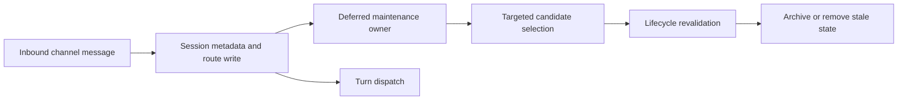

Codex review: needs maintainer review before merge. _Reviewed September 2, 2026, 9:15 AM ET / 13:15 UTC._

# ClawSweeper review

## What this changes

This PR moves automatic SQLite session maintenance out of normal session-entry writes into a coalesced, handle-bound deferred owner, with targeted candidate queries and lifecycle-race coverage.

## Regression provenance

Possible regression — probable (reproduction; reviewed change). No predecessor PR is attributed.

## Merge readiness

⚠️ **Ready for maintainer review - 4 items remain**

Keep open. The introduced patch is a coherent owner-boundary repair with no concrete correctness finding from source review, and current main does not contain it. Its changed automatic-cleanup timing and protected maintainer status require session-storage owner review before merge.

**Priority:** P1
**Reviewed head:** `a2c9c7ae4886980692f47e163a064291297e3d71`
**Owner decision:** Required. See [Decision needed](#decision-needed).

## Review scores

| Measure | Result | What it means |
|---|---|---|
| **Overall readiness** | 🐚 platinum hermit **(4/6)** | The patch has a sound owner boundary and focused regressions, with owner acceptance of deferred retention timing still required. |
| **Proof confidence** | 🌊 off-meta tidepool | Not applicable: The mandatory external-contributor proof gate does not apply to this member-authored PR; its body describes after-fix runtime measurements and boundary tests, but this read-only review did not execute them. |
| **Patch quality** | 🐚 platinum hermit **(4/6)** | No actionable review findings were identified. |

## Verification

| Check | Result | Evidence |
|---|---|---|
| **Real behavior** | Not applicable | Not applicable: The mandatory external-contributor proof gate does not apply to this member-authored PR; its body describes after-fix runtime measurements and boundary tests, but this read-only review did not execute them. |
| **Evidence reviewed** | 6 items | Entry-write boundary: The entry accessor now commits the entry and schedules maintenance afterward, rather than constructing a maintenance plan within the write transaction. Deferred lifecycle fence: The new per-store owner verifies that it still owns the exact open database handle before planning and again during finalization; subsequent writes advance a generation for a fresh pass. Targeted maintenance planning: Maintenance builds a lightweight key projection, loads only age/cap candidates, then reloads exact selected entries before archive or removal planning. |
| **Findings** | None | None. |
| **Security** | None | None. |

## How this fits together

Channel ingress records session metadata and route state before dispatching a turn. The session-maintenance subsystem later archives or removes stale entries and their unreferenced transcript state.

## Decision needed

| Question | Recommendation |
|---|---|
| Should normal SQLite session-entry writes adopt eventual, process-local automatic maintenance while explicit cleanup remains synchronous? | **Accept deferred automatic cleanup:** Land the handle-bound coalesced owner after normal exact-head CI, accepting that routine writes no longer wait for cleanup completion. |

Why: This changes the timing of retention work on persisted session state without adding a schema or configuration contract; source review supports the design, but accepting that operational tradeoff requires owner intent.

## Before merge

- [ ] **Resolve merge risk (P1)** - Automatic cleanup now has eventual rather than write-complete timing; a process or handle lifecycle change can defer retention work until a later eligible write.
- [ ] **Resolve merge risk (P1)** - Production code grows by 259 net lines for a bug fix; the coalesced owner and exact-handle fence are source-justified, but storage-owner review should confirm that this complexity is warranted.
- [ ] **Complete next step (P2)** - Obtain session-storage owner acceptance of deferred automatic-cleanup timing, then complete exact-head CI before merge.

<strong>Agent review details</strong>

### Security

None.

### PR surface

Source +259, Tests +277. Total +536 across 16 files.

View PR surface stats

| Area | Files | Added | Removed | Net |
|---|---:|---:|---:|---:|
| Source | 5 | 464 | 205 | +259 |
| Tests | 11 | 349 | 72 | +277 |
| Docs | 0 | 0 | 0 | 0 |
| Config | 0 | 0 | 0 | 0 |
| Generated | 0 | 0 | 0 | 0 |
| Other | 0 | 0 | 0 | 0 |
| **Total** | **16** | **813** | **277** | **+536** |

### Review metrics

| Metric | Value | Why it matters |
|---|---|---|
| **Production versus tests** | production +259, tests +277 | The patch replaces synchronous maintenance with a new process-local owner and candidate-query boundary, so its production growth merits storage-owner review. |

### Stored data model

Persistent data-model change detected: `unknown-data-model-change: src/config/sessions/session-accessor.sqlite-entry.ts`. Confirm migration or upgrade compatibility proof before merge.

### Merge-risk options

**Maintainer options:**
1. **Accept the deferred retention contract (recommended)**  
   Have a session-storage owner confirm that ordinary writes may return before automatic pruning or archival completes, then rely on exact-head CI for the implementation gate.
2. **Pause for a different lifecycle design**  
   Do not merge if automatic cleanup must survive a handle or process transition without waiting for another eligible write.

### Technical review

Best possible solution:

Retain the handle-bound, coalesced maintenance owner if a session-storage owner accepts eventual automatic cleanup on ordinary writes; preserve explicit cleanup’s synchronous contract and merge only after exact-head CI succeeds.

Do we have a high-confidence way to reproduce the issue?

Yes, source-reproducible: seed an unprotected stale session entry and send a channel inbound event; current main remains on the pre-PR entry-maintenance path, while the added boundary test models dispatch-before-cleanup.

Is this the best way to solve the issue?

Yes, subject to the stated lifecycle decision: moving maintenance to the post-commit owner addresses the implicated serialized-write boundary while retaining exact-entry and transcript-state revalidation before deletion.

AGENTS.md: found and applied where relevant.

Codex review notes: model internal, reasoning high; reviewed against [abb565ea5f9f](https://github.com/openclaw/openclaw/commit/abb565ea5f9feacd89a571247adb96a799a0e3ce).

### Labels

Label changes:

- add `merge-risk: 🚨 session-state`: The PR changes when automatic pruning and archive/removal of persisted session state occurs relative to normal entry writes.
- add `rating: 🐚 platinum hermit`: Overall readiness is 🐚 platinum hermit; proof is 🌊 off-meta tidepool and patch quality is 🐚 platinum hermit.
- remove `rating: 🦐 gold shrimp`: Current PR rating is `rating: 🐚 platinum hermit`, so this older rating label is no longer current.

Label justifications:

- `P1`: The linked report documents multi-second delays before Discord and Telegram channel-turn dispatch on large session stores.
- `merge-risk: 🚨 session-state`: The PR changes when automatic pruning and archive/removal of persisted session state occurs relative to normal entry writes.
- `rating: 🐚 platinum hermit`: Overall readiness is 🐚 platinum hermit; proof is 🌊 off-meta tidepool and patch quality is 🐚 platinum hermit.
- `status: 👀 ready for maintainer look`: ClawSweeper has no concrete contributor-facing blocker left for this PR. Not applicable: The mandatory external-contributor proof gate does not apply to this member-authored PR; its body describes after-fix runtime measurements and boundary tests, but this read-only review did not execute them.

### Evidence

What I checked:

- **Entry-write boundary:** The entry accessor now commits the entry and schedules maintenance afterward, rather than constructing a maintenance plan within the write transaction. ([`src/config/sessions/session-accessor.sqlite-entry.ts:556`](https://github.com/openclaw/openclaw/blob/a2c9c7ae4886980692f47e163a064291297e3d71/src/config/sessions/session-accessor.sqlite-entry.ts#L556), [a2c9c7ae4886](https://github.com/openclaw/openclaw/commit/a2c9c7ae4886980692f47e163a064291297e3d71))
- **Deferred lifecycle fence:** The new per-store owner verifies that it still owns the exact open database handle before planning and again during finalization; subsequent writes advance a generation for a fresh pass. ([`src/config/sessions/session-accessor.sqlite-maintenance-kick.ts:67`](https://github.com/openclaw/openclaw/blob/a2c9c7ae4886980692f47e163a064291297e3d71/src/config/sessions/session-accessor.sqlite-maintenance-kick.ts#L67), [a2c9c7ae4886](https://github.com/openclaw/openclaw/commit/a2c9c7ae4886980692f47e163a064291297e3d71))
- **Targeted maintenance planning:** Maintenance builds a lightweight key projection, loads only age/cap candidates, then reloads exact selected entries before archive or removal planning. ([`src/config/sessions/session-accessor.sqlite-maintenance.ts:361`](https://github.com/openclaw/openclaw/blob/a2c9c7ae4886980692f47e163a064291297e3d71/src/config/sessions/session-accessor.sqlite-maintenance.ts#L361), [a2c9c7ae4886](https://github.com/openclaw/openclaw/commit/a2c9c7ae4886980692f47e163a064291297e3d71))
- **Boundary regression coverage:** The added published Plugin SDK test verifies dispatch observes the stale entry before asynchronous cleanup removes it. ([`src/plugin-sdk/channel-inbound.test.ts:108`](https://github.com/openclaw/openclaw/blob/a2c9c7ae4886980692f47e163a064291297e3d71/src/plugin-sdk/channel-inbound.test.ts#L108), [a2c9c7ae4886](https://github.com/openclaw/openclaw/commit/a2c9c7ae4886980692f47e163a064291297e3d71))
- **Current-main and release provenance:** The PR head is not an ancestor of fetched current main, while its base is; the latest release v2026.8.2 also does not contain the head. A base-to-current-main diff showed no changes to the modified entry-maintenance files. ([abb565ea5f9f](https://github.com/openclaw/openclaw/commit/abb565ea5f9feacd89a571247adb96a799a0e3ce))
- **Feature history:** Recent maintenance history includes the prior merged session-retention repair by Ayaan Zaidi, establishing existing area involvement beyond this PR. ([`src/config/sessions/session-accessor.sqlite-maintenance.ts:325`](https://github.com/openclaw/openclaw/blob/98ff2294a93f8f17348ee8c3a7a2f66bc6ef5240/src/config/sessions/session-accessor.sqlite-maintenance.ts#L325), [98ff2294a93f](https://github.com/openclaw/openclaw/commit/98ff2294a93f8f17348ee8c3a7a2f66bc6ef5240))

Likely related people:

- **obviyus:** Suggested for follow-up; no historical authorship or introduction is verified. (role: unverified routing candidate; confidence: low)
- **Peter Steinberger:** Suggested for follow-up; no historical authorship or introduction is verified. (role: unverified routing candidate; confidence: low)

### Rating scale

| Score | Internal tier | Crab rank | Meaning |
|---:|:---:|---|---|
| **6/6** | S | 🦀 challenger crab | Exceptional readiness |
| **5/6** | A | 🦞 diamond lobster | Very strong readiness |
| **4/6** | B | 🐚 platinum hermit | Good normal PR; ordinary maintainer review |
| **3/6** | C | 🦐 gold shrimp | Useful, but confidence is limited |
| **2/6** | D | 🦪 silver shellfish | Proof or implementation needs work |
| **1/6** | F | 🧂 unranked krab | Not merge-ready |
| N/A | NA | 🌊 off-meta tidepool | Rating does not apply |

Overall follows the weaker of proof and patch quality.
Shiny media proof means a screenshot, video, or linked artifact directly shows the changed behavior. Runtime, network, CSP, and security claims still need visible diagnostics.

### Workflow

- ClawSweeper keeps one durable marker-backed review comment per issue or PR.
- Re-runs edit this comment so the latest verdict, findings, and automation markers stay together instead of adding duplicate bot comments.
- A fresh review can be triggered by eligible `@clawsweeper re-review` comments, exact-item GitHub events, scheduled/background review runs, or manual workflow dispatch.
- PR/issue authors and users with repository write access can comment `@clawsweeper re-review` or `@clawsweeper re-run` on an open PR or issue to request a fresh review only.
- Maintainers can also comment `@clawsweeper review` to request a fresh review only.
- Fresh-review commands do not start repair, autofix, rebase, CI repair, or automerge.
- Maintainer-only repair and merge flows require explicit commands such as `@clawsweeper autofix`, `@clawsweeper automerge`, `@clawsweeper fix ci`, or `@clawsweeper address review`.
- Maintainers can comment `@clawsweeper explain` to ask for more context, or `@clawsweeper stop` to stop active automation.

### History

Review history (1 earlier review cycle)

<!-- clawsweeper-review-history v=1 total=1 -->
- reviewed 2026-09-02T12:27:50.244Z sha b64c86fb78796d9632fd73837af0e3e343d2d7bf :: needs maintainer review before merge. :: none

<!-- clawsweeper-verdict:needs-human item=136283 sha=a2c9c7ae4886980692f47e163a064291297e3d71 confidence=medium updated_at=2026-09-02T13:11:21Z reviewed_at=2026-09-02T13:15:15.348Z lease_owner=github-run-33634034634-1 lease_comment_id=5510073864 source_revision=c693fbcf2292398cddeedf1c16ede5ed2d45e4beb02daa22f182285e809d1d4f live_verification=absent -->

<!-- clawsweeper-review-version item=136283 reviewed_at=2026-09-02T13:15:15.348Z sha=a2c9c7ae4886980692f47e163a064291297e3d71 source_revision=c693fbcf2292398cddeedf1c16ede5ed2d45e4beb02daa22f182285e809d1d4f lease_owner=github-run-33634034634-1 lease_comment_id=5510073864 v=1 -->

<!-- clawsweeper-review item=136283 -->