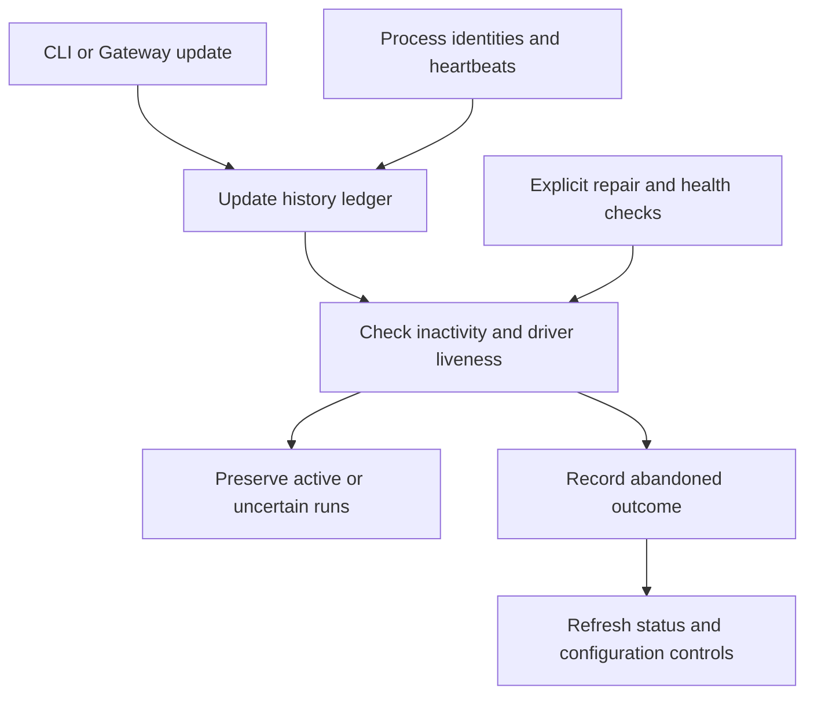

Codex review: blocked before merge. _Reviewed September 7, 2026, 6:53 PM ET / 22:53 UTC._

# ClawSweeper review

## What this changes

Tracks updater process lifetimes and adds conservative stale-update recovery so operators can clear stranded history without stopping a healthy Gateway.

## Merge readiness

⛔ **Blocked before merge - 4 items remain**

The recovery work remains necessary and has convincing installed-upgrade proof, but one history-selection defect can make repair report success despite unfinished finalization. The previous process-identity compatibility concern is addressed by the current fallback.

**Priority:** P1
**Reviewed head:** `d985f81a45a09dd7743f12b8ac149dd8be9ca26f`

## Review scores

| Measure | Result | What it means |
|---|---|---|
| **Overall readiness** | 🦐 gold shrimp **(3/6)** | Strong installed-upgrade evidence supports useful recovery work, but incomplete failed-history selection still blocks correctness. |
| **Proof confidence** | 🦞 diamond lobster **(5/6)** | Sufficient (terminal): The pinned PR body records a real published-2026.9.2 upgrade followed by candidate repair, with retained failed/abandoned history, no active run, unchanged serving processes, and successful health probes; the inspected survivor exercises those production boundaries. This proves the central recovery path, while the ordinary failed-finalization sequence remains a correctness gap. |
| **Patch quality** | 🦐 gold shrimp **(3/6)** | 1 actionable review finding remain. |

## Verification

| Check | Result | Evidence |
|---|---|---|
| **Real behavior** | Verified | Sufficient (terminal): The pinned PR body records a real published-2026.9.2 upgrade followed by candidate repair, with retained failed/abandoned history, no active run, unchanged serving processes, and successful health probes; the inspected survivor exercises those production boundaries. This proves the central recovery path, while the ordinary failed-finalization sequence remains a correctness gap. |
| **Evidence reviewed** | 9 items | Introduced recovery filter excludes ordinary failures: The new history inspection requires reason === "abandoned" before considering finalization markers. Consequently, newer failed finalizations with null or other reasons do not prevent ledger-only recovery. Real finalization failures use a different outcome: Both fail() and complete(1) finish an owned finalization run without an abandonment reason; the ledger stores the absent reason as null. The recorded finalize steps survive, but the new recovery filter excludes these rows. Concrete failed-repair sequence: Full repair persists an explicitly requested channel before Doctor runs. Doctor receives allowGatewayActivation:false and refuses maintenance on an online managed service. That leaves the older stale row intact plus a newer failed finalization; a subsequent default repair can incorrectly take the ledger-only path. |
| **Findings** | 1 actionable finding | [P2] Include ordinary failed finalizations in the recovery decision |
| **Security** | None | None. |

## How this fits together

The update ledger records progress from CLI updates and Gateway-managed updates. Its active rows feed status displays and suspend configuration writes until an update reaches a terminal outcome.

## Before merge

- [ ] **Include ordinary failed finalizations in the recovery decision (P2)** - With an older stale requested row, run full repair and let Doctor or plugin convergence fail; `UpdateFinalizationLifecycle.fail()` and `complete(1)` retain a newer failed run with `finalize:*` steps and a null reason. This `reason === "abandoned"` filter drops it. A subsequent default repair can therefore pass healthy-Gateway checks, clear the older row, and report success without completing the failed work. For example, `update repair --channel beta` persists the channel before Doctor can refuse maintenance. Recognize unresolved ordinary finalization failures too, and add a sequential failed-repair-then-repair regression.
- [ ] **Resolve merge risk (P1)** - A healthy serving Gateway does not establish that a previously requested channel change or plugin convergence completed; the current history filter can conceal that unfinished work.
- [ ] **Complete next step (P2)** - Fix recovery-history selection so ordinary failed finalizations prevent ledger-only success, and add the sequential regression.
- [ ] **Add data-model compatibility proof** - Confirm migration or upgrade compatibility proof before merge.

## Findings

- [P2] Include ordinary failed finalizations in the recovery decision — `src/cli/update-cli/update-repair-command.ts:58-62`

<strong>Agent review details</strong>

### Security

None.

### PR surface

Source +771, Tests +1738, Docs +167, Other +336. Total +3012 across 54 files.

View PR surface stats

| Area | Files | Added | Removed | Net |
|---|---:|---:|---:|---:|
| Source | 24 | 998 | 227 | +771 |
| Tests | 19 | 1801 | 63 | +1738 |
| Docs | 3 | 169 | 2 | +167 |
| Config | 0 | 0 | 0 | 0 |
| Generated | 0 | 0 | 0 | 0 |
| Other | 8 | 338 | 2 | +336 |
| **Total** | **54** | **3306** | **294** | **+3012** |

### Review metrics

| Metric | Value | Why it matters |
|---|---|---|
| **Production versus validation growth** | Production +771 lines; tests and test support +2065; tooling +9 | Growth is justified by process tracking, transactional recovery, and installed-upgrade coverage rather than a parallel update implementation. |
| **Persistent contract** | 2 optional origin fields; at most 8 driver identities; 0 new tables | The change retains the existing storage format while adding recovery-significant metadata. |

### Stored data model

Persistent data-model change detected: `migration/backfill/repair: config/knip.config.ts`, `migration/backfill/repair: scripts/e2e/lib/upgrade-survivor/abandoned-update.mjs`, `migration/backfill/repair: scripts/e2e/lib/upgrade-survivor/abandoned-update.sh`, `migration/backfill/repair: scripts/e2e/lib/upgrade-survivor/assertions.mjs`, `migration/backfill/repair: scripts/e2e/lib/upgrade-survivor/run.sh`, `migration/backfill/repair: scripts/e2e/upgrade-survivor-docker.sh`, and 9 more. Confirm migration or upgrade compatibility proof before merge.

### Merge-risk options

**Maintainer options:**
1. **Preserve failed finalization in recovery decisions (recommended)**  
   Include ordinary failed post-core runs in the convergence decision and cover a failed full repair followed by default repair.

### Technical review

Best possible solution:

Permit ledger-only recovery only when retained history establishes that no unresolved post-core work remains, regardless of the failure reason.

Do we have a high-confidence way to reproduce the issue?

Yes, from source: retain an old stale requested row, let a newer full repair fail with finalize steps and a null reason, then invoke default repair against a healthy matching Gateway. The new filter ignores that failed finalization; this review did not execute the sequence.

Is this the best way to solve the issue?

Mostly: recovery belongs in the existing ledger owner, and the installed-upgrade evidence supports the approach, but the shortcut must recognize ordinary failed finalization as well as abandonment.

Full review comments:

- [P2] Include ordinary failed finalizations in the recovery decision — `src/cli/update-cli/update-repair-command.ts:58-62`
  With an older stale requested row, run full repair and let Doctor or plugin convergence fail; `UpdateFinalizationLifecycle.fail()` and `complete(1)` retain a newer failed run with `finalize:*` steps and a null reason. This `reason === "abandoned"` filter drops it. A subsequent default repair can therefore pass healthy-Gateway checks, clear the older row, and report success without completing the failed work. For example, `update repair --channel beta` persists the channel before Doctor can refuse maintenance. Recognize unresolved ordinary finalization failures too, and add a sequential failed-repair-then-repair regression.
  Confidence: 0.94

Overall correctness: patch is incorrect
Overall confidence: 0.91

AGENTS.md: found and applied where relevant.

Codex review notes: model internal, reasoning medium; reviewed against [de9fce55774f](https://github.com/openclaw/openclaw/commit/de9fce55774ffaf759d5378135d0443828a62bb0).

### Labels

Label justifications:

- `P1`: Stranded update history blocks existing update recovery and configuration workflows on reported installations.
- `merge-risk: 🚨 compatibility`: The new repair shortcut can report success while previously requested post-update convergence remains incomplete.
- `rating: 🦐 gold shrimp`: Overall readiness is 🦐 gold shrimp; proof is 🦞 diamond lobster and patch quality is 🦐 gold shrimp.
- `status: ⏳ waiting on author`: ClawSweeper has contributor-facing work open and is waiting for author action. Sufficient (terminal): The pinned PR body records a real published-2026.9.2 upgrade followed by candidate repair, with retained failed/abandoned history, no active run, unchanged serving processes, and successful health probes; the inspected survivor exercises those production boundaries. This proves the central recovery path, while the ordinary failed-finalization sequence remains a correctness gap.
- `proof: sufficient`: Contributor real behavior proof is sufficient. The pinned PR body records a real published-2026.9.2 upgrade followed by candidate repair, with retained failed/abandoned history, no active run, unchanged serving processes, and successful health probes; the inspected survivor exercises those production boundaries. This proves the central recovery path, while the ordinary failed-finalization sequence remains a correctness gap.

### Evidence

What I checked:

- **Introduced recovery filter excludes ordinary failures:** The new history inspection requires reason === "abandoned" before considering finalization markers. Consequently, newer failed finalizations with null or other reasons do not prevent ledger-only recovery. ([`src/cli/update-cli/update-repair-command.ts:60`](https://github.com/openclaw/openclaw/blob/d985f81a45a09dd7743f12b8ac149dd8be9ca26f/src/cli/update-cli/update-repair-command.ts#L60), [d985f81a45a0](https://github.com/openclaw/openclaw/commit/d985f81a45a09dd7743f12b8ac149dd8be9ca26f))
- **Real finalization failures use a different outcome:** Both fail() and complete(1) finish an owned finalization run without an abandonment reason; the ledger stores the absent reason as null. The recorded finalize steps survive, but the new recovery filter excludes these rows. ([`src/cli/update-cli/update-finalization-lifecycle.ts:182`](https://github.com/openclaw/openclaw/blob/d985f81a45a09dd7743f12b8ac149dd8be9ca26f/src/cli/update-cli/update-finalization-lifecycle.ts#L182), [d985f81a45a0](https://github.com/openclaw/openclaw/commit/d985f81a45a09dd7743f12b8ac149dd8be9ca26f))
- **Concrete failed-repair sequence:** Full repair persists an explicitly requested channel before Doctor runs. Doctor receives allowGatewayActivation:false and refuses maintenance on an online managed service. That leaves the older stale row intact plus a newer failed finalization; a subsequent default repair can incorrectly take the ledger-only path. ([`src/cli/update-cli/update-command-finalize.ts:165`](https://github.com/openclaw/openclaw/blob/d985f81a45a09dd7743f12b8ac149dd8be9ca26f/src/cli/update-cli/update-command-finalize.ts#L165), [d985f81a45a0](https://github.com/openclaw/openclaw/commit/d985f81a45a09dd7743f12b8ac149dd8be9ca26f))
- **Conservative recovery and previous-review disposition:** Adoption now continues when self identity is unavailable while retaining a marker that disables automatic recovery. Reconciliation rereads activity and driver liveness inside the write transaction; explicit multi-row recovery preserves the selection when any selected run resumes. ([`src/infra/update-run-ledger.ts:200`](https://github.com/openclaw/openclaw/blob/d985f81a45a09dd7743f12b8ac149dd8be9ca26f/src/infra/update-run-ledger.ts#L200), [d985f81a45a0](https://github.com/openclaw/openclaw/commit/d985f81a45a09dd7743f12b8ac149dd8be9ca26f))
- **Current main still needs stale-history recovery:** Fetched main still routes public repair directly to full finalization, and its Gateway watcher only reads update history. The related merged initialization and legacy-continuation repairs prevent specific orphan producers but do not supply this recovery path. ([`src/gateway/update-run-watcher.ts:57`](https://github.com/openclaw/openclaw/blob/de9fce55774ffaf759d5378135d0443828a62bb0/src/gateway/update-run-watcher.ts#L57), [de9fce55774f](https://github.com/openclaw/openclaw/commit/de9fce55774ffaf759d5378135d0443828a62bb0))
- **Installed-upgrade proof:** The supplied complete PR body identifies head d985f81a45a09dd7743f12b8ac149dd8be9ca26f and candidate SHA-256 e9ac9cd05e11bd4b26fc91264b3ac1ff229d20e9b3c7977a68ecfb4a10649262. Its published-2026.9.2 upgrade transcript records candidate startup preserving the seeded legacy row, repair exiting 0 with failed/abandoned history, no active run, unchanged Gateway/supervisor process identities, and passing authenticated/HTTP probes. The reported main comparison exits 1 with the maintenance refusal. This uses real processes with a systemctl fixture, not native systemd. ([d985f81a45a0](https://github.com/openclaw/openclaw/commit/d985f81a45a09dd7743f12b8ac149dd8be9ca26f))

Likely related people:

- **steipete:** Suggested for follow-up; no historical authorship or introduction is verified. (role: unverified routing candidate; confidence: low)
- **TheAngryPit:** Suggested for follow-up; no historical authorship or introduction is verified. (role: unverified routing candidate; confidence: low)

### Rank-up moves

Optional improvements that raise the rating; they are not merge blockers.

- Preserve ordinary failed post-core work in the recovery decision and validate failed full repair followed by default repair.

### Rating scale

| Score | Internal tier | Crab rank | Meaning |
|---:|:---:|---|---|
| **6/6** | S | 🦀 challenger crab | Exceptional readiness |
| **5/6** | A | 🦞 diamond lobster | Very strong readiness |
| **4/6** | B | 🐚 platinum hermit | Good normal PR; ordinary maintainer review |
| **3/6** | C | 🦐 gold shrimp | Useful, but confidence is limited |
| **2/6** | D | 🦪 silver shellfish | Proof or implementation needs work |
| **1/6** | F | 🧂 unranked krab | Not merge-ready |
| N/A | NA | 🌊 off-meta tidepool | Rating does not apply |

Overall follows the weaker of proof and patch quality.
Shiny media proof means a screenshot, video, or linked artifact directly shows the changed behavior. Runtime, network, CSP, and security claims still need visible diagnostics.

### Workflow

- ClawSweeper keeps one durable marker-backed review comment per issue or PR.
- Re-runs edit this comment so the latest verdict, findings, and automation markers stay together instead of adding duplicate bot comments.
- A fresh review can be triggered by eligible `@clawsweeper re-review` comments, exact-item GitHub events, scheduled/background review runs, or manual workflow dispatch.
- PR/issue authors and users with repository write access can comment `@clawsweeper re-review` or `@clawsweeper re-run` on an open PR or issue to request a fresh review only.
- Maintainers can also comment `@clawsweeper review` to request a fresh review only.
- Fresh-review commands do not start repair, autofix, rebase, CI repair, or automerge.
- Maintainer-only repair and merge flows require explicit commands such as `@clawsweeper autofix`, `@clawsweeper automerge`, `@clawsweeper fix ci`, or `@clawsweeper address review`.
- Maintainers can comment `@clawsweeper explain` to ask for more context, or `@clawsweeper stop` to stop active automation.

### History

Review history (3 earlier review cycles)

<!-- clawsweeper-review-history v=1 total=3 -->
- reviewed 2026-09-07T21:14:23.244Z sha 70f6535ca9c554472d3ef93f3f55fde8d7161501 :: blocked before merge. :: none
- reviewed 2026-09-07T22:06:21.341Z sha 1151124771e1f08891200522e14d14f8010317c1 :: blocked before merge. :: none
- reviewed 2026-09-07T22:22:03.544Z sha 1151124771e1f08891200522e14d14f8010317c1 :: blocked before merge. :: none

<!-- clawsweeper-verdict:needs-human item=141562 sha=d985f81a45a09dd7743f12b8ac149dd8be9ca26f confidence=high updated_at=2026-09-07T22:49:13Z reviewed_at=2026-09-07T22:53:11.417Z lease_owner=github-run-34167788863-1 lease_comment_id=5576363729 source_revision=7404547306e2a695483c2bf157074050f5cacf973b113f8305c81aa05e6aae07 live_verification=absent -->
<!-- clawsweeper-review-state:blocked item=141562 sha=d985f81a45a09dd7743f12b8ac149dd8be9ca26f v=1 -->

<!-- clawsweeper-review-version item=141562 reviewed_at=2026-09-07T22:53:11.417Z sha=d985f81a45a09dd7743f12b8ac149dd8be9ca26f source_revision=7404547306e2a695483c2bf157074050f5cacf973b113f8305c81aa05e6aae07 lease_owner=github-run-34167788863-1 lease_comment_id=5576363729 v=1 -->

<!-- clawsweeper-review item=141562 -->